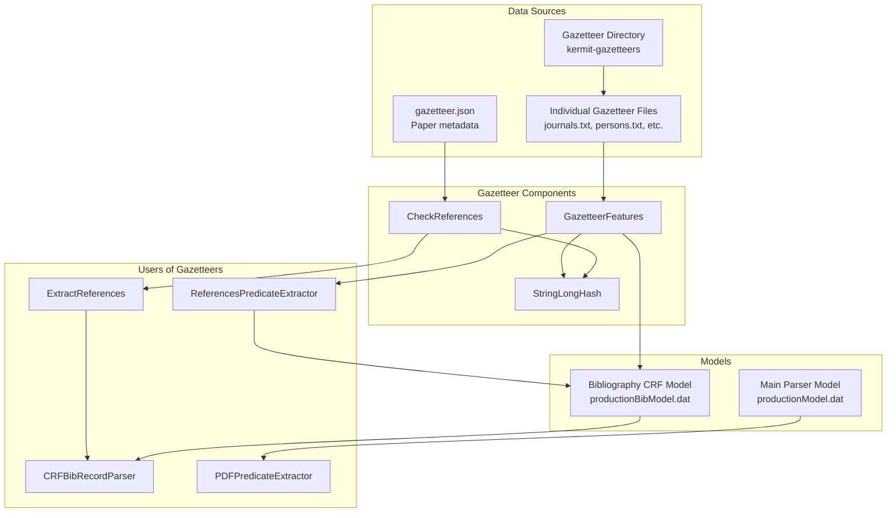
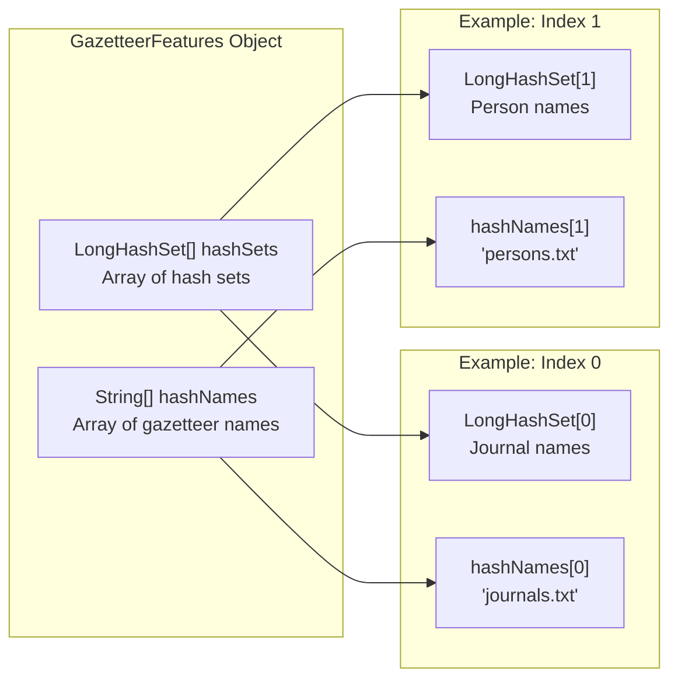
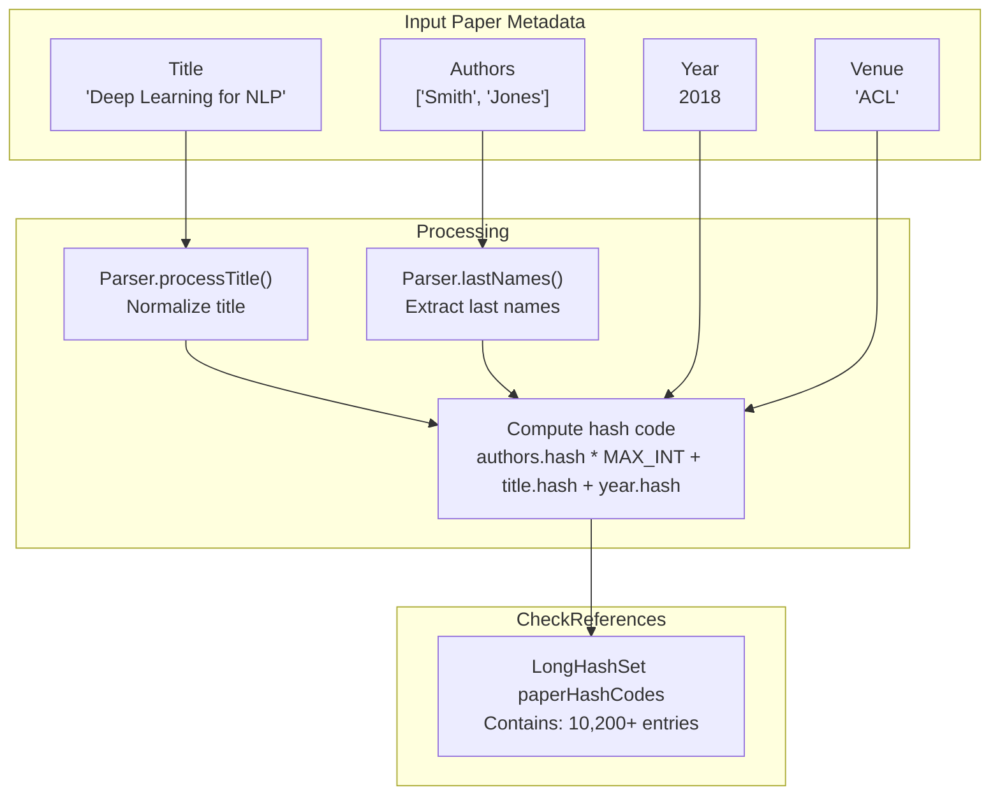
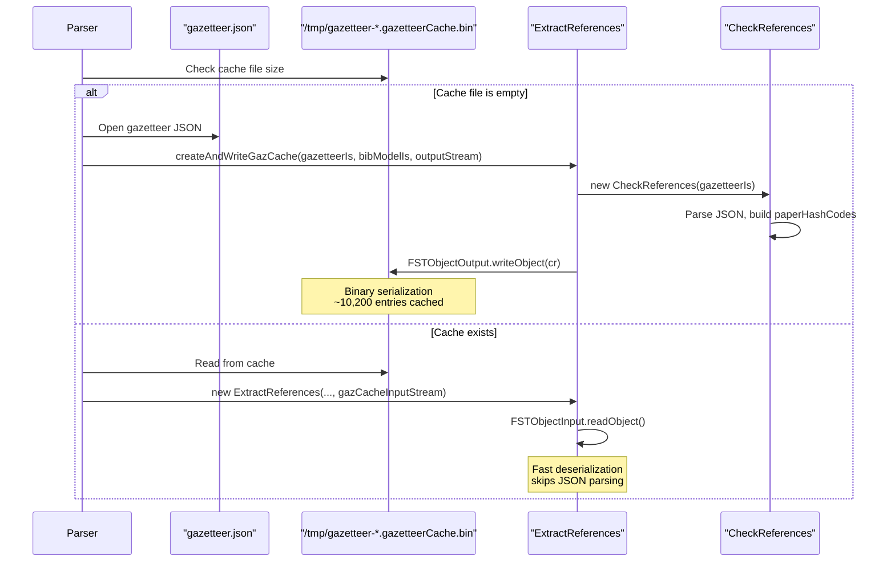
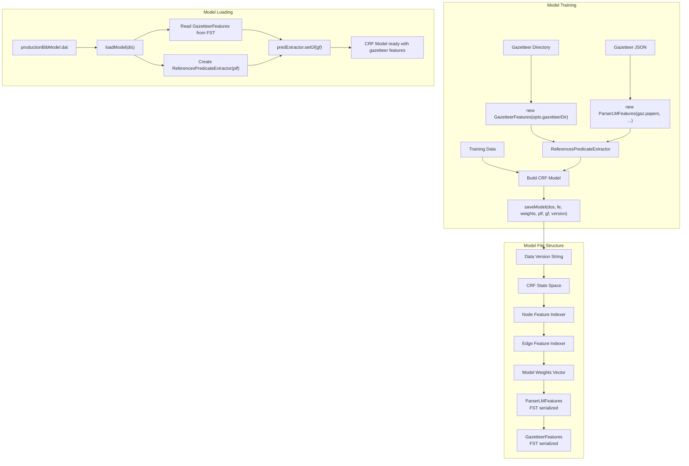

<!-- source: DeepWiki mcp.deepwiki.com · repo allenai/science-parse · page 2.6 Gazetteer System · fetched 2026-10-26 -->

# Gazetteer System

<details>
<summary>Relevant source files</summary>

The following files were used as context for generating this wiki page:

- [build.sbt](build.sbt)
- [cli/build.sbt](cli/build.sbt)
- [core/build.sbt](core/build.sbt)
- [core/src/main/java/org/allenai/scienceparse/CRFBibRecordParser.java](core/src/main/java/org/allenai/scienceparse/CRFBibRecordParser.java)
- [core/src/main/java/org/allenai/scienceparse/CheckReferences.java](core/src/main/java/org/allenai/scienceparse/CheckReferences.java)
- [core/src/main/java/org/allenai/scienceparse/ExtractReferences.java](core/src/main/java/org/allenai/scienceparse/ExtractReferences.java)
- [core/src/main/java/org/allenai/scienceparse/GazetteerFeatures.java](core/src/main/java/org/allenai/scienceparse/GazetteerFeatures.java)
- [core/src/main/java/org/allenai/scienceparse/Parser.java](core/src/main/java/org/allenai/scienceparse/Parser.java)
- [core/src/main/java/org/allenai/scienceparse/pdfapi/PDFExtractor.java](core/src/main/java/org/allenai/scienceparse/pdfapi/PDFExtractor.java)
- [server/build.sbt](server/build.sbt)

</details>


## Purpose and Scope

This document explains the Gazetteer System in Science Parse, which provides named entity recognition capabilities through precomputed lists of known entities such as journal names, person names, and geographic locations. The gazetteer system is used as a feature extraction mechanism for both the main CRF model and the bibliography parsing model. For information about how these gazetteers are used in CRF feature extraction, see [CRF Feature Engineering](#2.4). For information about bibliography parsing that uses these features, see [Training the Bibliography Model](#5.2).

Sources: [core/src/main/java/org/allenai/scienceparse/GazetteerFeatures.java:1-150](), [core/src/main/java/org/allenai/scienceparse/CheckReferences.java:1-54]()

## System Overview

The Gazetteer System consists of two primary components that work together to provide entity lookup capabilities during parsing:

1. **`GazetteerFeatures`** - A general-purpose gazetteer storage and lookup system that maintains multiple named entity lists and supports span-based matching across token sequences
2. **`CheckReferences`** - A specialized gazetteer for verifying parsed bibliography entries against known papers by matching titles, authors, years, and venues

Both components use hash-based storage with `LongHashSet` for efficient lookup and are designed to be serializable for caching. The gazetteer data is loaded once during initialization and used throughout the parsing process to generate features for CRF models and to score the quality of extracted references.

Sources: [core/src/main/java/org/allenai/scienceparse/GazetteerFeatures.java:21-29](), [core/src/main/java/org/allenai/scienceparse/CheckReferences.java:13-26]()

## Component Architecture



**Diagram: Gazetteer System Component Architecture**

The diagram shows how gazetteer data flows from file-based sources through the two main components and into the models and parsers that use them. `StringLongHash` provides the common hashing functionality used by both components.

Sources: [core/src/main/java/org/allenai/scienceparse/GazetteerFeatures.java:42-50](), [core/src/main/java/org/allenai/scienceparse/CheckReferences.java:16-22](), [core/src/main/java/org/allenai/scienceparse/ExtractReferences.java:64-100]()

## GazetteerFeatures: Data Structure and Operations

`GazetteerFeatures` stores multiple gazetteers in parallel arrays with hash-based lookup:



**Diagram: GazetteerFeatures Internal Structure**

### Key Operations

| Method | Purpose | Return Type |
|--------|---------|-------------|
| `inSet(String s, int i)` | Check if string exists in gazetteer `i` | `boolean` |
| `inSet(String s)` | Check which gazetteers contain string | `boolean[]` |
| `getSpans(List<String> ws)` | Find all gazetteer matches in token sequence | `List<LabelSpan>` |
| `getSpansForGaz(List<String> ws, int gn)` | Find matches for specific gazetteer | `List<LabelSpan>` |

### String Processing

All gazetteer entries undergo the transformation defined in `t(String s)` [core/src/main/java/org/allenai/scienceparse/GazetteerFeatures.java:53-55]():
- Convert to lowercase
- Remove punctuation
- Normalize whitespace
- Trim leading/trailing spaces

This ensures consistent matching regardless of formatting variations in the input text.

### Length Constraints

Gazetteer entries are limited to **7 words maximum** (`MAXLENGTH = 7`). This constraint:
- Keeps hash sets manageable in size
- Focuses on meaningful entity spans
- Is enforced during gazetteer loading via `withinLength()` [core/src/main/java/org/allenai/scienceparse/GazetteerFeatures.java:57-68]()

Sources: [core/src/main/java/org/allenai/scienceparse/GazetteerFeatures.java:31-150]()

## CheckReferences: Paper Verification

`CheckReferences` is a specialized gazetteer that stores known papers as hash codes computed from paper metadata:



**Diagram: CheckReferences Hash Code Computation**

### Hash Code Formula

The hash code combines multiple paper attributes [core/src/main/java/org/allenai/scienceparse/CheckReferences.java:36-46]():

```
hashCode = (authors.hashCode() * Integer.MAX_VALUE) + title.hashCode() + Integer.hashCode(year)
```

This formula provides:
- **Collision resistance**: Multiple attributes reduce false positives
- **Fast lookup**: Single long integer comparison
- **Normalization**: Uses `Parser.processTitle()` and `Parser.lastNames()` for consistent matching

### Usage in Reference Extraction

`CheckReferences` is used by `ExtractReferences` to score bibliography parsing strategies. The `numFound()` method [core/src/main/java/org/allenai/scienceparse/ExtractReferences.java:462-469]() counts how many parsed bibliography entries match known papers in the gazetteer. Strategies that find more known papers receive higher scores, helping select the best parsing approach.

Sources: [core/src/main/java/org/allenai/scienceparse/CheckReferences.java:1-54](), [core/src/main/java/org/allenai/scienceparse/ExtractReferences.java:462-483]()

## Loading and Caching Mechanism

The gazetteer loading process is optimized through a two-tier caching system:



**Diagram: Gazetteer Loading and Caching Flow**

### Cache Implementation Details

The caching mechanism is implemented in the `Parser` constructor [core/src/main/java/org/allenai/scienceparse/Parser.java:163-196]():

1. **Cache filename generation**: Based on gazetteer file path hash to ensure cache invalidation when the gazetteer file changes
   ```
   gazCacheFilename = String.format("%s-%08x.gazetteerCache.bin", 
                                     gazetteerFile.getName(),
                                     gazetteerFile.getCanonicalPath().hashCode())
   ```

2. **File locking**: Uses `FileLock` to prevent concurrent cache writes

3. **Serialization format**: FST (Fast Serialization) for efficient binary serialization

4. **Cache location**: System temp directory (`java.io.tmpdir`)

### Performance Impact

Loading from cache provides significant speedup:
- **Without cache**: Parse JSON gazetteer (~10,200 entries), compute all hashes
- **With cache**: Binary deserialization of pre-computed `LongHashSet`
- The system logs indicate this is a major optimization: "Loading the gazetteer takes a long time"

Sources: [core/src/main/java/org/allenai/scienceparse/Parser.java:163-196](), [core/src/main/java/org/allenai/scienceparse/ExtractReferences.java:85-100](), [core/src/main/java/org/allenai/scienceparse/ExtractReferences.java:159-170]()

## Integration with CRF Models

Gazetteers are integrated into CRF models as serialized components within the model files:



**Diagram: Gazetteer Integration in CRF Models**

### Training with Gazetteers

During training, gazetteers are loaded and incorporated into the predicate extractor [core/src/main/java/org/allenai/scienceparse/Parser.java:511-531]():

```
GazetteerFeatures gf = new GazetteerFeatures(opts.gazetteerDir);
predExtractor = new ReferencesPredicateExtractor(plf);
predExtractor.setGf(gf);
```

The trained model is then saved with both `ParserLMFeatures` and `GazetteerFeatures` serialized using FST [core/src/main/java/org/allenai/scienceparse/Parser.java:746-754]().

### Loading Models with Gazetteers

When loading a bibliography model, the gazetteer features are deserialized [core/src/main/java/org/allenai/scienceparse/ExtractReferences.java:181-200]():

```
ParserLMFeatures plf = (ParserLMFeatures)in.readObject();
GazetteerFeatures gf = (GazetteerFeatures)in.readObject();

val predExtractor = new ReferencesPredicateExtractor(plf);
predExtractor.setGf(gf);
```

The system logs whether the gazetteer was successfully loaded, as this is optional but improves performance.

Sources: [core/src/main/java/org/allenai/scienceparse/Parser.java:492-581](), [core/src/main/java/org/allenai/scienceparse/ExtractReferences.java:172-210]()

## Gazetteer File Formats

### Directory-Based Gazetteers (GazetteerFeatures)

The Kermit gazetteers are stored as a directory of text files [core/src/main/java/org/allenai/scienceparse/Parser.java:103-105]():

**Location**: Retrieved from datastore as `"org.allenai.scienceparse"`, `"kermit-gazetteers"`, version 1

**Format**:
- One file per gazetteer (e.g., `journals.txt`, `persons.txt`, `countries.txt`)
- One entry per line
- Lines starting with `#` are treated as comments
- Maximum 7 words per entry (enforced during loading)

**Example file structure**:
```
# Journal names
nature
science
proceedings of the national academy of sciences
journal of machine learning research
# ... more entries
```

### JSON-Based Gazetteer (CheckReferences)

The paper gazetteer is stored as JSON [core/src/main/java/org/allenai/scienceparse/Parser.java:100-102]():

**Location**: Retrieved from datastore as `"org.allenai.scienceparse"`, `"gazetteer.json"`, version 5

**Contents**: Array of paper objects with fields used by `ParserGroundTruth.Paper`:
- `title`: Paper title
- `authors`: Array of author names
- `year`: Publication year
- `venue`: Venue/journal name

This JSON file contains approximately **10,200 known papers** used to validate bibliography extraction quality.

Sources: [core/src/main/java/org/allenai/scienceparse/Parser.java:97-108](), [core/src/main/java/org/allenai/scienceparse/GazetteerFeatures.java:70-83](), [core/src/main/java/org/allenai/scienceparse/CheckReferences.java:16-22]()

## Usage in Feature Extraction

Gazetteers provide boolean features during CRF inference for both token-level and span-level matching:

### Span-Based Matching

`GazetteerFeatures.getSpans()` searches for all gazetteer matches within a token sequence [core/src/main/java/org/allenai/scienceparse/GazetteerFeatures.java:141-147]():

1. Iterates through all gazetteers
2. For each position in the token sequence:
   - Tests all spans up to `MAXLENGTH` (7 words)
   - Concatenates tokens in the span
   - Checks if the concatenated string exists in the gazetteer
3. Returns `List<LabelSpan>` with gazetteer name as the tag

### Feature Generation Example

Given tokens: `["Nature", "Biotechnology", "is", "a", "journal"]`

If `"nature biotechnology"` exists in the `journals.txt` gazetteer, the system generates:
- **LabelSpan**: tag=`"journals.txt"`, location=(0, 2)

This span information is then used by `ReferencesPredicateExtractor` to generate CRF features like:
- `"GAZ_journals.txt"` for tokens within the span
- Position-relative features for context

### Reference Scoring

In `ExtractReferences`, the `longestIdx()` method uses gazetteer matching to select the best bibliography parsing strategy [core/src/main/java/org/allenai/scienceparse/ExtractReferences.java:471-483]():

```
score = 10000 * numFound(results[i]) + results[i].size()
```

The formula heavily weights gazetteer matches (10,000×) over just the number of references parsed, ensuring that strategies producing verifiable results are preferred.

Sources: [core/src/main/java/org/allenai/scienceparse/GazetteerFeatures.java:119-147](), [core/src/main/java/org/allenai/scienceparse/ExtractReferences.java:462-483]()

## Model Artifacts and Versioning

### Default Gazetteer Artifacts

| Artifact | Version | Purpose | Retrieved via |
|----------|---------|---------|---------------|
| `gazetteer.json` | 5 | Paper metadata for validation | `getDefaultGazetteer()` |
| `kermit-gazetteers/` | 1 | Named entity gazetteers | `getDefaultGazetteerDir()` |
| `productionBibModel.dat` | 7 | Bibliography CRF with gazetteers | `getDefaultBibModel()` |

### Data Version Strings

The system uses version strings to ensure compatibility:

- **Bibliography model data version**: `"0.3-BIB"` [core/src/main/java/org/allenai/scienceparse/ExtractReferences.java:67]()
  - Used when loading/saving models that include `GazetteerFeatures`
  - Ensures serialization format compatibility

- **Main parser data version**: `"0.3"` [core/src/main/java/org/allenai/scienceparse/Parser.java:87]()
  - Used for models that may or may not include gazetteers

Version mismatches are detected via `IOUtils.ensureVersionMatch()` and will throw an `IOException` during loading.

Sources: [core/src/main/java/org/allenai/scienceparse/Parser.java:86-108](), [core/src/main/java/org/allenai/scienceparse/ExtractReferences.java:67](), [core/build.sbt:1-49]()

---

