<!-- source: DeepWiki mcp.deepwiki.com · repo allenai/science-parse · page 3 Server Module · fetched 2026-10-26 -->

# Server Module

<details>
<summary>Relevant source files</summary>

The following files were used as context for generating this wiki page:

- [README.md](README.md)
- [cli/README.md](cli/README.md)
- [core/README.md](core/README.md)
- [core/src/main/java/org/allenai/scienceparse/BibRecord.java](core/src/main/java/org/allenai/scienceparse/BibRecord.java)
- [core/src/main/java/org/allenai/scienceparse/CitationRecord.java](core/src/main/java/org/allenai/scienceparse/CitationRecord.java)
- [core/src/main/scala/org/allenai/scienceparse/JsonProtocol.scala](core/src/main/scala/org/allenai/scienceparse/JsonProtocol.scala)
- [core/src/main/scala/org/allenai/scienceparse/LabeledData.scala](core/src/main/scala/org/allenai/scienceparse/LabeledData.scala)
- [core/src/test/scala/org/allenai/scienceparse/JsonProtocolSpec.scala](core/src/test/scala/org/allenai/scienceparse/JsonProtocolSpec.scala)
- [server/README.md](server/README.md)
- [server/src/main/scala/org/allenai/scienceparse/FeedbackStore.scala](server/src/main/scala/org/allenai/scienceparse/FeedbackStore.scala)
- [server/src/main/scala/org/allenai/scienceparse/SPServer.scala](server/src/main/scala/org/allenai/scienceparse/SPServer.scala)

</details>


## Purpose and Scope

The Server Module provides a RESTful HTTP API wrapper around the Science Parse Core library, enabling PDF parsing as a web service. It runs on port 8080 and exposes endpoints for parsing papers by Semantic Scholar ID or direct PDF upload, with optional user feedback/correction storage in PostgreSQL.

This document covers the server's architecture, request handling, endpoints, and deployment. For details about the underlying parsing logic, see [Core Library](#2). For command-line batch processing, see [CLI Module](#4). For feedback system database schema details, see [Feedback System](#3.2).

## Architecture Overview

The server is implemented as a Jetty-based HTTP service in [server/src/main/scala/org/allenai/scienceparse/SPServer.scala](). The main entry point is the `SPServer` object which configures and starts the service.

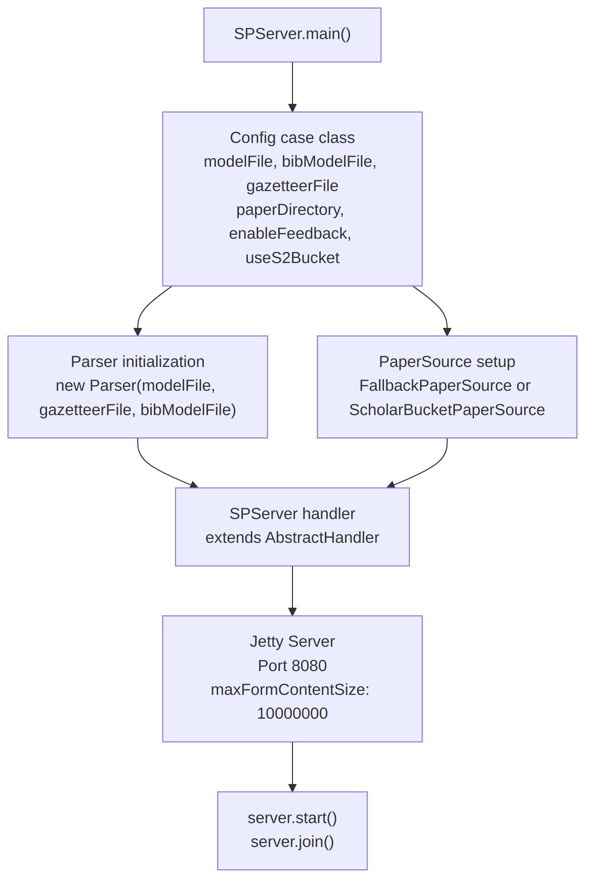

**Sources:** [server/src/main/scala/org/allenai/scienceparse/SPServer.scala:24-103]()

### Core Components

The `SPServer` class constructor takes three parameters:

| Parameter | Type | Purpose |
|-----------|------|---------|
| `paperSource` | `PaperSource` | Abstraction for retrieving PDFs by ID or from local storage |
| `scienceParser` | `Parser` | Shared singleton instance for parsing PDFs |
| `enableFeedback` | `Boolean` | Whether to enable PostgreSQL-backed feedback endpoints |

**Sources:** [server/src/main/scala/org/allenai/scienceparse/SPServer.scala:106-110]()

## Request/Response Flow

The server uses a custom routing system with two route types: `StringRoute` for exact path matches and `RegexRoute` for pattern-based matching with capture groups.

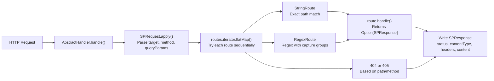

**Sources:** [server/src/main/scala/org/allenai/scienceparse/SPServer.scala:233-278]()

### Route Definitions

The server defines routes in order of precedence:

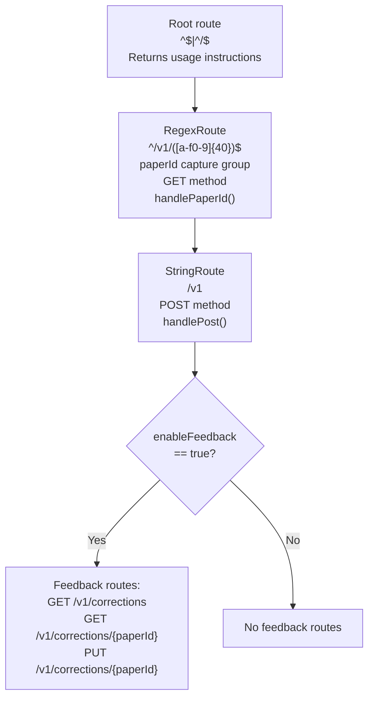

**Sources:** [server/src/main/scala/org/allenai/scienceparse/SPServer.scala:217-231]()

### Route Types Implementation

The routing system is implemented with two case classes:

| Route Type | Path Matching | Handler Signature |
|------------|---------------|-------------------|
| `StringRoute` | Exact string equality | `SPRequest => SPResponse` |
| `RegexRoute` | Regex pattern with named groups | `(SPRequest, Map[String, String]) => SPResponse` |

Both extend a common `Route` trait with methods: `canHandleTarget()`, `canHandle()`, and `handle()`.

**Sources:** [server/src/main/scala/org/allenai/scienceparse/SPServer.scala:167-213]()

## Parsing Endpoints

The server provides two primary parsing endpoints that delegate to the shared `Parser` instance.

### GET /v1/{paperId}

Retrieves and parses a paper by its 40-character hexadecimal Semantic Scholar ID.

**Query Parameters:**

| Parameter | Values | Default | Description |
|-----------|--------|---------|-------------|
| `format` | `LabeledData`, `ExtractedMetadata` | `LabeledData` | Output format |
| `skipFields` | Comma-separated field names | (none) | Fields to omit from `LabeledData` output |

**Implementation Flow:**

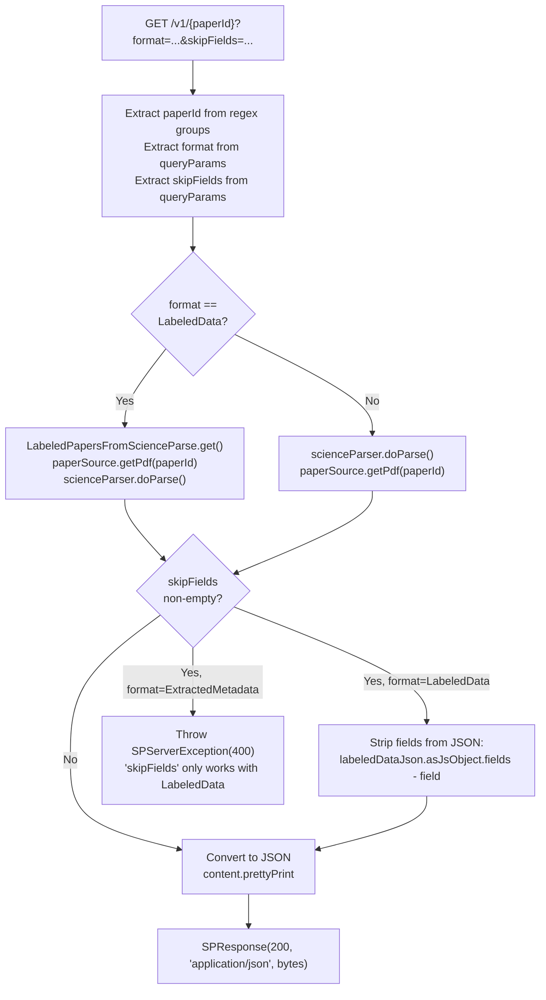

**Sources:** [server/src/main/scala/org/allenai/scienceparse/SPServer.scala:285-306]()

### POST /v1

Accepts a PDF via HTTP POST and parses it directly.

**Request Requirements:**
- Content-Type: `application/pdf` (not validated in code, but recommended)
- Body: Raw PDF bytes

**Query Parameters:**

| Parameter | Values | Default | Description |
|-----------|--------|---------|-------------|
| `format` | `LabeledData`, `ExtractedMetadata` | `LabeledData` | Output format |

**Implementation:**

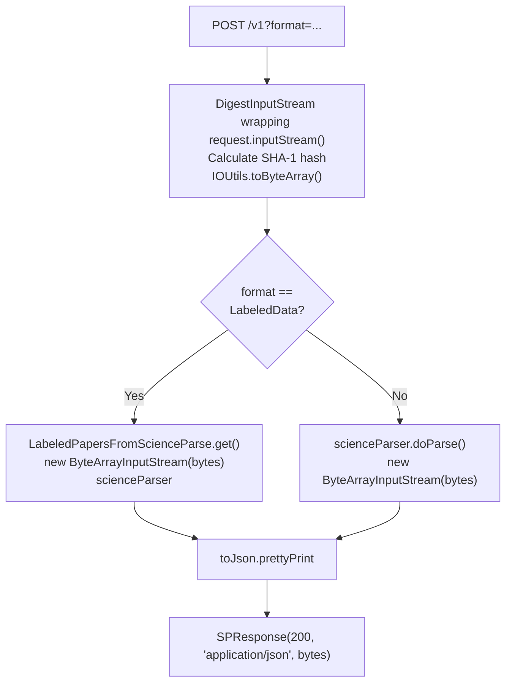

**Sources:** [server/src/main/scala/org/allenai/scienceparse/SPServer.scala:308-327]()

## Paper Source Abstraction

The `PaperSource` interface provides flexible PDF retrieval strategies. The server configures it based on command-line options:

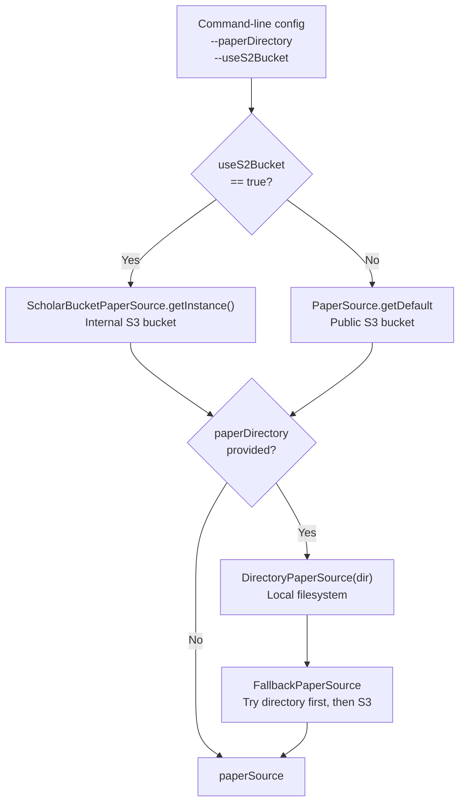

**Configuration:**

| Option | Effect |
|--------|--------|
| `--paperDirectory <dir>` | Creates `FallbackPaperSource` that tries local directory first, then falls back to S3 |
| `--useS2Bucket` | Uses internal Semantic Scholar S3 bucket instead of public bucket |
| (neither) | Uses public S3 bucket via `PaperSource.getDefault` |

**Sources:** [server/src/main/scala/org/allenai/scienceparse/SPServer.scala:81-95]()

## JSON Serialization

All responses use the spray-json library with custom formats defined in `JsonProtocol`. The serialization layer handles:

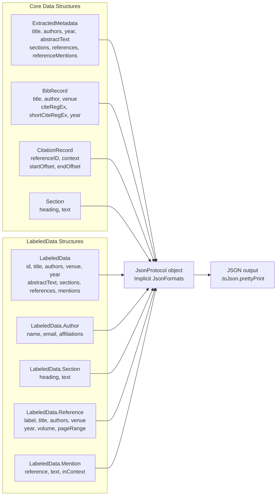

**Key Format Implementations:**

| Format | File Location |
|--------|---------------|
| `ExtractedMetadataJsonFormat` | [core/src/main/scala/org/allenai/scienceparse/JsonProtocol.scala:125-178]() |
| `BibRecordJsonFormat` | [core/src/main/scala/org/allenai/scienceparse/JsonProtocol.scala:63-99]() |
| `CitationRecordJsonFormat` | [core/src/main/scala/org/allenai/scienceparse/JsonProtocol.scala:101-123]() |
| `LabeledData` formats | [core/src/main/scala/org/allenai/scienceparse/JsonProtocol.scala:180-187]() |

**Sources:** [core/src/main/scala/org/allenai/scienceparse/JsonProtocol.scala:1-188](), [server/src/main/scala/org/allenai/scienceparse/SPServer.scala:18-19]()

## Feedback System

The feedback system is an optional feature (disabled by default via `enableFeedback = false`) that stores user corrections in PostgreSQL. For detailed schema information, see [Feedback System](#3.2).

### Feedback Routes

When enabled, three additional routes become available:

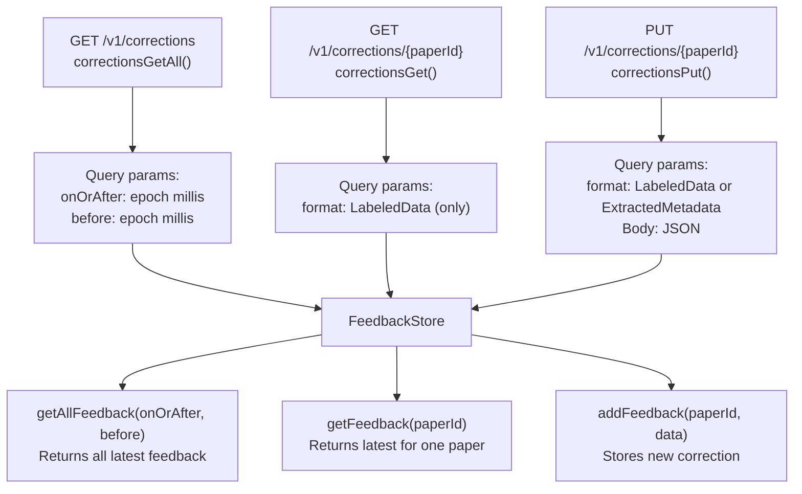

**Sources:** [server/src/main/scala/org/allenai/scienceparse/SPServer.scala:217-221](), [server/src/main/scala/org/allenai/scienceparse/SPServer.scala:332-393]()

### FeedbackStore Initialization

The `FeedbackStore` object initializes on first access:

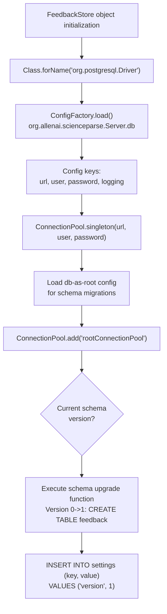

**Schema Version Management:**

The system uses a `settings` table to track schema versions and applies upgrade functions sequentially:

| Version | Upgrade Function |
|---------|------------------|
| 0 → 1 | Creates `feedback` table with columns: `paperId CHAR(40)`, `timeAdded TIMESTAMP`, `value JSONB` |

**Sources:** [server/src/main/scala/org/allenai/scienceparse/FeedbackStore.scala:11-86]()

## Command-Line Configuration

The server accepts the following command-line arguments:

| Option | Argument | Purpose |
|--------|----------|---------|
| `-m`, `--model` | File path | Custom Parser CRF model (defaults to production model) |
| `-b`, `--bibModel` | File path | Custom bibliography parsing model |
| `-g`, `--gazetteer` | File path | Custom gazetteer file |
| `-p`, `--paperDirectory` | Directory path | Local directory for PDF storage/fallback |
| `--enableFeedback` | (flag) | Enables PostgreSQL feedback endpoints |
| `--useS2Bucket` | (flag) | Uses internal S2 S3 bucket instead of public bucket |
| `--downloadModelOnly` | (flag) | Downloads models and exits without starting server |
| `--help` | (flag) | Prints help text |

**Configuration Example:**

```bash
java -Xmx6g -jar science-parse-server.jar \
  --model custom-model.dat \
  --paperDirectory /data/pdfs \
  --enableFeedback \
  --useS2Bucket
```

**Sources:** [server/src/main/scala/org/allenai/scienceparse/SPServer.scala:35-67]()

## Error Handling

The server uses a custom exception type `SPServerException` with HTTP status codes:

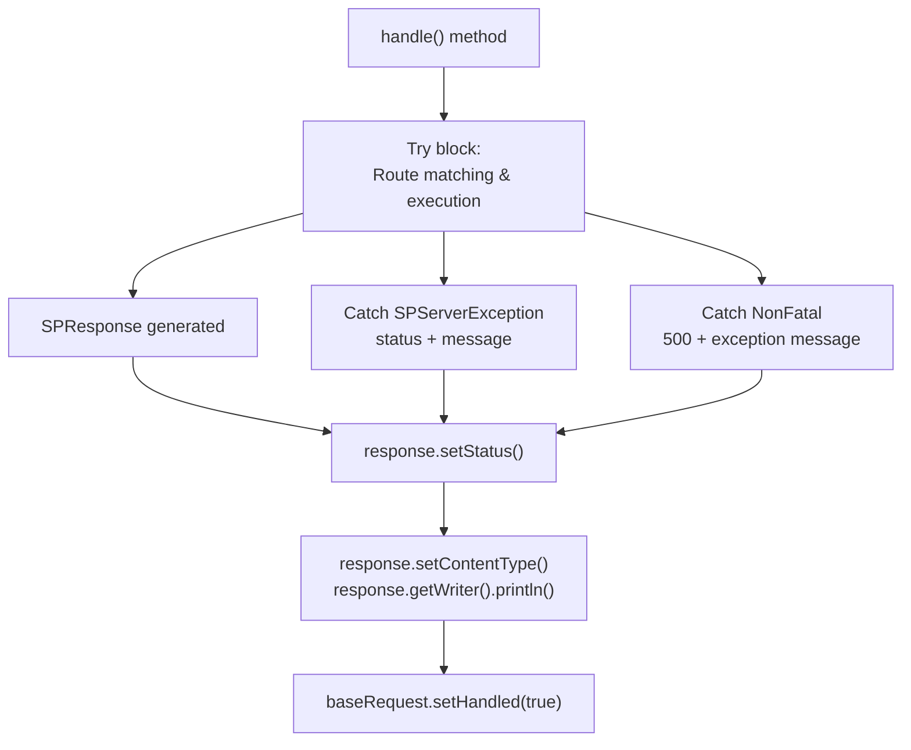

**Common Error Status Codes:**

| Status | Trigger |
|--------|---------|
| 400 | Invalid query parameters, unrecognized format, invalid JSON in PUT |
| 403 | Feedback endpoints accessed when `enableFeedback = false` |
| 404 | No route matches path, or no feedback found for paper ID |
| 405 | Route matches path but not HTTP method |
| 500 | Uncaught exceptions during parsing or processing |

**Sources:** [server/src/main/scala/org/allenai/scienceparse/SPServer.scala:116-118](), [server/src/main/scala/org/allenai/scienceparse/SPServer.scala:239-277]()

## Deployment Options

The Server Module supports multiple deployment strategies. For detailed deployment instructions, see [Server Deployment](#3.3).

### Docker Deployment

Build Docker image:
```bash
./makeDocker.sh
```

Run container:
```bash
docker run -p 8080:8080 -m 8g allenai/science-parse
```

**Sources:** [README.md:26]()

### Fat JAR Deployment

Build executable JAR:
```bash
sbt server/assembly
```

Run directly:
```bash
java -Xmx6g -jar server/target/scala-2.12/science-parse-server-assembly-3.0.1.jar
```

**Memory Recommendations:**
- Minimum heap: 6GB (`-Xmx6g`)
- Additional off-heap memory: 2GB recommended
- Some documents may require more memory

**Sources:** [server/README.md:20-24]()

### SBT Run (Development)

For development, start directly from SBT:
```bash
sbt server/run
```

This avoids the assembly step and enables faster iteration.

**Sources:** [README.md:73]()

## Performance Characteristics

### Model Loading

On first startup, the server downloads and caches model files:

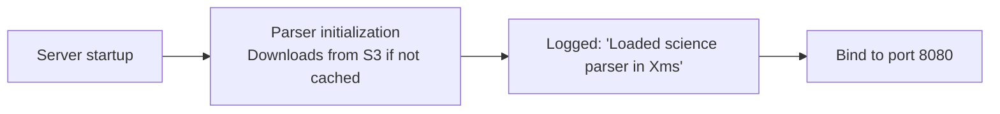

Typical load time: ~5-15 seconds on first run, ~1-3 seconds on subsequent runs (cached).

**Sources:** [server/src/main/scala/org/allenai/scienceparse/SPServer.scala:70-76]()

### Request Processing

- Uses a shared `Parser` singleton across all requests
- Parser instance is thread-safe for concurrent requests
- Memory usage scales with PDF complexity (especially images and tables)
- Jetty's max form content size: 10,000,000 bytes (~10MB)

**Sources:** [server/src/main/scala/org/allenai/scienceparse/SPServer.scala:98]()

---

