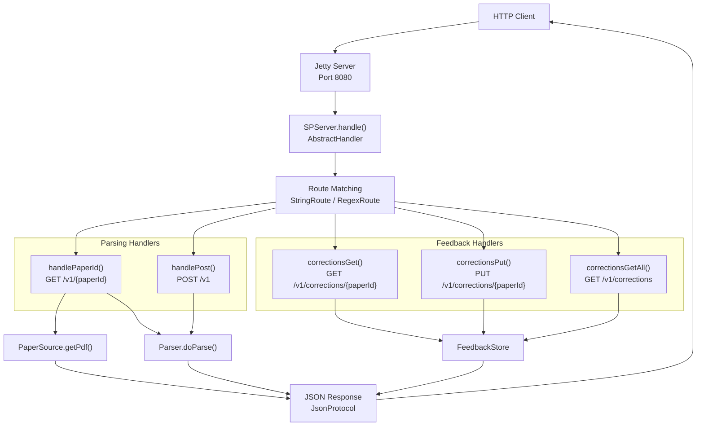
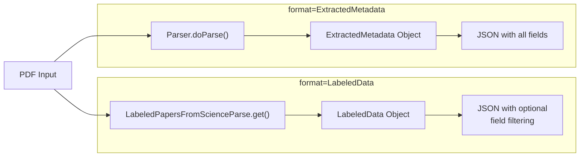
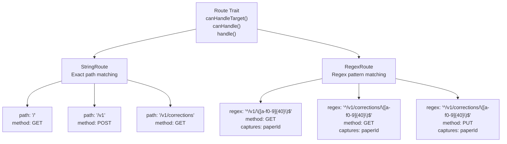
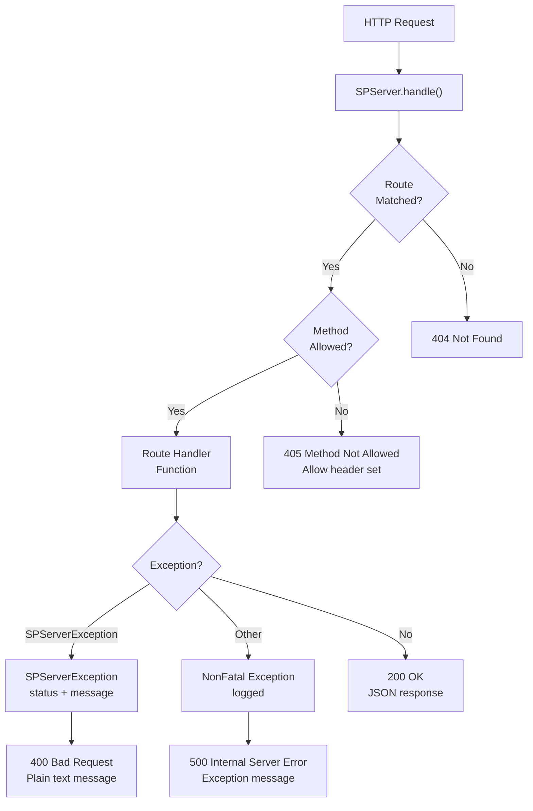
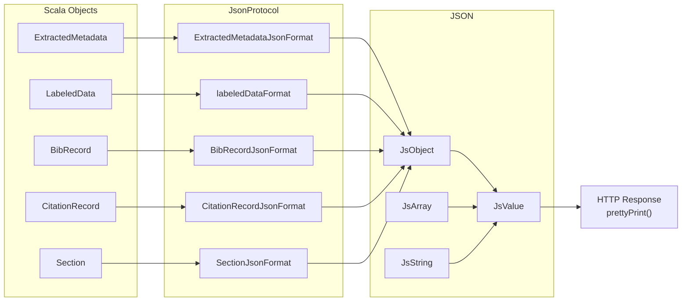
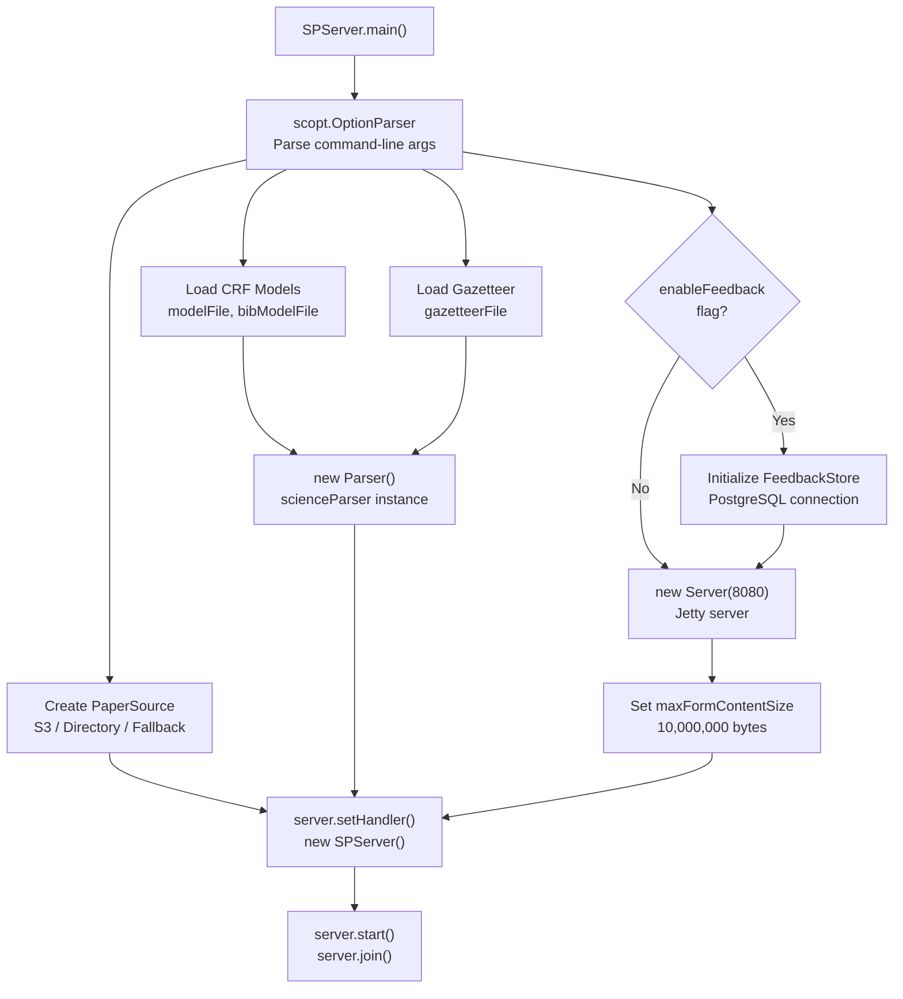

<!-- source: DeepWiki mcp.deepwiki.com · repo allenai/science-parse · page 3.1 REST API Endpoints · fetched 2026-10-26 -->

# REST API Endpoints

<details>
<summary>Relevant source files</summary>

The following files were used as context for generating this wiki page:

- [cli/README.md](cli/README.md)
- [core/README.md](core/README.md)
- [core/src/main/java/org/allenai/scienceparse/BibRecord.java](core/src/main/java/org/allenai/scienceparse/BibRecord.java)
- [core/src/main/java/org/allenai/scienceparse/CitationRecord.java](core/src/main/java/org/allenai/scienceparse/CitationRecord.java)
- [core/src/main/scala/org/allenai/scienceparse/JsonProtocol.scala](core/src/main/scala/org/allenai/scienceparse/JsonProtocol.scala)
- [core/src/main/scala/org/allenai/scienceparse/LabeledData.scala](core/src/main/scala/org/allenai/scienceparse/LabeledData.scala)
- [core/src/test/scala/org/allenai/scienceparse/JsonProtocolSpec.scala](core/src/test/scala/org/allenai/scienceparse/JsonProtocolSpec.scala)
- [server/README.md](server/README.md)
- [server/src/main/scala/org/allenai/scienceparse/FeedbackStore.scala](server/src/main/scala/org/allenai/scienceparse/FeedbackStore.scala)
- [server/src/main/scala/org/allenai/scienceparse/SPServer.scala](server/src/main/scala/org/allenai/scienceparse/SPServer.scala)

</details>


## Purpose and Scope

This page documents the HTTP REST API endpoints provided by the Science Parse Server. The server wraps the core parsing library with an HTTP interface, allowing clients to parse scientific papers either by uploading PDFs or by referencing Semantic Scholar paper IDs.

For information about deploying the server, see [Server Deployment](#3.3). For details on the optional feedback/corrections database schema, see [Feedback System](#3.2). For the underlying parsing implementation, see [Parser Class](#2.1).

## Architecture Overview

The `SPServer` class implements a custom HTTP handler using Jetty. The server binds to port 8080 by default and routes incoming requests through a flexible routing system that supports both exact string matches and regex-based pattern matching.

**Request Flow**



**Sources:** [server/src/main/scala/org/allenai/scienceparse/SPServer.scala:106-278]()

## Endpoint Reference

### Root Endpoint

#### GET `/` or GET (empty path)

Returns a plain-text usage message describing the API.

**Response:**
- **Status:** 200 OK
- **Content-Type:** `text/plain;charset=utf-8`
- **Body:** Usage instructions

**Sources:** [server/src/main/scala/org/allenai/scienceparse/SPServer.scala:224-228]()

---

### Parsing Endpoints

#### GET `/v1/{paperId}`

Retrieves and parses a paper by its Semantic Scholar paper ID (SHA-1 hash).

**Path Parameters:**
| Parameter | Type | Description |
|-----------|------|-------------|
| `paperId` | string | 40-character hexadecimal SHA-1 hash of the PDF |

**Query Parameters:**
| Parameter | Type | Default | Description |
|-----------|------|---------|-------------|
| `format` | string | `LabeledData` | Output format: `LabeledData` or `ExtractedMetadata` |
| `skipFields` | string | (empty) | Comma-separated field names to omit (only for `LabeledData` format) |

**Response:**
- **Status:** 200 OK
- **Content-Type:** `application/json`
- **Body:** Parsed paper metadata in JSON format

**Error Responses:**
- **400 Bad Request:** Invalid format parameter or `skipFields` used with `ExtractedMetadata`
- **404 Not Found:** Paper not found

**Example Request:**
```
GET /v1/498bb0efad6ec15dd09d941fb309aa18d6df9f5f
GET /v1/498bb0efad6ec15dd09d941fb309aa18d6df9f5f?format=ExtractedMetadata
GET /v1/498bb0efad6ec15dd09d941fb309aa18d6df9f5f?skipFields=sections
```

**Sources:** [server/src/main/scala/org/allenai/scienceparse/SPServer.scala:229-229](), [server/src/main/scala/org/allenai/scienceparse/SPServer.scala:285-306]()

---

#### POST `/v1`

Parses a PDF uploaded directly in the request body.

**Request:**
- **Content-Type:** `application/pdf` (required)
- **Body:** Raw PDF bytes

**Query Parameters:**
| Parameter | Type | Default | Description |
|-----------|------|---------|-------------|
| `format` | string | `LabeledData` | Output format: `LabeledData` or `ExtractedMetadata` |

**Response:**
- **Status:** 200 OK
- **Content-Type:** `application/json`
- **Body:** Parsed paper metadata in JSON format

**Error Responses:**
- **400 Bad Request:** Invalid format parameter or content type
- **500 Internal Server Error:** Parsing failure

**Example Request:**
```bash
curl -H "Content-type: application/pdf" \
     --data-binary @paper.pdf \
     "http://localhost:8080/v1?format=ExtractedMetadata"
```

**Sources:** [server/src/main/scala/org/allenai/scienceparse/SPServer.scala:230-230](), [server/src/main/scala/org/allenai/scienceparse/SPServer.scala:308-327]()

---

### Feedback Endpoints

The feedback endpoints are **disabled by default**. They must be enabled with the `--enableFeedback` flag and require a configured PostgreSQL database. See [Feedback System](#3.2) for database configuration.

#### GET `/v1/corrections/{paperId}`

Retrieves the most recent feedback/correction for a specific paper.

**Path Parameters:**
| Parameter | Type | Description |
|-----------|------|-------------|
| `paperId` | string | 40-character hexadecimal SHA-1 hash of the PDF |

**Query Parameters:**
| Parameter | Type | Default | Description |
|-----------|------|---------|-------------|
| `format` | string | `LabeledData` | Output format (currently only `LabeledData` supported) |

**Response:**
- **Status:** 200 OK
- **Content-Type:** `application/json`
- **Body:** Latest `LabeledData` correction for the paper

**Error Responses:**
- **403 Forbidden:** Feedback system disabled
- **404 Not Found:** No feedback exists for this paper
- **400 Bad Request:** Invalid format parameter

**Sources:** [server/src/main/scala/org/allenai/scienceparse/SPServer.scala:219-219](), [server/src/main/scala/org/allenai/scienceparse/SPServer.scala:332-343]()

---

#### PUT `/v1/corrections/{paperId}`

Stores a new correction for a specific paper. The correction data must be valid `LabeledData` or `ExtractedMetadata` JSON.

**Path Parameters:**
| Parameter | Type | Description |
|-----------|------|-------------|
| `paperId` | string | 40-character hexadecimal SHA-1 hash of the PDF |

**Request:**
- **Content-Type:** `application/json` (required)
- **Body:** `LabeledData` or `ExtractedMetadata` JSON

**Query Parameters:**
| Parameter | Type | Default | Description |
|-----------|------|---------|-------------|
| `format` | string | `LabeledData` | Input format: `LabeledData` or `ExtractedMetadata` |

**Response:**
- **Status:** 200 OK
- **Body:** Empty (success indicator)

**Error Responses:**
- **403 Forbidden:** Feedback system disabled
- **400 Bad Request:** Invalid content type, format, or malformed JSON

**Notes:**
- If the `LabeledData` ID does not start with `feedback:`, the server automatically prefixes it
- `ExtractedMetadata` input is converted to `LabeledData` internally

**Sources:** [server/src/main/scala/org/allenai/scienceparse/SPServer.scala:220-220](), [server/src/main/scala/org/allenai/scienceparse/SPServer.scala:345-377]()

---

#### GET `/v1/corrections`

Retrieves all feedback entries, optionally filtered by time range. Returns the most recent correction for each paper.

**Query Parameters:**
| Parameter | Type | Description |
|-----------|------|-------------|
| `onOrAfter` | long | Unix timestamp (milliseconds): include only feedback added on or after this time |
| `before` | long | Unix timestamp (milliseconds): include only feedback added before this time |

**Response:**
- **Status:** 200 OK
- **Content-Type:** `application/json`
- **Body:** Newline-delimited JSON objects (one per paper)

Each line contains a JSON object with:
- `paperId`: string
- `timeAdded`: ISO-8601 timestamp string
- Remaining fields from `LabeledData`

**Error Responses:**
- **403 Forbidden:** Feedback system disabled

**Example Request:**
```
GET /v1/corrections
GET /v1/corrections?onOrAfter=1609459200000&before=1612137600000
```

**Sources:** [server/src/main/scala/org/allenai/scienceparse/SPServer.scala:218-218](), [server/src/main/scala/org/allenai/scienceparse/SPServer.scala:379-393]()

---

## Output Formats

The server supports two output formats controlled by the `format` query parameter:

**Output Format Comparison**



**Sources:** [server/src/main/scala/org/allenai/scienceparse/SPServer.scala:287-305]()

### LabeledData Format

The `LabeledData` format provides a comprehensive view of the parsed paper with optional field filtering via `skipFields`.

**Structure:**
```json
{
  "id": "string",
  "title": "string | null",
  "authors": ["Author objects"] | null,
  "venue": "string | null",
  "year": number | null,
  "abstractText": "string | null",
  "sections": ["Section objects"] | null,
  "references": ["Reference objects"] | null,
  "mentions": ["Mention objects"] | null
}
```

**Nested Objects:**

| Type | Fields |
|------|--------|
| `Author` | `name: string`, `email: string | null`, `affiliations: [string]` |
| `Section` | `heading: string | null`, `text: string` |
| `Reference` | `label: string | null`, `title: string | null`, `authors: [string]`, `venue: string | null`, `year: number | null`, `volume: string | null`, `pageRange: (string, string) | null` |
| `Mention` | `reference: Reference`, `text: string`, `inContext: (Section, Range) | null` |
| `Range` | `start: number`, `end: number` |

**Sources:** [core/src/main/scala/org/allenai/scienceparse/LabeledData.scala:94-116](), [core/src/main/scala/org/allenai/scienceparse/JsonProtocol.scala:180-187]()

### ExtractedMetadata Format

The `ExtractedMetadata` format is the direct output from the core parser and cannot be field-filtered.

**Structure:**
```json
{
  "source": "GROBID | META | PDF | null",
  "title": "string | null",
  "authors": ["string"],
  "emails": ["string"],
  "sections": ["Section objects"] | null,
  "references": ["BibRecord objects"] | null,
  "referenceMentions": ["CitationRecord objects"] | null,
  "year": number,
  "abstractText": "string | null",
  "creator": "string | null"
}
```

**Nested Objects:**

| Type | Fields |
|------|--------|
| `Section` | `heading: string | null`, `text: string` |
| `BibRecord` | `title: string | null`, `author: [string]`, `venue: string | null`, `citeRegEx: string | null`, `shortCiteRegEx: string | null`, `year: number` |
| `CitationRecord` | `referenceID: number`, `context: string`, `startOffset: number`, `endOffset: number` |

**Sources:** [core/src/main/scala/org/allenai/scienceparse/JsonProtocol.scala:125-178](), [core/src/main/java/org/allenai/scienceparse/BibRecord.java:11-87](), [core/src/main/java/org/allenai/scienceparse/CitationRecord.java:7-35]()

---

## Routing System

The server implements a custom routing mechanism with two route types:

**Route Type Hierarchy**



**Sources:** [server/src/main/scala/org/allenai/scienceparse/SPServer.scala:167-213]()

### StringRoute

Matches exact path strings. Used for endpoints without dynamic path parameters.

**Implementation:** [server/src/main/scala/org/allenai/scienceparse/SPServer.scala:175-189]()

### RegexRoute

Matches paths using regular expressions and captures named groups. Used for endpoints with dynamic parameters like `{paperId}`.

**Implementation:** [server/src/main/scala/org/allenai/scienceparse/SPServer.scala:191-213]()

**Example regex patterns:**
- `^/v1/([a-f0-9]{40})$` - Captures 40-character hex SHA-1 as `paperId`
- `^$|^/$` - Matches empty string or single slash (root endpoint)

---

## Error Handling

The server uses a custom exception type `SPServerException` to represent HTTP errors with status codes.

**Error Response Flow**



**Sources:** [server/src/main/scala/org/allenai/scienceparse/SPServer.scala:233-277]()

### Common Error Codes

| Status | Description | Common Causes |
|--------|-------------|---------------|
| 400 | Bad Request | Invalid `format` parameter, malformed JSON, wrong content type, duplicate query parameters |
| 403 | Forbidden | Feedback endpoints accessed when feedback disabled |
| 404 | Not Found | No matching route, paper not found, no feedback exists |
| 405 | Method Not Allowed | Wrong HTTP method for endpoint (includes `Allow` header) |
| 500 | Internal Server Error | Parsing failure, uncaught exceptions |

**Sources:** [server/src/main/scala/org/allenai/scienceparse/SPServer.scala:116-118](), [server/src/main/scala/org/allenai/scienceparse/SPServer.scala:244-256]()

---

## JSON Serialization

The server uses spray-json for JSON serialization/deserialization. The `JsonProtocol` object defines implicit formats for all data types.

**Serialization Chain**



**Sources:** [core/src/main/scala/org/allenai/scienceparse/JsonProtocol.scala:7-188](), [server/src/main/scala/org/allenai/scienceparse/SPServer.scala:18-19]()

### Key Serialization Features

- **Null handling:** Optional fields serialize as `null` when absent
- **Java List support:** Java `List<T>` types are automatically converted to JSON arrays
- **Pattern support:** `java.util.regex.Pattern` objects serialize as pattern strings
- **Bidirectional:** All formats support both serialization (write) and deserialization (read)

**Sources:** [core/src/main/scala/org/allenai/scienceparse/JsonProtocol.scala:15-24](), [core/src/main/scala/org/allenai/scienceparse/JsonProtocol.scala:26-33]()

---

## Request Size Limits

The server configures Jetty with a maximum form content size to handle large PDF uploads:

**Configuration:** [server/src/main/scala/org/allenai/scienceparse/SPServer.scala:98-98]()
- **Max form content size:** 10,000,000 bytes (~9.5 MB)

This limit applies to POST request bodies, allowing for reasonably large PDF uploads.

---

## Server Initialization

The server initialization sequence demonstrates the dependencies and configuration:

**Initialization Sequence**



**Sources:** [server/src/main/scala/org/allenai/scienceparse/SPServer.scala:24-103]()

### Command-Line Options

| Option | Type | Description | Default |
|--------|------|-------------|---------|
| `-m, --model` | File | CRF model file path | Production model (auto-downloaded) |
| `-b, --bibModel` | File | Bibliography CRF model path | Production bib model (auto-downloaded) |
| `-g, --gazetteer` | File | Gazetteer file path | Production gazetteer (auto-downloaded) |
| `-p, --paperDirectory` | File | Local PDF directory (fallback to S3 if not found) | None (S3 only) |
| `--enableFeedback` | Flag | Enable feedback/corrections endpoints | Disabled |
| `--useS2Bucket` | Flag | Use internal S2 S3 bucket | Public bucket |
| `--downloadModelOnly` | Flag | Download models and exit (no server) | Run server |

**Sources:** [server/src/main/scala/org/allenai/scienceparse/SPServer.scala:25-67]()

---

