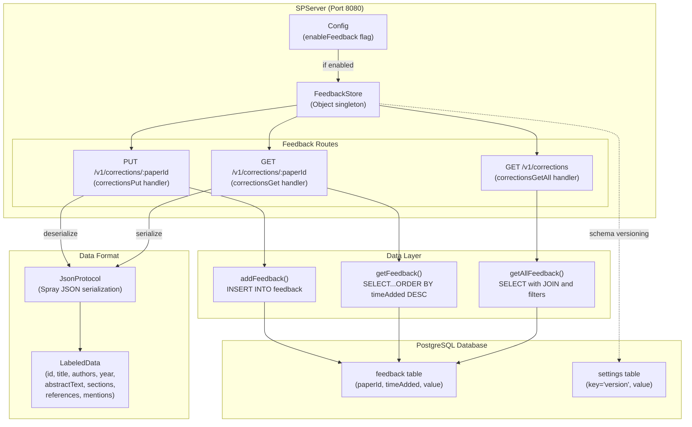
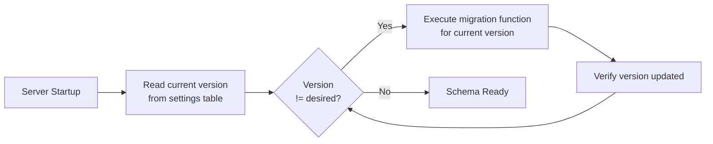
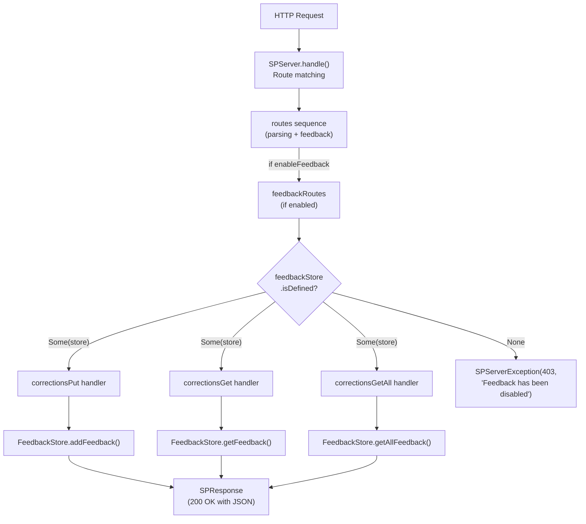

<!-- source: DeepWiki mcp.deepwiki.com · repo allenai/science-parse · page 3.2 Feedback System · fetched 2026-10-26 -->

# Feedback System

<details>
<summary>Relevant source files</summary>

The following files were used as context for generating this wiki page:

- [core/src/main/java/org/allenai/scienceparse/BibRecord.java](core/src/main/java/org/allenai/scienceparse/BibRecord.java)
- [core/src/main/java/org/allenai/scienceparse/CitationRecord.java](core/src/main/java/org/allenai/scienceparse/CitationRecord.java)
- [core/src/main/scala/org/allenai/scienceparse/JsonProtocol.scala](core/src/main/scala/org/allenai/scienceparse/JsonProtocol.scala)
- [core/src/main/scala/org/allenai/scienceparse/LabeledData.scala](core/src/main/scala/org/allenai/scienceparse/LabeledData.scala)
- [core/src/test/scala/org/allenai/scienceparse/JsonProtocolSpec.scala](core/src/test/scala/org/allenai/scienceparse/JsonProtocolSpec.scala)
- [server/src/main/scala/org/allenai/scienceparse/FeedbackStore.scala](server/src/main/scala/org/allenai/scienceparse/FeedbackStore.scala)
- [server/src/main/scala/org/allenai/scienceparse/SPServer.scala](server/src/main/scala/org/allenai/scienceparse/SPServer.scala)

</details>


## Purpose and Scope

The Feedback System is an optional feature of the Science Parse Server that stores user-provided corrections to extracted metadata in a PostgreSQL database. This system enables continuous improvement by collecting real-world corrections that can later be used to evaluate or retrain models. The feedback is stored as JSONB documents in the `LabeledData` format.

For information about the main parsing endpoints, see [REST API Endpoints](#3.1). For deployment configuration, see [Server Deployment](#3.3).

## Overview

The Feedback System provides a mechanism for external users to submit corrections to Science Parse's extraction results. These corrections are stored with timestamps and can be retrieved individually or in bulk. The system is disabled by default and must be explicitly enabled via the `--enableFeedback` command-line flag when starting the server.

Key characteristics:
- **Optional**: Must be explicitly enabled; disabled by default
- **Versioned Schema**: Includes automatic schema migration tracking
- **JSONB Storage**: Corrections stored as flexible JSON documents in PostgreSQL
- **Time-Based Queries**: Supports filtering feedback by timestamp ranges
- **Latest-Only Retrieval**: When retrieving feedback for a single paper, only the most recent correction is returned

Sources: [server/src/main/scala/org/allenai/scienceparse/SPServer.scala:1-395](), [server/src/main/scala/org/allenai/scienceparse/FeedbackStore.scala:1-147]()

## System Architecture



Sources: [server/src/main/scala/org/allenai/scienceparse/SPServer.scala:215-231](), [server/src/main/scala/org/allenai/scienceparse/FeedbackStore.scala:11-86]()

## Database Schema

The Feedback System uses PostgreSQL with ScalikeJDBC for database access. The schema includes versioned migrations to support future updates.

### Tables

| Table | Purpose | Primary Key |
|-------|---------|-------------|
| `settings` | Tracks schema version | `key` |
| `feedback` | Stores correction data | `(paperId, timeAdded)` |

### Feedback Table Structure

| Column | Type | Description |
|--------|------|-------------|
| `paperId` | `CHAR(40)` | SHA-1 hash of the PDF (40 hex characters) |
| `timeAdded` | `TIMESTAMP` | When the correction was submitted |
| `value` | `JSONB` | The correction data in `LabeledData` format |

### Schema Versioning

The system maintains a schema version in the `settings` table. On startup, the server automatically runs migration functions to upgrade from the current version to the desired version. The migration logic is defined in `schemaUpdateFunctions` map, which associates version numbers with upgrade functions.

Current schema version: `1`



Sources: [server/src/main/scala/org/allenai/scienceparse/FeedbackStore.scala:32-86](), [server/src/main/scala/org/allenai/scienceparse/FeedbackStore.scala:47-68]()

## API Endpoints

The Feedback System exposes three REST endpoints. All endpoints return `403 Forbidden` if feedback is disabled on the server.

### GET /v1/corrections/:paperId

Retrieves the most recent correction for a specific paper.

**Path Parameters:**
- `paperId`: 40-character SHA-1 hash (hex) of the PDF

**Query Parameters:**
- `format`: Output format (default: `"LabeledData"`)
  - `"LabeledData"`: Returns correction as `LabeledData` JSON

**Response:**
- `200 OK`: Returns the latest correction as JSON
- `404 Not Found`: No feedback exists for this paper
- `403 Forbidden`: Feedback disabled on server

**Implementation:** The handler queries the database with `ORDER BY timeAdded DESC LIMIT 1` to retrieve only the most recent correction.

Sources: [server/src/main/scala/org/allenai/scienceparse/SPServer.scala:332-343](), [server/src/main/scala/org/allenai/scienceparse/FeedbackStore.scala:103-115]()

### PUT /v1/corrections/:paperId

Stores a new correction for a specific paper.

**Path Parameters:**
- `paperId`: 40-character SHA-1 hash (hex) of the PDF

**Query Parameters:**
- `format`: Input format (default: `"LabeledData"`)
  - `"LabeledData"`: Expects correction as `LabeledData` JSON
  - `"ExtractedMetadata"`: Accepts `ExtractedMetadata` JSON, converts to `LabeledData`

**Request Body:**
- Content-Type: `application/json`
- Body: Correction data in specified format

**Response:**
- `200 OK`: Correction stored successfully
- `400 Bad Request`: Invalid JSON or format
- `403 Forbidden`: Feedback disabled on server

**ID Prefix Handling:** If the input `LabeledData.id` does not start with `"feedback:"`, the handler automatically prepends it.

Sources: [server/src/main/scala/org/allenai/scienceparse/SPServer.scala:345-377](), [server/src/main/scala/org/allenai/scienceparse/FeedbackStore.scala:88-99]()

### GET /v1/corrections

Retrieves all feedback with optional time-range filtering. Returns the latest correction for each paper.

**Query Parameters:**
- `onOrAfter`: Unix timestamp (milliseconds) - include only feedback added on or after this time
- `before`: Unix timestamp (milliseconds) - include only feedback added before this time

**Response:**
- `200 OK`: Newline-delimited JSON, one `LabeledData` object per line
- `403 Forbidden`: Feedback disabled on server

**Output Format:** Each line contains a compact JSON object with three fields:
- Paper ID (string)
- Time added (ISO-8601 timestamp string)
- `LabeledData` object

**Query Logic:** The handler uses a SQL JOIN to select only the latest feedback for each paper, then applies the time filters.

```sql
SELECT a.paperId, a.timeAdded, a.value FROM feedback AS a JOIN (
  SELECT paperId, MAX(timeAdded) AS timeAdded FROM feedback GROUP BY paperId
) AS b ON a.paperId = b.paperId AND a.timeAdded = b.timeAdded
WHERE a.timeAdded >= ? AND a.timeAdded < ?
```

Sources: [server/src/main/scala/org/allenai/scienceparse/SPServer.scala:379-393](), [server/src/main/scala/org/allenai/scienceparse/FeedbackStore.scala:122-145]()

## Data Models

### LabeledData

The `LabeledData` case class represents a paper's metadata and is the primary data format for feedback. All fields except `id` are optional, allowing partial corrections.

| Field | Type | Description |
|-------|------|-------------|
| `id` | `String` | Unique identifier (required) |
| `title` | `Option[String]` | Paper title |
| `authors` | `Option[Seq[Author]]` | List of authors with affiliations |
| `venue` | `Option[String]` | Publication venue |
| `year` | `Option[Int]` | Publication year |
| `abstractText` | `Option[String]` | Paper abstract |
| `sections` | `Option[Seq[Section]]` | Document sections with headings |
| `references` | `Option[Seq[Reference]]` | Bibliography entries |
| `mentions` | `Option[Seq[Mention]]` | In-text citation contexts |

**Nested Types:**

- `Author`: `(name: String, email: Option[String], affiliations: Seq[String])`
- `Section`: `(heading: Option[String], text: String)`
- `Reference`: `(label: Option[String], title: Option[String], authors: Seq[String], venue: Option[String], year: Option[Int], volume: Option[String], pageRange: Option[(String, String)])`
- `Mention`: `(reference: Reference, text: String, inContext: Option[(Section, Range)])`

Sources: [core/src/main/scala/org/allenai/scienceparse/LabeledData.scala:94-116](), [core/src/main/scala/org/allenai/scienceparse/LabeledData.scala:119-143]()

### Conversion from ExtractedMetadata

The `PUT` endpoint accepts `ExtractedMetadata` format and converts it to `LabeledData` using `LabeledData.fromExtractedMetadata()`. This conversion:

1. Maps `ExtractedMetadata` fields to corresponding `LabeledData` fields
2. Converts Java collections to Scala collections
3. Wraps primitive values in `Option` (e.g., year=0 becomes `None`)
4. Sets `mentions` to `None` (not yet implemented)

Sources: [core/src/main/scala/org/allenai/scienceparse/LabeledData.scala:147-178](), [server/src/main/scala/org/allenai/scienceparse/SPServer.scala:356-369]()

### JSON Serialization

The `JsonProtocol` object provides Spray JSON formats for all data models. The protocol handles:

- Scala `Option` to/from JSON null
- Java `List` to/from JSON arrays
- Nested case classes
- Type conversions (e.g., `JsNumber` to `Int`)

Sources: [core/src/main/scala/org/allenai/scienceparse/JsonProtocol.scala:1-188]()

## Configuration and Initialization

### Enabling Feedback

The feedback system is controlled by the `--enableFeedback` command-line flag:

```bash
# Disabled (default)
java -jar server-assembly.jar

# Enabled
java -jar server-assembly.jar --enableFeedback
```

When enabled, `SPServer` creates a `Some(FeedbackStore)` instance; otherwise, it's `None`. All feedback endpoints check this value and throw `SPServerException(403, "Feedback has been disabled on this server")` if disabled.

Sources: [server/src/main/scala/org/allenai/scienceparse/SPServer.scala:54-56](), [server/src/main/scala/org/allenai/scienceparse/SPServer.scala:215](), [server/src/main/scala/org/allenai/scienceparse/SPServer.scala:329-330]()

### Database Configuration

The `FeedbackStore` object reads database configuration from `application.conf` using Typesafe Config:

**Required Configuration Keys:**

| Key | Description |
|-----|-------------|
| `org.allenai.scienceparse.Server.db.url` | JDBC connection URL |
| `org.allenai.scienceparse.Server.db.user` | Database username |
| `org.allenai.scienceparse.Server.db.password` | Database password |
| `org.allenai.scienceparse.Server.db.logging` | Enable SQL logging (optional) |

**Root Database Connection for Migrations:**

Schema migrations require elevated privileges. The system uses a separate connection with root credentials:

| Key | Description |
|-----|-------------|
| `org.allenai.scienceparse.Server.db-as-root.url` | JDBC connection URL (root) |
| `org.allenai.scienceparse.Server.db-as-root.user` | Root username |
| `org.allenai.scienceparse.Server.db-as-root.password` | Root password |

The root connection is used only during startup for schema upgrades, then closed. The regular connection is used for all feedback operations.

Sources: [server/src/main/scala/org/allenai/scienceparse/FeedbackStore.scala:12-44]()

## Request Routing



Sources: [server/src/main/scala/org/allenai/scienceparse/SPServer.scala:217-231](), [server/src/main/scala/org/allenai/scienceparse/SPServer.scala:233-278]()

## Implementation Details

### Thread Safety

The `FeedbackStore` object is a singleton initialized at class load time. ScalikeJDBC manages connection pooling with configurable pool sizes. The `ConnectionPoolSettings` for the root connection pool uses `initialSize = 1, maxSize = 2`.

Sources: [server/src/main/scala/org/allenai/scienceparse/FeedbackStore.scala:11](), [server/src/main/scala/org/allenai/scienceparse/FeedbackStore.scala:42]()

### Transaction Handling

- `addFeedback`: Uses `DB.localTx` for transactional INSERT
- `getFeedback`: Uses `DB.readOnly` for read-only SELECT
- `getAllFeedback`: Uses `DB.readOnly` for read-only SELECT with JOIN

All database operations are wrapped in ScalikeJDBC session management, ensuring proper resource cleanup.

Sources: [server/src/main/scala/org/allenai/scienceparse/FeedbackStore.scala:88-145]()

### Error Handling in PUT Endpoint

The `correctionsPut` handler validates input through multiple layers:

1. **Content-Type Check**: Rejects non-JSON requests with 400
2. **JSON Parsing**: Catches `DeserializationException`, `JsonMappingException`, `UnrecognizedPropertyException`
3. **Format Conversion**: Supports both `LabeledData` and `ExtractedMetadata` inputs
4. **ID Prefix Enforcement**: Ensures `id` starts with `"feedback:"`

Any JSON parsing errors are caught and returned as `400 Bad Request` with the error message.

Sources: [server/src/main/scala/org/allenai/scienceparse/SPServer.scala:345-377]()

### Memory Considerations

The `correctionsGetAll` endpoint loads the entire result set into memory before streaming it as newline-delimited JSON. The implementation includes a comment acknowledging this limitation: "This keeps the whole result set in memory, which is bad. It should be streamed."

For large feedback datasets, this could cause memory pressure. However, ScalikeJDBC's underlying implementation already loads results into memory, so optimizing the endpoint alone would not solve the issue.

Sources: [server/src/main/scala/org/allenai/scienceparse/SPServer.scala:385-392]()

---

