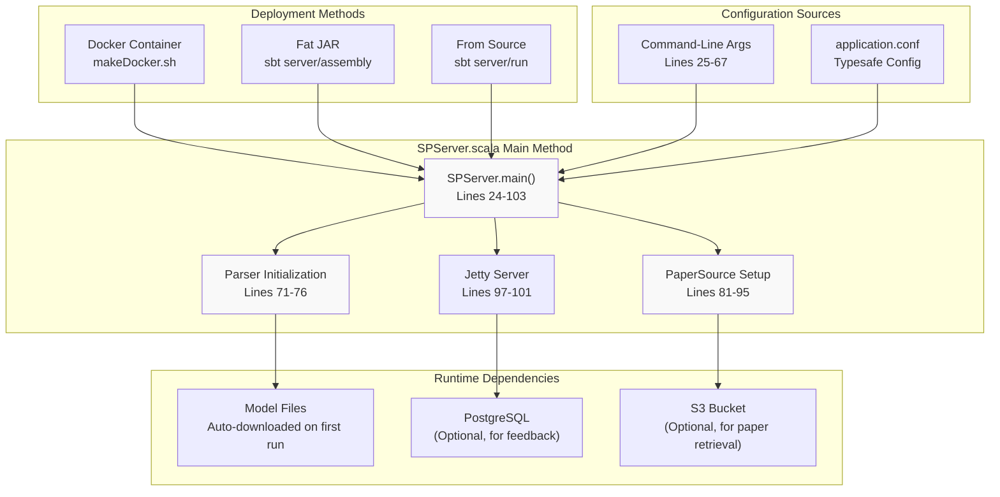
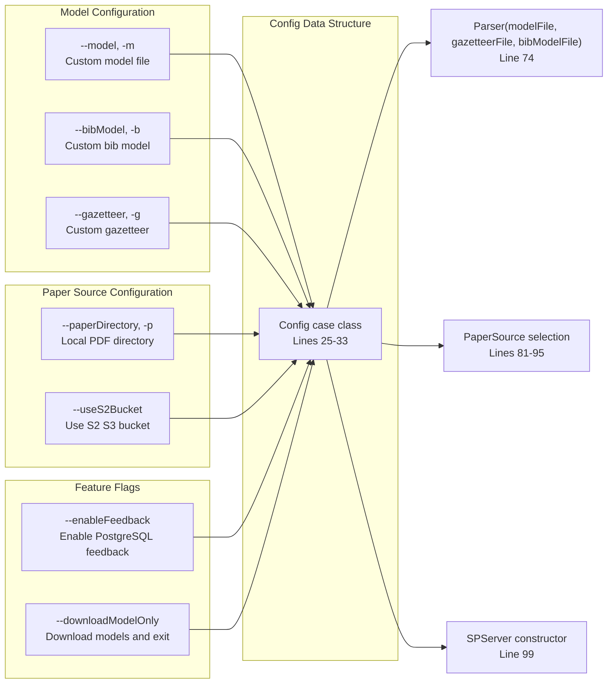
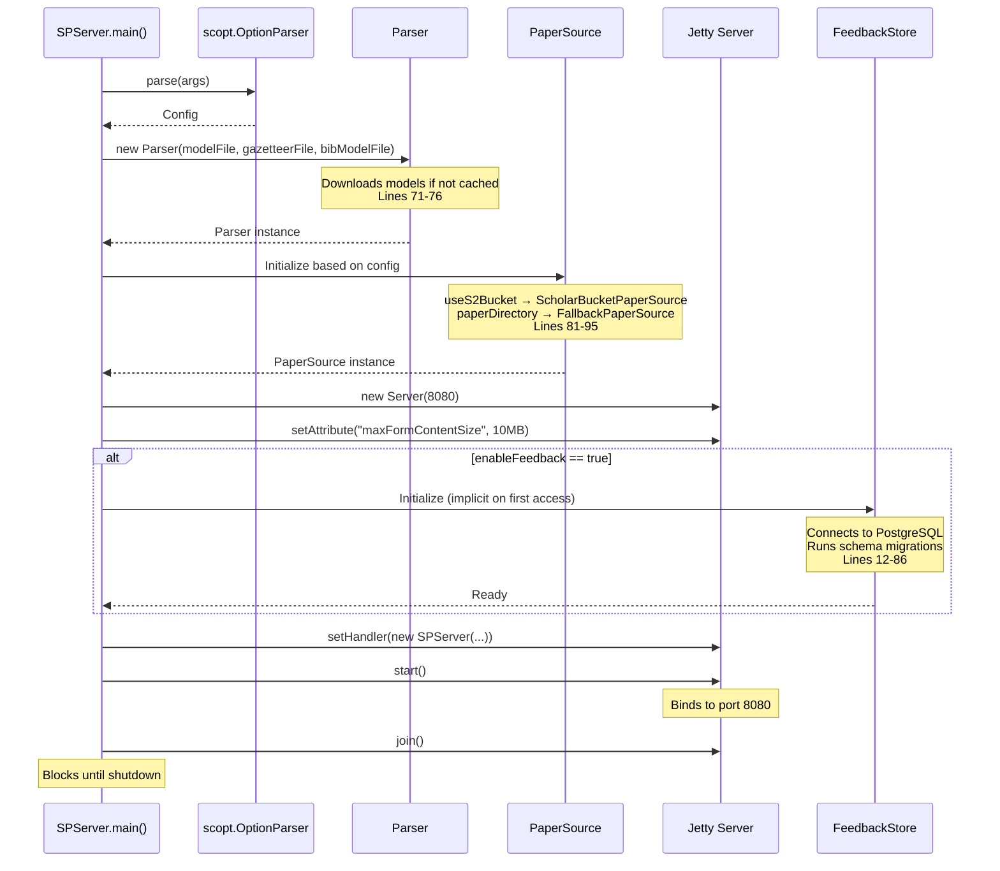
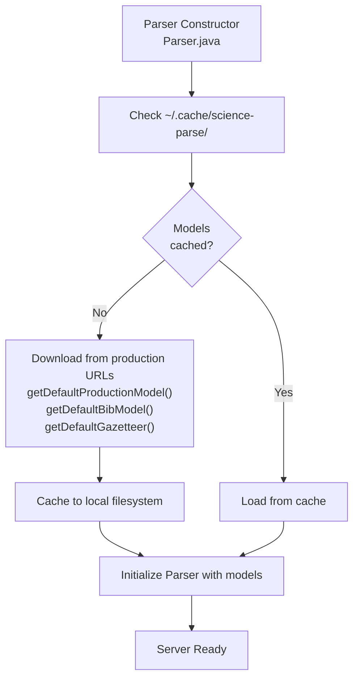

<!-- source: DeepWiki mcp.deepwiki.com · repo allenai/science-parse · page 3.3 Server Deployment · fetched 2026-10-26 -->

# Server Deployment

<details>
<summary>Relevant source files</summary>

The following files were used as context for generating this wiki page:

- [README.md](README.md)
- [cli/README.md](cli/README.md)
- [core/README.md](core/README.md)
- [core/src/main/java/org/allenai/scienceparse/BibRecord.java](core/src/main/java/org/allenai/scienceparse/BibRecord.java)
- [core/src/main/java/org/allenai/scienceparse/CitationRecord.java](core/src/main/java/org/allenai/scienceparse/CitationRecord.java)
- [core/src/main/scala/org/allenai/scienceparse/JsonProtocol.scala](core/src/main/scala/org/allenai/scienceparse/JsonProtocol.scala)
- [core/src/main/scala/org/allenai/scienceparse/LabeledData.scala](core/src/main/scala/org/allenai/scienceparse/LabeledData.scala)
- [core/src/test/scala/org/allenai/scienceparse/JsonProtocolSpec.scala](core/src/test/scala/org/allenai/scienceparse/JsonProtocolSpec.scala)
- [server/README.md](server/README.md)
- [server/src/main/scala/org/allenai/scienceparse/FeedbackStore.scala](server/src/main/scala/org/allenai/scienceparse/FeedbackStore.scala)
- [server/src/main/scala/org/allenai/scienceparse/SPServer.scala](server/src/main/scala/org/allenai/scienceparse/SPServer.scala)

</details>


## Purpose and Scope

This page provides detailed instructions for deploying the Science Parse Server in production and development environments. It covers the three primary deployment methods (Docker, fat JAR, and from source), configuration options, resource requirements, and initialization behavior.

For information about the server's REST API endpoints, see [REST API Endpoints](#3.1). For details about the optional feedback system and PostgreSQL configuration, see [Feedback System](#3.2).

## Deployment Overview

The Science Parse Server (`SPServer`) is a Jetty-based HTTP service that exposes the Core parsing library via REST endpoints. It runs on port 8080 and requires substantial memory and disk space for model files.

### Deployment Architecture



**Sources:** [server/src/main/scala/org/allenai/scienceparse/SPServer.scala:24-103](), [server/README.md]()

## Prerequisites and Resource Requirements

### Memory Requirements

The server requires significant heap memory for parsing operations:
- **Minimum recommended:** 6 GB heap (`-Xmx6g`)
- **Off-heap memory:** Additional 2 GB minimum for native operations
- **Total system memory:** 8-10 GB recommended

Complex documents may require more memory. Memory requirements scale with concurrent request volume.

### Disk Space Requirements

| Component | Size | Purpose |
|-----------|------|---------|
| Model files (first download) | ~2-3 GB | CRF models, gazetteer, word vectors |
| Docker image | ~1 GB | If using Docker deployment |
| Temporary files | Variable | PDF processing cache |

Model files are downloaded automatically on first startup and cached at `~/.cache/science-parse/` by default.

### System Requirements

- **Java:** OpenJDK 8 or later
- **Operating System:** Linux (Ubuntu 14.04.5 recommended for consistency), macOS, or Windows
- **Network:** Internet access for initial model download
- **Optional:** PostgreSQL 9.x+ (if enabling feedback mechanism)
- **Optional:** AWS credentials (if using S3 paper retrieval)

**Sources:** [server/README.md:20-24](), [README.md:48-58]()

## Configuration Options

The server is configured via command-line arguments parsed by the `scopt` library. All configuration is optional with sensible defaults.

### Command-Line Arguments



**Detailed Options:**

| Argument | Type | Default | Description |
|----------|------|---------|-------------|
| `-m, --model` | File | Production model | Path to custom CRF model file for header extraction |
| `-b, --bibModel` | File | Production model | Path to custom CRF model file for bibliography parsing |
| `-g, --gazetteer` | File | Production gazetteer | Path to custom gazetteer file (must not be used in training) |
| `-p, --paperDirectory` | File | None | Local directory containing PDFs; falls back to S3 if paper not found |
| `--enableFeedback` | Flag | false | Enables PostgreSQL-backed feedback endpoints (requires DB configuration) |
| `--useS2Bucket` | Flag | false | Uses internal Semantic Scholar S3 bucket for paper retrieval |
| `--downloadModelOnly` | Flag | false | Downloads all model files and exits without starting server |
| `--help` | Flag | N/A | Displays help text and exits |

**Sources:** [server/src/main/scala/org/allenai/scienceparse/SPServer.scala:25-67]()

### Configuration File (application.conf)

When enabling feedback, PostgreSQL connection details are read from `application.conf` using Typesafe Config:

```
org.allenai.scienceparse.Server {
  db {
    url = "jdbc:postgresql://localhost:5432/scienceparse"
    user = "scienceparse_user"
    password = ${?DB_PASSWORD}  # Read from DB_PASSWORD env var
    logging = false
  }
  
  db-as-root {
    url = "jdbc:postgresql://localhost:5432/scienceparse"
    user = "postgres"
    password = ${?DB_ROOT_PASSWORD}  # For schema migrations
  }
}
```

The `db-as-root` configuration is used only during startup for schema migrations.

**Sources:** [server/src/main/scala/org/allenai/scienceparse/FeedbackStore.scala:15-39]()

## Server Initialization Flow



**Sources:** [server/src/main/scala/org/allenai/scienceparse/SPServer.scala:69-103](), [server/src/main/scala/org/allenai/scienceparse/FeedbackStore.scala:12-86]()

## Deployment Method 1: Docker

### Building the Docker Image

Science Parse provides a shell script to build a Docker image:

```bash
cd science-parse
./makeDocker.sh
```

This script:
1. Runs `sbt server/assembly` to build the fat JAR
2. Creates a Dockerfile (or uses an existing one)
3. Builds the Docker image with the JAR bundled
4. Tags the image appropriately

### Running the Docker Container

**Basic deployment:**
```bash
docker run -p 8080:8080 -m 8g science-parse:latest
```

**With custom models:**
```bash
docker run -p 8080:8080 -m 8g \
  -v /path/to/models:/models \
  science-parse:latest \
  --model /models/custom.dat \
  --bibModel /models/custom-bib.dat
```

**With local paper directory:**
```bash
docker run -p 8080:8080 -m 8g \
  -v /path/to/papers:/papers:ro \
  science-parse:latest \
  --paperDirectory /papers
```

**With feedback enabled:**
```bash
docker run -p 8080:8080 -m 8g \
  -e DB_PASSWORD=secret \
  -e DB_ROOT_PASSWORD=rootsecret \
  science-parse:latest \
  --enableFeedback
```

### Docker Compose Example

```yaml
version: '3.8'
services:
  scienceparse:
    image: science-parse:latest
    ports:
      - "8080:8080"
    mem_limit: 8g
    environment:
      - DB_PASSWORD=${DB_PASSWORD}
      - DB_ROOT_PASSWORD=${DB_ROOT_PASSWORD}
    command: ["--enableFeedback"]
    depends_on:
      - postgres
    volumes:
      - model-cache:/root/.cache/science-parse
      
  postgres:
    image: postgres:12
    environment:
      - POSTGRES_DB=scienceparse
      - POSTGRES_USER=scienceparse_user
      - POSTGRES_PASSWORD=${DB_PASSWORD}
    volumes:
      - postgres-data:/var/lib/postgresql/data

volumes:
  model-cache:
  postgres-data:
```

**Sources:** [server/README.md:18-25](), [README.md:70-73]()

## Deployment Method 2: Fat JAR

### Building the Fat JAR

Use SBT to create a self-contained executable JAR with all dependencies bundled:

```bash
sbt server/assembly
```

This creates a JAR at `server/target/scala-2.12/science-parse-server-assembly-<version>.jar`.

The assembly process:
- Compiles all Scala and Java sources
- Runs the test suite
- Bundles all runtime dependencies
- Resolves dependency conflicts using the `sbt-assembly` plugin merge strategy

### Running the Fat JAR

**Basic deployment:**
```bash
java -Xmx6g -jar science-parse-server-assembly-3.0.0.jar
```

**With configuration:**
```bash
java -Xmx6g -jar science-parse-server-assembly-3.0.0.jar \
  --model /path/to/custom-model.dat \
  --paperDirectory /data/papers \
  --enableFeedback
```

**Download models without starting server:**
```bash
java -Xmx6g -jar science-parse-server-assembly-3.0.0.jar \
  --downloadModelOnly
```

This is useful for containerized deployments where you want to pre-download models during image build rather than at runtime.

### Systemd Service Example

For production Linux deployments, create `/etc/systemd/system/science-parse.service`:

```ini
[Unit]
Description=Science Parse Server
After=network.target postgresql.service

[Service]
Type=simple
User=scienceparse
WorkingDirectory=/opt/science-parse
ExecStart=/usr/bin/java -Xmx6g \
  -Dconfig.file=/etc/science-parse/application.conf \
  -jar /opt/science-parse/science-parse-server.jar \
  --enableFeedback
Restart=on-failure
RestartSec=10s
StandardOutput=journal
StandardError=journal

[Install]
WantedBy=multi-user.target
```

Enable and start:
```bash
sudo systemctl enable science-parse
sudo systemctl start science-parse
sudo systemctl status science-parse
```

**Sources:** [server/README.md:18-22](), [README.md:70-72]()

## Deployment Method 3: Running from Source

### Prerequisites

1. Install SBT 1.2.7 or later
2. Clone the repository: `git clone https://github.com/allenai/science-parse.git`
3. Ensure Java 8+ is installed

### Running with SBT

**Start the server directly:**
```bash
cd science-parse
sbt "server/run"
```

**With arguments:**
```bash
sbt "server/run --paperDirectory /data/papers --enableFeedback"
```

**With custom JVM options:**
```bash
sbt -J-Xmx6g "server/run"
```

### Development Mode

For development, you can use SBT's continuous compilation:

```bash
sbt
> ~server/compile  # Recompiles on file changes
> server/run       # Start server
```

### IntelliJ IDEA Setup

1. Import project as SBT project
2. Install Lombok plugin: File → Settings → Plugins → Search "Lombok" → Install
3. Enable annotation processing: File → Settings → Build, Execution, Deployment → Compiler → Annotation Processors → Enable annotation processing
4. Create a Run Configuration:
   - Main class: `org.allenai.scienceparse.SPServer`
   - VM options: `-Xmx6g`
   - Program arguments: `--paperDirectory /path/to/papers`
   - Module: `server`

**Sources:** [README.md:64-78](), [server/README.md:18-25]()

## First-Time Startup and Model Downloads

### Model Download Behavior

On first startup, the `Parser` class automatically downloads required model files:



### Downloaded Files

| File | Approximate Size | Purpose |
|------|------------------|---------|
| Production model | ~800 MB | CRF weights for title/author extraction |
| Bibliography model | ~400 MB | CRF weights for reference parsing |
| Gazetteer | ~100 MB | Entity recognition cache (serialized) |
| Word vectors | ~500 MB | Embeddings for feature engineering |

### Cache Location

Default cache location: `~/.cache/science-parse/`

This can be influenced by environment variables like `XDG_CACHE_HOME` depending on the caching library used.

### Pre-warming for Production

To avoid download delays in production, pre-download models:

```bash
# Method 1: Use --downloadModelOnly flag
java -Xmx6g -jar science-parse-server.jar --downloadModelOnly

# Method 2: Run a test parse
curl -X POST \
  -H "Content-Type: application/pdf" \
  --data-binary @test.pdf \
  http://localhost:8080/v1
```

**Sources:** [server/src/main/scala/org/allenai/scienceparse/SPServer.scala:71-76](), [README.md:48](), [server/README.md:20]()

## Production Considerations

### Resource Limits and Scaling

**Jetty Configuration:**
The server sets `maxFormContentSize` to 10 MB for uploaded PDFs:
```scala
server.setAttribute("org.eclipse.jetty.server.Request.maxFormContentSize", 10000000)
```
([server/src/main/scala/org/allenai/scienceparse/SPServer.scala:98]())

To handle larger PDFs, increase this value before calling `server.start()`.

**Concurrency:**
The `Parser` singleton is shared across all requests. Parsing operations are thread-safe but memory-intensive. Limit concurrent requests based on available memory:
- 6 GB heap: ~2-3 concurrent requests
- 10 GB heap: ~4-6 concurrent requests
- 16 GB heap: ~8-10 concurrent requests

### Logging

The server uses `org.allenai.common.Logging` backed by SLF4J. Configure via `logback.xml`:

```xml
<configuration>
  <appender name="STDOUT" class="ch.qos.logback.core.ConsoleAppender">
    <encoder>
      <pattern>%d{HH:mm:ss.SSS} [%thread] %-5level %logger{36} - %msg%n</pattern>
    </encoder>
  </appender>
  
  <logger name="org.allenai.scienceparse" level="INFO"/>
  <logger name="scalikejdbc" level="WARN"/>
  
  <root level="INFO">
    <appender-ref ref="STDOUT" />
  </root>
</configuration>
```

### Health Checks

Implement health checks for orchestration platforms:

```bash
# Basic availability check
curl -f http://localhost:8080/ || exit 1

# Parse a small test document
curl -f -X POST \
  -H "Content-Type: application/pdf" \
  --data-binary @health-check.pdf \
  http://localhost:8080/v1 > /dev/null || exit 1
```

### Monitoring Metrics

Key metrics to monitor:
- **Memory usage:** Heap and off-heap (via JMX)
- **Request latency:** P50, P95, P99 parse times
- **Error rate:** Failed parses, timeouts
- **Model cache hits:** Verify models loaded only once
- **Database connections:** If feedback enabled

### Security Considerations

1. **Network exposure:** Bind to `127.0.0.1` if using a reverse proxy:
   ```scala
   val server = new Server(new InetSocketAddress("127.0.0.1", 8080))
   ```

2. **Rate limiting:** Implement at reverse proxy level (nginx, HAProxy)

3. **Input validation:** The server accepts arbitrary PDFs; consider:
   - Maximum file size limits
   - Malicious PDF detection
   - Request authentication if needed

4. **Database security:** If using feedback:
   - Use strong passwords
   - Restrict network access to PostgreSQL
   - Enable SSL for database connections

### Backup and Recovery

**Model files:** Backed by production URLs; no backup needed (will re-download if cache lost)

**Feedback data (if enabled):** Regular PostgreSQL backups:
```bash
pg_dump -U scienceparse_user scienceparse > backup.sql
```

**Sources:** [server/src/main/scala/org/allenai/scienceparse/SPServer.scala:97-101](), [server/src/main/scala/org/allenai/scienceparse/FeedbackStore.scala]()

---

