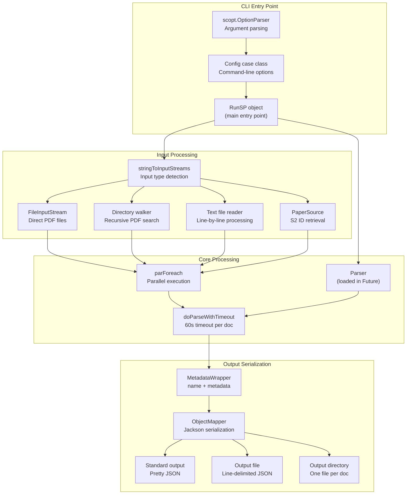
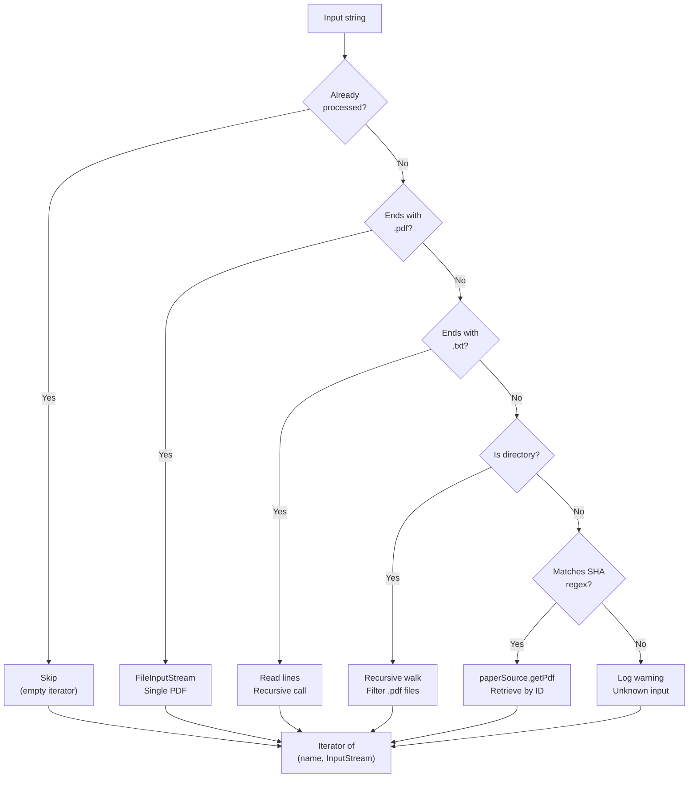
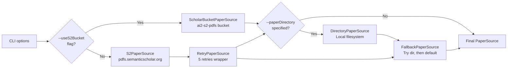
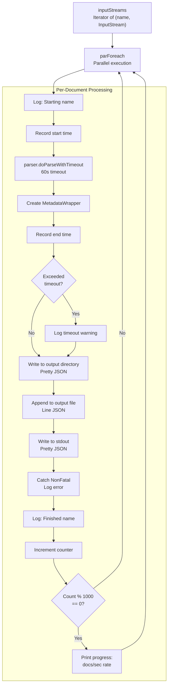
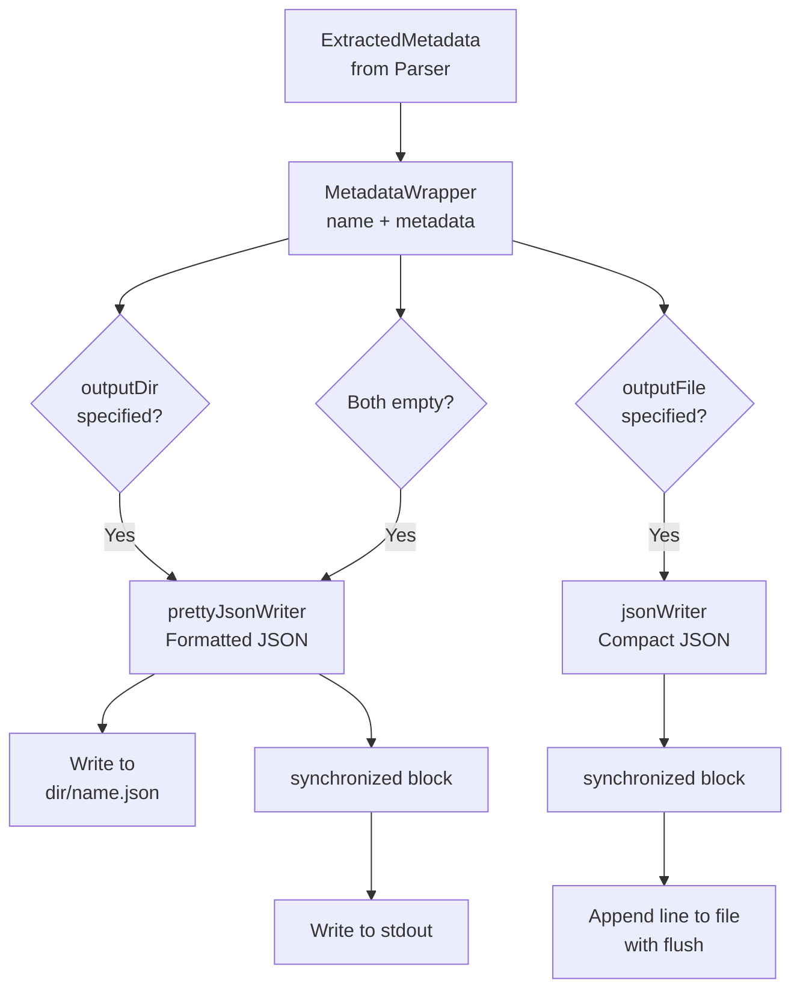

<!-- source: DeepWiki mcp.deepwiki.com · repo allenai/science-parse · page 4 CLI Module · fetched 2026-10-26 -->

# CLI Module

Relevant source files

The following files were used as context for generating this wiki page:

- [cli/README.md](cli/README.md)
- [cli/src/main/scala/org/allenai/scienceparse/RunSP.scala](cli/src/main/scala/org/allenai/scienceparse/RunSP.scala)
- [core/README.md](core/README.md)
- [core/src/main/java/org/allenai/scienceparse/DirectoryPaperSource.java](core/src/main/java/org/allenai/scienceparse/DirectoryPaperSource.java)
- [core/src/main/java/org/allenai/scienceparse/FallbackPaperSource.java](core/src/main/java/org/allenai/scienceparse/FallbackPaperSource.java)
- [core/src/main/java/org/allenai/scienceparse/PaperSource.java](core/src/main/java/org/allenai/scienceparse/PaperSource.java)
- [core/src/main/java/org/allenai/scienceparse/RetryPaperSource.java](core/src/main/java/org/allenai/scienceparse/RetryPaperSource.java)
- [core/src/main/java/org/allenai/scienceparse/ScholarBucketPaperSource.java](core/src/main/java/org/allenai/scienceparse/ScholarBucketPaperSource.java)
- [core/src/main/scala/org/allenai/scienceparse/PrintCRFInput.scala](core/src/main/scala/org/allenai/scienceparse/PrintCRFInput.scala)
- [core/src/main/scala/org/allenai/scienceparse/PrintFeaturizedCRFInput.scala](core/src/main/scala/org/allenai/scienceparse/PrintFeaturizedCRFInput.scala)
- [core/src/main/scala/org/allenai/scienceparse/S2PaperSource.scala](core/src/main/scala/org/allenai/scienceparse/S2PaperSource.scala)
- [server/README.md](server/README.md)

## Purpose and Scope

The CLI Module provides a command-line interface for batch processing PDF documents through Science Parse. It is implemented as `RunSP`, a standalone executable that can parse thousands of PDFs in parallel and write results to various output formats. The CLI is distributed as a fat JAR containing all dependencies, making it suitable for batch processing workflows, scripting, and integration with other tools.

For detailed information about command-line arguments and usage patterns, see [CLI Usage and Options](#4.1). For information about PDF retrieval strategies, see [Paper Source Strategies](#4.2). For programmatic access to the parsing functionality, see [Core Library](#2).

**Sources:** [cli/README.md:1-39](), [cli/src/main/scala/org/allenai/scienceparse/RunSP.scala:1-250]()

## Architecture Overview

The CLI module is built around the `RunSP` object, which orchestrates PDF retrieval, parsing, and output serialization. It operates as a thin wrapper over the Core Library's `Parser` class, adding input handling, parallel processing, and output formatting capabilities.

**Architecture Components:**

| Component | Type | Purpose |
|-----------|------|---------|
| `RunSP` | Scala object | Main entry point, coordinates all CLI operations |
| `Config` | Case class | Holds parsed command-line arguments |
| `stringToInputStreams` | Function | Converts input strings to `(name, InputStream)` pairs |
| `MetadataWrapper` | Case class | Wraps `ExtractedMetadata` with document name |
| `parForeach` | Iterator method | Parallel processing of input documents |
| `OptionParser` | scopt library | Command-line argument parsing |

**Sources:** [cli/src/main/scala/org/allenai/scienceparse/RunSP.scala:23-31](), [cli/src/main/scala/org/allenai/scienceparse/RunSP.scala:43-81](), [cli/src/main/scala/org/allenai/scienceparse/RunSP.scala:99-101]()

## Input Type Detection and Processing

The CLI supports multiple input formats through the `stringToInputStreams` function, which performs type detection and converts diverse input specifications into uniform `InputStream` pairs. This design allows mixing different input types in a single command.

**Input Type Rules:**

| Pattern | Detection | Processing |
|---------|-----------|------------|
| `*.pdf` | File extension | Open as `FileInputStream` directly |
| `*.txt` | File extension | Read lines, recursively process each with `parMap(16)` |
| Directory | `File.isDirectory` | Walk recursively, collect all `*.pdf` files |
| SHA-1 hash | Regex `^[0-9a-f]{40}$` | Retrieve via configured `PaperSource` |
| Other | No match | Log warning, skip |

The system maintains a skip set by reading document names from existing output files [cli/src/main/scala/org/allenai/scienceparse/RunSP.scala:119-127](). This allows resuming interrupted batch processing jobs without re-processing completed documents.

**Sources:** [cli/src/main/scala/org/allenai/scienceparse/RunSP.scala:129-189](), [cli/src/main/scala/org/allenai/scienceparse/RunSP.scala:191]()

## PaperSource Configuration

The CLI constructs a `PaperSource` strategy based on command-line options, supporting multiple PDF retrieval backends. The system uses a fallback chain when a local directory is specified, attempting local retrieval before falling back to network sources.

**PaperSource Selection Logic:**

1. **Default source determination** [cli/src/main/scala/org/allenai/scienceparse/RunSP.scala:103-107]():
   - If `--useS2Bucket`: `ScholarBucketPaperSource.getInstance()`
   - Otherwise: `PaperSource.getDefault` (which returns `RetryPaperSource` wrapping `S2PaperSource`)

2. **Directory override** [cli/src/main/scala/org/allenai/scienceparse/RunSP.scala:109-117]():
   - If `--paperDirectory` specified: Wrap default in `FallbackPaperSource` with `DirectoryPaperSource` as primary
   - This allows local caching while maintaining network fallback

**Sources:** [cli/src/main/scala/org/allenai/scienceparse/RunSP.scala:103-117](), [core/src/main/java/org/allenai/scienceparse/PaperSource.java:17-21]()

## Parallel Execution Model

The CLI uses parallel processing to maximize throughput when processing multiple documents. The `parForeach` iterator method distributes work across available CPU cores while maintaining progress tracking and error isolation.

**Execution Characteristics:**

| Feature | Implementation | Location |
|---------|----------------|----------|
| Parallelism | `parForeach` on iterator | [cli/src/main/scala/org/allenai/scienceparse/RunSP.scala:200]() |
| Timeout per doc | 60,000 ms (60 seconds) | [cli/src/main/scala/org/allenai/scienceparse/RunSP.scala:199]() |
| Error handling | `NonFatal` catch, log and continue | [cli/src/main/scala/org/allenai/scienceparse/RunSP.scala:232-235]() |
| Progress tracking | `AtomicInteger` with milestone prints | [cli/src/main/scala/org/allenai/scienceparse/RunSP.scala:198](), [cli/src/main/scala/org/allenai/scienceparse/RunSP.scala:238-243]() |
| Text file parallelism | Nested `parMap(16)` for line processing | [cli/src/main/scala/org/allenai/scienceparse/RunSP.scala:165]() |

The parser is loaded asynchronously in a `Future` [cli/src/main/scala/org/allenai/scienceparse/RunSP.scala:99-101]() with a 15-minute timeout [cli/src/main/scala/org/allenai/scienceparse/RunSP.scala:195](). This allows model downloads and initialization to complete while input processing setup continues.

**Sources:** [cli/src/main/scala/org/allenai/scienceparse/RunSP.scala:195-244]()

## Output Serialization

The CLI wraps parsing results in a `MetadataWrapper` and serializes them using Jackson JSON. Multiple output modes can be active simultaneously, allowing results to be written to different destinations in different formats.

**JSON Writers:**

| Writer | Configuration | Use Case |
|--------|--------------|----------|
| `jsonWriter` | Compact, single-line | Output file mode (`-f`) |
| `prettyJsonWriter` | Indented, multi-line | Directory mode (`-o`), stdout |

Both writers use Jackson's `ObjectMapper` with `DefaultScalaModule` [cli/src/main/scala/org/allenai/scienceparse/RunSP.scala:26-28]() to handle Scala collections and case classes.

**Thread Safety:**

Output operations use explicit synchronization to prevent data corruption during parallel writes:
- **File output**: Synchronized on the `OutputStream` [cli/src/main/scala/org/allenai/scienceparse/RunSP.scala:218]()
- **Stdout output**: Synchronized on `System.out` [cli/src/main/scala/org/allenai/scienceparse/RunSP.scala:227]()

The `MetadataWrapper` case class [cli/src/main/scala/org/allenai/scienceparse/RunSP.scala:24]() adds a `name` field to distinguish documents in batch output.

**Sources:** [cli/src/main/scala/org/allenai/scienceparse/RunSP.scala:206-230](), [cli/src/main/scala/org/allenai/scienceparse/RunSP.scala:24](), [cli/src/main/scala/org/allenai/scienceparse/RunSP.scala:26-28]()

## Logging Configuration

The CLI applies extensive logging configuration to suppress verbose output from dependencies and focus on parsing progress. Logging behavior can be modified with the `--quiet` flag.

**Logging Levels:**

| Logger | Default Level | Quiet Mode |
|--------|--------------|------------|
| `org.apache.pdfbox` | OFF | OFF |
| `org.apache.fontbox` | OFF | OFF |
| `org.allenai.pdfbox` | OFF | OFF |
| `org.allenai.fontbox` | OFF | OFF |
| `org.allenai.pdffigures2.TextExtractor` | ERROR | ERROR |
| Root logger | INFO | INFO |
| `org.allenai.scienceparse` | INFO | WARN |
| `org.allenai.scienceparse.Parser` | INFO | ERROR |

This configuration [cli/src/main/scala/org/allenai/scienceparse/RunSP.scala:88-97]() reduces noise from PDF processing libraries while maintaining visibility into parsing progress and errors.

**Sources:** [cli/src/main/scala/org/allenai/scienceparse/RunSP.scala:88-97]()

## Model Customization

The CLI allows overriding default models and gazetteers for experimentation or custom-trained models. If no custom models are specified, the system uses production defaults from the Core Library.

**Model Parameters:**

| Option | Default | Purpose |
|--------|---------|---------|
| `-m`, `--model` | `Parser.getDefaultProductionModel` | General CRF model for title/author extraction |
| `-b`, `--bibModel` | `Parser.getDefaultBibModel` | Bibliography-specific CRF model |
| `-g`, `--gazetteer` | `Parser.getDefaultGazetteer` | Entity gazetteer for validation |

These paths are resolved and passed to the `Parser` constructor [cli/src/main/scala/org/allenai/scienceparse/RunSP.scala:84-100](). Models are loaded lazily on first use, and the default models are automatically downloaded and cached if not present locally.

**Sources:** [cli/src/main/scala/org/allenai/scienceparse/RunSP.scala:44-54](), [cli/src/main/scala/org/allenai/scienceparse/RunSP.scala:84-100]()

---

