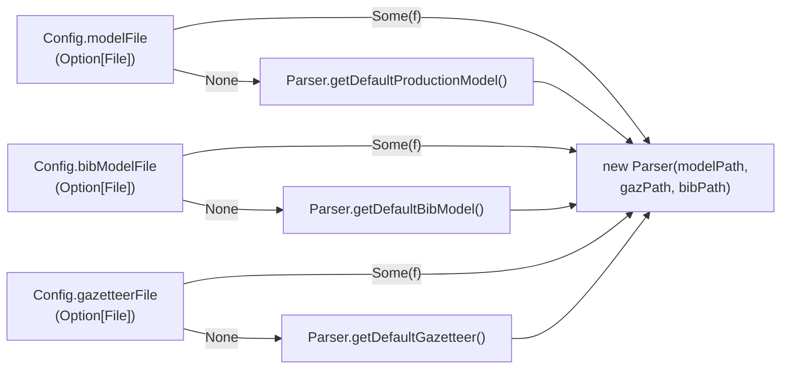
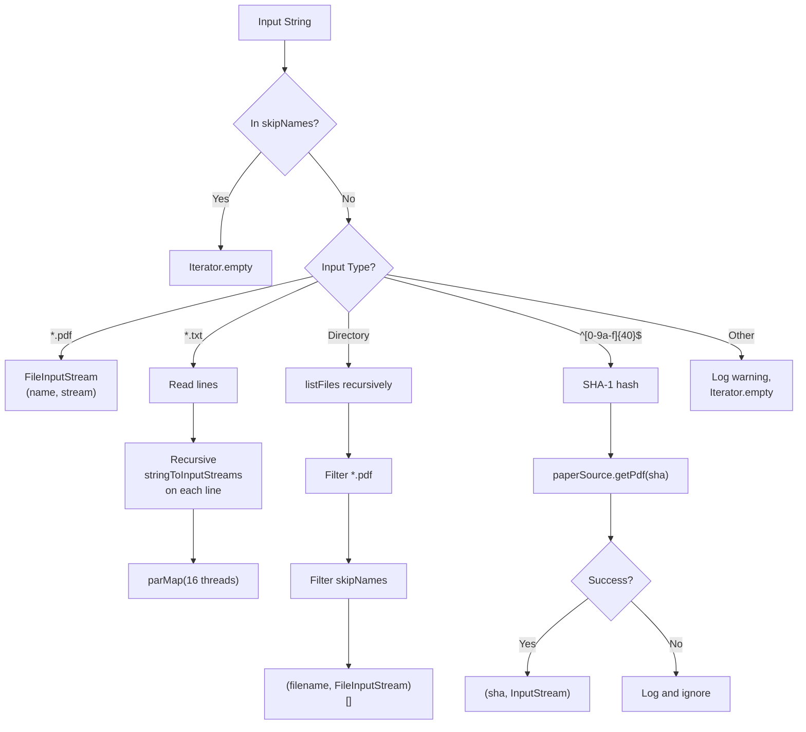
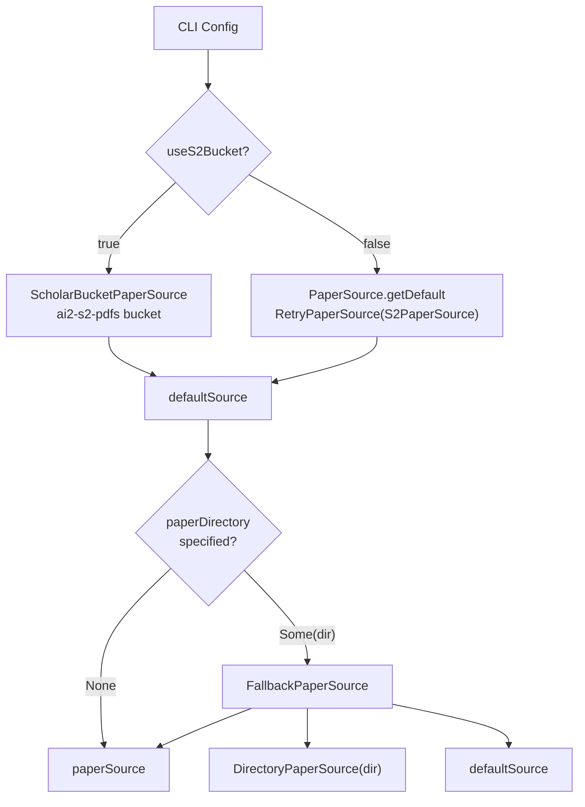
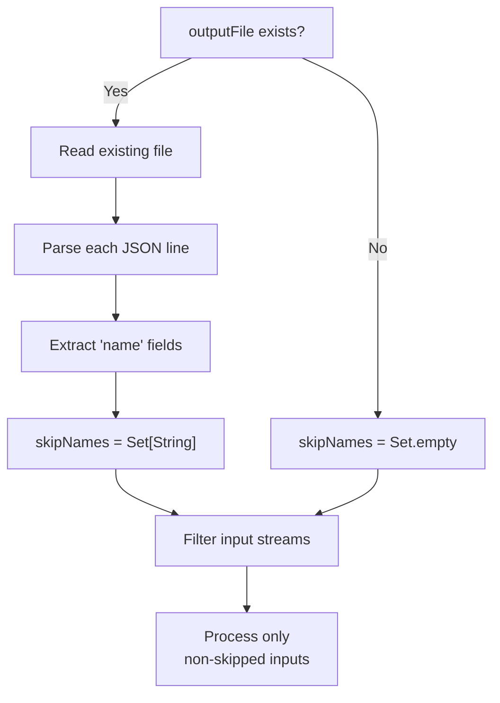
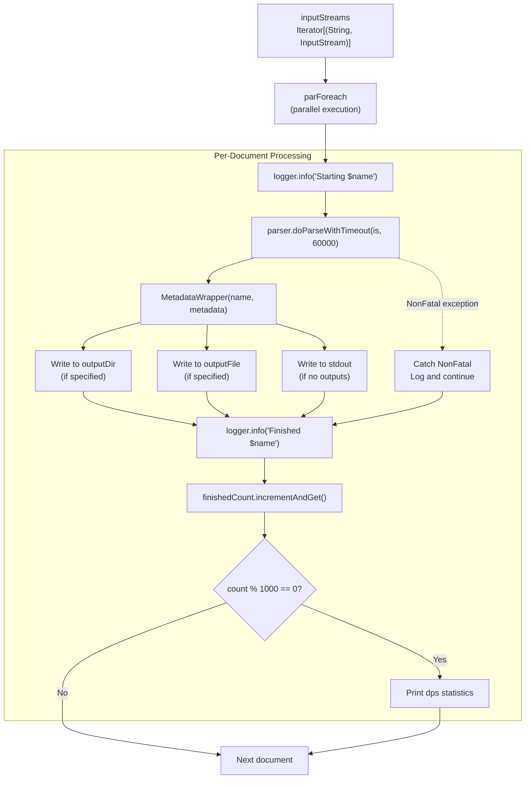
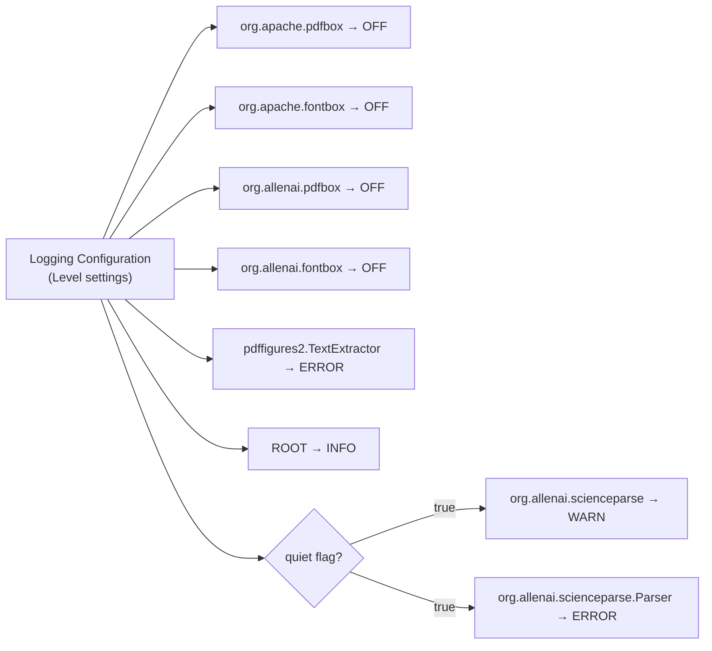

<!-- source: DeepWiki mcp.deepwiki.com · repo allenai/science-parse · page 4.1 CLI Usage and Options · fetched 2026-10-26 -->

# CLI Usage and Options

<details>
<summary>Relevant source files</summary>

The following files were used as context for generating this wiki page:

- [cli/README.md](cli/README.md)
- [cli/src/main/scala/org/allenai/scienceparse/RunSP.scala](cli/src/main/scala/org/allenai/scienceparse/RunSP.scala)
- [core/README.md](core/README.md)
- [core/src/main/java/org/allenai/scienceparse/DirectoryPaperSource.java](core/src/main/java/org/allenai/scienceparse/DirectoryPaperSource.java)
- [core/src/main/java/org/allenai/scienceparse/FallbackPaperSource.java](core/src/main/java/org/allenai/scienceparse/FallbackPaperSource.java)
- [core/src/main/java/org/allenai/scienceparse/PaperSource.java](core/src/main/java/org/allenai/scienceparse/PaperSource.java)
- [core/src/main/java/org/allenai/scienceparse/RetryPaperSource.java](core/src/main/java/org/allenai/scienceparse/RetryPaperSource.java)
- [core/src/main/java/org/allenai/scienceparse/ScholarBucketPaperSource.java](core/src/main/java/org/allenai/scienceparse/ScholarBucketPaperSource.java)
- [core/src/main/scala/org/allenai/scienceparse/PrintCRFInput.scala](core/src/main/scala/org/allenai/scienceparse/PrintCRFInput.scala)
- [core/src/main/scala/org/allenai/scienceparse/PrintFeaturizedCRFInput.scala](core/src/main/scala/org/allenai/scienceparse/PrintFeaturizedCRFInput.scala)
- [core/src/main/scala/org/allenai/scienceparse/S2PaperSource.scala](core/src/main/scala/org/allenai/scienceparse/S2PaperSource.scala)
- [server/README.md](server/README.md)

</details>


## Purpose and Scope

This page documents the command-line interface (CLI) for Science Parse, implemented by the `RunSP` class. The CLI provides batch processing capabilities for parsing multiple PDFs with configurable model files, input sources, and output formats. This interface is designed for processing large numbers of documents in parallel, with features for resuming interrupted runs and flexible input/output specifications.

For information about the `PaperSource` abstraction used by the CLI to retrieve PDFs, see [Paper Source Strategies](#4.2). For details about the underlying parsing logic and data models, see [Parser Class](#2.1) and [Data Models](#2.5).

**Sources:** [cli/src/main/scala/org/allenai/scienceparse/RunSP.scala](), [cli/README.md]()

---

## Basic Invocation

The CLI is packaged as a fat JAR through `sbt cli/assembly`. Basic invocation follows this pattern:

```bash
java -Xmx6g -jar science-parse-cli-assembly.jar [options] <inputs...>
```

The `-Xmx6g` heap allocation is recommended as Science Parse requires substantial memory for PDF processing and model loading. Some documents may require additional heap space.

**Memory Requirements:**
- Minimum heap: 6 GB (`-Xmx6g`)
- Recommended: 8-10 GB for large or complex documents
- Off-heap memory: Additional ~2 GB for native libraries and PDFBox

**Sources:** [cli/README.md:11-17](), [cli/src/main/scala/org/allenai/scienceparse/RunSP.scala:30-98]()

---

## Command-Line Arguments

The CLI uses the `scopt` library for argument parsing, as defined in [cli/src/main/scala/org/allenai/scienceparse/RunSP.scala:43-81](). All arguments are optional except for at least one input specification.

### Arguments Table

| Short | Long | Type | Default | Description |
|-------|------|------|---------|-------------|
| `-m` | `--model` | File | Production model | Main CRF model file for title/author extraction |
| `-b` | `--bibModel` | File | Production bib model | CRF model for bibliography parsing |
| `-g` | `--gazetteer` | File | Production gazetteer | Gazetteer cache for entity recognition |
| `-p` | `--paperDirectory` | File | None | Local directory to search for PDFs before remote retrieval |
| | `--useS2Bucket` | Flag | false | Use internal S3 bucket (`ai2-s2-pdfs`) instead of public API |
| `-o` | `--outputDirectory` | File | None | Write one JSON file per document (pretty-printed) |
| `-f` | `--outputFile` | File | None | Append one JSON line per document (compact) |
| `-q` | `--quiet` | Flag | false | Suppress progress logging, show only warnings/errors |
| | `<inputs...>` | String[] | Required | PDF paths, directories, S2 IDs, or text files |

**Sources:** [cli/src/main/scala/org/allenai/scienceparse/RunSP.scala:43-81]()

---

## Model and Gazetteer Configuration

### Model File Options

The CLI accepts custom model files for evaluation or experimentation. If not specified, production models are downloaded and cached automatically via [core/src/main/java/org/allenai/scienceparse/Parser.java]().



**Default Model Resolution:**
- [cli/src/main/scala/org/allenai/scienceparse/RunSP.scala:84-86](): Resolves `modelFile`, `bibModelFile`, and `gazetteerFile` using `Parser.getDefault*` methods if not specified
- First run downloads models from remote storage (AWS S3)
- Subsequent runs use cached models from local filesystem

**Warning:** When specifying a custom model, ensure the gazetteer is compatible. Using the same gazetteer for both training and evaluation can inflate accuracy metrics.

**Sources:** [cli/src/main/scala/org/allenai/scienceparse/RunSP.scala:84-86](), [cli/src/main/scala/org/allenai/scienceparse/RunSP.scala:44-54]()

---

## Input Specification

The CLI accepts multiple input arguments, each processed according to its format. Input resolution is handled by `stringToInputStreams` in [cli/src/main/scala/org/allenai/scienceparse/RunSP.scala:130-189]().

### Input Resolution Diagram



### Input Format Details

**PDF Files** ([cli/src/main/scala/org/allenai/scienceparse/RunSP.scala:136-137]()):
- Must have `.pdf` extension
- Returns iterator with single `(filename, FileInputStream)` pair

**Text Files** ([cli/src/main/scala/org/allenai/scienceparse/RunSP.scala:138-165]()):
- Must have `.txt` extension
- Each line is recursively processed through `stringToInputStreams`
- Uses parallel mapping with 16 threads: `parMap(stringToInputStreams, 16)`
- Allows composition of inputs (text files referencing directories, SHA-1s, other text files)

**Directories** ([cli/src/main/scala/org/allenai/scienceparse/RunSP.scala:166-175]()):
- Recursively traverses all subdirectories
- Filters for files ending in `.pdf`
- Returns `(filename, FileInputStream)` for each PDF
- Respects `skipNames` for resumption

**S2 Paper IDs** ([cli/src/main/scala/org/allenai/scienceparse/RunSP.scala:176-183]()):
- 40-character hexadecimal SHA-1 hash: regex `^[0-9a-f]{40}$`
- Retrieved via `paperSource.getPdf(sha1)`
- Failures logged but processing continues with remaining inputs

**Sources:** [cli/src/main/scala/org/allenai/scienceparse/RunSP.scala:130-189]()

---

## Paper Source Strategy

The CLI constructs a `PaperSource` based on configuration flags and options:



**Default Source** ([cli/src/main/scala/org/allenai/scienceparse/RunSP.scala:104-108]()):
- `useS2Bucket=false`: Uses `PaperSource.getDefault`, which wraps `S2PaperSource` with `RetryPaperSource(5 retries)`
- `useS2Bucket=true`: Uses `ScholarBucketPaperSource` for direct S3 access

**Paper Directory Fallback** ([cli/src/main/scala/org/allenai/scienceparse/RunSP.scala:109-116]()):
- When `--paperDirectory` is specified, creates `FallbackPaperSource(DirectoryPaperSource(dir), defaultSource)`
- Attempts local directory first, falls back to remote retrieval on failure
- Useful for offline processing with partial local cache

**Sources:** [cli/src/main/scala/org/allenai/scienceparse/RunSP.scala:103-117](), [core/src/main/java/org/allenai/scienceparse/PaperSource.java]()

---

## Output Specification

The CLI supports three output modes, which can be combined:

### Output Modes

**1. Standard Output (Default)** ([cli/src/main/scala/org/allenai/scienceparse/RunSP.scala:226-230]()):
- Used when neither `-o` nor `-f` is specified
- Pretty-printed JSON format via `prettyJsonWriter`
- Thread-synchronized writes to prevent interleaving
- Wrapped in `MetadataWrapper` with `name` and `metadata` fields

**2. Output Directory** (`-o/--outputDirectory`) ([cli/src/main/scala/org/allenai/scienceparse/RunSP.scala:211-213]()):
- Creates one `.json` file per document: `${name}.json`
- Pretty-printed format for human readability
- Directory must exist or be creatable

**3. Output File** (`-f/--outputFile`) ([cli/src/main/scala/org/allenai/scienceparse/RunSP.scala:216-223]()):
- One JSON object per line (newline-delimited JSON)
- Compact format without pretty-printing
- Thread-synchronized appends with explicit flush
- Supports resume: existing entries are parsed to populate `skipNames`

### Output Format Comparison

| Mode | Format | Use Case | Resumable |
|------|--------|----------|-----------|
| stdout | Pretty JSON | Interactive inspection | No |
| `-o dir/` | Pretty JSON, one file per doc | Archival, manual review | No |
| `-f file` | Compact JSON, one line per doc | Bulk processing, streaming analysis | Yes |

### Resume Capability

The output file mode supports resumption of interrupted runs. When `--outputFile` points to an existing file:



**Implementation** ([cli/src/main/scala/org/allenai/scienceparse/RunSP.scala:120-127]()):
- Reads existing output file using Jackson `ObjectMapper`
- Extracts `name` field from each line
- Filters inputs to exclude already-processed documents
- Appends new results to file with `FileOutputStream(file, true)` (append mode)

**Sources:** [cli/src/main/scala/org/allenai/scienceparse/RunSP.scala:120-127](), [cli/src/main/scala/org/allenai/scienceparse/RunSP.scala:193-247]()

---

## Execution Model

### Parallel Processing Architecture

The CLI processes documents in parallel using `parForeach` from the AI2 Common library:



**Parallelism Details:**
- Uses `parForeach` from [org.allenai.common.ParIterator]() 
- Degree of parallelism determined by available CPU cores
- Each document processed independently
- Thread-safe writes to shared output streams via synchronization

**Timeout Handling** ([cli/src/main/scala/org/allenai/scienceparse/RunSP.scala:199-208]()):
- Per-document timeout: 60,000 ms (60 seconds)
- Invokes `parser.doParseWithTimeout(is, timeout)`
- Warns if document exceeds timeout but completes
- Timeout enforced by `Parser` class, not CLI

**Error Handling** ([cli/src/main/scala/org/allenai/scienceparse/RunSP.scala:232-235]()):
- Catches all `NonFatal` exceptions per document
- Logs exception message without stack trace
- Continues processing remaining documents
- Failed documents do not block progress

**Progress Reporting** ([cli/src/main/scala/org/allenai/scienceparse/RunSP.scala:238-243]()):
- Prints statistics every 1,000 documents
- Shows documents per second (dps) rate
- Format: `Finished N documents. X.XX dps`

**Sources:** [cli/src/main/scala/org/allenai/scienceparse/RunSP.scala:193-247]()

---

## Logging Configuration

The CLI applies extensive logging configuration to reduce noise from dependencies:



**Configuration Code** ([cli/src/main/scala/org/allenai/scienceparse/RunSP.scala:88-97]()):
- Disables PDFBox, FontBox, and pdffigures2 logging to reduce clutter
- Sets root logger to INFO level
- Quiet mode (`-q/--quiet`):
  - Science Parse package → WARN
  - Parser class → ERROR
  - Shows only critical errors and progress milestones

**Sources:** [cli/src/main/scala/org/allenai/scienceparse/RunSP.scala:88-97]()

---

## Metadata Output Format

The CLI wraps parsing results in a `MetadataWrapper` class:

```java
case class MetadataWrapper(name: String, metadata: ExtractedMetadata)
```

**JSON Structure:**
```json
{
  "name": "paper_id_or_filename",
  "metadata": {
    "title": "Paper Title",
    "authors": ["Author 1", "Author 2"],
    "year": 2023,
    "abstractText": "Abstract content...",
    "sections": [...],
    "references": [...],
    "referenceMentions": [...]
  }
}
```

**Name Field** ([cli/src/main/scala/org/allenai/scienceparse/RunSP.scala:24-28]()):
- For PDFs: Filename without path
- For directories: Relative filename from directory root
- For S2 IDs: The SHA-1 hash
- For text file entries: Depends on the entry type

The `metadata` field contains the full `ExtractedMetadata` object documented in [Data Models](#2.5).

**Sources:** [cli/src/main/scala/org/allenai/scienceparse/RunSP.scala:24-28](), [cli/src/main/scala/org/allenai/scienceparse/RunSP.scala:205-223]()

---

## Complete Usage Examples

### Example 1: Parse Single PDF
```bash
java -Xmx6g -jar science-parse-cli-assembly.jar paper.pdf
```
Output: Pretty-printed JSON to stdout

### Example 2: Batch Process Directory
```bash
java -Xmx6g -jar science-parse-cli-assembly.jar \
  -o output_json/ \
  /path/to/pdf_directory/
```
Output: One JSON file per PDF in `output_json/`

### Example 3: Process S2 Paper IDs from File
```bash
# papers.txt contains one SHA-1 per line
java -Xmx6g -jar science-parse-cli-assembly.jar \
  -f results.jsonl \
  papers.txt
```
Output: Newline-delimited JSON in `results.jsonl`, resumable

### Example 4: Custom Models with Local Cache
```bash
java -Xmx6g -jar science-parse-cli-assembly.jar \
  -m custom_model.dat \
  -b custom_bib_model.dat \
  -g custom_gazetteer.json \
  -p /local/pdf/cache/ \
  -f output.jsonl \
  -q \
  paper_ids.txt
```
- Uses custom models
- Checks local cache before remote retrieval
- Quiet mode, only warnings
- Resumable output file

### Example 5: Mixed Input Types
```bash
java -Xmx6g -jar science-parse-cli-assembly.jar \
  paper1.pdf \
  /directory/with/pdfs/ \
  abc123def456... \
  papers.txt
```
Processes: single PDF, all PDFs in directory, one S2 ID, all inputs from text file

**Sources:** [cli/README.md](), [cli/src/main/scala/org/allenai/scienceparse/RunSP.scala]()

---

## Performance Considerations

**Parser Initialization** ([cli/src/main/scala/org/allenai/scienceparse/RunSP.scala:99-101]()):
- Initialized asynchronously in a `Future` while inputs are resolved
- Allows model loading to overlap with input preparation
- 15-minute timeout for parser initialization: `Await.result(parserFuture, 15 minutes)`

**Parallel Throughput:**
- Throughput depends on CPU cores, document complexity, and I/O bandwidth
- Progress reporting shows documents per second (dps)
- Typical rates: 1-10 dps depending on hardware and document types

**Memory Management:**
- Each parallel thread holds document data in memory during processing
- Peak memory scales with parallelism degree × average document size
- Monitor heap usage; increase `-Xmx` if OutOfMemoryErrors occur

**Resume Performance:**
- Skip-name lookup is O(1) via `Set` data structure
- Large output files increase startup time proportionally
- Consider splitting very large runs into batches

**Sources:** [cli/src/main/scala/org/allenai/scienceparse/RunSP.scala:99-101](), [cli/src/main/scala/org/allenai/scienceparse/RunSP.scala:195-244]()

---

