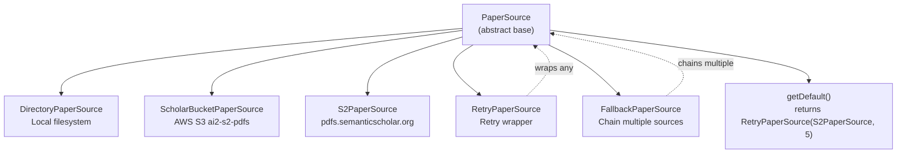
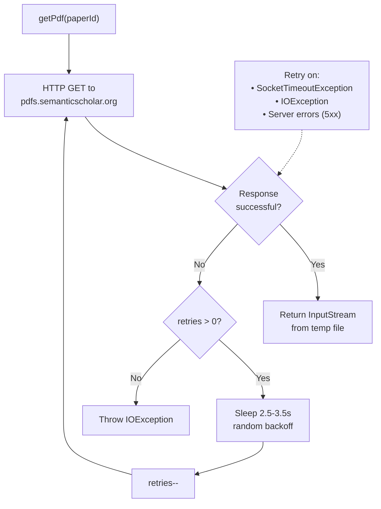
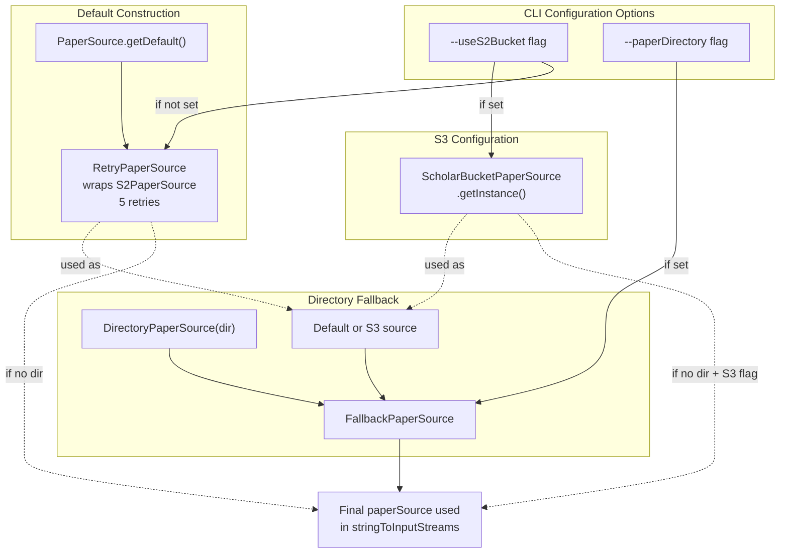
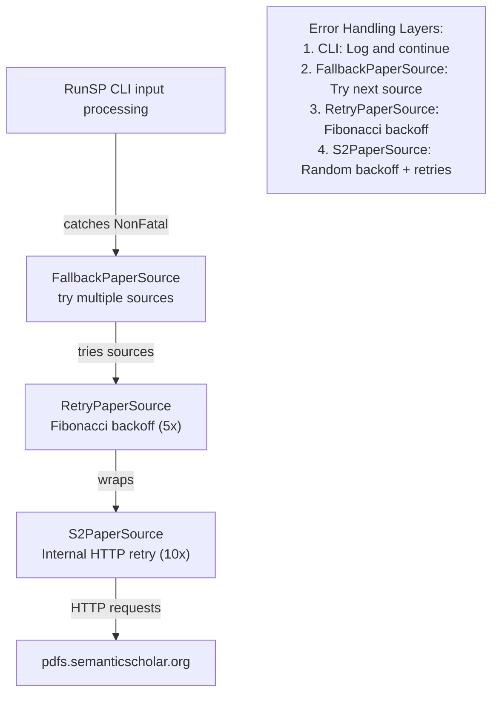

<!-- source: DeepWiki mcp.deepwiki.com · repo allenai/science-parse · page 4.2 Paper Source Strategies · fetched 2026-10-26 -->

# Paper Source Strategies

<details>
<summary>Relevant source files</summary>

The following files were used as context for generating this wiki page:

- [cli/src/main/scala/org/allenai/scienceparse/RunSP.scala](cli/src/main/scala/org/allenai/scienceparse/RunSP.scala)
- [core/src/main/java/org/allenai/scienceparse/DirectoryPaperSource.java](core/src/main/java/org/allenai/scienceparse/DirectoryPaperSource.java)
- [core/src/main/java/org/allenai/scienceparse/FallbackPaperSource.java](core/src/main/java/org/allenai/scienceparse/FallbackPaperSource.java)
- [core/src/main/java/org/allenai/scienceparse/PaperSource.java](core/src/main/java/org/allenai/scienceparse/PaperSource.java)
- [core/src/main/java/org/allenai/scienceparse/RetryPaperSource.java](core/src/main/java/org/allenai/scienceparse/RetryPaperSource.java)
- [core/src/main/java/org/allenai/scienceparse/ScholarBucketPaperSource.java](core/src/main/java/org/allenai/scienceparse/ScholarBucketPaperSource.java)
- [core/src/main/scala/org/allenai/scienceparse/PrintCRFInput.scala](core/src/main/scala/org/allenai/scienceparse/PrintCRFInput.scala)
- [core/src/main/scala/org/allenai/scienceparse/PrintFeaturizedCRFInput.scala](core/src/main/scala/org/allenai/scienceparse/PrintFeaturizedCRFInput.scala)
- [core/src/main/scala/org/allenai/scienceparse/S2PaperSource.scala](core/src/main/scala/org/allenai/scienceparse/S2PaperSource.scala)

</details>


This page documents the `PaperSource` abstraction and its implementations, which provide a flexible strategy pattern for retrieving PDF documents by paper ID. This system enables the Science Parse CLI and other components to fetch papers from multiple backends (local directories, AWS S3, HTTP endpoints) with automatic fallback, retry logic, and error handling.

For information about the CLI tool that uses these strategies, see [CLI Usage and Options](#4.1). For information about the parsing pipeline once PDFs are retrieved, see [Parser Class](#2.1).

## The PaperSource Abstraction

The `PaperSource` class defines a simple contract for PDF retrieval. All implementations extend this abstract base class and provide a single method.

**Core Interface:**

The abstract class [core/src/main/java/org/allenai/scienceparse/PaperSource.java:11-12]() defines:

```java
abstract InputStream getPdf(String paperId) throws IOException;
```

This method takes a paper identifier (typically a SHA-1 hash) and returns an `InputStream` containing the PDF bytes. The abstraction allows the CLI and other components to work with any PDF source without coupling to specific retrieval mechanisms.

**Default Paper Source:**

The class provides a static factory method `getDefault()` [core/src/main/java/org/allenai/scienceparse/PaperSource.java:17-21]() that returns a `RetryPaperSource` wrapping `S2PaperSource` with 5 retries. This default can be overridden for testing via the `defaultPaperSource` field.



**Sources:** [core/src/main/java/org/allenai/scienceparse/PaperSource.java](), [core/src/main/java/org/allenai/scienceparse/DirectoryPaperSource.java](), [core/src/main/java/org/allenai/scienceparse/ScholarBucketPaperSource.java](), [core/src/main/scala/org/allenai/scienceparse/S2PaperSource.scala](), [core/src/main/java/org/allenai/scienceparse/RetryPaperSource.java](), [core/src/main/java/org/allenai/scienceparse/FallbackPaperSource.java]()

## PaperSource Implementations

### DirectoryPaperSource

The simplest implementation retrieves PDFs from a local directory. Given a `paperId`, it constructs the path `dir/paperId.pdf` and returns a `BufferedInputStream`.

**Implementation:** [core/src/main/java/org/allenai/scienceparse/DirectoryPaperSource.java:12-24]()

```java
public DirectoryPaperSource(final File dir) {
    this.dir = dir;
}

public InputStream getPdf(final String paperId) throws FileNotFoundException {
    final File file = new File(dir, paperId + ".pdf");
    return new BufferedInputStream(new FileInputStream(file));
}
```

**Use case:** Batch processing from local disk, development/testing with local paper collections.

**Sources:** [core/src/main/java/org/allenai/scienceparse/DirectoryPaperSource.java]()

### ScholarBucketPaperSource

This implementation retrieves papers from AWS S3 buckets used internally by Semantic Scholar. It implements a singleton pattern and searches multiple buckets.

**Implementation:** [core/src/main/java/org/allenai/scienceparse/ScholarBucketPaperSource.java:20-74]()

**Key features:**
- **Singleton pattern:** [core/src/main/java/org/allenai/scienceparse/ScholarBucketPaperSource.java:21-24]() ensures only one S3 client instance
- **Multi-bucket fallback:** Tries `ai2-s2-pdfs` first, then `ai2-s2-pdfs-private` [core/src/main/java/org/allenai/scienceparse/ScholarBucketPaperSource.java:26-28]()
- **Key structure:** Constructs S3 key as `{first4chars}/{remaining}.pdf` [core/src/main/java/org/allenai/scienceparse/ScholarBucketPaperSource.java:32]()
- **Temporary file buffering:** Downloads S3 content to temp file to avoid stream timeouts [core/src/main/java/org/allenai/scienceparse/ScholarBucketPaperSource.java:63-72]()

The temporary file strategy prevents timeout issues when consumers read the InputStream slowly, as S3 connections can time out if data isn't consumed promptly.

**Sources:** [core/src/main/java/org/allenai/scienceparse/ScholarBucketPaperSource.java]()

### S2PaperSource

Retrieves papers from the public Semantic Scholar CDN at `pdfs.semanticscholar.org`. This is the default fallback for papers not available locally.

**Implementation:** [core/src/main/scala/org/allenai/scienceparse/S2PaperSource.scala:13-72]()

**Key features:**
- **Built-in retry logic:** [core/src/main/scala/org/allenai/scienceparse/S2PaperSource.scala:17-49]() retries up to 10 times with exponential backoff
- **Smart retry conditions:** Retries on `SocketTimeoutException`, `IOException`, and server errors (5xx)
- **Random backoff:** Sleeps 2.5-3.5 seconds between retries [core/src/main/scala/org/allenai/scienceparse/S2PaperSource.scala:24]() to avoid thundering herd
- **Temporary file buffering:** Like `ScholarBucketPaperSource`, downloads to temp file [core/src/main/scala/org/allenai/scienceparse/S2PaperSource.scala:56-68]()
- **URL construction:** `https://pdfs.semanticscholar.org/{first4}/{remaining}.pdf` [core/src/main/scala/org/allenai/scienceparse/S2PaperSource.scala:52]()

**Retry logic visualization:**



**Sources:** [core/src/main/scala/org/allenai/scienceparse/S2PaperSource.scala]()

### RetryPaperSource

A decorator that wraps any `PaperSource` and adds Fibonacci backoff retry logic. This is distinct from `S2PaperSource`'s internal retries.

**Implementation:** [core/src/main/java/org/allenai/scienceparse/RetryPaperSource.java:12-63]()

**Key features:**
- **Configurable tries:** Defaults to 3, constructor allows custom count [core/src/main/java/org/allenai/scienceparse/RetryPaperSource.java:16-23]()
- **Fibonacci backoff:** Wait times follow Fibonacci sequence (1s, 1s, 2s, 3s, 5s...) [core/src/main/java/org/allenai/scienceparse/RetryPaperSource.java:39-58]()
- **Generic wrapper:** Can wrap any `PaperSource` implementation [core/src/main/java/org/allenai/scienceparse/RetryPaperSource.java:13-14]()

The default `PaperSource.getDefault()` returns `new RetryPaperSource(S2PaperSource, 5)`, providing 5 retries with Fibonacci backoff on top of S2's internal 10 retries.

**Sources:** [core/src/main/java/org/allenai/scienceparse/RetryPaperSource.java](), [core/src/main/java/org/allenai/scienceparse/PaperSource.java:17-21]()

### FallbackPaperSource

Chains multiple `PaperSource` implementations, trying each in sequence until one succeeds. This enables hierarchical fallback strategies.

**Implementation:** [core/src/main/java/org/allenai/scienceparse/FallbackPaperSource.java:12-41]()

**Algorithm:** [core/src/main/java/org/allenai/scienceparse/FallbackPaperSource.java:22-40]()
1. Try each source except the last, catching all exceptions
2. If all fail, try the last source without catching (propagates error)
3. Logs progress: "Getting paper X from source Y failed, Z more sources to try"

**Example composition:**
```java
new FallbackPaperSource(
    new DirectoryPaperSource(localDir),
    new RetryPaperSource(S2PaperSource, 5)
)
```

This tries the local directory first, then falls back to S2 with retries.

**Sources:** [core/src/main/java/org/allenai/scienceparse/FallbackPaperSource.java]()

## Composition Strategies in CLI

The `RunSP` CLI demonstrates sophisticated composition of `PaperSource` strategies based on configuration options.

### CLI PaperSource Construction

The CLI constructs a `PaperSource` based on command-line flags [cli/src/main/scala/org/allenai/scienceparse/RunSP.scala:103-117]():

| Configuration | Resulting PaperSource |
|--------------|----------------------|
| `--useS2Bucket` | `ScholarBucketPaperSource.getInstance()` |
| Default | `RetryPaperSource(S2PaperSource, 5)` |
| `--paperDirectory dir` | `FallbackPaperSource(DirectoryPaperSource(dir), default)` |

**Construction code:**

```scala
val paperSource = {
  val defaultSource = if(config.useS2Bucket)
    ScholarBucketPaperSource.getInstance()
  else
    PaperSource.getDefault

  config.paperDirectory match {
    case None => defaultSource
    case Some(dir) =>
      new FallbackPaperSource(
        new DirectoryPaperSource(dir),
        defaultSource
      )
  }
}
```

This creates a hierarchy where local directories are tried first, falling back to S3 or HTTP as needed.



**Sources:** [cli/src/main/scala/org/allenai/scienceparse/RunSP.scala:103-117]()

### Input Processing with PaperSource

The CLI's `stringToInputStreams` function [cli/src/main/scala/org/allenai/scienceparse/RunSP.scala:130-189]() converts various input types to `InputStream`s using the configured `PaperSource`:

**Input types handled:**

| Input Pattern | Processing |
|--------------|-----------|
| `*.pdf` | Direct `FileInputStream` from local file |
| `*.txt` | Read file line-by-line, recursively process each line |
| Directory | Recursively find all `*.pdf` files |
| 40-char hex SHA | Call `paperSource.getPdf(sha)` |
| Other | Log warning and skip |

**SHA-1 detection and retrieval:** [cli/src/main/scala/org/allenai/scienceparse/RunSP.scala:176-183]()
```scala
val shaRegex = "^[0-9a-f]{40}$" r
...
else if (shaRegex.findFirstIn(s).isDefined) {
  try {
    Iterator((s, paperSource.getPdf(s)))
  } catch {
    case NonFatal(e) =>
      logger.info(s"Locating $s failed with ${e.toString}. Ignoring.")
      Iterator.empty
  }
}
```

The function gracefully handles failures by logging and continuing, allowing batch processing to proceed even when some papers fail to retrieve.

**Sources:** [cli/src/main/scala/org/allenai/scienceparse/RunSP.scala:129-189]()

## Error Handling and Retry Strategies

The system employs multiple layers of error handling and retry logic:

### Retry Hierarchy



**Combined retry behavior:**

For the default configuration (`PaperSource.getDefault()`), a single paper ID experiences:
1. Up to 5 attempts from `RetryPaperSource` (1s, 1s, 2s, 3s, 5s backoff)
2. Each attempt makes up to 10 tries in `S2PaperSource` (2.5-3.5s random backoff)
3. Total maximum attempts: 5 × 10 = 50 HTTP requests

This aggressive retry strategy ensures transient network errors don't prevent successful paper retrieval.

**Sources:** [core/src/main/java/org/allenai/scienceparse/RetryPaperSource.java](), [core/src/main/scala/org/allenai/scienceparse/S2PaperSource.scala](), [cli/src/main/scala/org/allenai/scienceparse/RunSP.scala:176-183]()

## Usage Examples

### Basic CLI Usage

**Process papers from local directory with S2 fallback:**
```bash
./science-parse-cli --paperDirectory /path/to/pdfs 0a1b2c3d... xyz789...
```

Constructs: `FallbackPaperSource(DirectoryPaperSource(/path/to/pdfs), RetryPaperSource(S2PaperSource, 5))`

**Use S3 bucket instead of HTTP:**
```bash
./science-parse-cli --useS2Bucket 0a1b2c3d...
```

Constructs: `ScholarBucketPaperSource.getInstance()`

**Combine directory and S3:**
```bash
./science-parse-cli --paperDirectory /cache --useS2Bucket 0a1b2c3d...
```

Constructs: `FallbackPaperSource(DirectoryPaperSource(/cache), ScholarBucketPaperSource.getInstance())`

**Sources:** [cli/src/main/scala/org/allenai/scienceparse/RunSP.scala:68-74]()

### Programmatic Usage

**Creating a custom paper source chain:**
```java
PaperSource customSource = new FallbackPaperSource(
    new DirectoryPaperSource(new File("/fast-cache")),
    new DirectoryPaperSource(new File("/slow-archive")),
    new RetryPaperSource(S2PaperSource$.MODULE$, 3)
);

InputStream pdfStream = customSource.getPdf("0a1b2c3d...");
```

**Overriding the default for testing:**
```java
PaperSource.defaultPaperSource = new DirectoryPaperSource(testDir);
// Now PaperSource.getDefault() returns the test directory source
```

**Sources:** [core/src/main/java/org/allenai/scienceparse/FallbackPaperSource.java](), [core/src/main/java/org/allenai/scienceparse/PaperSource.java:14-15]()

## Temporary File Management

Both `S2PaperSource` and `ScholarBucketPaperSource` download to temporary files before returning InputStreams. This design prevents timeout issues.

**Rationale:** Remote connections (HTTP or S3) can time out if the stream isn't consumed quickly. By downloading to a temp file first, the remote connection completes immediately, and consumers can read at their own pace.

**S2PaperSource implementation:** [core/src/main/scala/org/allenai/scienceparse/S2PaperSource.scala:56-70]()
- Creates temp file with pattern `paperId.*.paper.pdf`
- Copies HTTP stream to file with `REPLACE_EXISTING`
- Registers file for deletion on exit
- Returns buffered stream from temp file

**ScholarBucketPaperSource implementation:** [core/src/main/java/org/allenai/scienceparse/ScholarBucketPaperSource.java:63-72]()
- Similar pattern, but temp file deleted immediately after opening stream
- Uses try-finally to ensure cleanup

**Trade-offs:**
- **Pro:** Prevents timeout errors, allows slow PDF parsing
- **Pro:** Enables retry without re-downloading
- **Con:** Requires disk space (papers can be 10+ MB)
- **Con:** Adds latency for initial download

**Sources:** [core/src/main/scala/org/allenai/scienceparse/S2PaperSource.scala:56-70](), [core/src/main/java/org/allenai/scienceparse/ScholarBucketPaperSource.java:63-72]()

## Extension Points

To implement a custom paper source:

1. **Extend `PaperSource`:** [core/src/main/java/org/allenai/scienceparse/PaperSource.java:11-12]()
2. **Implement `getPdf(String paperId)`:** Return `InputStream` or throw `IOException`
3. **Consider using decorators:**
   - Wrap in `RetryPaperSource` for automatic retries
   - Combine with `FallbackPaperSource` for multi-source support

**Example custom implementation:**
```java
public class DatabasePaperSource extends PaperSource {
    private final DataSource db;
    
    @Override
    public InputStream getPdf(String paperId) throws IOException {
        byte[] pdfBytes = db.query("SELECT pdf FROM papers WHERE id = ?", paperId);
        if (pdfBytes == null) {
            throw new FileNotFoundException("Paper " + paperId + " not in database");
        }
        return new ByteArrayInputStream(pdfBytes);
    }
}
```

**Sources:** [core/src/main/java/org/allenai/scienceparse/PaperSource.java]()

---

