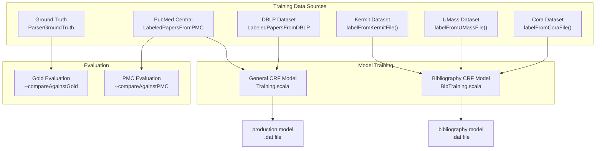
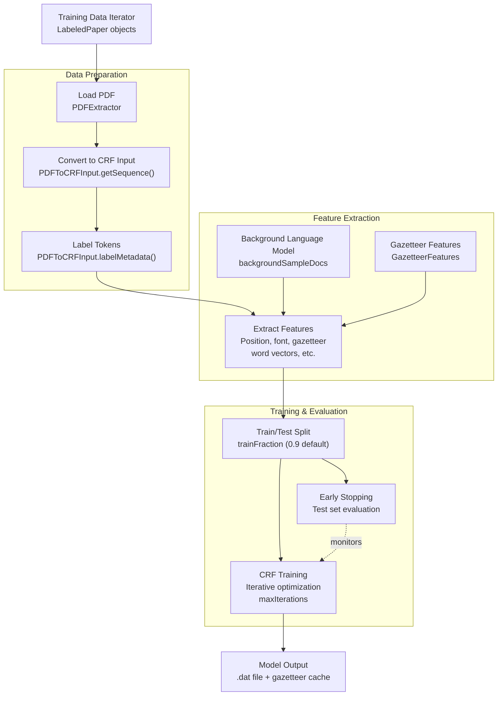
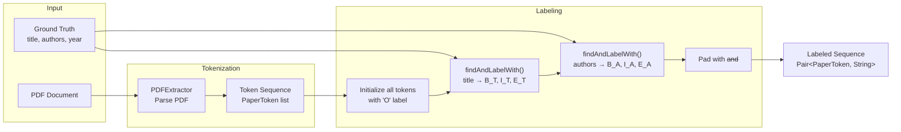
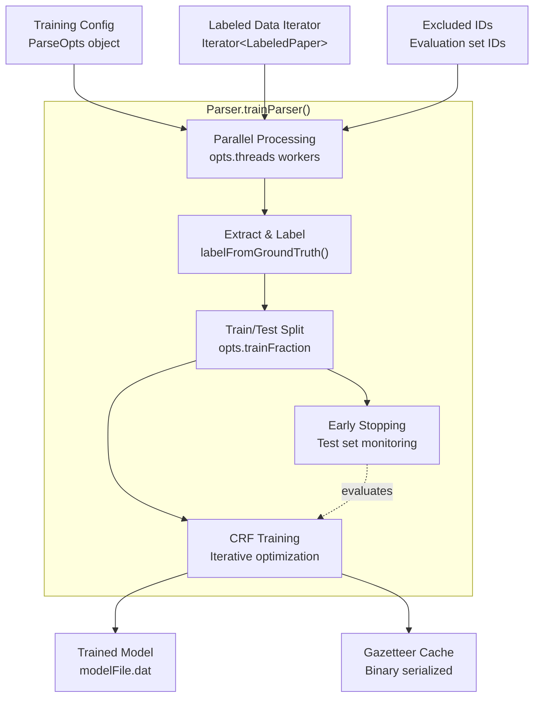
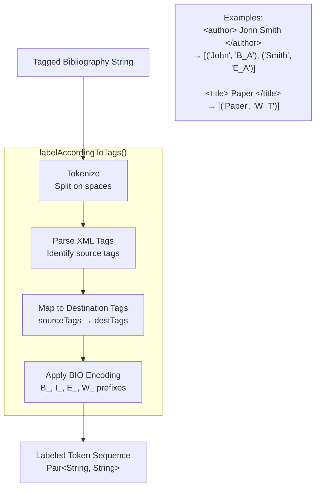
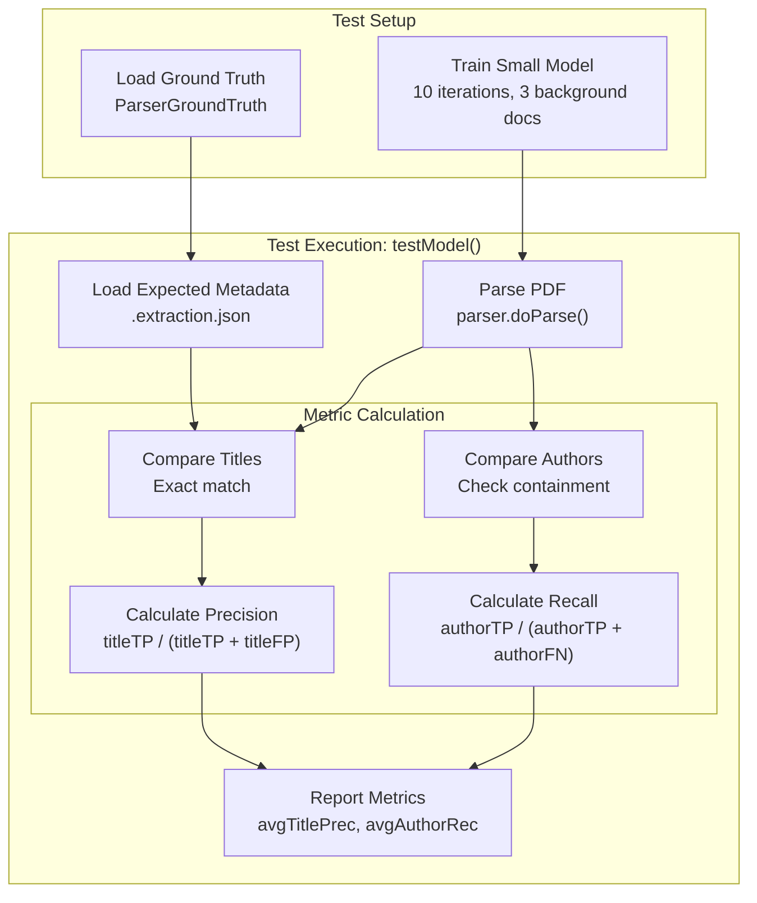
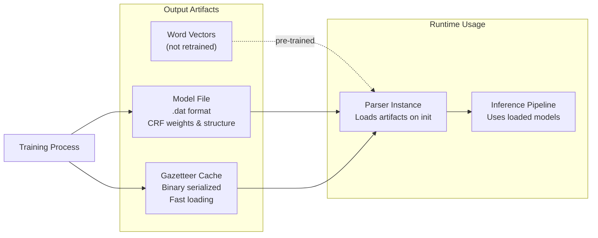

<!-- source: DeepWiki mcp.deepwiki.com · repo allenai/science-parse · page 5 Training and Evaluation · fetched 2026-10-26 -->

# Training and Evaluation

<details>
<summary>Relevant source files</summary>

The following files were used as context for generating this wiki page:

- [.circleci/config.yml](.circleci/config.yml)
- [build.sbt](build.sbt)
- [cli/README.md](cli/README.md)
- [cli/build.sbt](cli/build.sbt)
- [core/README.md](core/README.md)
- [core/build.sbt](core/build.sbt)
- [core/src/main/java/org/allenai/scienceparse/CRFBibRecordParser.java](core/src/main/java/org/allenai/scienceparse/CRFBibRecordParser.java)
- [core/src/main/java/org/allenai/scienceparse/GazetteerFeatures.java](core/src/main/java/org/allenai/scienceparse/GazetteerFeatures.java)
- [core/src/main/java/org/allenai/scienceparse/PDFDocToPartitionedText.java](core/src/main/java/org/allenai/scienceparse/PDFDocToPartitionedText.java)
- [core/src/main/java/org/allenai/scienceparse/PDFToCRFInput.java](core/src/main/java/org/allenai/scienceparse/PDFToCRFInput.java)
- [core/src/main/java/org/allenai/scienceparse/pdfapi/PDFFontMetrics.java](core/src/main/java/org/allenai/scienceparse/pdfapi/PDFFontMetrics.java)
- [core/src/main/scala/org/allenai/scienceparse/InterleavingIterator.scala](core/src/main/scala/org/allenai/scienceparse/InterleavingIterator.scala)
- [core/src/main/scala/org/allenai/scienceparse/Training.scala](core/src/main/scala/org/allenai/scienceparse/Training.scala)
- [core/src/test/java/org/allenai/scienceparse/PDFToCRFInputTest.java](core/src/test/java/org/allenai/scienceparse/PDFToCRFInputTest.java)
- [core/src/test/java/org/allenai/scienceparse/ParserTest.java](core/src/test/java/org/allenai/scienceparse/ParserTest.java)
- [server/README.md](server/README.md)
- [server/build.sbt](server/build.sbt)

</details>


This page describes how to train and evaluate models in Science Parse. SP uses machine learning models (Conditional Random Fields) to extract metadata from PDFs, and these models need to be trained on labeled data. For information about using pre-trained models for parsing, see [Core Library](#2). For information about the CRF feature engineering that powers these models, see [CRF Feature Engineering](#2.4).

---

## Overview

Science Parse uses **two CRF models** that require training:

1. **General Parser Model** - Extracts titles, authors, and years from PDF headers
2. **Bibliography Parser Model** - Extracts structured metadata from bibliography entries (title, authors, venue, year)

Additionally, the system uses two artifacts that are not trained but can be customized:

3. **Gazetteer** - Lists of known entities (journal names, person names, countries) used as features
4. **Word Vectors** - Pre-trained word embeddings

The training process converts labeled data into token sequences with features, then uses iterative optimization to learn CRF weights. The system supports multiple training data sources and includes evaluation utilities to measure model performance.

**Sources:** [core/src/main/scala/org/allenai/scienceparse/Training.scala:1-133](), [core/README.md:42-70]()

---

## Training Data Sources

Science Parse supports three primary sources of labeled training data:

| Data Source | Domain | Format | Size | Used For |
|------------|--------|--------|------|----------|
| **DBLP** | Computer Science | Structured metadata | ~34,000 papers (configurable) | General model training |
| **PMC** (PubMed Central) | Medical/Biomedical | XML + PDF pairs | Gigabytes of data | General model training, evaluation |
| **Ground Truth** | Computer Science | Manual annotations | Small set for testing | Evaluation only |
| **Cora/UMass/Kermit** | Various | XML-tagged bibliography entries | Varies | Bibliography model training |

### Data Source Details



**Sources:** [core/src/main/scala/org/allenai/scienceparse/Training.scala:30-31](), [core/src/main/scala/org/allenai/scienceparse/Training.scala:80-91](), [core/src/main/java/org/allenai/scienceparse/CRFBibRecordParser.java:122-145]()

---

## General Model Training Process

### Training Pipeline Architecture



### Entry Point: Training.scala

The main training executable is [`Training.scala`](). Run it with:

```bash
sbt "core/runMain org.allenai.scienceparse.Training --help"
```

**Key configuration parameters:**

| Parameter | Default | Description |
|-----------|---------|-------------|
| `output` | (required) | Output file path for trained model |
| `maxHeaderWords` | `Parser.MAXHEADERWORDS` | Max words to consider in header |
| `maxIterations` | 1000 | Maximum training iterations |
| `backgroundSampleDocs` | 40,000 | Documents for background language model |
| `trainFraction` | 0.9 | Fraction of data for training (vs. testing) |
| `minYear` | 2008 | Earliest publication year to include |
| `maxPaperCount` | 34,000 | Maximum labeled documents to use |
| `minExpectedFeatureCount` | 13 | Min feature occurrences to include |

**Sources:** [core/src/main/scala/org/allenai/scienceparse/Training.scala:18-31](), [core/src/main/scala/org/allenai/scienceparse/Training.scala:33-94]()

### Training Data Selection

The system supports three training modes:

1. **DBLP only** (default): `--trainOnDBLP`
   - Computer science papers
   - Retrieved via `LabeledPapersFromDBLP.get`

2. **PMC only**: `--trainOnPMC`
   - Medical/biomedical papers
   - Retrieved via `LabeledPapersFromPMC.getCleaned.drop(10000)`
   - First 10,000 reserved for evaluation

3. **Both datasets**: `--trainOnBoth`
   - Interleaves DBLP and PMC using `InterleavingIterator`
   - Provides domain diversity

**Sources:** [core/src/main/scala/org/allenai/scienceparse/Training.scala:80-91](), [core/src/main/scala/org/allenai/scienceparse/InterleavingIterator.scala:1-29]()

### Label Generation Process



The labeling system uses **BIO tagging** (Begin, Inside, Outside) with additional **W** (Whole) and **E** (End) tags:

- `B_T` - Beginning of title
- `I_T` - Inside title
- `E_T` - End of title
- `W_T` - Single-word title
- `B_A` - Beginning of author name
- `I_A` - Inside author name
- `E_A` - End of author name
- `O` - Outside any labeled span

**Sources:** [core/src/main/java/org/allenai/scienceparse/PDFToCRFInput.java:287-316](), [core/src/main/java/org/allenai/scienceparse/PDFToCRFInput.java:329-357]()

### Training Invocation

The actual training is performed by `Parser.trainParser()`:



**Sources:** [core/src/main/scala/org/allenai/scienceparse/Training.scala:96-132](), [core/src/test/java/org/allenai/scienceparse/ParserTest.java:104-124]()

### Example Training Command

```bash
sbt "core/runMain org.allenai.scienceparse.Training \
  --output my-model.dat \
  --maxIterations 1000 \
  --trainFraction 0.9 \
  --maxPaperCount 30000 \
  --trainOnBoth"
```

This trains a model on both DBLP and PMC data, using 30,000 papers, 90% for training and 10% for evaluation, with up to 1,000 iterations.

**Sources:** [core/README.md:53](), [core/src/main/scala/org/allenai/scienceparse/Training.scala:1-133]()

---

## Bibliography Model Training

The bibliography model is a separate CRF trained specifically for parsing citation strings into structured metadata (title, authors, venue, year).

### Bibliography Training Data Formats

Science Parse supports three bibliography training data formats:

#### 1. Cora Format

```xml
<author> J. Smith </author> <title> A Great Paper </title> <journal> Nature </journal> <date> 2020 </date>
```

Processed by `getLabeledLineCora()` which maps tags:
- `<author>` → `authorTag`
- `<title>` → `titleTag`
- `<journal>`, `<booktitle>` → `venueTag`
- `<date>` → `yearTag`

#### 2. UMass Format

```xml
<authors> J. Smith </authors> <title> A Great Paper </title> <journal> Nature </journal> <year> 2020 </year>
```

Processed by `getLabeledLineUMass()` with similar tag mappings.

#### 3. Kermit Format

```xml
<author> J. Smith </author> <title level="a"> A Great Paper </title> <title level="j"> Nature </title> <date> 2020 </date>
```

Processed by `getLabeledLineKermit()` which handles hierarchical title levels:
- `level="a"` (article) → `titleTag`
- `level="j"` (journal) or `level="m"` (monograph) → `venueTag`

**Sources:** [core/src/main/java/org/allenai/scienceparse/CRFBibRecordParser.java:31-42](), [core/src/main/java/org/allenai/scienceparse/CRFBibRecordParser.java:94-103](), [core/src/main/java/org/allenai/scienceparse/CRFBibRecordParser.java:105-120]()

### Bibliography Label Processing



**Sources:** [core/src/main/java/org/allenai/scienceparse/CRFBibRecordParser.java:44-92]()

### Bibliography Model Usage at Inference

The trained bibliography model is used by `CRFBibRecordParser.parseRecord()`:

1. Extract citation marker (e.g., `[1]` or `1.`)
2. Tokenize remaining text
3. Run CRF model to predict labels
4. Extract spans for title, authors, venue, year
5. Create `BibRecord` object with citation patterns

The model includes a **loading cache** (`bestGuessCache`) that caches CRF predictions for 10 minutes with a maximum of 10,240 entries to improve performance on repeated bibliography entries.

**Sources:** [core/src/main/java/org/allenai/scienceparse/CRFBibRecordParser.java:153-163](), [core/src/main/java/org/allenai/scienceparse/CRFBibRecordParser.java:165-266]()

---

## Model Evaluation

### Evaluation Entry Point

Science Parse provides `LabeledDataEvaluation` for model evaluation:

```bash
# Evaluate against gold-annotated CS papers
sbt "core/runMain org.allenai.scienceparse.LabeledDataEvaluation --compareAgainstGold"

# Evaluate against PubMed Central papers
sbt "core/runMain org.allenai.scienceparse.LabeledDataEvaluation --compareAgainstPMC"
```

**Sources:** [core/README.md:64-66]()

### Evaluation Datasets

#### Gold Annotations

The gold evaluation set consists of manually annotated Computer Science papers stored in [`ParserGroundTruth`](). The evaluation set IDs are stored in `Evaluation.goldDocIds` to ensure they are excluded from training.

#### PMC Evaluation

PubMed Central papers come with rich XML metadata that serves as ground truth. The system:
1. Downloads PDF + XML pairs
2. Parses the PDF with Science Parse
3. Compares extracted metadata against XML ground truth
4. Computes metrics

**Sources:** [core/src/main/scala/org/allenai/scienceparse/Training.scala:117-121](), [core/src/test/java/org/allenai/scienceparse/ParserTest.java:149-152]()

### Test Framework



**Sources:** [core/src/test/java/org/allenai/scienceparse/ParserTest.java:50-88](), [core/src/test/java/org/allenai/scienceparse/ParserTest.java:90-147]()

### Evaluation Metrics

The test framework computes:

| Metric | Formula | Description |
|--------|---------|-------------|
| **Title Precision** | `titleTP / (titleTP + titleFP)` | Fraction of extracted titles that match ground truth |
| **Author Recall** | `authorTP / (authorTP + authorFN)` | Fraction of ground truth authors found in extraction |

Note: Title is treated as precision/recall (assumed single title per paper), while authors use recall because there can be multiple authors per paper.

The test iterates over multiple papers and computes average metrics:

```java
double avgTitlePrec = 0.0;
double avgAuthorRec = 0.0;
for (String s : pdfKeys) {
  val res = testModel(s, p);
  avgTitlePrec += res.getOne();  // Title precision
  avgAuthorRec += res.getTwo();  // Author recall
}
avgTitlePrec /= cases;
avgAuthorRec /= cases;
```

**Sources:** [core/src/test/java/org/allenai/scienceparse/ParserTest.java:60-87](), [core/src/test/java/org/allenai/scienceparse/ParserTest.java:129-141]()

### Platform Considerations

From the documentation:

> PDF parsing is different from platform to platform, and can depend even on the locally installed packages. As such, we see different training and evaluation performance for the same code, when run on different machines. To keep things consistent, we do all our test runs on Ubuntu 14.04.5.

This means evaluation results may vary slightly across platforms due to PDF rendering differences in the underlying PDFBox library.

**Sources:** [core/README.md:70]()

---

## Model Artifacts

### Output Files

Training produces the following artifacts:



### Model Loading

The `Parser` class loads models on initialization:

1. **Production model** - Downloaded from datastore on first run
2. **Bibliography model** - Downloaded separately
3. **Gazetteer cache** - Binary serialized for fast loading
4. **Word vectors** - Pre-trained embeddings

Custom models can be specified:
```java
Parser p = new Parser(
  new File("my-model.dat"),
  new File("my-gazetteer.dat"),
  new File("my-bib-model.dat")
);
```

**Sources:** [core/README.md:44-50](), [core/README.md:58]()

### Gazetteer Cache Optimization

The gazetteer is stored as binary-serialized `LongHashSet` objects for performance:

```java
private LongHashSet[] hashSets;  // One per gazetteer
private String[] hashNames;      // Gazetteer names

public boolean inSet(String s, int i) {
  long hc = StringLongHash.hash(t(s));
  return hashSets[i].contains(hc);
}
```

This provides O(1) lookup for gazetteer membership, which is crucial since gazetteer features are computed for every token during both training and inference.

**Sources:** [core/src/main/java/org/allenai/scienceparse/GazetteerFeatures.java:28-96]()

---

## CI/CD Integration

The CircleCI configuration runs tests on every commit:

```yaml
- run:
    name: Test package
    command: cat /dev/null | sbt test
```

This executes all test classes including `ParserTest` which trains a small model and evaluates it, ensuring the training pipeline remains functional.

**Sources:** [.circleci/config.yml:26-28]()

---

