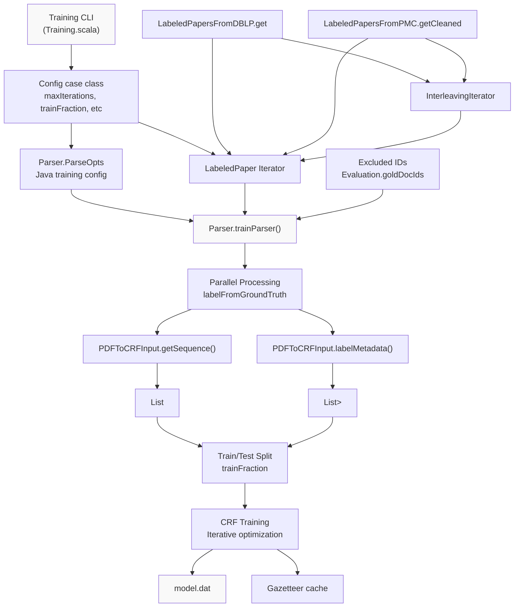
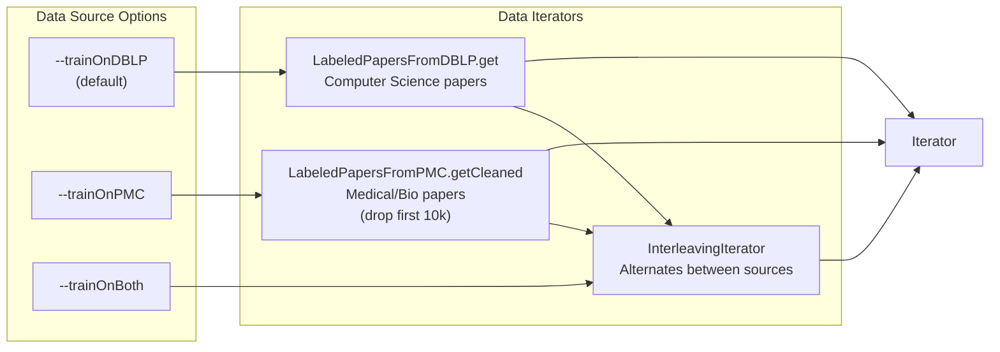
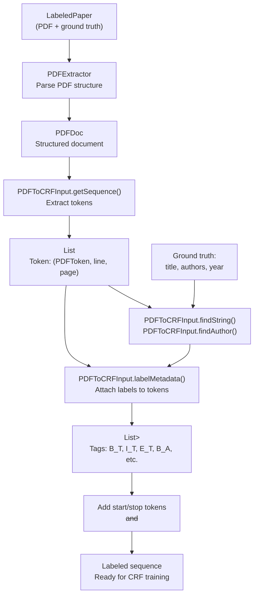
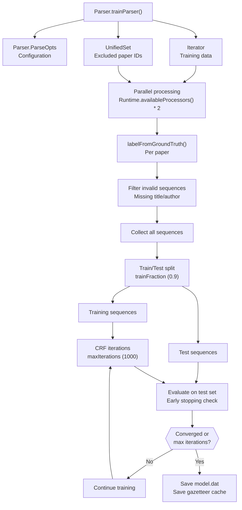

<!-- source: DeepWiki mcp.deepwiki.com · repo allenai/science-parse · page 5.1 Training the Main CRF Model · fetched 2026-10-26 -->

# Training the Main CRF Model

<details>
<summary>Relevant source files</summary>

The following files were used as context for generating this wiki page:

- [.circleci/config.yml](.circleci/config.yml)
- [cli/README.md](cli/README.md)
- [core/README.md](core/README.md)
- [core/src/main/java/org/allenai/scienceparse/PDFDocToPartitionedText.java](core/src/main/java/org/allenai/scienceparse/PDFDocToPartitionedText.java)
- [core/src/main/java/org/allenai/scienceparse/PDFToCRFInput.java](core/src/main/java/org/allenai/scienceparse/PDFToCRFInput.java)
- [core/src/main/java/org/allenai/scienceparse/pdfapi/PDFFontMetrics.java](core/src/main/java/org/allenai/scienceparse/pdfapi/PDFFontMetrics.java)
- [core/src/main/scala/org/allenai/scienceparse/InterleavingIterator.scala](core/src/main/scala/org/allenai/scienceparse/InterleavingIterator.scala)
- [core/src/main/scala/org/allenai/scienceparse/Training.scala](core/src/main/scala/org/allenai/scienceparse/Training.scala)
- [core/src/test/java/org/allenai/scienceparse/PDFToCRFInputTest.java](core/src/test/java/org/allenai/scienceparse/PDFToCRFInputTest.java)
- [core/src/test/java/org/allenai/scienceparse/ParserTest.java](core/src/test/java/org/allenai/scienceparse/ParserTest.java)
- [server/README.md](server/README.md)

</details>


This page describes how to train the general CRF (Conditional Random Field) model used by Science Parse for extracting paper metadata (title, authors, and year) from PDF headers. This model is distinct from the bibliography-specific CRF model used for parsing citations (see [Training the Bibliography Model](#5.2)).

The main CRF model operates on token sequences extracted from PDF documents and uses features derived from font metrics, layout information, and gazetteer lookups to identify metadata fields. Training produces a `.dat` model file and an optimized gazetteer cache that are loaded during inference.

## Training Entry Point

The primary interface for training is the `Training` Scala object at [core/src/main/scala/org/allenai/scienceparse/Training.scala:14-133](). This provides a command-line interface with configurable options for all training parameters.

**Basic usage:**
```
sbt "core/runMain org.allenai.scienceparse.Training --output model.dat"
```

This command trains a model with default parameters (matching those used for the production model) and saves it to `model.dat`.

**Sources:** [core/src/main/scala/org/allenai/scienceparse/Training.scala:14-133]()

## Training Architecture



The training pipeline begins with the `Training` object parsing command-line arguments into a `Config` object, which is then converted to `Parser.ParseOpts` for the Java training code. An iterator over `LabeledPaper` instances is constructed from one or more data sources, and paper IDs from the evaluation set are excluded. The `Parser.trainParser()` method orchestrates parallel processing to convert PDFs into labeled token sequences, splits them into train/test sets, and performs iterative CRF optimization.

**Sources:** [core/src/main/scala/org/allenai/scienceparse/Training.scala:14-133](), [core/src/test/java/org/allenai/scienceparse/ParserTest.java:104-124]()

## Configuration Options

Training configuration is specified through the `Config` case class at [core/src/main/scala/org/allenai/scienceparse/Training.scala:18-31]() and converted to `Parser.ParseOpts` at [core/src/main/scala/org/allenai/scienceparse/Training.scala:97-115]().

| Parameter | Type | Default | Description |
|-----------|------|---------|-------------|
| `output` | `File` | (required) | Output path for the trained model `.dat` file |
| `maxHeaderWords` | `Int` | `Parser.MAXHEADERWORDS` | Maximum words to consider as header when boundary unknown |
| `maxIterations` | `Int` | 1000 | Maximum CRF training iterations |
| `backgroundSampleDocs` | `Int` | 40000 | Number of documents for background language model |
| `backgroundDirectory` | `Option[File]` | `publicDirectory("productionBackgroundDocs", 1)` | Directory containing background documents |
| `gazetteerFile` | `Option[File]` | `Parser.getDefaultGazetteer` | Gazetteer JSON file with entity lists |
| `trainFraction` | `Double` | 0.9 | Fraction of data for training (remainder for test) |
| `minYear` | `Int` | 2008 | Earliest publication year to accept |
| `maxPaperCount` | `Int` | 34000 | Maximum number of labeled documents |
| `excludeIdsFile` | `Option[File]` | `None` | File with paper IDs to exclude (one per line) |
| `minExpectedFeatureCount` | `Int` | 13 | Minimum feature occurrences before inclusion |
| `trainingData` | `Iterator[LabeledPaper]` | `LabeledPapersFromDBLP.get` | Source of labeled training data |

**Example with custom parameters:**
```
sbt "core/runMain org.allenai.scienceparse.Training \
  --output custom_model.dat \
  --maxIterations 500 \
  --trainFraction 0.85 \
  --maxPaperCount 20000 \
  --trainOnBoth"
```

**Sources:** [core/src/main/scala/org/allenai/scienceparse/Training.scala:18-31](), [core/src/main/scala/org/allenai/scienceparse/Training.scala:97-115]()

## Training Data Sources

Science Parse supports three training data sources, selectable via command-line flags:



### DBLP (Default)
- **Flag:** `--trainOnDBLP` (default behavior)
- **Source:** `LabeledPapersFromDBLP.get` at [core/src/main/scala/org/allenai/scienceparse/Training.scala:81-82]()
- **Domain:** Computer Science
- **Description:** Provides labeled papers from the DBLP bibliography database

### PMC (PubMed Central)
- **Flag:** `--trainOnPMC`
- **Source:** `LabeledPapersFromPMC.getCleaned.drop(10000)` at [core/src/main/scala/org/allenai/scienceparse/Training.scala:84-86]()
- **Domain:** Medical and Biological Sciences
- **Description:** Provides papers from PubMed Central with rich XML metadata. The first 10,000 papers are reserved for evaluation (see [Model Evaluation](#5.3))

### Combined (DBLP + PMC)
- **Flag:** `--trainOnBoth`
- **Source:** `InterleavingIterator` at [core/src/main/scala/org/allenai/scienceparse/Training.scala:89-91]()
- **Description:** Alternates between DBLP and PMC sources using [core/src/main/scala/org/allenai/scienceparse/InterleavingIterator.scala:1-30]() to provide domain diversity

**Exclusion mechanism:** Training always excludes papers from the evaluation gold set (`Evaluation.goldDocIds`) at [core/src/main/scala/org/allenai/scienceparse/Training.scala:117-121]() to prevent train/test contamination.

**Sources:** [core/src/main/scala/org/allenai/scienceparse/Training.scala:80-92](), [core/src/main/scala/org/allenai/scienceparse/InterleavingIterator.scala:1-30]()

## Data Preparation Pipeline

The training process converts raw `LabeledPaper` instances (containing PDFs and ground truth metadata) into labeled token sequences suitable for CRF training. This happens in parallel through the `labelFromGroundTruth` method (called within `Parser.trainParser()`).



### Token Extraction

Token sequences are extracted via `PDFToCRFInput.getSequence()` at [core/src/main/java/org/allenai/scienceparse/PDFToCRFInput.java:253-260](), which iterates through pages and lines, creating `PaperToken` instances that wrap `PDFToken` objects with line and page numbers.

### Ground Truth Labeling

The `PDFToCRFInput.labelMetadata()` method at [core/src/main/java/org/allenai/scienceparse/PDFToCRFInput.java:329-357]() performs the core labeling logic:

1. **Initialize:** Create a list of `(token, "O")` pairs (all tokens start as "Other")
2. **Find title:** Use `findString()` at [core/src/main/java/org/allenai/scienceparse/PDFToCRFInput.java:114-135]() to locate the exact title string
3. **Find authors:** Use `findAuthor()` at [core/src/main/java/org/allenai/scienceparse/PDFToCRFInput.java:188-191]() for each author, which uses flexible pattern matching to handle abbreviations
4. **Apply labels:** Mark token spans with BIO tags (Begin, Inside, End) or W (Whole) for single-token spans

**Label format:**
- Title: `B_T`, `I_T`, `E_T`, `W_T`
- Author: `B_A`, `I_A`, `E_A`, `W_A`
- Other: `O`
- Start/Stop: `<S>`, `</S>`

See test example at [core/src/test/java/org/allenai/scienceparse/PDFToCRFInputTest.java:52-73]().

### Author Pattern Matching

Author finding uses sophisticated pattern matching at [core/src/main/java/org/allenai/scienceparse/PDFToCRFInput.java:137-186]() to handle:
- Abbreviated first/middle names (e.g., "M. C." matching "Marco C.")
- Optional middle initials (e.g., "Marco Baroni" matching "Marco C. Baroni")
- Footnote markers after names
- Case-insensitive matching

**Sources:** [core/src/main/java/org/allenai/scienceparse/PDFToCRFInput.java:253-260](), [core/src/main/java/org/allenai/scienceparse/PDFToCRFInput.java:329-357](), [core/src/main/java/org/allenai/scienceparse/PDFToCRFInput.java:114-135](), [core/src/main/java/org/allenai/scienceparse/PDFToCRFInput.java:188-191](), [core/src/test/java/org/allenai/scienceparse/PDFToCRFInputTest.java:52-73]()

## Feature Engineering

Each `PaperToken` carries features derived from the underlying `PDFToken` and its context. While the feature extraction code itself is not shown in the provided files, the `PaperToken` class encapsulates the following information used for feature generation:

- **Token string:** The actual text
- **Font metrics:** Font name, size, and space width from `PDFFontMetrics` at [core/src/main/java/org/allenai/scienceparse/pdfapi/PDFFontMetrics.java:1-39]()
- **Position:** Line number and page number
- **Bounds:** X/Y coordinates via helper methods at [core/src/main/java/org/allenai/scienceparse/PDFToCRFInput.java:204-244]()

Features typically include:
- Token text and n-gram features
- Font family, size, and style (bold, italic)
- Positional features (distance from page edges)
- Layout features (line breaks, indentation)
- Gazetteer features (matching against known author/venue lists)
- Background language model scores

The gazetteer system is documented separately in [Gazetteer System](#2.6).

**Sources:** [core/src/main/java/org/allenai/scienceparse/pdfapi/PDFFontMetrics.java:1-39](), [core/src/main/java/org/allenai/scienceparse/PDFToCRFInput.java:204-244]()

## Training Execution



### Execution Flow

1. **Parallel label generation:** The training code uses `opts.threads` (default: 2× CPU count at [core/src/main/scala/org/allenai/scienceparse/Training.scala:101]()) to process papers in parallel
2. **Sequence validation:** Papers that fail to label (missing title or required authors) are filtered out at [core/src/main/java/org/allenai/scienceparse/PDFToCRFInput.java:335-351]()
3. **Dataset splitting:** Uses `trainFraction` (default 0.9) to create train/test sets
4. **Iterative optimization:** CRF parameters are optimized for up to `maxIterations` (default 1000) iterations
5. **Evaluation:** Test set performance is monitored for early stopping
6. **Model serialization:** Final model and optimized gazetteer cache are written to disk

### Performance Considerations

- **Memory:** Training can require substantial memory. The test at [core/src/test/java/org/allenai/scienceparse/ParserTest.java:90-147]() shows a minimal example with only 3 background samples and 10 iterations
- **Threading:** Set via `opts.threads` at [core/src/main/scala/org/allenai/scienceparse/Training.scala:101]()
- **Feature filtering:** `minExpectedFeatureCount` (default 13) at [core/src/main/scala/org/allenai/scienceparse/Training.scala:115]() controls feature inclusion threshold
- **Background samples:** `backgroundSampleDocs` (default 40000) at [core/src/main/scala/org/allenai/scienceparse/Training.scala:102]() controls language model size

**Sources:** [core/src/main/scala/org/allenai/scienceparse/Training.scala:96-132](), [core/src/test/java/org/allenai/scienceparse/ParserTest.java:90-147]()

## Output Artifacts

Training produces two primary artifacts:

### Model File (`.dat`)
- **Location:** Specified by `--output` flag or `opts.modelFile`
- **Format:** Binary serialized CRF model
- **Contents:** Feature weights, transition parameters, label inventory
- **Usage:** Loaded via `Parser` constructor for inference

### Gazetteer Cache
- **Format:** Binary serialization of gazetteer lookups
- **Purpose:** Optimizes startup time compared to parsing raw JSON
- **Contents:** Pre-computed entity lookups for author names, venues, etc.

The production model and gazetteer are downloaded automatically on first use from the datastore, as documented in [Getting Started](#1.2).

**Sources:** [core/src/main/scala/org/allenai/scienceparse/Training.scala:131-132]()

## Testing and Validation

The test suite provides examples of end-to-end training:

### Test Case: ParserTest.testParserWithGroundTruth()

Located at [core/src/test/java/org/allenai/scienceparse/ParserTest.java:90-147](), this test demonstrates:

1. Creating a minimal `Parser.ParseOpts` configuration at [core/src/test/java/org/allenai/scienceparse/ParserTest.java:104-114]()
2. Loading ground truth from a JSON file via `LabeledPapersFromDBLP.getFromGroundTruth()` at [core/src/test/java/org/allenai/scienceparse/ParserTest.java:119-122]()
3. Calling `Parser.trainParser()` at [core/src/test/java/org/allenai/scienceparse/ParserTest.java:124]()
4. Instantiating the trained model at [core/src/test/java/org/allenai/scienceparse/ParserTest.java:125-128]()
5. Evaluating title precision and author recall at [core/src/test/java/org/allenai/scienceparse/ParserTest.java:129-142]()

This test uses minimal settings:
- 10 iterations
- 4 threads
- 3 background samples
- 0.9 train fraction
- No author checking during training

**Sources:** [core/src/test/java/org/allenai/scienceparse/ParserTest.java:90-147]()

## Related Pages

- For training bibliography-specific models, see [Training the Bibliography Model](#5.2)
- For evaluating trained models, see [Model Evaluation](#5.3)
- For understanding CRF features, see [CRF Feature Engineering](#2.4)
- For information about the gazetteer, see [Gazetteer System](#2.6)

---

