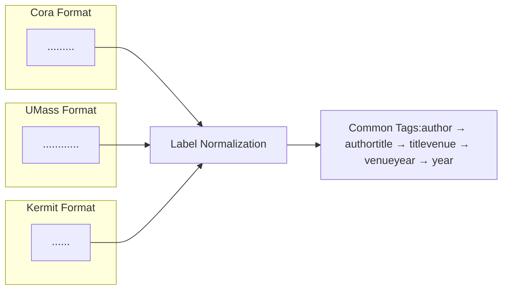
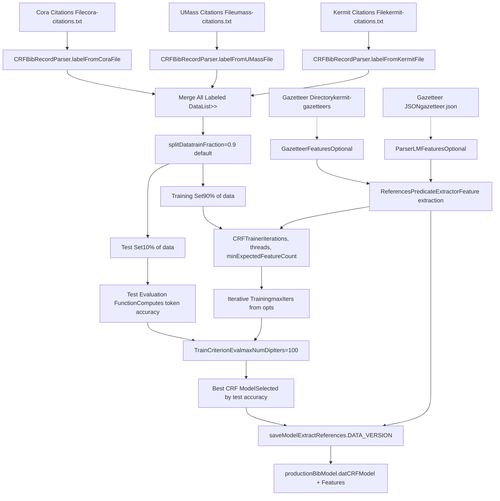
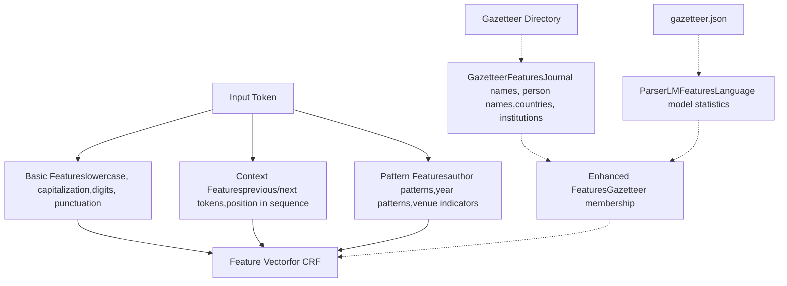
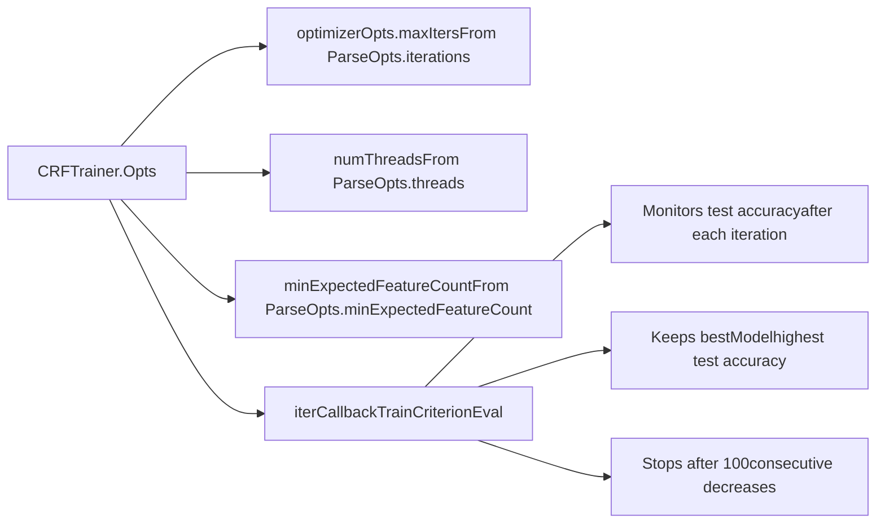
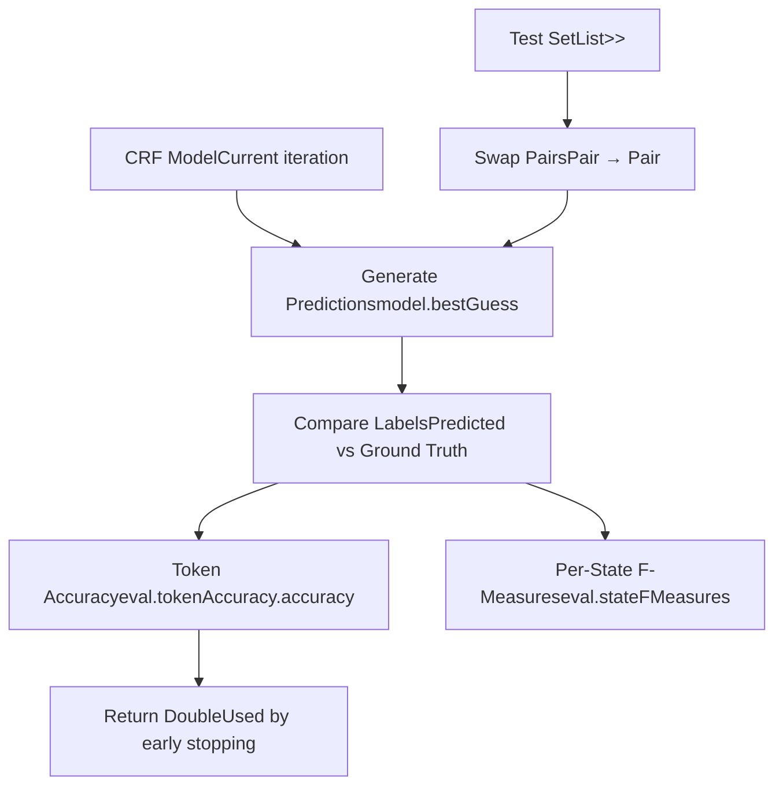
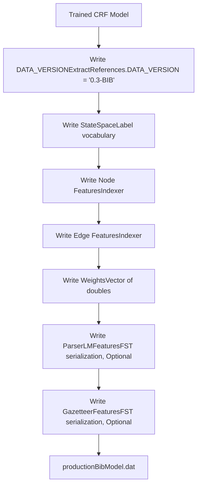

<!-- source: DeepWiki mcp.deepwiki.com · repo allenai/science-parse · page 5.2 Training the Bibliography Model · fetched 2026-10-26 -->

# Training the Bibliography Model

<details>
<summary>Relevant source files</summary>

The following files were used as context for generating this wiki page:

- [build.sbt](build.sbt)
- [cli/build.sbt](cli/build.sbt)
- [core/build.sbt](core/build.sbt)
- [core/src/main/java/org/allenai/scienceparse/CRFBibRecordParser.java](core/src/main/java/org/allenai/scienceparse/CRFBibRecordParser.java)
- [core/src/main/java/org/allenai/scienceparse/CheckReferences.java](core/src/main/java/org/allenai/scienceparse/CheckReferences.java)
- [core/src/main/java/org/allenai/scienceparse/ExtractReferences.java](core/src/main/java/org/allenai/scienceparse/ExtractReferences.java)
- [core/src/main/java/org/allenai/scienceparse/GazetteerFeatures.java](core/src/main/java/org/allenai/scienceparse/GazetteerFeatures.java)
- [core/src/main/java/org/allenai/scienceparse/Parser.java](core/src/main/java/org/allenai/scienceparse/Parser.java)
- [core/src/main/java/org/allenai/scienceparse/pdfapi/PDFExtractor.java](core/src/main/java/org/allenai/scienceparse/pdfapi/PDFExtractor.java)
- [server/build.sbt](server/build.sbt)

</details>


This page describes how to train the bibliography-specific CRF model used by Science Parse for parsing citation strings. This model is separate from the main document parsing model and is specifically designed to extract structured fields (title, authors, venue, year) from raw bibliography entries.

For training the main document parser model, see [Training the Main CRF Model](#5.1). For evaluating trained models, see [Model Evaluation](#5.3).

## Overview

The bibliography model is a Conditional Random Field (CRF) that learns to segment and label tokens in citation strings. Unlike the main parser which processes PDF tokens, the bibliography model operates on plain text citation strings extracted from reference sections.

The trained model is used by `CRFBibRecordParser` during reference extraction as one of several fallback strategies. When multiple bibliography format extractors compete to parse a reference section (see [Reference and Citation Extraction](#2.3)), those using CRF-based parsing typically produce higher-quality results than pure regex-based parsers.

**Key Components:**
- **Training function**: `Parser.trainBibliographyCRF`
- **Model class**: `CRFBibRecordParser`
- **Feature extractor**: `ReferencesPredicateExtractor`
- **Model format version**: `ExtractReferences.DATA_VERSION = "0.3-BIB"`

Sources: [core/src/main/java/org/allenai/scienceparse/Parser.java:492-581](), [core/src/main/java/org/allenai/scienceparse/CRFBibRecordParser.java]()

## Training Data Formats

The bibliography model can be trained on three labeled citation corpus formats: Cora, UMass, and Kermit. Each uses XML-style tags to annotate different fields within citation strings.

### Format Specifications



### Tag Mappings

| Source Format | Source Tag | Normalized Tag | Notes |
|--------------|------------|----------------|-------|
| Cora | `<author>` | `author` | Author names |
| Cora | `<title>` | `title` | Paper title |
| Cora | `<journal>`, `<booktitle>`, `<tech>` | `venue` | Publication venue |
| Cora | `<date>` | `year` | Publication year |
| UMass | `<authors>` | `author` | Author names |
| UMass | `<title>` | `title` | Paper title |
| UMass | `<journal>`, `<booktitle>`, `<thesis>` | `venue` | Publication venue |
| UMass | `<year>` | `year` | Publication year |
| Kermit | `<author>` | `author` | Author names |
| Kermit | `<title level="a">` | `title` | Article title |
| Kermit | `<title level="j">`, `<title level="m">` | `venue` | Journal/book title |
| Kermit | `<date>` | `year` | Publication year |

### BIO Tagging Scheme

The normalized labels are converted to BIO (Begin-Inside-Outside) format for CRF training:

- **B_tag**: Beginning of a span
- **I_tag**: Inside a span (continuation)
- **E_tag**: End of a span
- **W_tag**: Whole span (single token)
- **O**: Outside any span

Example transformation:
```
Input:  <author> John Smith </author> , <title> A Survey </title>
Tokens: [<S>, John, Smith, ,, A, Survey, </S>]
Labels: [<S>, B_author, E_author, O, B_title, E_title, </S>]
```

Sources: [core/src/main/java/org/allenai/scienceparse/CRFBibRecordParser.java:31-145]()

## Training Process Flow



### Training Function Signature

The main entry point is `Parser.trainBibliographyCRF`:

```java
public static void trainBibliographyCRF(
    final File bibsGroundTruthDirectory,
    final ParseOpts opts
)

// Or with explicit files:
public static void trainBibliographyCRF(
    File coraTrainFile, 
    File umassTrainFile, 
    File kermitTrainFile, 
    ParseOpts opts
)
```

### ParseOpts Configuration

The training process is controlled by a `ParseOpts` object with the following relevant fields:

| Field | Type | Purpose | Default |
|-------|------|---------|---------|
| `modelFile` | String | Output path for trained model | Required |
| `gazetteerDir` | String | Directory with gazetteer files | Optional (null) |
| `gazetteerFile` | String | JSON gazetteer for language model | Optional (null) |
| `backgroundDirectory` | String | Background corpus directory | Required if using LM features |
| `backgroundSamples` | int | Number of background samples | Required if using LM features |
| `trainFraction` | double | Fraction of data for training | 0.9 |
| `iterations` | int | Maximum CRF training iterations | Configurable |
| `threads` | int | Number of parallel threads | Runtime.availableProcessors() |
| `minExpectedFeatureCount` | double | Feature pruning threshold | Configurable |

Sources: [core/src/main/java/org/allenai/scienceparse/Parser.java:492-581]()

## Feature Engineering for Bibliography

The `ReferencesPredicateExtractor` generates features for each token in a citation string. These features help the CRF model learn patterns for identifying different citation components.

### Core Feature Extractor



### GazetteerFeatures

If a gazetteer directory is provided (`opts.gazetteerDir`), the system loads gazetteers for various entity types:

- **Purpose**: Improve recognition of known entities in citations
- **Format**: One file per gazetteer type, one entry per line
- **Encoding**: String entries are hashed for efficient lookup
- **Maximum length**: 7 words per entry
- **Preprocessing**: Lowercase, punctuation removal, whitespace normalization

The gazetteer directory should contain files like:
- `journals.txt` - Known journal names
- `conferences.txt` - Known conference names
- `authors.txt` - Common author names
- `institutions.txt` - Institution names

Example gazetteer entry processing:
```
Input:  "Proceedings of the VLDB Endowment"
Transform: "proceedings of the vldb endowment"
Hash: Long hash code for efficient lookup
```

### ParserLMFeatures

If a gazetteer JSON file is provided (`opts.gazetteerFile`), the system computes language model features:

- **Background corpus**: Required via `opts.backgroundDirectory`
- **Statistics**: Word frequencies, bigrams, trigrams from training data
- **Purpose**: Capture distributional patterns of words in different citation fields

Sources: [core/src/main/java/org/allenai/scienceparse/ReferencesPredicateExtractor.java](), [core/src/main/java/org/allenai/scienceparse/GazetteerFeatures.java:1-150]()

## Training Configuration and Execution

### Setting Up Training Options



### Training Loop

The CRF training proceeds as follows:

1. **Initialization**: Create `CRFTrainer` with training data and feature extractor
2. **Iteration**: For each training iteration (up to `maxIters`):
   - Compute gradients on training data
   - Update model weights using L-BFGS optimizer
   - Invoke iteration callback (`TrainCriterionEval`)
3. **Evaluation**: After each iteration:
   - Compute token accuracy on test set
   - If accuracy improves, save as best model
   - Track number of consecutive decreases
4. **Early stopping**: Stop if accuracy hasn't improved for 100 iterations
5. **Output**: Return the model with best test accuracy

### Parallel Processing

Training uses parallel processing for efficiency:
- **Thread pool**: Created with `opts.threads` workers
- **MROpts**: Parallel map-reduce operations for evaluation
- **Executor ID**: `"mr-crf-bib-train-eval"`

Sources: [core/src/main/java/org/allenai/scienceparse/Parser.java:534-581]()

## Model Evaluation Metrics

### Token-Level Accuracy

The primary evaluation metric is token-level accuracy:

```
Token Accuracy = (Number of correctly labeled tokens) / (Total tokens)
```

The `Evaluation.compute` method computes this by comparing predicted labels against ground truth labels in the test set.

### Evaluation Function



The evaluation runs in parallel using a map-reduce framework with the specified number of threads.

Sources: [core/src/main/java/org/allenai/scienceparse/Parser.java:549-566]()

## Model Serialization

### Save Format

The trained bibliography model is saved using a specific serialization format that ensures compatibility with the `ExtractReferences` loader:



### Serialization Code Path

The model is saved via `Parser.saveModel` with the bibliography-specific version:

1. **Version string**: `ExtractReferences.DATA_VERSION` identifies the format
2. **CRF components**: State space, feature indexers, weights
3. **Feature objects**: Language model and gazetteer features (if used)
4. **Serialization**: FST (Fast-Serialization) for efficient binary encoding

### Loading Process

The saved model is loaded by `ExtractReferences.loadModel`:

```java
public static CRFModel<String, String, String> loadModel(DataInputStream dis)
```

This creates a `CRFModel<String, String, String>` where:
- First `String`: State/label type (e.g., "B_author", "I_title")
- Second `String`: Observation type (token string)
- Third `String`: State/label type (output)

Sources: [core/src/main/java/org/allenai/scienceparse/Parser.java:722-755](), [core/src/main/java/org/allenai/scienceparse/ExtractReferences.java:172-210]()

## Integration with Reference Extraction

### CRFBibRecordParser Usage

Once trained, the bibliography model is used by `CRFBibRecordParser` to parse individual citation strings:

```mermaid
graph LR
    Input["Citation String<lb/>'[1] J. Smith. Title. Venue 2020.'"]
    
    Input --> Strip["Strip Citation Marker<lb/>Extract '[1]' or '1.'"]
    Strip --> Tokenize["Tokenize<lb/>Split on whitespace"]
    
    Tokenize --> Tokens["Token List<lb/>['<S>', 'J.', 'Smith.', ..., '</S>']"]
    
    Tokens --> Cache["bestGuessCache<lb/>LoadingCache<lb/>10min TTL, 10240 entries"]
    
    Cache --> CRF["CRF Model Inference<lb/>model.bestGuess"]
    
    CRF --> Labels["Label Sequence<lb/>['<S>', 'B_author', 'I_author', ...]"]
    
    Labels --> Pad["Pad Tag Sequence<lb/>PDFToCRFInput.padTagSequence"]
    Pad --> Spans["Extract Spans<lb/>ExtractedMetadata.getSpans"]
    
    Spans --> Fields["Extracted Fields<lb/>title, authors, venue, year"]
    Fields --> BibRecord["BibRecord Object<lb/>With cite regex patterns"]
```



### Caching Strategy

The `CRFBibRecordParser` uses a Guava `LoadingCache` to avoid redundant inference:

- **Max size**: 10,240 entries
- **Expiration**: 10 minutes after access
- **Key**: `ArrayList<String>` (token list)
- **Value**: `List<String>` (label sequence)

This significantly speeds up reference extraction when the same citation appears multiple times or similar citations are processed in sequence.

### Integration Points

The trained model integrates with the extraction system at multiple levels:

1. **Direct use**: `CRFBibRecordParser` for CRF-based parsing
2. **Fallback chain**: Combined with regex parsers in `BibStractor` implementations
3. **Strategy tournament**: Competes with other extraction strategies
4. **Gazetteer scoring**: Results validated against known papers

Sources: [core/src/main/java/org/allenai/scienceparse/CRFBibRecordParser.java:23-272](), [core/src/main/java/org/allenai/scienceparse/ExtractReferences.java:59-157]()

## Example Training Command

While Science Parse doesn't expose a direct CLI for bibliography model training, the training can be invoked programmatically:

```java
import org.allenai.scienceparse.Parser;
import org.allenai.scienceparse.ParseOpts;
import java.io.File;

// Configure training options
ParseOpts opts = new ParseOpts();
opts.modelFile = "path/to/output/bibModel.dat";
opts.gazetteerDir = "path/to/kermit-gazetteers";  // Optional
opts.gazetteerFile = "path/to/gazetteer.json";    // Optional
opts.backgroundDirectory = "path/to/background";   // If using gazetteerFile
opts.backgroundSamples = 10000;                    // If using gazetteerFile
opts.trainFraction = 0.9;
opts.iterations = 1000;
opts.threads = 8;
opts.minExpectedFeatureCount = 5.0;

// Train with separate files
File coraFile = new File("data/cora-citations.txt");
File umassFile = new File("data/umass-citations.txt");
File kermitFile = new File("data/kermit-citations.txt");

Parser.trainBibliographyCRF(coraFile, umassFile, kermitFile, opts);

// Or train from directory containing these files
File bibDir = new File("data/bibliography-training");
Parser.trainBibliographyCRF(bibDir, opts);
```

The default production model was trained on a combination of all three corpora with gazetteer features enabled.

Sources: [core/src/main/java/org/allenai/scienceparse/Parser.java:492-581]()

---

