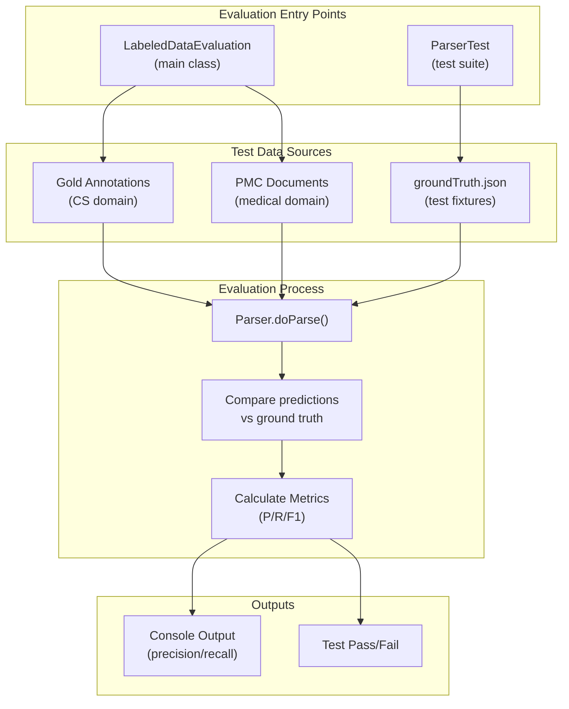
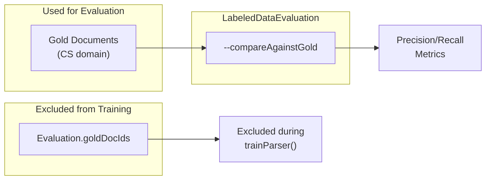
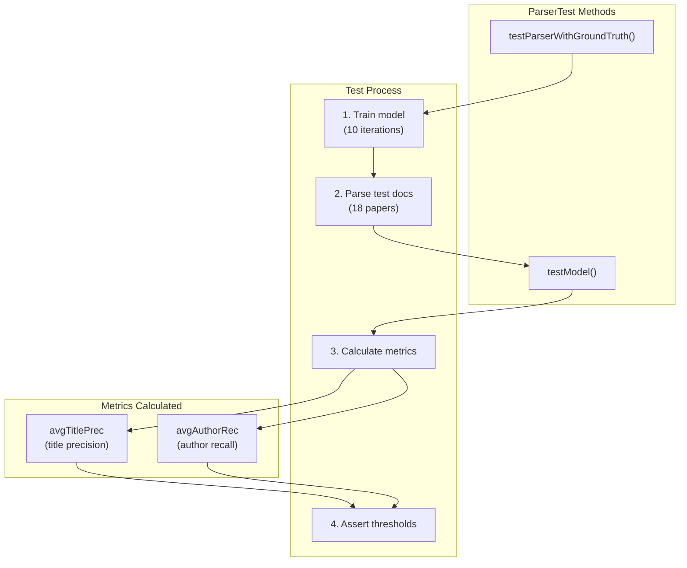
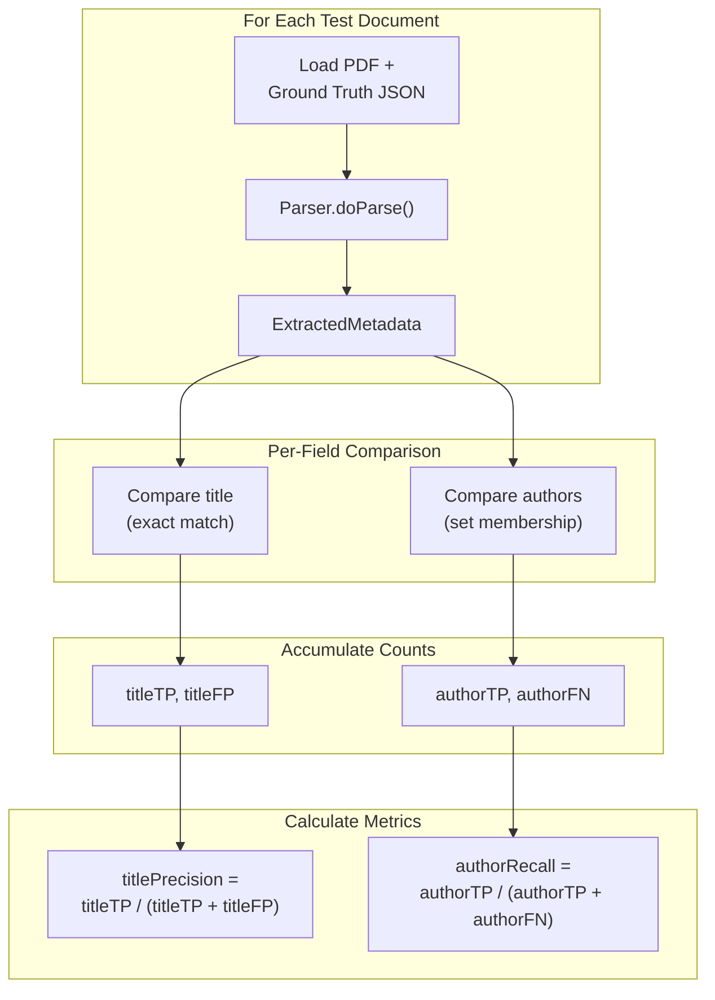

<!-- source: DeepWiki mcp.deepwiki.com · repo allenai/science-parse · page 5.3 Model Evaluation · fetched 2026-10-26 -->

# Model Evaluation

<details>
<summary>Relevant source files</summary>

The following files were used as context for generating this wiki page:

- [.circleci/config.yml](.circleci/config.yml)
- [cli/README.md](cli/README.md)
- [core/README.md](core/README.md)
- [core/src/main/java/org/allenai/scienceparse/PDFDocToPartitionedText.java](core/src/main/java/org/allenai/scienceparse/PDFDocToPartitionedText.java)
- [core/src/main/java/org/allenai/scienceparse/PDFToCRFInput.java](core/src/main/java/org/allenai/scienceparse/PDFToCRFInput.java)
- [core/src/main/java/org/allenai/scienceparse/pdfapi/PDFFontMetrics.java](core/src/main/java/org/allenai/scienceparse/pdfapi/PDFFontMetrics.java)
- [core/src/main/scala/org/allenai/scienceparse/InterleavingIterator.scala](core/src/main/scala/org/allenai/scienceparse/InterleavingIterator.scala)
- [core/src/main/scala/org/allenai/scienceparse/Training.scala](core/src/main/scala/org/allenai/scienceparse/Training.scala)
- [core/src/test/java/org/allenai/scienceparse/PDFToCRFInputTest.java](core/src/test/java/org/allenai/scienceparse/PDFToCRFInputTest.java)
- [core/src/test/java/org/allenai/scienceparse/ParserTest.java](core/src/test/java/org/allenai/scienceparse/ParserTest.java)
- [server/README.md](server/README.md)

</details>


## Purpose and Scope

This document describes the evaluation procedures, metrics, test data sources, and tools used to measure the performance of Science Parse models. Evaluation validates both the main CRF model for header extraction and the bibliography model.

For information about training models, see [Training the Main CRF Model](#5.1) and [Training the Bibliography Model](#5.2). For information about the Parser class and inference, see [Parser Class](#2.1).

## Overview

Science Parse uses multiple evaluation approaches to measure model quality across different domains and data sources. The evaluation system supports both automated testing during development and comprehensive benchmark evaluations using large labeled datasets.



**Sources:** [core/README.md](), [core/src/test/java/org/allenai/scienceparse/ParserTest.java](), [core/src/main/scala/org/allenai/scienceparse/Training.scala]()

## Evaluation Data Sources

### Gold Annotations

The primary evaluation dataset consists of gold-annotated documents from the Computer Science domain. These documents have been manually labeled with correct titles, authors, and other metadata. The gold document IDs are referenced in the training configuration to ensure they are excluded from training data.



The gold document IDs are stored in `Evaluation.goldDocIds` and automatically excluded during training via [core/src/main/scala/org/allenai/scienceparse/Training.scala:117-121]().

**Sources:** [core/README.md:64-66](), [core/src/main/scala/org/allenai/scienceparse/Training.scala:117]()

### PMC Documents

PubMed Central (PMC) provides an extensive source of evaluation data from the medical domain. PMC documents include rich XML metadata describing the PDF contents, which serves as ground truth for evaluation.

Key characteristics:
- **Domain**: Medical and biological sciences
- **Format**: PDFs with accompanying XML metadata
- **Download**: Several gigabytes of data (cached after first download)
- **Access**: Via `LabeledPapersFromPMC.getCleaned`

The PMC evaluation uses documents beyond the first 10,000, which are reserved for training:

```scala
// From Training.scala
opt[Unit]("trainOnPMC") action { (_, c) =>
  c.copy(trainingData = LabeledPapersFromPMC.getCleaned.drop(10000))
  // Drop 10000 because we test on those.
} text "Train with data from PMC"
```

**Sources:** [core/README.md:66](), [core/src/main/scala/org/allenai/scienceparse/Training.scala:84-87]()

### Ground Truth Test Fixtures

For unit testing, the test suite uses a small ground truth dataset stored in `groundTruth.json`. This file contains a curated set of papers with known correct extractions, used for regression testing during development.

Test fixture structure:
- Located at: `/groundTruth.json` (in test resources)
- Format: JSON array of labeled papers
- Papers included: `pdfKeys` array defines test documents

The test fixture includes papers like:
- `/P14-1059.pdf` - "How to make words with vectors: Phrase generation in distributional semantics"
- `/bagnell11.pdf`, `/seung08.pdf`, `/ding11.pdf`, etc.

**Sources:** [core/src/test/java/org/allenai/scienceparse/ParserTest.java:29-32,119-122]()

## Evaluation Tools and Entry Points

### LabeledDataEvaluation Class

The primary evaluation tool is the `LabeledDataEvaluation` class, which can be run from the command line:

```bash
# Evaluate against gold-annotated CS documents
sbt "core/runMain org.allenai.scienceparse.LabeledDataEvaluation --compareAgainstGold"

# Evaluate against PMC medical documents
sbt "core/runMain org.allenai.scienceparse.LabeledDataEvaluation --compareAgainstPMC"

# See all options
sbt "core/runMain org.allenai.scienceparse.LabeledDataEvaluation --help"
```

This class loads the specified test dataset, parses each document, and compares the extracted metadata against ground truth to calculate metrics.

**Sources:** [core/README.md:64-68]()

### ParserTest Suite

The `ParserTest` class provides automated regression tests that validate model behavior during development. It includes two main test methods:



The test creates a temporary model file and trains it with limited iterations for fast execution:

```java
Parser.ParseOpts opts = new Parser.ParseOpts();
opts.iterations = 10;
opts.threads = 4;
opts.trainFraction = 0.9;
opts.backgroundSamples = 3;
```

**Sources:** [core/src/test/java/org/allenai/scienceparse/ParserTest.java:90-147]()

## Evaluation Metrics

### Title Metrics

Title evaluation calculates precision and recall by comparing the extracted title against the ground truth title:

```java
double titleTP = 0.0;  // True positives (correct extractions)
double titleFP = 0.0;  // False positives (incorrect extractions)

if (guessValue != null && guessValue.equals(expectedValue))
  titleTP++;
else
  titleFP++;

// Title precision = recall (since we extract exactly one title)
double titlePrecision = titleTP / (titleTP + titleFP + 0.000001);
```

Title precision equals recall in this context because the system extracts exactly one title per document.

**Sources:** [core/src/test/java/org/allenai/scienceparse/ParserTest.java:60-72]()

### Author Metrics

Author evaluation focuses on recall, measuring the fraction of ground truth authors that were correctly extracted:

```java
double authorTP = 0.0;  // True positives (authors found)
double authorFN = 0.0;  // False negatives (authors missed)

for (Object expectedValue : groundTruthAuthors) {
  if (em.authors.contains(expectedValue))
    authorTP++;
  else
    authorFN++;
}

double authorRecall = authorTP / (authorTP + authorFN + 0.000001);
```

The small epsilon (0.000001) prevents division by zero in edge cases.

**Sources:** [core/src/test/java/org/allenai/scienceparse/ParserTest.java:60-87]()

### Metrics Calculation Flow



**Sources:** [core/src/test/java/org/allenai/scienceparse/ParserTest.java:50-88]()

## Running Evaluations

### Development Testing

For quick regression testing during development:

```bash
# Run the full test suite (includes model evaluation)
sbt test

# Run only the ParserTest class
sbt "core/testOnly org.allenai.scienceparse.ParserTest"
```

The test suite automatically:
1. Creates a temporary model file
2. Trains the model with limited iterations (10)
3. Evaluates on 18 test documents from `groundTruth.json`
4. Calculates average precision and recall
5. Logs results

**Sources:** [core/src/test/java/org/allenai/scienceparse/ParserTest.java:90-147](), [.circleci/config.yml:27-28]()

### Comprehensive Evaluation

For full model evaluation before release:

```bash
# Computer Science domain evaluation
sbt "core/runMain org.allenai.scienceparse.LabeledDataEvaluation --compareAgainstGold"

# Medical domain evaluation (downloads ~2GB if not cached)
sbt "core/runMain org.allenai.scienceparse.LabeledDataEvaluation --compareAgainstPMC"
```

The comprehensive evaluation:
- Parses hundreds or thousands of documents
- Reports detailed per-field metrics
- Compares performance across domains
- May take significant time to complete

**Sources:** [core/README.md:64-68]()

### Custom Model Evaluation

To evaluate a custom trained model:

```bash
sbt "core/runMain org.allenai.scienceparse.LabeledDataEvaluation \
  --compareAgainstGold \
  --modelFile /path/to/custom-model.dat"
```

See the help output for all available options:
```bash
sbt "core/runMain org.allenai.scienceparse.LabeledDataEvaluation --help"
```

**Sources:** [core/README.md:58,68]()

## Train/Test Split Configuration

### Split Fraction

The training configuration includes a `trainFraction` parameter that controls the split between training and test data:

```scala
case class Config(
  trainFraction: Double = 0.9,  // Use 90% for training, 10% for testing
  // ...
)
```

This split is configured in [core/src/main/scala/org/allenai/scienceparse/Training.scala:25]() and applied during model training to enable early stopping based on test set performance.

**Sources:** [core/src/main/scala/org/allenai/scienceparse/Training.scala:18-31,111]()

### Exclusion of Evaluation Documents

To prevent data leakage, evaluation documents are explicitly excluded from training:

```scala
val excludedIds = Evaluation.goldDocIds ++ config.excludeIdsFile.map { excludedIdsFile =>
  Resource.using(Source.fromFile(excludedIdsFile)) { source =>
    source.getLines().map(_.trim)
  }.toSet
}.getOrElse(Set.empty)
```

This ensures that:
1. `Evaluation.goldDocIds` are never used for training
2. Additional IDs can be excluded via `--excludeIdsFile`
3. Training and evaluation datasets remain disjoint

**Sources:** [core/src/main/scala/org/allenai/scienceparse/Training.scala:117-121]()

### Test Data Source in Training

The training script can optionally load test data from the ground truth file:

```java
final Iterator<LabeledPaper> labeledTrainingData =
  JavaConverters.asJavaIteratorConverter(
    LabeledPapersFromDBLP.getFromGroundTruth(
      Paths.get(filePathOfResource("/groundTruth.json")))).asJava();
```

This allows the training process to use the same test fixtures during development that are used in the test suite.

**Sources:** [core/src/test/java/org/allenai/scienceparse/ParserTest.java:119-122]()

## Platform Considerations

PDF parsing behavior can vary across platforms and installed packages. The Science Parse team performs all official test runs on Ubuntu 14.04.5 to maintain consistency:

> "PDF parsing is different from platform to platform, and can depend even on the locally installed packages. As such, we see different training and evaluation performance for the same code, when run on different machines. To keep things consistent, we do all our test runs on Ubuntu 14.04.5."

This platform consistency ensures:
- Reproducible evaluation metrics
- Comparable results across releases
- Reliable CI/CD testing

**Sources:** [core/README.md:70](), [.circleci/config.yml:6]()

## Integration with CI/CD

The CircleCI configuration runs the test suite (including evaluation tests) on every build:

```yaml
- run:
    name: Test package
    command: cat /dev/null | sbt test
```

This ensures:
- Automatic regression detection
- Consistent evaluation environment (OpenJDK 8)
- Test results stored as artifacts

**Sources:** [.circleci/config.yml:27-28,6-8]()

---

