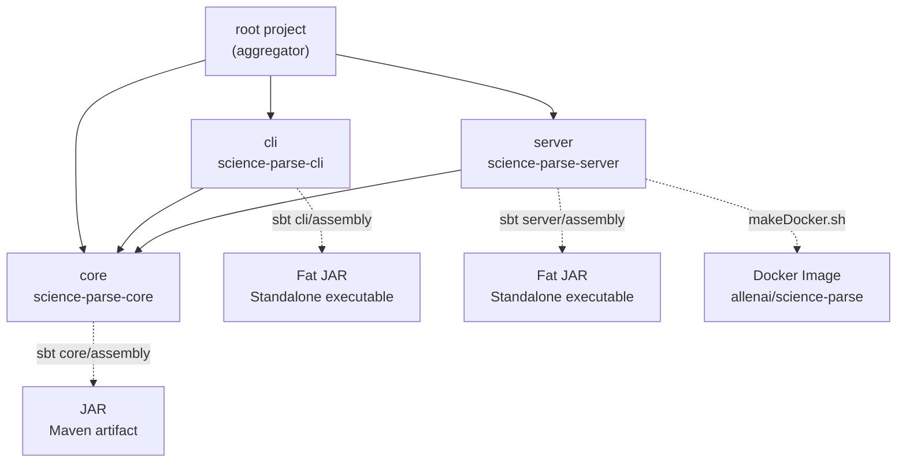
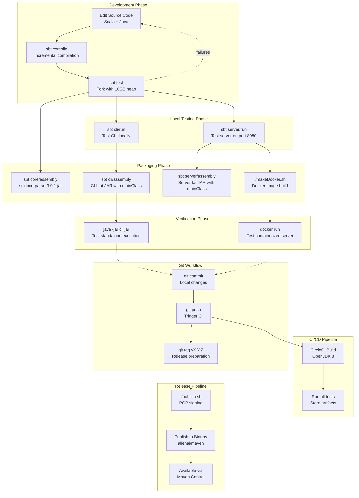
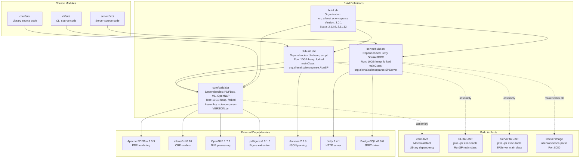

<!-- source: DeepWiki mcp.deepwiki.com · repo allenai/science-parse · page 6 Build and Development · fetched 2026-10-26 -->

# Build and Development

<details>
<summary>Relevant source files</summary>

The following files were used as context for generating this wiki page:

- [.gitignore](.gitignore)
- [build.sbt](build.sbt)
- [cli/build.sbt](cli/build.sbt)
- [core/build.sbt](core/build.sbt)
- [core/src/main/java/org/allenai/scienceparse/CRFBibRecordParser.java](core/src/main/java/org/allenai/scienceparse/CRFBibRecordParser.java)
- [core/src/main/java/org/allenai/scienceparse/GazetteerFeatures.java](core/src/main/java/org/allenai/scienceparse/GazetteerFeatures.java)
- [project/build.properties](project/build.properties)
- [project/plugins.sbt](project/plugins.sbt)
- [server/build.sbt](server/build.sbt)

</details>


This page provides an overview of the build system, development workflow, and packaging process for Science Parse. It covers the essential information needed to compile, test, and package the project for development and deployment purposes.

For detailed information about specific aspects:
- SBT configuration, tasks, and dependency management: see [SBT Build System](#6.1)
- IDE setup and Lombok configuration: see [Development Environment Setup](#6.2)
- Publishing artifacts and version management: see [Release Process](#6.3)

## Prerequisites

Science Parse requires the following tools for development:

| Tool | Version | Purpose |
|------|---------|---------|
| JDK | 8 | Required for compilation and runtime |
| SBT | 1.2.7 | Build tool for compilation, testing, and packaging |
| Git | Any recent version | Version control |
| Docker | Any recent version | Optional, for building server containers |

The project is configured to use OpenJDK 8 for maximum compatibility with dependencies like PDFBox and Apache OpenNLP. Cross-compilation to multiple Scala versions (2.11.12 and 2.12.9) is supported, with Scala 2.13.0 not yet supported due to required collections API changes.

**Sources:** [project/build.properties:1](), [build.sbt:3-6]()

## Project Structure

Science Parse follows a multi-module SBT project structure with three main modules:



**Module Descriptions:**

- **root**: Aggregate project at [build.sbt:41-51]() that does not publish artifacts but coordinates builds across modules
- **core**: Library module at [build.sbt:53-58]() containing all parsing logic, published as a Maven dependency
- **cli**: Command-line interface at [build.sbt:60-65]() that depends on core, builds to a fat JAR
- **server**: HTTP API server at [build.sbt:67-72]() that depends on core, builds to both fat JAR and Docker image

**Sources:** [build.sbt:8-11](), [build.sbt:41-72]()

## Common Development Tasks

### Compilation

```bash
# Compile all modules
sbt compile

# Compile specific module
sbt core/compile
sbt cli/compile
sbt server/compile
```

### Testing

```bash
# Run all tests
sbt test

# Run tests for specific module
sbt core/test

# Run specific test class
sbt "core/testOnly org.allenai.scienceparse.ParserTest"
```

Tests run with 10GB heap memory allocation as configured in [core/build.sbt:1]() and fork into separate JVM processes [core/build.sbt:3]() to prevent memory issues during test execution.

### Running Locally

```bash
# Run CLI with 10GB heap
sbt "cli/run --help"

# Run server with 10GB heap
sbt "server/run"
```

Both CLI and server modules configure `javaOptions in run` to allocate sufficient memory and fork into separate processes [cli/build.sbt:1-3](), [server/build.sbt:1-3]().

### Building Artifacts

```bash
# Build core library JAR
sbt core/assembly

# Build CLI fat JAR with all dependencies
sbt cli/assembly

# Build server fat JAR
sbt server/assembly

# Build Docker image
./makeDocker.sh
```

The assembly plugin creates "fat JARs" (also called "superjars") that bundle all dependencies into a single executable JAR file. The `assemblyMergeStrategy` configuration handles conflicts when multiple dependencies contain the same file [cli/build.sbt:7-10](), [server/build.sbt:7-11]().

**Sources:** [core/build.sbt:1-3](), [cli/build.sbt:1-10](), [server/build.sbt:1-11]()

## Build Configuration

### SBT Plugins

Science Parse uses three essential SBT plugins configured in [project/plugins.sbt]():

| Plugin | Version | Purpose |
|--------|---------|---------|
| `sbt-assembly` | 0.14.9 | Creates fat JARs with all dependencies bundled |
| `sbt-pgp` | 1.1.2-1 | Signs artifacts with PGP for secure publishing |
| `sbt-bintray` | 0.5.4 | Publishes artifacts to Bintray repository |

**Sources:** [project/plugins.sbt:1-5]()

### Common Settings

All modules share common settings defined at [build.sbt:13-39]():

- **Cross-compilation**: Supports Scala 2.11.12 and 2.12.9 [build.sbt:14]()
- **Resolvers**: Uses JCenter and Allen AI's Bintray repository [build.sbt:15-18]()
- **License**: Apache 2.0 [build.sbt:21]()
- **Publishing**: Configured for Bintray with Maven style [build.sbt:26-28]()
- **SCM**: Links to GitHub repository [build.sbt:23-25]()

**Sources:** [build.sbt:13-39]()

## Development Workflow



This diagram shows the complete development lifecycle from editing code to publishing releases. The workflow emphasizes:

1. **Incremental Development**: Fast compile-test cycles with SBT's incremental compilation
2. **Memory Management**: Tests and local runs allocate 10GB heap to handle large PDFs
3. **Forked Execution**: Tests and runs execute in separate JVMs to prevent conflicts
4. **Multi-format Packaging**: Same code produces library JARs, fat JARs, and Docker images
5. **Automated CI/CD**: CircleCI validates every push before release
6. **Signed Releases**: PGP signing ensures artifact authenticity

**Sources:** [build.sbt:1-73](), [core/build.sbt:1-5](), [cli/build.sbt:1-10](), [server/build.sbt:1-11]()

## Module Dependencies and Artifacts



This diagram illustrates how source modules, build definitions, and external dependencies combine to produce build artifacts. Key aspects:

1. **Dependency Graph**: CLI and server both depend on core, which has the heaviest dependency set
2. **Build Configuration**: Each module's `build.sbt` specifies dependencies, memory settings, and assembly configuration
3. **Main Classes**: CLI and server specify entry points for standalone execution
4. **Artifact Types**: Core produces a library JAR for Maven consumption, while CLI and server produce fat JARs for standalone execution
5. **Docker Integration**: Server has an additional Docker image build target

**Sources:** [build.sbt:1-73](), [core/build.sbt:1-49](), [cli/build.sbt:1-19](), [server/build.sbt:1-20]()

## Ignored Files

The `.gitignore` configuration excludes build artifacts and IDE-specific files from version control:

| Pattern | Purpose |
|---------|---------|
| `.gradle/`, `build/`, `gradle/` | Gradle artifacts (legacy) |
| `*.ipr`, `*.iws`, `*.iml` | IntelliJ IDEA project files |
| `target/`, `project/target/`, `project/project/` | SBT build output directories |
| `.*~` | Emacs backup files |
| `EvalErrors.log` | Training error logs |

The `.gitignore` explicitly allows module directories (`!/cli/`, `!/core/`, `!/server/`, `!/project/`) to ensure source code is tracked [.gitignore:24-27]().

**Sources:** [.gitignore:1-28]()

## Build System Features

### Assembly Plugin Configuration

The assembly plugin creates fat JARs by merging all dependencies into a single executable file. When conflicts occur (multiple dependencies contain the same file), merge strategies determine resolution:

**CLI Merge Strategy** [cli/build.sbt:7-10]():
- `logback.xml`: Take first occurrence (prevents duplicate logging configuration)
- Default: Standard merge strategy for other conflicts

**Server Merge Strategy** [server/build.sbt:7-11]():
- `logback.xml`: Take first occurrence
- `application.conf`: Concatenate all occurrences (combines Typesafe Config files)
- Default: Standard merge strategy

### Cross-Compilation

The project supports multiple Scala versions through `crossScalaVersions` [build.sbt:14](). This allows:
- Publishing artifacts for both Scala 2.11 and 2.12 ecosystems
- Testing compatibility across Scala versions
- Smooth migration path for downstream consumers

Scala 2.13 support is noted as not yet available due to required collections API changes [build.sbt:5]().

**Sources:** [build.sbt:3-6,14](), [cli/build.sbt:7-10](), [server/build.sbt:7-11]()

## Next Steps

For more detailed information on specific aspects of the build and development process:

- **Understanding SBT configuration**: See [SBT Build System](#6.1) for detailed explanation of tasks, dependency resolution, and plugin configuration
- **Setting up your development environment**: See [Development Environment Setup](#6.2) for IDE configuration, Lombok setup, and debugging tips
- **Publishing releases**: See [Release Process](#6.3) for the complete workflow of versioning, tagging, signing, and publishing artifacts

**Sources:** [build.sbt:1-73](), [core/build.sbt:1-49](), [cli/build.sbt:1-19](), [server/build.sbt:1-20](), [project/plugins.sbt:1-5](), [project/build.properties:1](), [.gitignore:1-28]()

---

