<!-- source: DeepWiki mcp.deepwiki.com · repo allenai/science-parse · page 6.1 SBT Build System · fetched 2026-10-26 -->

# SBT Build System

<details>
<summary>Relevant source files</summary>

The following files were used as context for generating this wiki page:

- [build.sbt](build.sbt)
- [cli/build.sbt](cli/build.sbt)
- [core/build.sbt](core/build.sbt)
- [core/src/main/java/org/allenai/scienceparse/CRFBibRecordParser.java](core/src/main/java/org/allenai/scienceparse/CRFBibRecordParser.java)
- [core/src/main/java/org/allenai/scienceparse/GazetteerFeatures.java](core/src/main/java/org/allenai/scienceparse/GazetteerFeatures.java)
- [project/build.properties](project/build.properties)
- [project/plugins.sbt](project/plugins.sbt)
- [server/build.sbt](server/build.sbt)

</details>


## Purpose and Scope

This document describes the SBT (Scala Build Tool) build system configuration for Science Parse. It covers the multi-module project structure, dependency management, assembly configurations for creating fat JARs, and the publishing pipeline. For information about the actual release and deployment process, see [Release Process](#6.3). For IDE setup and annotation processing, see [Development Environment Setup](#6.2).

**Sources:** [build.sbt:1-73](), [project/build.properties:1-2]()

---

## Overview

Science Parse uses SBT 1.2.7 as its build tool, configured as a multi-module project with three primary modules: Core, CLI, and Server. The build system supports cross-compilation for Scala 2.11.12 and 2.12.9, manages complex dependency trees with exclusions, and produces multiple artifact types: library JARs for Maven/SBT consumers, and fat JARs (superjars) for standalone execution.

**Sources:** [build.sbt:3-11](), [project/build.properties:1-2]()

---

## Multi-Module Project Structure

### Module Hierarchy

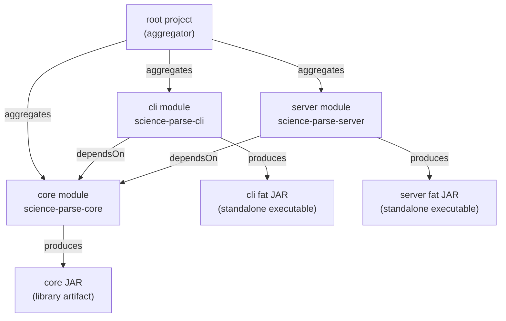

**Sources:** [build.sbt:41-72]()

### Root Project Configuration

The root project serves as an aggregator that does not publish artifacts itself. It defines organization-wide settings and aggregates the three child modules.

| Setting | Value |
|---------|-------|
| Organization | `org.allenai.scienceparse` |
| Version | `3.0.1` |
| Scala Version | `2.12.9` (default) |
| Cross-compiled | `2.11.12`, `2.12.9` |
| Published | No (`publish / skip := true`) |

**Sources:** [build.sbt:8-51]()

### Module Definitions

**Core Module** ([build.sbt:53-58]()):
- **Artifact Name:** `science-parse-core`
- **Description:** Java to extract titles, authors, abstracts, body text, and bibliographies from scholarly documents
- **Purpose:** Library module containing all parsing logic
- **Dependencies:** None (base module)

**CLI Module** ([build.sbt:60-65]()):
- **Artifact Name:** `science-parse-cli`
- **Description:** Java CLI to extract titles, authors, abstracts, body text, and bibliographies from scholarly documents
- **Purpose:** Command-line interface for batch processing
- **Dependencies:** Depends on Core

**Server Module** ([build.sbt:67-72]()):
- **Artifact Name:** `science-parse-server`
- **Description:** Java server to extract titles, authors, abstracts, body text, and bibliographies from scholarly documents
- **Purpose:** HTTP API server
- **Dependencies:** Depends on Core

---

## Common Build Configuration

### Resolvers and Repositories

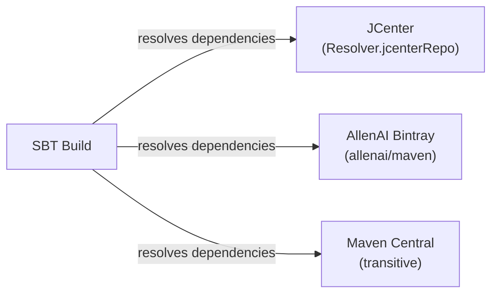

The build system uses two primary resolvers defined in `commonSettings`:
- **JCenter:** Standard Maven repository
- **AllenAI Bintray:** Organization-specific artifacts (e.g., `common-core`, `datastore`, `pdffigures2`)

**Sources:** [build.sbt:15-18]()

### Publishing Configuration

All modules share common publishing settings configured for Bintray:

| Setting | Value |
|---------|-------|
| License | Apache-2.0 |
| Repository | `allenai/maven` |
| Style | Maven (`publishMavenStyle := true`) |
| Test Artifacts | Not published (`publishArtifact in Test := false`) |
| POM Filtering | Excludes all repositories (`pomIncludeRepository := { _ => false }`) |

The configuration includes SCM information pointing to the GitHub repository and developer information for Allen Institute for Artificial Intelligence.

**Sources:** [build.sbt:20-39]()

---

## Module-Specific Configurations

### Core Module

#### Test Configuration

```scala
javaOptions in Test += s"-Xmx10G"
fork in Test := true
```

The Core module requires substantial memory (10GB heap) for testing and runs tests in a forked JVM to isolate resources.

**Sources:** [core/build.sbt:1-3]()

#### Assembly Configuration

```scala
assemblyJarName in assembly := s"science-parse-${version.value}.jar"
```

The Core module produces a fat JAR named `science-parse-3.0.1.jar`, though this is primarily used for testing. The library artifact is the standard JAR without assembly.

**Sources:** [core/build.sbt:5-6]()

#### Dependency Structure

```mermaid
graph TB
    Core["core module"]
    
    subgraph "ML/NLP Dependencies"
        ML["org.allenai:ml:0.16<br/>(CRF models)"]
        Word2Vec["org.allenai.word2vec:word2vecjava:2.0.0<br/>(embeddings)"]
        OpenNLP["org.apache.opennlp:opennlp-tools:1.7.2<br/>(sentence detection)"]
    end
    
    subgraph "PDF Processing"
        PDFBox["org.apache.pdfbox:pdfbox:2.0.9"]
        FontBox["org.apache.pdfbox:fontbox:2.0.9"]
        PDFFigures["org.allenai:pdffigures2:0.1.0<br/>(section extraction)"]
    end
    
    subgraph "AllenAI Common"
        CommonCore["org.allenai.common:common-core:2.0.0"]
        Datastore["org.allenai.datastore:datastore:2.0.0<br/>(model downloads)"]
    end
    
    subgraph "Utilities"
        Lombok["org.projectlombok:lombok:1.16.20<br/>(annotations)"]
        Guava["com.google.guava:guava:18.0"]
        GSCollections["com.goldmansachs:gs-collections:6.1.0"]
        SprayJSON["io.spray:spray-json:1.3.5"]
        FST["de.ruedigermoeller:fst:2.47<br/>(serialization)"]
    end
    
    subgraph "AWS"
        S3SDK["com.amazonaws:aws-java-sdk-s3:1.11.213"]
    end
    
    subgraph "Bouncycastle"
        BCProv["org.bouncycastle:bcprov-jdk15on:1.54"]
        BCMail["org.bouncycastle:bcmail-jdk15on:1.54"]
        BCPKIX["org.bouncycastle:bcpkix-jdk15on:1.54"]
    end
    
    Core --> ML
    Core --> Word2Vec
    Core --> OpenNLP
    Core --> PDFBox
    Core --> FontBox
    Core --> PDFFigures
    Core --> CommonCore
    Core --> Datastore
    Core --> Lombok
    Core --> Guava
    Core --> GSCollections
    Core --> SprayJSON
    Core --> FST
    Core --> S3SDK
    Core --> BCProv
    Core --> BCMail
    Core --> BCPKIX
```

Key exclusions prevent conflicts:
- **commons-logging:** Excluded from AWS SDK and PDFBox, replaced by `jcl-over-slf4j`
- **slf4j-simple:** Excluded from ML library to avoid binding conflicts
- **args4j:** Excluded from ML library
- **commons-math3:** Excluded from common-core
- **log4j:** Excluded from word2vecjava

**Sources:** [core/build.sbt:7-48]()

### CLI Module

#### Assembly Configuration

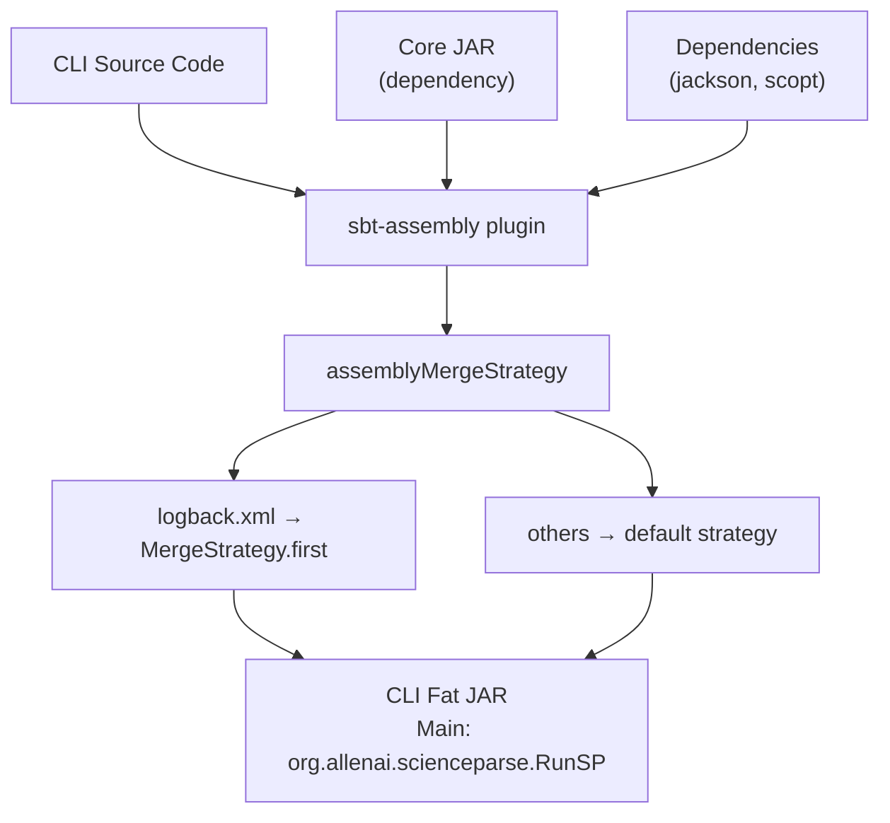

**Configuration Details:**

| Setting | Value |
|---------|-------|
| Main Class | `org.allenai.scienceparse.RunSP` |
| Fork | `true` |
| JVM Options | `-Xmx10G` |
| Merge Strategy | First `logback.xml` wins |

**Sources:** [cli/build.sbt:1-18]()

#### Dependencies

The CLI module has minimal dependencies beyond Core:
- **Jackson (2.7.9):** JSON serialization (`jackson-core`, `jackson-databind`, `jackson-module-scala`)
- **scopt (3.4.0):** Command-line argument parsing
- **slf4j:** Logging bridge

**Sources:** [cli/build.sbt:12-18]()

### Server Module

#### Assembly Configuration

The Server module uses a similar assembly strategy to CLI but with different merge rules:

```scala
mainClass in assembly := Some("org.allenai.scienceparse.SPServer")

assemblyMergeStrategy in assembly := {
  case "logback.xml" => MergeStrategy.first
  case "application.conf" => MergeStrategy.concat
  case x => (assemblyMergeStrategy in assembly).value.apply(x)
}
```

**Key Differences:**
- **Main Class:** `org.allenai.scienceparse.SPServer`
- **Application Config:** Uses `MergeStrategy.concat` to merge multiple `application.conf` files (important for Typesafe Config library)

**Sources:** [server/build.sbt:5-11]()

#### Dependencies

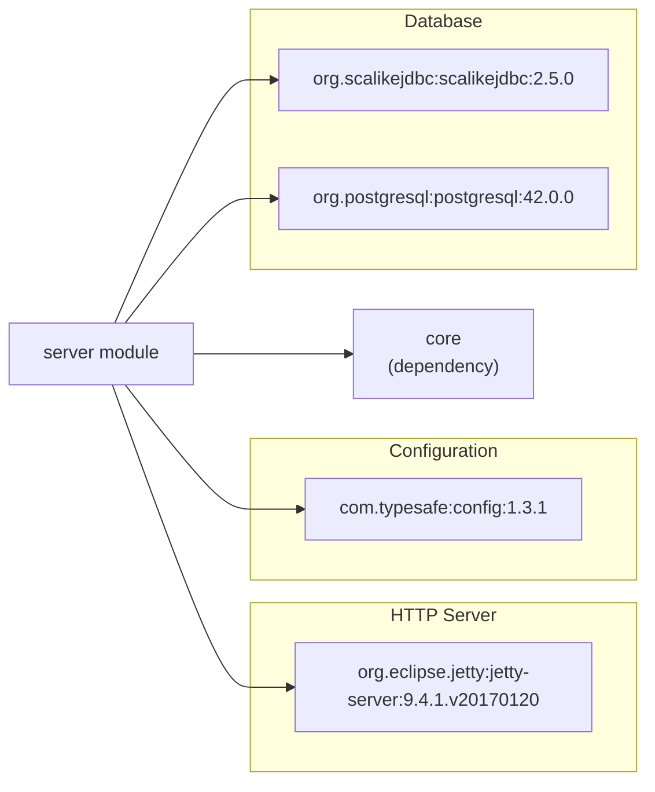

The Server module adds:
- **Jetty 9.4.1:** HTTP server implementation
- **Typesafe Config 1.3.1:** Configuration management
- **ScalikeJDBC 2.5.0:** Database access (with commons-logging excluded)
- **PostgreSQL 42.0.0:** JDBC driver for feedback system

**Sources:** [server/build.sbt:13-19]()

---

## SBT Plugins

The project uses three essential plugins configured in [project/plugins.sbt:1-6]():

### Plugin Configuration

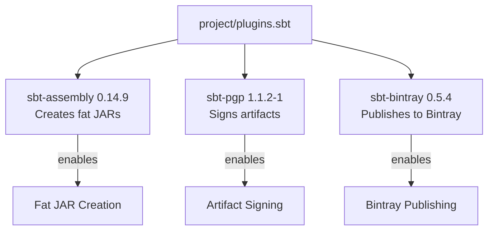

| Plugin | Version | Purpose |
|--------|---------|---------|
| sbt-assembly | 0.14.9 | Merges all dependencies into a single executable JAR |
| sbt-pgp | 1.1.2-1 | Signs published artifacts with PGP keys |
| sbt-bintray | 0.5.4 | Simplifies publishing to Bintray repositories |

**Sources:** [project/plugins.sbt:1-6]()

---

## Key Build Tasks

### Compilation Tasks

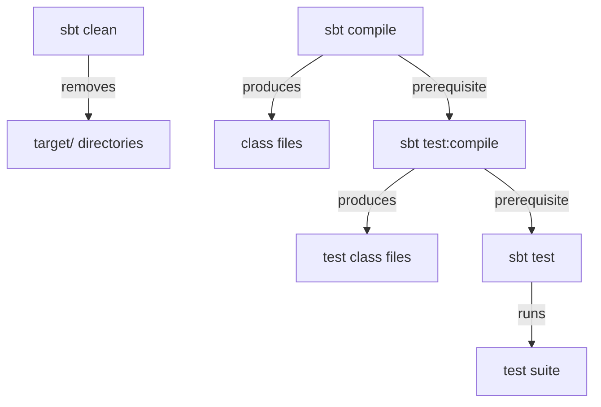

**Common Commands:**

| Command | Description |
|---------|-------------|
| `sbt clean` | Removes all generated files |
| `sbt compile` | Compiles main sources |
| `sbt test:compile` | Compiles test sources |
| `sbt test` | Runs all tests |
| `sbt core/test` | Runs only Core tests |

**Sources:** [build.sbt:13-72](), [core/build.sbt:1-3]()

### Assembly Tasks

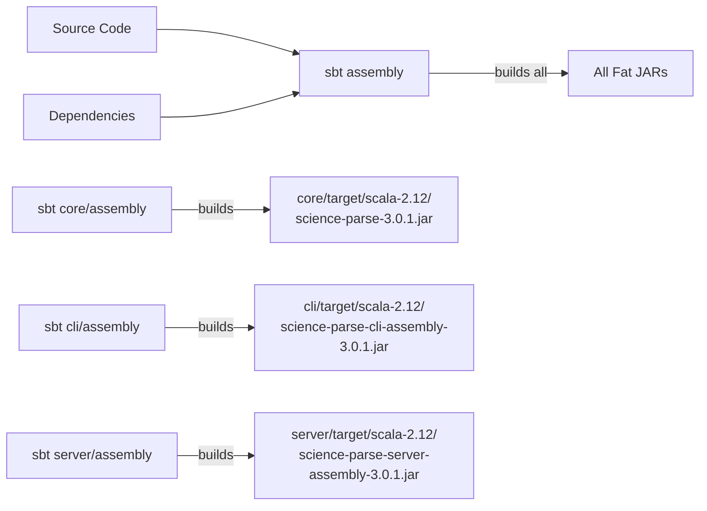

**Assembly Commands:**

| Command | Output Location |
|---------|----------------|
| `sbt core/assembly` | `core/target/scala-2.12/science-parse-3.0.1.jar` |
| `sbt cli/assembly` | `cli/target/scala-2.12/science-parse-cli-assembly-3.0.1.jar` |
| `sbt server/assembly` | `server/target/scala-2.12/science-parse-server-assembly-3.0.1.jar` |

The fat JARs include all dependencies and can be executed directly:
```bash
java -Xmx10G -jar cli/target/scala-2.12/science-parse-cli-assembly-3.0.1.jar <args>
```

**Sources:** [core/build.sbt:5-6](), [cli/build.sbt:5-10](), [server/build.sbt:5-11]()

### Publishing Tasks

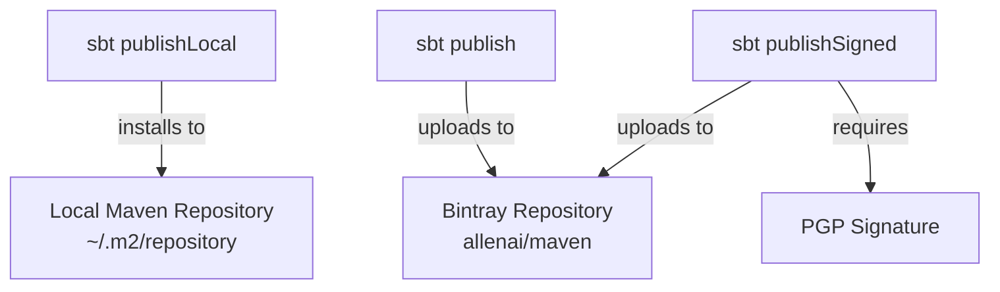

**Publishing Commands:**

| Command | Description |
|---------|-------------|
| `sbt publishLocal` | Installs to local Maven repository |
| `sbt publish` | Publishes to Bintray (unsigned) |
| `sbt publishSigned` | Signs and publishes to Bintray |
| `sbt core/publish` | Publishes only Core module |

**Note:** Publishing requires Bintray credentials configured in `~/.bintray/.credentials` or via environment variables. See [Release Process](#6.3) for details.

**Sources:** [build.sbt:20-39](), [project/plugins.sbt:3-6]()

---

## Cross-Compilation

### Supported Scala Versions

The build supports cross-compilation for two Scala versions:

```scala
lazy val scala211 = "2.11.12"
lazy val scala212 = "2.12.9"
lazy val supportedScalaVersions = List(scala212, scala211)

ThisBuild / scalaVersion := scala212
crossScalaVersions := supportedScalaVersions
```

**Version Table:**

| Version | Status | Notes |
|---------|--------|-------|
| 2.11.12 | Supported | Legacy compatibility |
| 2.12.9 | Default | Primary development version |
| 2.13.0 | Not Supported | Requires collections API migration |

**Sources:** [build.sbt:3-14]()

### Cross-Compilation Commands

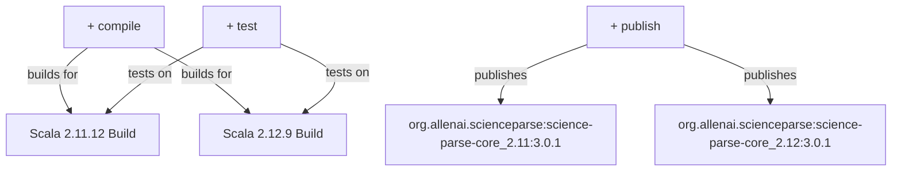

**Commands:**

| Command | Description |
|---------|-------------|
| `sbt +compile` | Compiles for all cross-versions |
| `sbt +test` | Tests all cross-versions |
| `sbt +publish` | Publishes all cross-versions |
| `sbt ++2.11.12 compile` | Compiles for specific version |

**Sources:** [build.sbt:3-14]()

---

## Ivy Logging Configuration

The build includes a configuration to reduce dependency resolution noise:

```scala
ivyLoggingLevel in ThisBuild := UpdateLogging.Quiet
```

This suppresses verbose Ivy update logs during dependency resolution, making build output more readable.

**Sources:** [build.sbt:1-1]()

---

## Memory Configuration

### JVM Options

Both CLI and Server modules require significant heap memory:

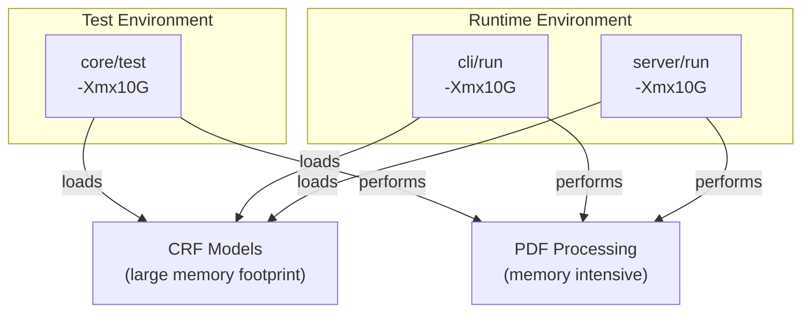

**Memory Requirements:**

| Context | Heap Size | Fork |
|---------|-----------|------|
| Core Tests | 10GB | Yes (`fork in Test := true`) |
| CLI Runtime | 10GB | Yes (`fork := true`) |
| Server Runtime | 10GB | Yes (`fork := true`) |

The high memory requirement is driven by:
- CRF model loading (hundreds of MB)
- PDF rendering via Apache PDFBox
- Caching mechanisms (gazetteer cache, bibliography cache)

**Sources:** [core/build.sbt:1-3](), [cli/build.sbt:1-3](), [server/build.sbt:1-3]()

---

## Dependency Exclusions

The build employs careful dependency management to avoid conflicts:

### Logging Bridge Strategy

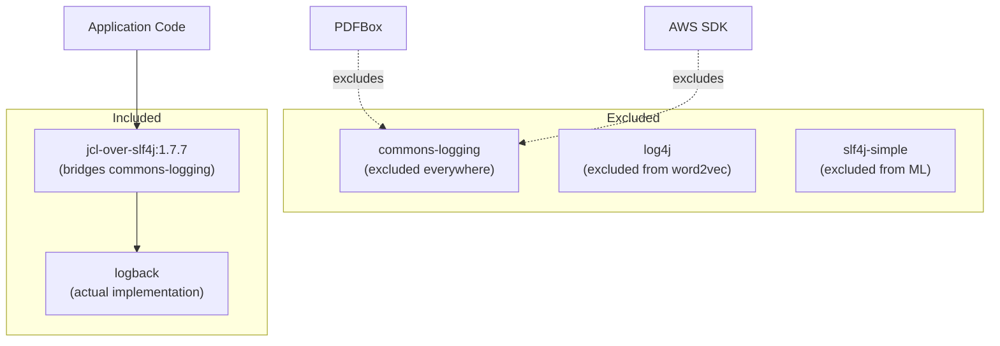

**Exclusion Pattern:**

All libraries that use `commons-logging` are excluded, and `jcl-over-slf4j` is included to bridge calls to SLF4J/Logback.

**Sources:** [core/build.sbt:11-33]()

### Other Exclusions

| Library | Excluded Dependency | Reason |
|---------|---------------------|--------|
| common-core | commons-math3 | Version conflict |
| ML library | args4j, slf4j-simple | Binding conflicts |
| word2vecjava | log4j, commons-logging | Logging conflicts |

**Sources:** [core/build.sbt:8-33]()

---

## Working with the Build System

### Common Development Workflows

**Workflow 1: Make Code Changes and Test**
```bash
sbt core/compile      # Compile core
sbt core/test         # Run core tests
```

**Workflow 2: Build Standalone CLI**
```bash
sbt cli/assembly
java -Xmx10G -jar cli/target/scala-2.12/science-parse-cli-assembly-3.0.1.jar --help
```

**Workflow 3: Build and Run Server**
```bash
sbt server/assembly
java -Xmx10G -jar server/target/scala-2.12/science-parse-server-assembly-3.0.1.jar
```

**Workflow 4: Publish Local for Testing**
```bash
sbt core/publishLocal
# Now usable as: "org.allenai.scienceparse" %% "science-parse-core" % "3.0.1"
```

**Workflow 5: Cross-Compile and Test All Versions**
```bash
sbt +clean +compile +test
```

**Sources:** [build.sbt:1-73](), [cli/build.sbt:1-18](), [server/build.sbt:1-19]()

---

## Build File Locations

### File Structure

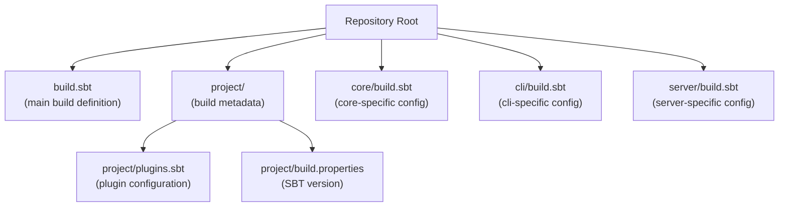

**File Responsibilities:**

| File | Purpose |
|------|---------|
| [build.sbt:1-73]() | Multi-module project definition, common settings |
| [core/build.sbt:1-48]() | Core module dependencies and configuration |
| [cli/build.sbt:1-18]() | CLI module dependencies and assembly |
| [server/build.sbt:1-19]() | Server module dependencies and assembly |
| [project/plugins.sbt:1-6]() | SBT plugin configuration |
| [project/build.properties:1-2]() | SBT version specification |

**Sources:** All cited files

---

