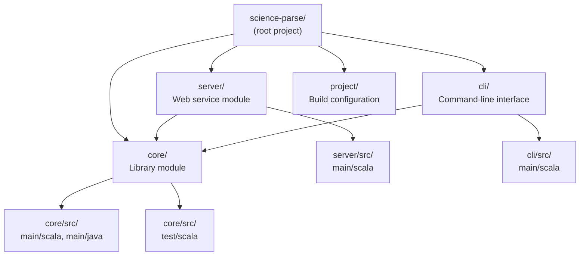
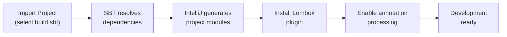
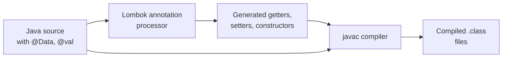
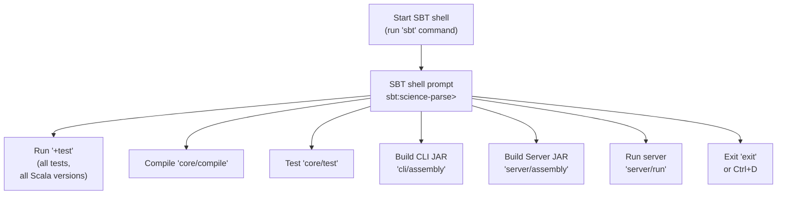
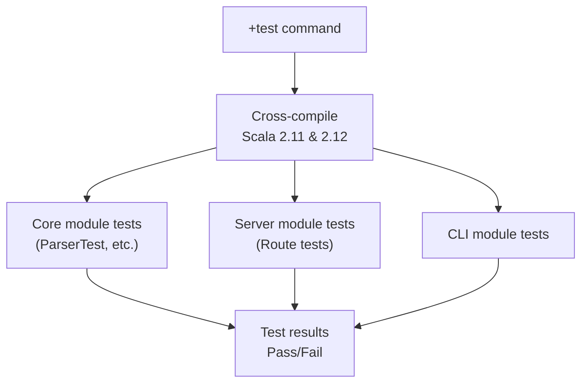
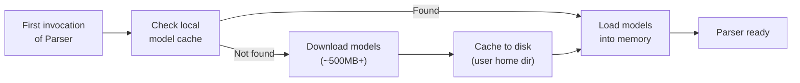

<!-- source: DeepWiki mcp.deepwiki.com · repo allenai/science-parse · page 6.2 Development Environment Setup · fetched 2026-10-26 -->

# Development Environment Setup

<details>
<summary>Relevant source files</summary>

The following files were used as context for generating this wiki page:

- [.gitignore](.gitignore)
- [README.md](README.md)

</details>


This page provides instructions for setting up a local development environment for contributing to Science Parse. It covers IDE configuration, Lombok annotation processing, and common development workflows. For information about the build system configuration and tasks, see [SBT Build System](#6.1). For release procedures, see [Release Process](#6.3).

## Prerequisites

Science Parse is a hybrid Java/Scala project built with SBT. The following table lists the required software and recommended versions:

| Component | Required Version | Notes |
|-----------|-----------------|-------|
| Java Development Kit (JDK) | 8 | OpenJDK 8 recommended; matches CI environment |
| Scala | 2.11.x or 2.12.x | Managed by SBT; cross-compilation supported |
| SBT | 1.2.7+ | Build tool; install from https://www.scala-sbt.org |
| Git | Any recent version | Version control |
| Docker | Optional | Required only for server deployment testing |

Science Parse can be used as a library in any JVM-based language, though development of the project itself requires understanding of both Java and Scala.

**Sources:** [README.md:60-65]()

## Project Structure

The Science Parse repository is organized as a multi-module SBT project with three primary modules:



Each module has its own `src/main/scala`, `src/main/java`, and `src/test/scala` directories. The project follows standard SBT conventions for source organization.

**Sources:** [README.md:24-28](), [.gitignore:24-27]()

## IDE Setup: IntelliJ IDEA

IntelliJ IDEA is the recommended IDE for Science Parse development due to its strong Scala and SBT support. The following workflow shows how IntelliJ integrates with the project:



### Import Steps

1. **Open IntelliJ IDEA** and select "Open" or "Import Project"
2. **Navigate** to the `science-parse` directory and select the `build.sbt` file
3. **Import as SBT project** when prompted
4. **Wait** for SBT to resolve dependencies and IntelliJ to index the project

IntelliJ will generate `.iml` files for each module (these are gitignored per [.gitignore:10-12]()).

**Sources:** [README.md:60-65](), [.gitignore:9-12]()

## Lombok Configuration

Science Parse uses [Project Lombok](https://projectlombok.org) for compile-time code generation, particularly in Java classes. Lombok provides annotations like `@Data`, `@val`, and others that reduce boilerplate code. This requires special IDE configuration to enable annotation processing.

### Why Lombok is Required

The following diagram shows how Lombok integrates into the compilation pipeline:



Without Lombok configured, the IDE will show compilation errors for missing methods that are actually generated at compile time.

### IntelliJ Lombok Setup

Follow these steps to enable Lombok in IntelliJ:

1. **Install the Lombok Plugin**:
   - Go to `File > Settings > Plugins` (Windows/Linux) or `IntelliJ IDEA > Preferences > Plugins` (macOS)
   - Search for "Lombok"
   - Install the plugin from https://plugins.jetbrains.com/plugin/6317
   - Restart IntelliJ when prompted

2. **Enable Annotation Processing**:
   - Go to `File > Settings > Build, Execution, Deployment > Compiler > Annotation Processors` (Windows/Linux)
   - Or `IntelliJ IDEA > Preferences > Build, Execution, Deployment > Compiler > Annotation Processors` (macOS)
   - Check "Enable annotation processing"
   - Set "Obtain processors from project classpath"
   - Apply and OK

Configuration reference: https://www.jetbrains.com/idea/help/configuring-annotation-processing.html

### Lombok Features Used

Science Parse uses these Lombok annotations:

| Annotation | Purpose | Equivalent Scala Feature |
|------------|---------|------------------------|
| `@val` | Type inference for local variables | Scala `val` keyword |
| `@Data` | Generates getters, setters, toString, equals, hashCode | Scala case class |
| `@Cleanup` | Automatic resource management | Scala `Try` with resources |

**Sources:** [README.md:75-84]()

## SBT Shell Workflow

The primary interface for building and testing Science Parse is the SBT shell. This diagram shows the typical development workflow:



### Common SBT Commands

Launch the SBT shell by running `sbt` in the project root directory. Once in the shell, use these commands:

| Command | Purpose | Output |
|---------|---------|--------|
| `compile` | Compile all modules | Target directories with .class files |
| `+test` | Run all tests across Scala versions | Test results and coverage |
| `core/test` | Run tests for core module only | Core test results |
| `server/test` | Run tests for server module only | Server test results |
| `cli/assembly` | Build CLI fat JAR | `cli/target/scala-2.12/science-parse-cli-assembly-*.jar` |
| `server/assembly` | Build server fat JAR | `server/target/scala-2.12/science-parse-server-assembly-*.jar` |
| `server/run` | Start server from SBT | Server running on port 8080 |
| `clean` | Remove generated files | Cleans all target directories |

### Running the CLI Locally

After building the CLI with `cli/assembly`, you can run it from bash:

```bash
java -Xmx10g -jar cli/target/scala-2.12/science-parse-cli-assembly-*.jar <args>
```

The `-Xmx10g` flag allocates 10GB of heap memory, which is recommended for processing large PDFs. See [CLI Usage and Options](#4.1) for available arguments.

### Running the Server Locally

Two options for running the server:

1. **From SBT shell** (for rapid development):
   ```
   sbt:science-parse> server/run
   ```

2. **From fat JAR** (for deployment testing):
   ```bash
   sbt server/assembly
   java -Xmx10g -jar server/target/scala-2.12/science-parse-server-assembly-*.jar
   ```

The server starts on port 8080 by default. Access it at `http://localhost:8080/v1/{paperId}`. See [REST API Endpoints](#3.1) for available routes.

**Sources:** [README.md:67-73]()

## Testing

Science Parse includes comprehensive test suites for all modules. The following diagram shows the test execution flow:



### Running Tests

From the SBT shell:

- **All tests, all Scala versions**: `+test`
- **All tests, current Scala version**: `test`
- **Core tests only**: `core/test`
- **Server tests only**: `server/test`
- **CLI tests only**: `cli/test`
- **Specific test class**: `core/testOnly org.allenai.scienceparse.ParserTest`

### Test Output Location

Test results and logs are written to `target/` directories:

```
core/target/test-reports/
server/target/test-reports/
cli/target/test-reports/
```

These directories are gitignored per [.gitignore:18-20]().

**Sources:** [README.md:69](), [.gitignore:18-20]()

## First-Time Setup: Model Downloads

On first run, Science Parse downloads pre-trained model files from remote storage. This is a one-time operation; subsequent runs use cached models.



### Expected Behavior

The first time you run tests or the server, you will see:
- A delay of several minutes while models download
- Console output indicating download progress
- Subsequent runs start much faster (seconds instead of minutes)

The model cache location is typically:
- Linux/macOS: `~/.scienceparse/models/`
- Windows: `%USERPROFILE%\.scienceparse\models\`

**Sources:** [README.md:48]()

## Development Environment Checklist

Use this checklist to verify your environment is correctly configured:

| Step | Verification | Expected Result |
|------|-------------|-----------------|
| JDK installed | `java -version` | Java version 1.8.x |
| SBT installed | `sbt sbtVersion` | `[info] 1.2.7` or higher |
| Project imports | Open in IntelliJ | No import errors |
| Lombok plugin | IntelliJ Plugins settings | Lombok listed and enabled |
| Annotation processing | IntelliJ Compiler settings | "Enable annotation processing" checked |
| Compilation | `sbt compile` | `[success]` message |
| Tests | `sbt core/test` | Tests pass |
| Server runs | `sbt server/run` | Server starts on port 8080 |

**Sources:** [README.md:60-78]()

## Common Development Tasks

### Adding Dependencies

Dependencies are managed in `build.sbt`. To add a new dependency:

1. Edit `build.sbt` (see [SBT Build System](#6.1) for structure)
2. Reload SBT: `reload` in SBT shell
3. IntelliJ will automatically detect changes and reimport

### Cleaning Build Artifacts

Remove all generated files:
```
sbt:science-parse> clean
```

This removes all `target/` directories and forces a full rebuild on next compile.

### Dealing with "Out of Memory" Errors

If you encounter OOM errors during development:

1. Increase SBT memory in `.sbtopts` file (create in project root):
   ```
   -Xmx4G
   -XX:+UseG1GC
   ```

2. Or set `SBT_OPTS` environment variable:
   ```bash
   export SBT_OPTS="-Xmx4G"
   ```

### Formatting Code

Science Parse does not enforce a specific code formatter, but consistency is encouraged. IntelliJ's built-in Scala formatter can be used with default settings.

**Sources:** [README.md:60-73]()

## Troubleshooting

### IntelliJ Shows Red Underlines on Valid Code

**Symptoms**: IntelliJ marks Lombok-generated methods as missing (e.g., getters on `@Data` classes)

**Solution**:
1. Verify Lombok plugin is installed and enabled
2. Verify annotation processing is enabled in settings
3. Rebuild project: `Build > Rebuild Project`
4. Invalidate caches: `File > Invalidate Caches / Restart`

### SBT Cannot Resolve Dependencies

**Symptoms**: `sbt compile` fails with "unresolved dependency" errors

**Solution**:
1. Check internet connectivity (some dependencies come from remote repositories)
2. Clear SBT cache: `rm -rf ~/.ivy2/cache`
3. Reload SBT: `reload` in SBT shell
4. If problem persists, check `project/plugins.sbt` for invalid repositories

### Tests Fail with "Model Not Found"

**Symptoms**: First-time tests fail with exceptions about missing model files

**Solution**:
1. Ensure internet connectivity for initial model download
2. Check disk space (models require ~500MB+)
3. Wait for full download to complete (may take 5-10 minutes)
4. If download fails, manually clear cache and retry

**Sources:** [README.md:48-58](), [README.md:75-84]()

---

