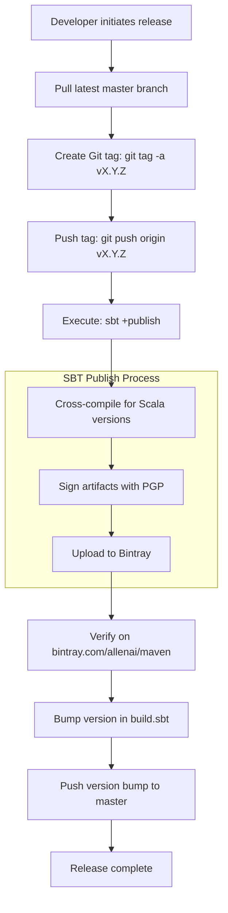
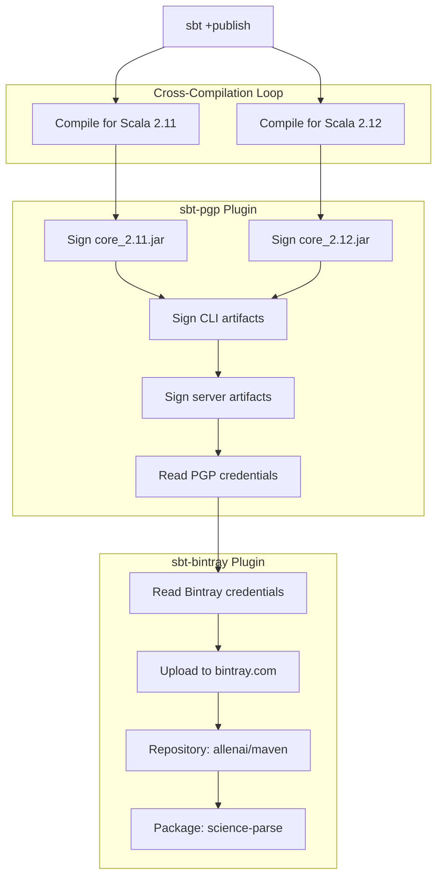
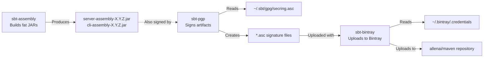

<!-- source: DeepWiki mcp.deepwiki.com · repo allenai/science-parse · page 6.3 Release Process · fetched 2026-10-26 -->

# Release Process

<details>
<summary>Relevant source files</summary>

The following files were used as context for generating this wiki page:

- [README.md](README.md)
- [project/build.properties](project/build.properties)
- [project/plugins.sbt](project/plugins.sbt)

</details>


This document describes the procedures for releasing new versions of Science Parse to Bintray/Maven Central. It covers version management, tagging, artifact signing, publishing, and rollback procedures. For information about the build system itself, see [SBT Build System](#6.1). For development environment setup, see [Development Environment Setup](#6.2).

## Purpose and Scope

The Science Parse project uses a tag-based release workflow that publishes artifacts to Bintray, making them available through Maven Central for consumption by downstream projects. This page documents the manual release process, the SBT plugins involved, and the commands required to publish new versions.

## Release Workflow Overview

The release process follows a sequential workflow triggered by Git tags. The diagram below illustrates the complete release pipeline:



**Sources:** [README.md:89-103]()

## Step-by-Step Release Procedure

### 1. Prepare for Release

Before initiating a release, ensure the `master` branch is in a releasable state:

```bash
# Pull latest changes
git checkout master
git pull origin master

# Verify tests pass
sbt +test
```

The `+test` command runs tests across all configured Scala versions to ensure cross-compatibility.

**Sources:** [README.md:69](), [README.md:94]()

### 2. Create Version Tag

Create an annotated Git tag following semantic versioning (X.Y.Z):

```bash
git tag -a vX.Y.Z -m "Release X.Y.Z"
```

The tag name must start with `v` followed by the version number. The annotation message typically follows the format "Release X.Y.Z".

**Example:**
```bash
git tag -a v3.0.1 -m "Release 3.0.1"
```

Push the tag to the remote repository:

```bash
git push origin vX.Y.Z
```

**Sources:** [README.md:95-96]()

### 3. Publish to Bintray

Execute the publish command with cross-compilation:

```bash
sbt +publish
```

The `+` prefix is **required** to publish artifacts for all configured Scala versions. Without it, only the default Scala version will be published, breaking compatibility for users on other versions.

The following diagram shows what happens during the `sbt +publish` command:



**Sources:** [README.md:97](), [project/plugins.sbt:1-5]()

### 4. Verify Publication

After publishing completes, verify the artifacts are available on Bintray:

1. Navigate to https://bintray.com/allenai/maven
2. Locate the `science-parse` package
3. Verify all expected artifacts are present:
   - `science-parse_2.11-X.Y.Z.jar`
   - `science-parse_2.12-X.Y.Z.jar`
   - POM files
   - Source and Javadoc JARs
   - PGP signatures (.asc files)

**Sources:** [README.md:98]()

### 5. Bump Version for Next Development Cycle

After a successful release, increment the version number in `build.sbt` for the next development cycle:

```scala
// In build.sbt
version := "X.Y.Z+1"  // e.g., "3.0.1" after releasing "3.0.0"
```

Commit and push this change:

```bash
git add build.sbt
git commit -m "Bump version to X.Y.Z+1"
git push origin master
```

This ensures ongoing development uses a version number distinct from the released version.

**Sources:** [README.md:99-100]()

## SBT Plugin Configuration

The release process relies on three key SBT plugins configured in [project/plugins.sbt]():

| Plugin | Version | Purpose |
|--------|---------|---------|
| `sbt-assembly` | 0.14.9 | Creates fat JARs with all dependencies |
| `sbt-pgp` | 1.1.2-1 | Signs artifacts with PGP keys |
| `sbt-bintray` | 0.5.4 | Publishes to Bintray repository |

**Sources:** [project/plugins.sbt:1-5]()

### Plugin Interaction



**Sources:** [project/plugins.sbt:1-5]()

## Credentials and Authentication

### PGP Signing

The `sbt-pgp` plugin requires PGP credentials to sign artifacts. Credentials are typically stored in:

- `~/.sbt/gpg/secring.asc` (private key)
- `~/.sbt/gpg/pubring.asc` (public key)

Or configured via environment variables:
```bash
export PGP_SECRET_RING=/path/to/secring.asc
export PGP_PASSPHRASE=your-passphrase
```

### Bintray Authentication

The `sbt-bintray` plugin requires Bintray API credentials, typically stored in `~/.bintray/.credentials`:

```
realm = Bintray API Realm
host = api.bintray.com
user = <bintray-username>
password = <bintray-api-key>
```

These credentials are read automatically during the `sbt publish` command.

**Sources:** [project/plugins.sbt:3-5]()

## Cross-Compilation Strategy

Science Parse supports multiple Scala versions (2.11 and 2.12). The `+` prefix in SBT commands triggers cross-compilation:

```bash
sbt +publish    # Publishes for all Scala versions
sbt publish     # Publishes for default Scala version only (incorrect!)
```

This ensures users can depend on Science Parse regardless of their Scala version:

```scala
// Works for both Scala 2.11 and 2.12 projects
libraryDependencies += "org.allenai" %% "science-parse" % "3.0.0"
```

The `%%` operator in dependencies automatically selects the correct artifact based on the consuming project's Scala version.

**Sources:** [README.md:97]()

## Rollback and Error Recovery

### Unpublishing a Release

If a release contains errors, it can be unpublished from Bintray:

```bash
sbt bintrayUnpublish
```

This removes the artifacts from Bintray, allowing you to fix issues and re-release.

**Sources:** [README.md:102-103]()

### Retagging a Version

If you need to retag a version to point to a different commit:

```bash
# Delete the local tag
git tag -d vX.Y.Z

# Delete the remote tag
git push origin :refs/tags/vX.Y.Z

# Create a new tag at the correct commit
git tag -a vX.Y.Z -m "Release X.Y.Z"

# Push the new tag
git push origin vX.Y.Z
```

After retagging, run `sbt +publish` again to publish the corrected version.

**Sources:** [README.md:102-103]()

## Release Checklist

Use this checklist to ensure all release steps are completed:

- [ ] All tests pass: `sbt +test`
- [ ] Latest master branch pulled locally
- [ ] Git tag created: `git tag -a vX.Y.Z -m "Release X.Y.Z"`
- [ ] Tag pushed to origin: `git push origin vX.Y.Z`
- [ ] Artifacts published: `sbt +publish` (note the `+`)
- [ ] Artifacts verified on https://bintray.com/allenai/maven
- [ ] Version bumped in `build.sbt` to X.Y.Z+1
- [ ] Version bump committed and pushed to master

## Version Numbering

Science Parse follows [semantic versioning](https://semver.org/):

- **Major version (X)**: Incompatible API changes
- **Minor version (Y)**: Backwards-compatible functionality additions
- **Patch version (Z)**: Backwards-compatible bug fixes

The current version can be found in [README.md:32](), which should be updated when releasing.

**Sources:** [README.md:32](), [README.md:89-103]()

## Build System Requirements

The release process requires:

- **SBT version**: 1.2.7 (specified in [project/build.properties:1]())
- **Java version**: OpenJDK 8 (required for compatibility)
- **PGP keys**: For artifact signing
- **Bintray credentials**: For publishing access

**Sources:** [project/build.properties:1]()

## CI/CD Integration

While the release process is currently manual, the project uses CircleCI for continuous integration. Every commit triggers:

1. Compilation across all modules
2. Test execution: `sbt +test`
3. Artifact storage for successful builds

The CircleCI configuration validates that the code is releasable before manual release steps are executed. This reduces the risk of releasing broken versions.

**Sources:** [README.md:89-103]()

---

