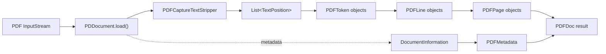
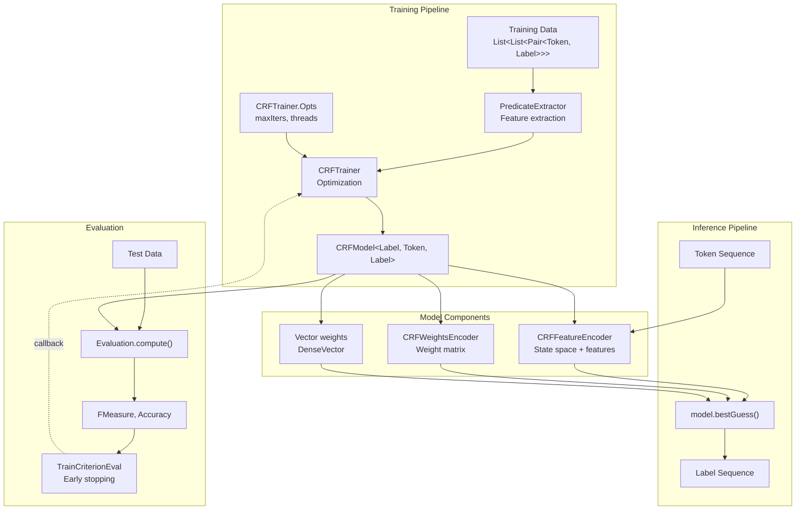
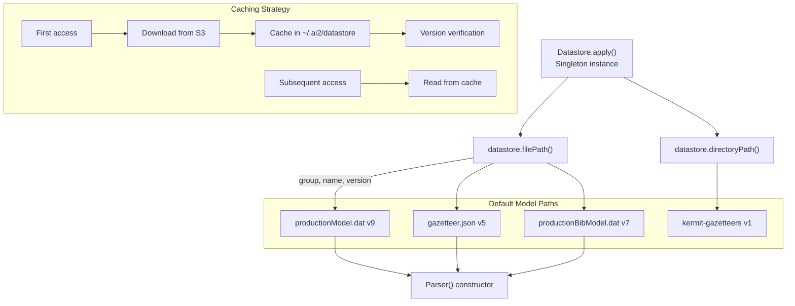
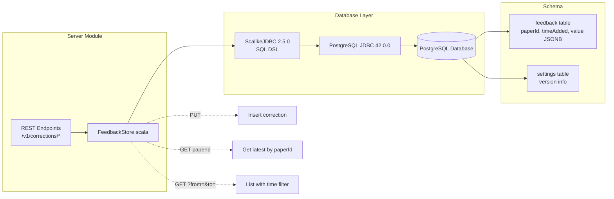
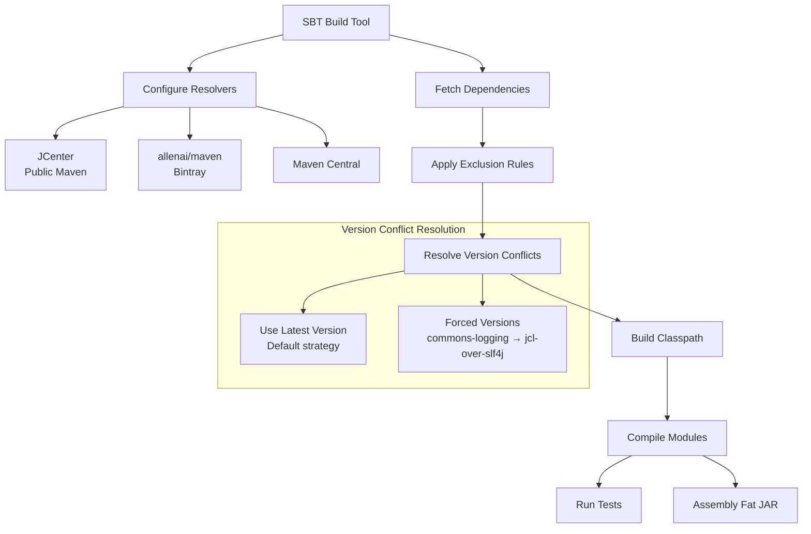

<!-- source: DeepWiki mcp.deepwiki.com · repo allenai/science-parse · page 7 External Dependencies · fetched 2026-10-26 -->

# External Dependencies

<details>
<summary>Relevant source files</summary>

The following files were used as context for generating this wiki page:

- [.gitmodules](.gitmodules)
- [build.sbt](build.sbt)
- [cli/build.sbt](cli/build.sbt)
- [core/build.sbt](core/build.sbt)
- [core/src/main/java/org/allenai/scienceparse/CRFBibRecordParser.java](core/src/main/java/org/allenai/scienceparse/CRFBibRecordParser.java)
- [core/src/main/java/org/allenai/scienceparse/CheckReferences.java](core/src/main/java/org/allenai/scienceparse/CheckReferences.java)
- [core/src/main/java/org/allenai/scienceparse/ExtractReferences.java](core/src/main/java/org/allenai/scienceparse/ExtractReferences.java)
- [core/src/main/java/org/allenai/scienceparse/GazetteerFeatures.java](core/src/main/java/org/allenai/scienceparse/GazetteerFeatures.java)
- [core/src/main/java/org/allenai/scienceparse/Parser.java](core/src/main/java/org/allenai/scienceparse/Parser.java)
- [core/src/main/java/org/allenai/scienceparse/pdfapi/PDFExtractor.java](core/src/main/java/org/allenai/scienceparse/pdfapi/PDFExtractor.java)
- [server/build.sbt](server/build.sbt)

</details>


## Purpose and Scope

This page documents the major external libraries and services that Science Parse depends on. It covers the purpose of each dependency, which modules use them, and how they integrate into the parsing pipeline. For information about the internal architecture and how components interact, see [Architecture](#1.1). For details about model training and data sources, see [Training and Evaluation](#5).

## Dependency Overview by Module

The following table summarizes the key external dependencies across the three Science Parse modules:

| Dependency | Version | Used By | Purpose |
|------------|---------|---------|---------|
| Apache PDFBox | 2.0.9 | Core | PDF rendering and text extraction |
| allenai/ml | 0.16 | Core | CRF model training and inference |
| pdffigures2 | 0.1.0 | Core | Figure and section extraction |
| allenai/datastore | 2.0.0 | Core | Model file management and caching |
| OpenNLP | 1.7.2 | Core | NLP processing utilities |
| AWS S3 SDK | 1.11.213 | Core | S3 paper retrieval |
| FST | 2.47 | Core | Fast object serialization |
| PostgreSQL JDBC | 42.0.0 | Server | Feedback database |
| Jetty | 9.4.1 | Server | HTTP server |
| Jackson | 2.7.9 | CLI | JSON serialization |

**Diagram: Dependency Structure by Module**

```mermaid
graph TB
    subgraph "Core Module Dependencies"
        PDFBox["Apache PDFBox 2.0.9<br/>PDF processing"]
        ML["allenai/ml 0.16<br/>CRF models"]
        PDF2["pdffigures2 0.1.0<br/>Section extraction"]
        DS["Datastore 2.0.0<br/>Model files"]
        OpenNLP["OpenNLP 1.7.2<br/>NLP utilities"]
        S3["AWS S3 SDK 1.11.213<br/>Paper retrieval"]
        FST["FST 2.47<br/>Serialization"]
        Guava["Guava 18.0<br/>Collections"]
        GSC["GS Collections 6.1.0<br/>Primitives"]
        Lombok["Lombok 1.16.20<br/>Code generation"]
    end
    
    subgraph "Server Module Dependencies"
        Jetty["Jetty 9.4.1<br/>HTTP server"]
        PG["PostgreSQL JDBC 42.0.0<br/>Database"]
        SJDBC["ScalikeJDBC 2.5.0<br/>SQL DSL"]
    end
    
    subgraph "CLI Module Dependencies"
        Jackson["Jackson 2.7.9<br/>JSON"]
        Scopt["scopt 3.4.0<br/>CLI parsing"]
    end
    
    Parser[Parser.java]
    PDFExtractor[PDFExtractor.java]
    ExtractRefs[ExtractReferences.java]
    
    SPServer[SPServer.scala]
    FeedbackStore[FeedbackStore.scala]
    
    RunSP[RunSP.scala]
    
    Parser --> ML
    Parser --> DS
    Parser --> FST
    
    PDFExtractor --> PDFBox
    PDFExtractor --> PDF2
    
    ExtractRefs --> ML
    ExtractRefs --> OpenNLP
    ExtractRefs --> FST
    
    RunSP --> S3
    RunSP --> Jackson
    RunSP --> Scopt
    
    SPServer --> Jetty
    SPServer --> Jackson
    
    FeedbackStore --> PG
    FeedbackStore --> SJDBC
```



Sources: [core/build.sbt:1-49](), [server/build.sbt:1-20](), [cli/build.sbt:1-19]()

## PDF Processing Dependencies

### Apache PDFBox

**Version:** 2.0.9 (core) and 2.0.9 (fontbox)

Apache PDFBox is the foundational library for all PDF processing in Science Parse. It provides low-level access to PDF document structure, text extraction, and rendering capabilities.

**Key Integration Points:**

- [core/src/main/java/org/allenai/scienceparse/pdfapi/PDFExtractor.java:11]() - Main integration class
- [core/src/main/java/org/allenai/scienceparse/Parser.java:30]() - Uses `PDDocument` for document loading

**Usage in PDFExtractor:**



The `PDFCaptureTextStripper` class [core/src/main/java/org/allenai/scienceparse/pdfapi/PDFExtractor.java:337-439]() extends PDFBox's `PDFTextStripper` to capture detailed position and font information for each text token. This enables Science Parse to:

- Detect font sizes and families for header identification
- Compute spatial relationships between tokens for line assembly
- Extract bounding boxes for layout analysis
- Handle superscripts (encoded as ⍐...⍗) [core/src/main/java/org/allenai/scienceparse/pdfapi/PDFExtractor.java:294-325]()

**PDF Metadata Extraction:**

The system extracts metadata using PDFBox's `DocumentInformation` API [core/src/main/java/org/allenai/scienceparse/pdfapi/PDFExtractor.java:127-151]():
- Title (with quality heuristics to reject bad titles)
- Authors (parsed from semicolon or comma-delimited strings)
- Keywords
- Creation/modification dates
- Creator information

Sources: [core/build.sbt:11-12](), [core/src/main/java/org/allenai/scienceparse/pdfapi/PDFExtractor.java:1-441]()

### pdffigures2

**Version:** 0.1.0

pdffigures2 is an Allen AI library for extracting figures, tables, and section headers from PDF documents. It provides more sophisticated document structure analysis than basic text extraction.

**Integration:**

Science Parse uses pdffigures2's `FigureExtractor` class through the `org.allenai.pdffigures2` package [core/src/main/java/org/allenai/scienceparse/Parser.java:27](). The extractor is invoked as part of the parsing pipeline to identify document sections, though the specific invocation code is not shown in the provided excerpts.

**Purpose:**
- Section boundary detection
- Figure and table extraction
- Document structure recognition

Sources: [core/build.sbt:38](), [core/src/main/java/org/allenai/scienceparse/Parser.java:27]()

## Machine Learning Dependencies

### allenai/ml Library

**Version:** 0.16

The `allenai/ml` library provides the core machine learning infrastructure for Science Parse, specifically Conditional Random Fields (CRF) for sequence labeling.

**Diagram: ML Library Components**



**Key Classes:**

1. **CRFModel** [core/src/main/java/org/allenai/scienceparse/Parser.java:88]() - The trained model used for inference
   - Generic type parameters: `<String, PaperToken, String>` for main parser
   - Generic type parameters: `<String, String, String>` for bibliography parser

2. **CRFTrainer** [core/src/main/java/org/allenai/scienceparse/Parser.java:569-688]() - Training implementation
   - Configurable via `CRFTrainer.Opts` [core/src/main/java/org/allenai/scienceparse/Parser.java:541-544]()
   - Supports multi-threaded training
   - Early stopping via `TrainCriterionEval` [core/src/main/java/org/allenai/scienceparse/Parser.java:563-566]()

3. **CRFFeatureEncoder** [core/src/main/java/org/allenai/scienceparse/Parser.java:798]() - Converts features to indices
   - Uses `StateSpace` for label transitions
   - Uses `Indexer<String>` for node and edge features

4. **Evaluation** [core/src/main/java/org/allenai/scienceparse/Parser.java:667]() - Model evaluation utilities
   - Token-level accuracy
   - Per-label F-measures
   - Used in early stopping decisions

**Model Serialization:**

Models are saved and loaded using a custom format [core/src/main/java/org/allenai/scienceparse/Parser.java:722-755]():
```
1. Data version string
2. StateSpace (label set and transitions)
3. Node features Indexer
4. Edge features Indexer
5. Weights vector (doubles)
6. ParserLMFeatures (optional, via FST)
7. GazetteerFeatures (optional, via FST)
```

**Parallel Processing:**

The library supports parallel map-reduce operations via `Parallel.MROpts` [core/src/main/java/org/allenai/scienceparse/Parser.java:547-548]() for efficient evaluation on multi-core systems.

Sources: [core/build.sbt:14-17](), [core/src/main/java/org/allenai/scienceparse/Parser.java:1-1532](), [core/src/main/java/org/allenai/scienceparse/ExtractReferences.java:1-1086]()

### OpenNLP

**Version:** 1.7.2

OpenNLP provides natural language processing utilities used in reference extraction and text processing.

**Usage:**

While the specific integration points are not visible in the provided excerpts, OpenNLP is included as a dependency [core/build.sbt:41]() and likely used for:
- Sentence boundary detection
- Tokenization
- Named entity recognition support

Sources: [core/build.sbt:41]()

## Storage and Retrieval Dependencies

### Datastore Library

**Version:** 2.0.0

The Allen AI Datastore library provides a sophisticated model file management system with versioning and automatic downloading.

**Diagram: Datastore Integration**



**Key Methods:**

1. **getDefaultProductionModel()** [core/src/main/java/org/allenai/scienceparse/Parser.java:97-99]()
   - Returns: Path to `productionModel.dat` version 9
   - Group: `org.allenai.scienceparse`

2. **getDefaultGazetteer()** [core/src/main/java/org/allenai/scienceparse/Parser.java:100-102]()
   - Returns: Path to `gazetteer.json` version 5
   - Contains 10.2K paper entries for validation

3. **getDefaultBibModel()** [core/src/main/java/org/allenai/scienceparse/Parser.java:106-108]()
   - Returns: Path to `productionBibModel.dat` version 7
   - Bibliography-specific CRF model

4. **getDefaultGazetteerDir()** [core/src/main/java/org/allenai/scienceparse/Parser.java:103-105]()
   - Returns: Directory path to `kermit-gazetteers` version 1
   - Structured gazetteers for entity recognition

**Versioning Strategy:**

Each model file has an explicit version number. When the Parser needs a model, the Datastore:
1. Checks if the file exists locally with the correct version
2. If not, downloads from a versioned S3 bucket
3. Caches locally for future use
4. Verifies integrity

This ensures reproducible results and allows model updates without code changes.

Sources: [core/build.sbt:23](), [core/src/main/java/org/allenai/scienceparse/Parser.java:96-108]()

### AWS S3 SDK

**Version:** 1.11.213

The AWS SDK enables retrieval of papers from S3 buckets, primarily used by the CLI module for batch processing.

**Integration:**

The S3 client is used through the `PaperSource` abstraction (see [Paper Source Strategies](#4.2)) to retrieve PDFs by Semantic Scholar paper IDs. The SDK provides:
- S3 object retrieval
- Credential management
- Retry logic
- Streaming support

Sources: [core/build.sbt:30]()

### PostgreSQL

**Version:** 42.0.0 (JDBC driver)

PostgreSQL is used exclusively by the Server module to store user feedback and corrections.

**Diagram: Database Integration**



**Schema Details:**

The feedback system uses JSONB storage for flexibility, allowing arbitrary correction data structures without schema migrations. The `settings` table tracks schema versions for migration management.

**ScalikeJDBC:**

ScalikeJDBC [server/build.sbt:17]() provides a Scala DSL for SQL queries, offering:
- Type-safe query construction
- Connection pooling
- Transaction management
- Result mapping to case classes

Sources: [server/build.sbt:17-18]()

## Serialization and Data Format Dependencies

### FST (Fast Serialization)

**Version:** 2.47

FST provides high-performance Java object serialization, significantly faster than standard Java serialization.

**Usage in Science Parse:**

1. **Model Serialization** [core/src/main/java/org/allenai/scienceparse/Parser.java:747-754]()
   - Saves `ParserLMFeatures` objects
   - Saves `GazetteerFeatures` objects
   - Used in both main parser and bibliography models

2. **Gazetteer Cache** [core/src/main/java/org/allenai/scienceparse/Parser.java:166-194]()
   - Creates binary cache of parsed gazetteer JSON
   - Reduces startup time from seconds to milliseconds
   - Cache file naming: `{gazetteerFile}-{hash}.gazetteerCache.bin`

3. **Model Loading** [core/src/main/java/org/allenai/scienceparse/Parser.java:786-792]()
   - Deserializes feature extractors from model files
   - Handles backward compatibility

**Cache Strategy:**

The gazetteer cache [core/src/main/java/org/allenai/scienceparse/Parser.java:171-195]() uses file locking to prevent race conditions:
```
1. Create/open cache file in temp directory
2. Acquire exclusive file lock
3. If file size == 0:
   - Parse JSON gazetteer
   - Serialize with FST
   - Write to locked file
4. Else:
   - Read pre-existing cache
5. Release lock
```

Sources: [core/build.sbt:40](), [core/src/main/java/org/allenai/scienceparse/Parser.java:31](), [core/src/main/java/org/allenai/scienceparse/ExtractReferences.java:29-30]()

### Jackson and Spray JSON

**Jackson Version:** 2.7.9 (CLI module)  
**Spray JSON Version:** 1.3.5 (Core module)

The system uses two JSON libraries for different purposes:

**Jackson (CLI):**
- Used by `RunSP` for input/output serialization [cli/build.sbt:12-16]()
- Handles batch processing results
- Scala module for case class support

**Spray JSON (Core):**
- Used for internal JSON protocol definitions [core/build.sbt:39]()
- Lightweight and Scala-idiomatic
- Server response serialization

Sources: [core/build.sbt:39](), [cli/build.sbt:12-16]()

## Server Dependencies

### Jetty

**Version:** 9.4.1.v20170120

Eclipse Jetty provides the embedded HTTP server for the Science Parse Server module.

**Integration:**

Jetty serves the REST API on port 8080 (default). The server is configured and started by `SPServer` with:
- Custom routing system (StringRoute, RegexRoute)
- JSON request/response handling
- Multipart file upload support
- CORS headers

Sources: [server/build.sbt:15]()

### Typesafe Config

**Version:** 1.3.1

Used for configuration management in the server module, following the HOCON (Human-Optimized Config Object Notation) format. Enables:
- Environment-specific configuration
- Configuration file cascading
- Type-safe config access

Sources: [server/build.sbt:16]()

## Utility Libraries

### GS Collections

**Version:** 6.1.0

GS Collections (now Eclipse Collections) provides high-performance primitive collections, avoiding boxing overhead.

**Usage Examples:**

1. **Primitive Maps** [core/src/main/java/org/allenai/scienceparse/Parser.java:7]()
   - `MutableCharIntMap` for character-to-int mappings
   - Used in feature extraction

2. **Primitive Sets** [core/src/main/java/org/allenai/scienceparse/Parser.java:8]()
   - `MutableIntSet` for tracking parse numbers
   - `LongHashSet` for gazetteer hash codes [core/src/main/java/org/allenai/scienceparse/GazetteerFeatures.java:16]()

3. **Tuples** [core/src/main/java/org/allenai/scienceparse/Parser.java:10]()
   - `Pair<T, U>` extensively used for label pairs
   - Immutable and efficient

Sources: [core/build.sbt:19](), [core/src/main/java/org/allenai/scienceparse/Parser.java:4-10](), [core/src/main/java/org/allenai/scienceparse/GazetteerFeatures.java:15-17]()

### Lombok

**Version:** 1.16.20

Lombok eliminates boilerplate code through annotation processing.

**Common Annotations Used:**

- `@Data` - Generates getters, setters, equals, hashCode, toString [core/src/main/java/org/allenai/scienceparse/Parser.java:309]()
- `@Builder` - Fluent builder pattern
- `@val` - Type inference for final variables [core/src/main/java/org/allenai/scienceparse/Parser.java:12]()
- `@Slf4j` - Logger field injection [core/src/main/java/org/allenai/scienceparse/pdfapi/PDFExtractor.java:37]()
- `@SneakyThrows` - Unchecked exception wrapping [core/src/main/java/org/allenai/scienceparse/pdfapi/PDFExtractor.java:107]()

**Development Note:** Lombok requires IDE plugin installation for proper code completion and error highlighting. See [Development Environment Setup](#6.2) for configuration details.

Sources: [core/build.sbt:18](), [core/src/main/java/org/allenai/scienceparse/Parser.java:12]()

### Guava

**Version:** 18.0

Google Guava provides utilities for:
- Immutable collections
- Caching (LoadingCache)
- String utilities
- Preconditions and null-checking

**Key Usage:**

The `LoadingCache` [core/src/main/java/org/allenai/scienceparse/CRFBibRecordParser.java:3-4]() is used in `CRFBibRecordParser` to cache CRF inference results:
- Maximum size: 10,240 entries
- Expiration: 10 minutes after access
- Significantly speeds up repeated bibliography parsing

Sources: [core/build.sbt:34](), [core/src/main/java/org/allenai/scienceparse/CRFBibRecordParser.java:3-163]()

### Bouncy Castle

**Versions:** 1.54 (bcprov, bcmail, bcpkix)

Bouncy Castle provides cryptographic functionality for:
- PDF encryption/decryption
- Certificate handling
- Signature verification

Required for processing encrypted PDF documents that PDFBox may encounter.

Sources: [core/build.sbt:24-26]()

## Dependency Management and Build

### Git Submodule

The project includes the `allenai/ml` library as a Git submodule at `ext/ml` on the `mr-patch` branch [.gitmodules:1-4](). This allows:
- Local modifications to the ML library
- Version pinning
- Development workflow integration

### SBT Resolvers

The build configuration includes custom Maven repositories [build.sbt:15-18]():
- JCenter (Bintray's public repository)
- Allen AI Bintray repository (`allenai/maven`)

These resolvers provide access to Allen AI's internal libraries like `pdffigures2`, `datastore`, and `word2vecjava`.

### Exclusion Rules

Several dependencies have exclusion rules to prevent conflicts:
- `commons-logging` is excluded in favor of `jcl-over-slf4j` [core/build.sbt:11-13]()
- `slf4j-simple` is excluded from `allenai/ml` [core/build.sbt:16]()
- Various Apache commons modules are excluded to prevent version conflicts

**Diagram: Dependency Resolution Flow**



Sources: [build.sbt:1-73](), [core/build.sbt:1-49](), [.gitmodules:1-4]()

## Version Compatibility

### Scala Versions

Science Parse is cross-compiled for Scala 2.11.12 and 2.12.9 [build.sbt:3-6]():
- Default: Scala 2.12.9
- Supported: Scala 2.11.12
- Not yet supported: Scala 2.13.0 (requires collections API updates)

### Java Version

The system requires **Java 8** (OpenJDK 8) as indicated by CircleCI configuration and API usage. This is due to:
- PDFBox 2.0.9 Java 8 requirements
- ML library dependencies
- Use of Java 8 streams and lambda expressions

### Dependency Version Matrix

| Category | Library | Core | CLI | Server |
|----------|---------|------|-----|--------|
| **Logging** | slf4j | 1.7.7 | 1.7.7 | 1.7.7 |
| **JSON** | spray-json | 1.3.5 | - | - |
| **JSON** | jackson | - | 2.7.9 | - |
| **SQL** | scalikejdbc | - | - | 2.5.0 |
| **HTTP** | jetty | - | - | 9.4.1 |
| **Scala** | scala-java8-compat | 0.8.0 | - | - |

All modules share logging infrastructure through `slf4j` with `jcl-over-slf4j` to redirect Apache Commons Logging.

Sources: [build.sbt:3-11](), [core/build.sbt:13](), [cli/build.sbt:13](), [server/build.sbt:14]()