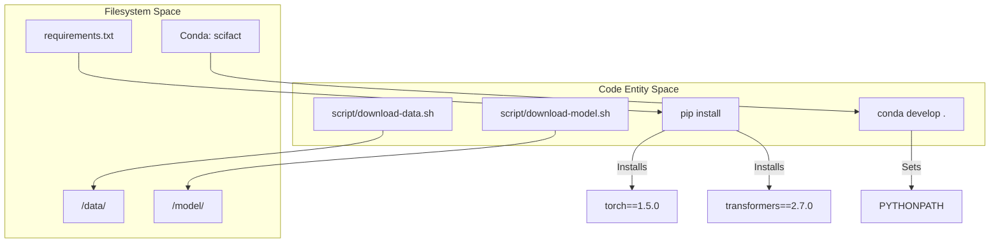
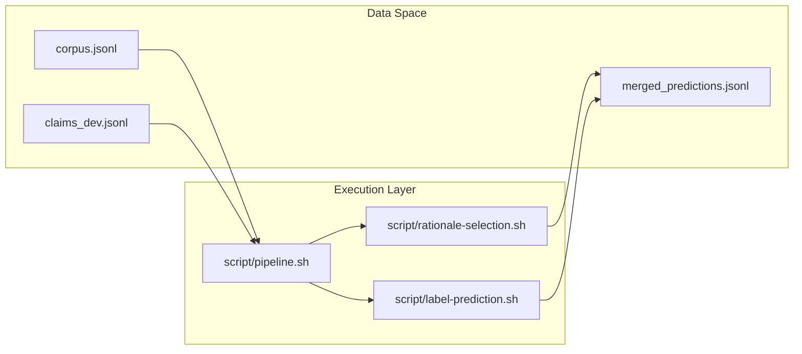

<!-- source: DeepWiki mcp.deepwiki.com · repo allenai/scifact · page 1.1 Getting Started: Installation & Environment Setup · fetched 2026-10-26 -->

# Getting Started: Installation & Environment Setup

<details>
<summary>Relevant source files</summary>

The following files were used as context for generating this wiki page:

- [README.md](README.md)
- [doc/claims-with-citances.md](doc/claims-with-citances.md)
- [requirements.txt](requirements.txt)
- [script/download-data.sh](script/download-data.sh)
- [script/download-model.sh](script/download-model.sh)

</details>


This page provides a comprehensive guide to setting up the SciFact development environment. It covers dependency management via Conda, data acquisition, pre-trained model retrieval, and the execution of the end-to-end verification pipeline.

## 1. Environment Configuration

The SciFact project requires Python 3.7. The environment setup involves creating a dedicated Conda environment and installing specific versions of deep learning libraries, including `torch` and `transformers`.

### Step-by-Step Setup

1.  **Create Conda Environment**: Initialize a new environment named `scifact`.
    ```bash
    conda create --name scifact python=3.7 conda-build
    ```
2.  **Project Integration**: Add the project root to your `PYTHONPATH` using `conda develop`. This allows the interpreter to resolve internal modules like `verisci`.
    ```bash
    conda develop .
    ```
3.  **Install Dependencies**: Install the required Python packages listed in `requirements.txt`.
    ```bash
    pip install -r requirements.txt
    ```

### Key Dependencies
The project relies on the following core libraries for its NLP pipeline:
*   `torch==1.5.0`: Core tensor computations and neural network modules.
*   `transformers==2.7.0`: Interface for BERT, RoBERTa, and SciBERT models.
*   `scispacy==0.2.5`: Specialized scientific text processing.
*   `jsonlines==1.2.0`: Handling the `.jsonl` data formats used throughout the pipeline.

**Sources:** [README.md:35-55](), [requirements.txt:1-30]()

---

## 2. Data and Model Acquisition

SciFact uses a structured directory format for its corpus and claims. Pre-trained models are hosted on AWS S3 and can be retrieved using provided shell scripts.

### Downloading the Dataset
Run the following script to download and unpack the corpus and claim files:
```bash
./script/download-data.sh
```
This script fetches `data.tar.gz` and extracts it into a `data/` directory with the following structure:
*   `corpus.jsonl`: The collection of scientific abstracts.
*   `claims_train.jsonl` / `claims_dev.jsonl`: Labeled claims for training and development.
*   `claims_test.jsonl`: Unlabeled claims for leaderboard submission.

### Downloading Pre-trained Models
Models are categorized by their component (rationale selection or label prediction), the BERT variant used, and the training dataset.
```bash
./script/download-model.sh [model-component] [bert-variant] [training-dataset]
```
*   **Components**: `rationale`, `label`.
*   **Variants**: `roberta_large`, `roberta_base`, `scibert`, `biomed_roberta_base`.
*   **Training Sets**: `scifact`, `fever_scifact`, `fever`, `snopes`.

**Sources:** [README.md:96-124](), [README.md:138-159](), [script/download-data.sh:1-16](), [script/download-model.sh:1-34]()

---

## 3. System Architecture & Data Flow

The following diagrams illustrate how the installation components map to the functional entities in the codebase.

### Environment and Data Entity Mapping
This diagram bridges the "Natural Language" requirements to the "Code Entities" that manage them.


**Sources:** [README.md:35-55](), [requirements.txt:1-30](), [script/download-data.sh:1-16](), [script/download-model.sh:1-34]()

### Pipeline Execution Flow
This diagram shows the relationship between the scripts and the data components they produce.


**Sources:** [README.md:57-85](), [script/download-data.sh:1-16]()

---

## 4. Running the End-to-End Pipeline

Once the environment is set up and data is downloaded, you can run the full verification pipeline. The pipeline consists of three main stages: retrieval, rationale selection, and label prediction.

### Pipeline Command
```bash
./script/pipeline.sh [retrieval] [model] [dataset]
```

### Argument Configurations
| Argument | Options | Description |
| :--- | :--- | :--- |
| `retrieval` | `oracle`, `open` | `oracle` uses gold abstracts; `open` uses TF-IDF retrieval. |
| `model` | `oracle-rationale`, `zero-shot`, `verisci` | `verisci` is the standard pipeline described in the paper. |
| `dataset` | `dev`, `test` | Use `dev` for evaluation; `test` for unlabeled predictions. |

### Example: Reproducing Paper Metrics
To run the standard "VeriSci" pipeline on the development set with open retrieval:
```bash
./script/pipeline.sh open verisci dev
```
This script will:
1.  Retrieve relevant abstracts from `corpus.jsonl`.
2.  Select rationale sentences within those abstracts.
3.  Predict the veracity label (SUPPORT, REFUTE, or NO_INFO).
4.  Output a `merged_predictions.jsonl` file and compute performance metrics (F1 scores).

**Sources:** [README.md:57-94]()

---

