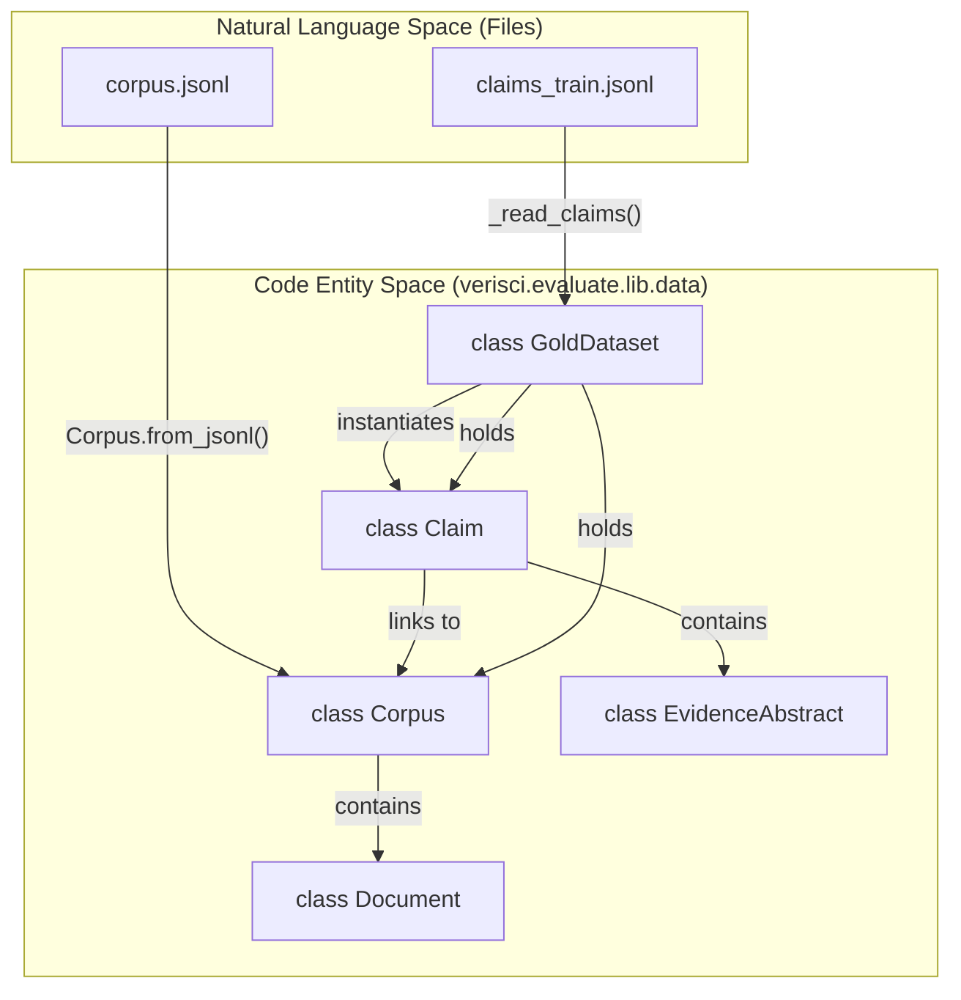
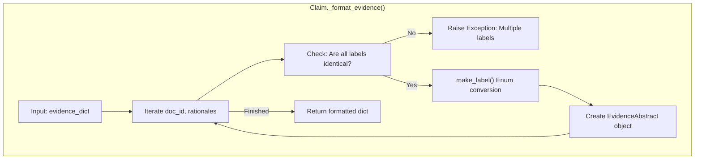

<!-- source: DeepWiki mcp.deepwiki.com · repo allenai/scifact · page 1.2 Dataset: Schema, Formats, and Claim Generation · fetched 2026-10-26 -->

# Dataset: Schema, Formats, and Claim Generation

Relevant source files

The following files were used as context for generating this wiki page:

- [README.md](README.md)
- [doc/claims-with-citances.md](doc/claims-with-citances.md)
- [doc/data.md](doc/data.md)
- [doc/training.md](doc/training.md)
- [verisci/evaluate/lib/data.py](verisci/evaluate/lib/data.py)
- [verisci/inference/merge_predictions.py](verisci/inference/merge_predictions.py)

This page provides a technical deep dive into the SciFact dataset structure, the programmatic interfaces used to interact with the data, and the specialized formats for claim generation research.

## Data Formats and Schema

The SciFact dataset is distributed as a set of JSONL (JSON Lines) files. The core components are the **Corpus**, which contains the evidence documents, and the **Claims**, which contain the statements to be verified along with their ground-truth evidence and labels.

### Corpus Schema (`corpus.jsonl`)
The corpus contains the abstracts used as the source of evidence. Each line is a JSON object representing a single document.

| Field | Type | Description |
| :--- | :--- | :--- |
| `doc_id` | `number` | The unique S2ORC identifier for the document. |
| `title` | `string` | The title of the scientific paper. |
| `abstract` | `string[]` | The abstract text, pre-tokenized into a list of sentences. |
| `structured` | `boolean` | Indicates if the abstract contains section headers (e.g., "METHODS", "RESULTS"). |

Sources: [doc/data.md:67-75](), [verisci/evaluate/lib/data.py:54-59]()

### Claims Schema (`claims_train.jsonl`, `claims_dev.jsonl`)
Claims include the statement text and the "gold" evidence required to verify them.

| Field | Type | Description |
| :--- | :--- | :--- |
| `id` | `number` | Unique integer claim ID. |
| `claim` | `string` | The natural language statement. |
| `evidence` | `dict` | Keyed by `doc_id`, containing a list of rationale objects (sentences and labels). |
| `cited_doc_ids` | `number[]` | IDs of documents cited in the original paper's citation sentence. |

**Evidence Object Detail:**
Within the `evidence` dictionary, each entry for a `doc_id` contains a list of rationales. In the current SciFact release, all rationales for a single abstract share the same label (`SUPPORT` or `CONTRADICT`).

Sources: [doc/data.md:15-32](), [verisci/evaluate/lib/data.py:158-178]()

---

## Python API: GoldDataset and Data Models

The `verisci` library provides a high-level API to load and manipulate these files, abstracting the raw JSON into Python dataclasses.

### Key Classes
- **`GoldDataset`**: The primary entry point. It loads both the `Corpus` and the claim files, linking them together. [verisci/evaluate/lib/data.py:98-104]()
- **`Corpus`**: A collection of `Document` objects. It provides `get_document(doc_id)` for O(1) or O(N) lookup. [verisci/evaluate/lib/data.py:63-91]()
- **`Claim`**: Represents a single claim. During initialization, it converts raw evidence dictionaries into `EvidenceAbstract` objects and resolves `cited_doc_ids` into full `Document` objects. [verisci/evaluate/lib/data.py:145-156]()
- **`Label` (Enum)**: Maps dataset strings to integers: `SUPPORTS` (2), `NEI` (1), `REFUTES` (0). [verisci/evaluate/lib/data.py:20-23]()

### Data Flow and Relationship
The following diagram illustrates how the `GoldDataset` class bridges the gap between the raw JSONL files and the internal Python object graph.

**Data Loading and Object Mapping**

Sources: [verisci/evaluate/lib/data.py:83-91](), [verisci/evaluate/lib/data.py:102-104](), [verisci/evaluate/lib/data.py:113-127]()

---

## Claim Generation: `claims_with_citances.jsonl`

For research into generating claims from citation contexts (citances), a specialized dataset is provided. This format maps a citation sentence within its original paragraph context to the resulting atomic claims.

### Schema Detail
- **`citation_paragraph`**: The full paragraph from the source paper.
- **`citance`**: The specific sentence containing the citation.
- **`claims`**: A list of objects containing:
    - `claim_text`: The resulting atomic claim.
    - `claim_subject`: The specific entity the claim is about.
    - `is_negation`: Boolean indicating if the claim contradicts the citance.

Sources: [doc/claims-with-citances.md:1-14](), [README.md:128-136]()

---

## Implementation Details: Evidence Formatting

The `Claim` class performs a critical normalization step in its `__post_init__` method. While the JSON schema allows for multiple rationales with different labels per document, the `verisci` implementation enforces a "one label per abstract" rule for the current SciFact release.

**Logic Flow for Evidence Normalization**

### Key Functions
- `make_label(label_str)`: Converts strings like "SUPPORT" or "CONTRADICT" into `Label` enum values. [verisci/evaluate/lib/data.py:26-35]()
- `Claim.pretty_print()`: A utility for debugging that renders a claim and its associated evidence sentences directly to the console. [verisci/evaluate/lib/data.py:184-202]()

Sources: [verisci/evaluate/lib/data.py:158-178](), [doc/data.md:91-114]()

---

