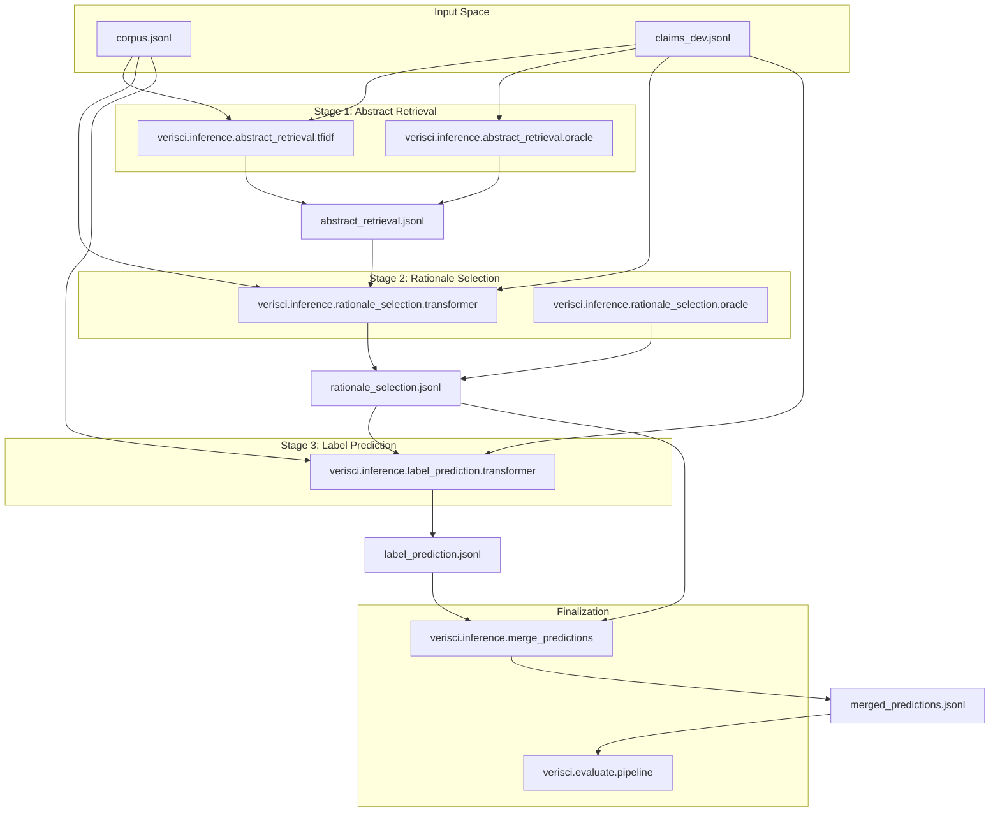
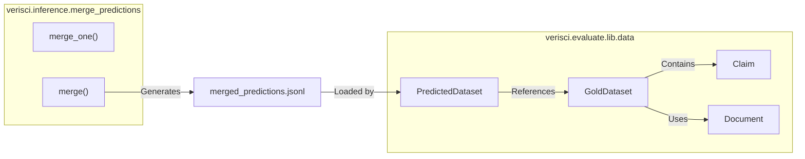

<!-- source: DeepWiki mcp.deepwiki.com · repo allenai/scifact · page 2 Verification Pipeline Architecture · fetched 2026-10-26 -->

# Verification Pipeline Architecture

Relevant source files

The following files were used as context for generating this wiki page:

- [doc/model.md](doc/model.md)
- [script/label-prediction.sh](script/label-prediction.sh)
- [script/pipeline.sh](script/pipeline.sh)
- [script/rationale-selection.sh](script/rationale-selection.sh)
- [verisci/evaluate/lib/data.py](verisci/evaluate/lib/data.py)
- [verisci/evaluate/pipeline.py](verisci/evaluate/pipeline.py)
- [verisci/inference/merge_predictions.py](verisci/inference/merge_predictions.py)

The SciFact verification pipeline is a modular, three-stage system designed to verify scientific claims against a large corpus of research abstracts. The pipeline transitions from a massive search space (thousands of documents) to a specific set of supporting or refuting sentences (rationales) and a final veracity label.

The pipeline is orchestrated primarily through shell scripts that invoke Python modules, with each stage communicating via standardized JSONL files.

## Pipeline Overview

The verification process follows a sequential flow where the output of one stage serves as the input for the next. This modularity allows for "Oracle" experiments, where gold-standard data can be substituted for any stage's output to isolate component performance.

### Verification Workflow Diagram

This diagram illustrates the flow of data through the system's core inference modules and the resulting file artifacts.

**Sources:** [script/pipeline.sh:46-102](), [doc/model.md:3-7]()

---

## Pipeline Stages

### 1. Abstract Retrieval
The first stage filters the `corpus.jsonl` to identify a small set of documents (typically $k=3$) relevant to a given claim. The system supports a TF-IDF baseline and an Oracle mode for evaluation.
*   **Primary Script:** `verisci/inference/abstract_retrieval/tfidf.py`
*   **Output:** `abstract_retrieval.jsonl`
*   **For details, see [Abstract Retrieval](#2.1)**

### 2. Rationale Selection
Given the retrieved abstracts, this stage identifies specific sentences that provide evidence for or against the claim. It uses a Transformer-based model to score sentences and selects them based on a probability threshold (flex) or a fixed count (top-k).
*   **Primary Script:** `verisci/inference/rationale_selection/transformer.py`
*   **Output:** `rationale_selection.jsonl`
*   **For details, see [Rationale Selection](#2.2)**

### 3. Label Prediction
This stage assigns a veracity label—`SUPPORTS`, `REFUTES`, or `NOT_ENOUGH_INFO` (NEI)—to the claim based on the rationales selected in the previous step.
*   **Primary Script:** `verisci/inference/label_prediction/transformer.py`
*   **Output:** `label_prediction.jsonl`
*   **For details, see [Label Prediction](#2.3)**

**Sources:** [script/pipeline.sh:46-93](), [doc/model.md:17-143]()

---

## Data Integration and Merging

The outputs of the Rationale Selection and Label Prediction stages are stored in separate files. To perform final evaluation or submission, these must be unified into a single result file.

### Prediction Merging
The `merge_predictions.py` script performs the following logic:
1.  Aligns rationale and label files by `claim_id` [verisci/inference/merge_predictions.py:58-61]().
2.  Filters out documents where the predicted label is `NOT_ENOUGH_INFO` [verisci/inference/merge_predictions.py:41-43]().
3.  Pairs the selected sentence indices with the final veracity label for each document [verisci/inference/merge_predictions.py:42-43]().

### Code Entity Mapping
The following diagram maps the high-level pipeline concepts to the specific Python classes and functions responsible for data representation and merging.

**Sources:** [verisci/inference/merge_predictions.py:21-70](), [verisci/evaluate/lib/data.py:98-218]()

---

## Execution Modes

The pipeline can be executed in different configurations using `script/pipeline.sh` [script/pipeline.sh:1-12]():

| Mode | Retrieval | Rationale Selection | Label Model |
| :--- | :--- | :--- | :--- |
| **Oracle** | `oracle.py` | `oracle.py` | `transformer.py` |
| **Zero-Shot** | `tfidf.py` | `transformer.py` (FEVER) | `transformer.py` (FEVER) |
| **VeriSci** | `tfidf.py` | `transformer.py` (SciFact) | `transformer.py` (FEVER+SciFact) |

**Sources:** [script/pipeline.sh:14-23](), [script/pipeline.sh:48-81]()

For detailed instructions on running the full pipeline and merging results, see **[Prediction Merging and Pipeline Execution](#2.4)**.

---

