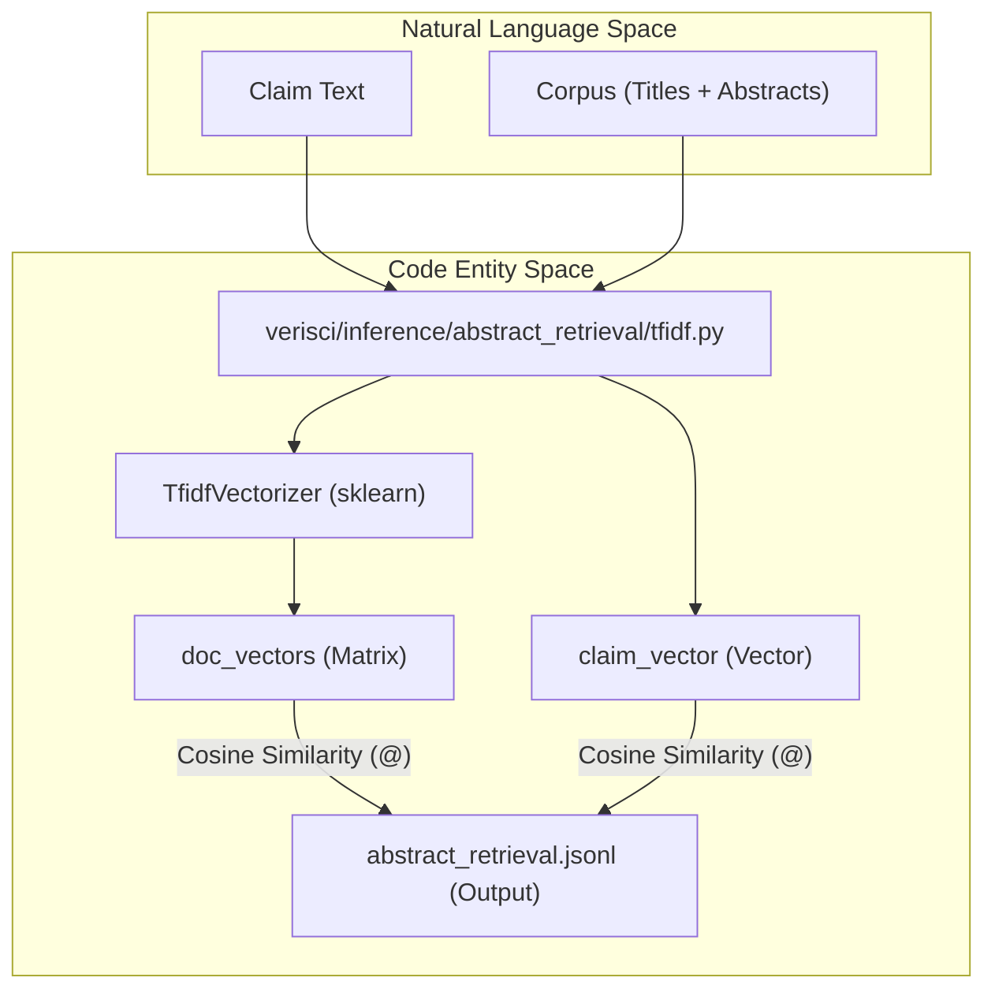
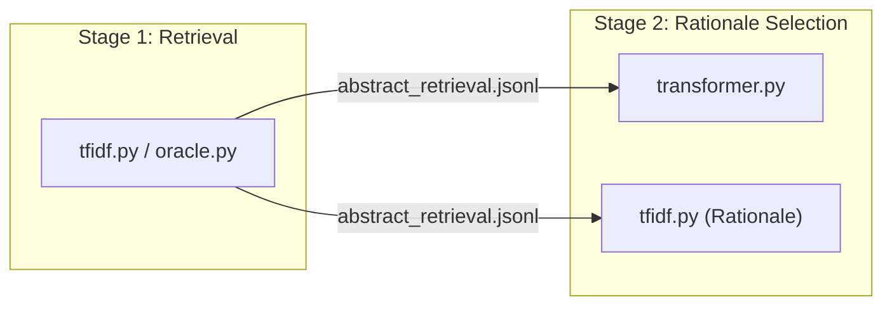

<!-- source: DeepWiki mcp.deepwiki.com · repo allenai/scifact · page 2.1 Abstract Retrieval · fetched 2026-10-26 -->

# Abstract Retrieval

<details>
<summary>Relevant source files</summary>

The following files were used as context for generating this wiki page:

- [doc/model.md](doc/model.md)
- [verisci/evaluate/pipeline.py](verisci/evaluate/pipeline.py)
- [verisci/evaluate/rationale_selection.py](verisci/evaluate/rationale_selection.py)
- [verisci/inference/abstract_retrieval/oracle.py](verisci/inference/abstract_retrieval/oracle.py)
- [verisci/inference/abstract_retrieval/tfidf.py](verisci/inference/abstract_retrieval/tfidf.py)
- [verisci/inference/label_prediction/oracle.py](verisci/inference/label_prediction/oracle.py)
- [verisci/inference/rationale_selection/first.py](verisci/inference/rationale_selection/first.py)

</details>


Abstract Retrieval is the first stage of the SciFact verification pipeline [doc/model.md:3-4](). Its primary goal is to identify a subset of documents from the corpus that are likely to contain evidence (rationales) for a given claim. The output of this stage serves as the input for the subsequent Rationale Selection stage [doc/model.md:100]().

The system supports two main modes: **Oracle** retrieval (using gold-standard data) and **TF-IDF** retrieval (open retrieval using term frequency-inverse document frequency).

## Implementation Overview

The retrieval process transforms a natural language claim into a set of document identifiers. The following diagram illustrates the data flow and the code entities involved in this transformation.

### Retrieval Data Flow

Sources: [verisci/inference/abstract_retrieval/tfidf.py:5-37]()

## Retrieval Methods

### 1. TF-IDF Retrieval
The TF-IDF retriever [verisci/inference/abstract_retrieval/tfidf.py]() uses `sklearn.feature_extraction.text.TfidfVectorizer` to represent both the corpus and the claims in a vector space.

*   **Mechanism**: It concatenates the document title and all sentences in the abstract to form the document representation [verisci/inference/abstract_retrieval/tfidf.py:27-28]().
*   **Ranking**: Documents are ranked by the dot product (cosine similarity) of the `doc_vectors` and the `claim_vector` [verisci/inference/abstract_retrieval/tfidf.py:35-36]().
*   **Parameters**:
    *   `--k`: Number of documents to retrieve per claim [verisci/inference/abstract_retrieval/tfidf.py:10]().
    *   `--min-gram` / `--max-gram`: N-gram range for the vectorizer [verisci/inference/abstract_retrieval/tfidf.py:11-12]().

### 2. Oracle Retrieval
The Oracle retriever [verisci/inference/abstract_retrieval/oracle.py]() is used for upper-bound experiments. It bypasses actual search and returns the ground-truth document IDs associated with a claim.

*   **Behavior**: It extracts keys from the `evidence` field in the dataset [verisci/inference/abstract_retrieval/oracle.py:14]().
*   **NEI Handling**: If `--include-nei` is specified, it will include the first document from `cited_doc_ids` for claims that have no supporting/refuting evidence (NOT_ENOUGH_INFO) [verisci/inference/abstract_retrieval/oracle.py:15-16]().

Sources: [verisci/inference/abstract_retrieval/tfidf.py:1-54](), [verisci/inference/abstract_retrieval/oracle.py:1-22](), [doc/model.md:19-37]()

## Output Format: `abstract_retrieval.jsonl`

Regardless of the method used, the output is a JSONL file where each line corresponds to a claim and its retrieved documents.

| Field | Type | Description |
| :--- | :--- | :--- |
| `claim_id` | Integer | The unique identifier of the claim. |
| `doc_ids` | List[Int] | A list of retrieved document IDs, ranked by relevance. |

**Example Entry:**
```json
{"claim_id": 1, "doc_ids": [123, 456, 789]}
```
Sources: [verisci/inference/abstract_retrieval/tfidf.py:44-47](), [verisci/inference/abstract_retrieval/oracle.py:18-21]()

## Evaluation

Evaluation is performed by comparing the retrieved document IDs against the gold-standard evidence documents.

### Metrics
The TF-IDF script calculates several statistics if the dataset is not the test set [verisci/inference/abstract_retrieval/tfidf.py:17]():
*   **Reciprocal Rank**: Median, Average, Min, and Max reciprocal ranks of the gold documents within the retrieved list [verisci/inference/abstract_retrieval/tfidf.py:50-53]().

### Execution
To evaluate retrieval performance, use the dedicated evaluation script:
```sh
python verisci/evaluate/abstract_retrieval.py \
    --dataset data/claims_test.jsonl \
    --abstract-retrieval abstract_retrieval.jsonl
```
Sources: [verisci/inference/abstract_retrieval/tfidf.py:49-54](), [doc/model.md:41-44]()

## Usage Summary

| Scenario | Script | Key Arguments |
| :--- | :--- | :--- |
| **Open Retrieval** | `tfidf.py` | `--k`, `--min-gram`, `--max-gram`, `--corpus` |
| **Upper-bound Testing** | `oracle.py` | `--dataset`, `--include-nei` |
| **Evaluation** | `abstract_retrieval.py` | `--dataset`, `--abstract-retrieval` |

### Pipeline Integration
The retrieval output is consumed by the Rationale Selection scripts via the `--abstract-retrieval` argument [doc/model.md:54, 71, 100]().


Sources: [doc/model.md:17-107]()

---

