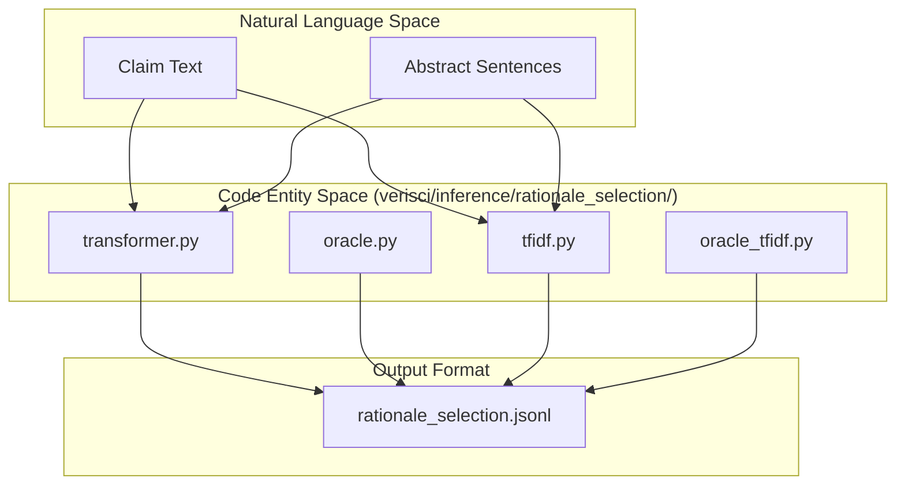
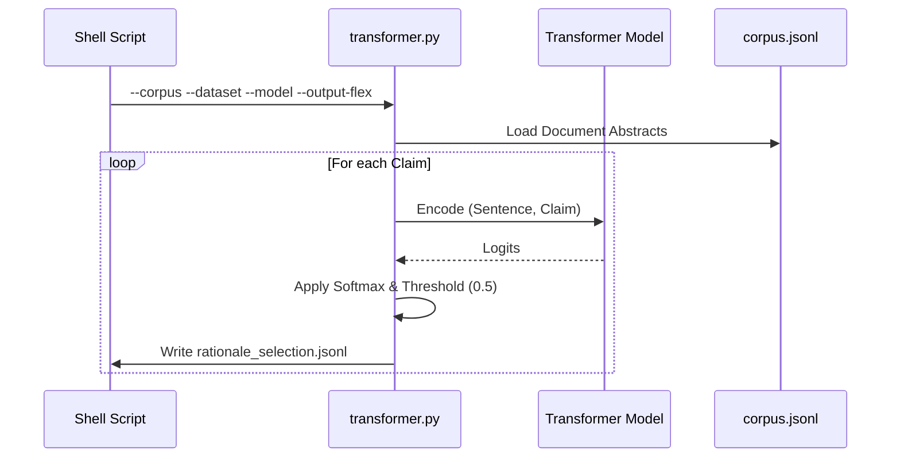

<!-- source: DeepWiki mcp.deepwiki.com · repo allenai/scifact · page 2.2 Rationale Selection · fetched 2026-10-26 -->

# Rationale Selection

<details>
<summary>Relevant source files</summary>

The following files were used as context for generating this wiki page:

- [script/label-prediction.sh](script/label-prediction.sh)
- [script/rationale-selection.sh](script/rationale-selection.sh)
- [verisci/inference/label_prediction/transformer.py](verisci/inference/label_prediction/transformer.py)
- [verisci/inference/rationale_selection/last.py](verisci/inference/rationale_selection/last.py)
- [verisci/inference/rationale_selection/oracle.py](verisci/inference/rationale_selection/oracle.py)
- [verisci/inference/rationale_selection/oracle_tfidf.py](verisci/inference/rationale_selection/oracle_tfidf.py)
- [verisci/inference/rationale_selection/tfidf.py](verisci/inference/rationale_selection/tfidf.py)
- [verisci/inference/rationale_selection/transformer.py](verisci/inference/rationale_selection/transformer.py)

</details>


Rationale selection is the second stage of the SciFact verification pipeline. Its purpose is to identify specific sentences (rationales) within retrieved abstracts that support or refute a given claim. This stage transforms a document-level retrieval into a sentence-level evidence set, which is then used by the Label Predictor to determine the final veracity of the claim.

## Overview and Data Flow

The rationale selection module takes as input the claims and the abstracts identified in the [Abstract Retrieval](2.1.-Abstract-Retrieval) stage. It outputs a JSONL file mapping claim IDs to document IDs and their corresponding rationale sentence indices.

### System Architecture and Code Entity Mapping

The following diagram illustrates how the rationale selection process bridges the natural language abstracts to the structured evidence used in the code.

**Rationale Selection Data Flow**

**Sources:** [verisci/inference/rationale_selection/transformer.py:8-20](), [verisci/inference/rationale_selection/oracle.py:4-8](), [verisci/inference/rationale_selection/tfidf.py:8-14]()

## Transformer-based Selection

The primary method for rationale selection uses a Transformer-based sequence classifier (e.g., SciBERT, RoBERTa). The model is trained to perform binary classification on sentence-claim pairs to determine if a sentence is a rationale.

### Implementation Details
The implementation in `verisci/inference/rationale_selection/transformer.py` performs the following steps:
1. **Encoding**: By default, it pairs each sentence in an abstract with the claim: `zip(sentences, [claim] * len(sentences))` [verisci/inference/rationale_selection/transformer.py:44-45]().
2. **Scoring**: The model outputs a probability score for each sentence being a rationale using a softmax over the classification head [verisci/inference/rationale_selection/transformer.py:50]().
3. **Selection Strategies**:
    *   **Threshold (Flex)**: Selects all sentences with a score $\ge$ `args.threshold` (default 0.5) [verisci/inference/rationale_selection/transformer.py:13, 65]().
    *   **Top-K**: Selects the $K$ highest-scoring sentences [verisci/inference/rationale_selection/transformer.py:61-63]().

### The `--only-rationale` Flag
If the `--only-rationale` flag is provided, the model encodes only the sentences without concatenating the claim [verisci/inference/rationale_selection/transformer.py:45](). This is typically used when evaluating models trained specifically to identify "evidence-like" sentences regardless of the specific claim.

**Sources:** [verisci/inference/rationale_selection/transformer.py:29-55](), [script/rationale-selection.sh:42-53]()

## Selection Strategies and Baselines

SciFact supports several baseline and oracle strategies for research and benchmarking.

| Strategy | File | Description |
| :--- | :--- | :--- |
| **Oracle** | `oracle.py` | Selects the actual gold-standard rationale sentences from the dataset [verisci/inference/rationale_selection/oracle.py:20-21](). |
| **TF-IDF** | `tfidf.py` | Uses `TfidfVectorizer` to find the $K$ sentences in the abstract most similar to the claim [verisci/inference/rationale_selection/tfidf.py:27-34](). |
| **Oracle + TF-IDF** | `oracle_tfidf.py` | Uses Oracle rationales for SUPPORT/REFUTE claims and TF-IDF for NOT_ENOUGH_INFO claims [verisci/inference/rationale_selection/oracle_tfidf.py:29-39](). |
| **First Sentence** | (Implicit) | A baseline selecting the first sentence of an abstract. |
| **Last Sentence** | `last.py` | A baseline selecting only the final sentence of each abstract [verisci/inference/rationale_selection/last.py:18](). |

**Sources:** [verisci/inference/rationale_selection/oracle.py:14-28](), [verisci/inference/rationale_selection/tfidf.py:21-39](), [verisci/inference/rationale_selection/oracle_tfidf.py:23-44](), [verisci/inference/rationale_selection/last.py:14-23]()

## Execution Logic

The rationale selection is typically invoked via `script/rationale-selection.sh`. This script manages model downloading and runs the transformer inference.

**Rationale Selection Sequence**

**Sources:** [script/rationale-selection.sh:47-53](), [verisci/inference/rationale_selection/transformer.py:34-55]()

## Output Format

The output is a JSONL file where each line represents a claim and its associated evidence rationales.

**Schema:**
```json
{
  "claim_id": 123,
  "evidence": {
    "doc_id_A": [0, 2],
    "doc_id_B": []
  }
}
```
*   `claim_id`: Unique identifier for the claim [verisci/inference/rationale_selection/transformer.py:68]().
*   `evidence`: A dictionary where keys are document IDs and values are lists of zero-indexed sentence indices identified as rationales [verisci/inference/rationale_selection/transformer.py:69]().

**Sources:** [verisci/inference/rationale_selection/transformer.py:58-70](), [verisci/inference/label_prediction/transformer.py:63-67]()

---

