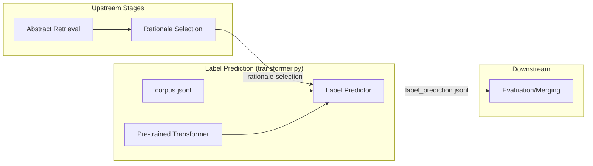

<!-- source: DeepWiki mcp.deepwiki.com · repo allenai/scifact · page 2.3 Label Prediction · fetched 2026-10-26 -->

# Label Prediction

<details>
<summary>Relevant source files</summary>

The following files were used as context for generating this wiki page:

- [script/label-prediction.sh](script/label-prediction.sh)
- [script/rationale-selection.sh](script/rationale-selection.sh)
- [verisci/evaluate/rationale_selection.py](verisci/evaluate/rationale_selection.py)
- [verisci/inference/abstract_retrieval/oracle.py](verisci/inference/abstract_retrieval/oracle.py)
- [verisci/inference/label_prediction/oracle.py](verisci/inference/label_prediction/oracle.py)
- [verisci/inference/label_prediction/transformer.py](verisci/inference/label_prediction/transformer.py)
- [verisci/inference/rationale_selection/first.py](verisci/inference/rationale_selection/first.py)
- [verisci/inference/rationale_selection/transformer.py](verisci/inference/rationale_selection/transformer.py)

</details>


The Label Prediction module is the final stage of the SciFact verification pipeline. It takes a claim and its associated rationales (selected in the previous stage) and classifies the relationship into one of three categories: `SUPPORT`, `CONTRADICT`, or `NOT_ENOUGH_INFO` (NEI) [verisci/inference/label_prediction/transformer.py:31-31]().

## System Architecture

The label predictor is a Transformer-based sequence classifier. It consumes the output of the Rationale Selection stage and produces a document-level verdict for each retrieved abstract.

### Data Flow and Entity Mapping
The following diagram illustrates how natural language inputs are transformed into code entities and processed by the `Transformer` predictor.

**Label Prediction Process Flow**
```mermaid
graph TD
    subgraph "Natural Language Space"
        Claim["Claim Text"]
        Rationale["Rationale Sentences"]
    end

    subgraph "Code Entity Space (verisci/inference/label_prediction/transformer.py)"
        InputData["dataset (JSONL)"]
        RationaleData["rationale_selection (JSONL)"]
        CorpusData["corpus (JSONL)"]
        
        Predictor["AutoModelForSequenceClassification"]
        Tokenizer["AutoTokenizer"]
        
        Claim --> InputData
        Rationale --> RationaleData
        
        InputData -->|data['claim']| Encode["encode() function"]
        RationaleData -->|selection['evidence']| Encode
        CorpusData -->|corpus[doc_id]['abstract']| Encode
        
        Tokenizer -->|batch_encode_plus| Encode
        Encode -->|encoded_dict| Predictor
        Predictor -->|label_scores| Output["output.write()"]
    end
    
    Output --> Verdict["Final Label: SUPPORT/CONTRADICT/NEI"]
```
**Sources:** [verisci/inference/label_prediction/transformer.py:19-31](), [verisci/inference/label_prediction/transformer.py:58-76]()

---

## Input Modes

The `transformer.py` script supports three input modes via the `--mode` flag, which determines how the sequence is constructed before being fed into the Transformer model [verisci/inference/label_prediction/transformer.py:13-13]().

| Mode | Description | Implementation |
| :--- | :--- | :--- |
| `claim_and_rationale` | Standard mode. Concatenates the claim and the selected rationale sentences. | `list(zip(sentences, claims))` |
| `only_claim` | Ablation mode. Predicts the label based solely on the claim text (checking for dataset bias). | `claims` |
| `only_rationale` | Ablation mode. Predicts based only on the rationale sentences. | `sentences` |

**Sources:** [verisci/inference/label_prediction/transformer.py:33-38](), [script/label-prediction.sh:56-64]()

---

## Implementation Details

### The Labeling Logic
The predictor iterates through each document identified in the rationale selection file. For each document, it concatenates the sentences identified by their indices into a single string [verisci/inference/label_prediction/transformer.py:63-67]().

1. **NEI Handling**: If the rationale selection stage returns no evidence indices for a document, the predictor automatically assigns `NOT_ENOUGH_INFO` with a confidence of 1.0 [verisci/inference/label_prediction/transformer.py:64-65]().
2. **Encoding**: The `encode` function handles tokenization and enforces a maximum sequence length of 512 tokens using a `truncation_strategy='only_first'` [verisci/inference/label_prediction/transformer.py:44-51]().
3. **Classification**: The model outputs logits for three classes. A softmax is applied to determine the label and the confidence score [verisci/inference/label_prediction/transformer.py:69-72]().

### Oracle Label Predictor
The codebase includes an `oracle.py` predictor used for upper-bound evaluation. It bypasses the Transformer model and assigns labels based on the gold standard data:
* It checks if the predicted rationale sentences are a subset of any gold rationale set [verisci/inference/label_prediction/oracle.py:24-24]().
* If a valid subset is found, it assigns the gold label [verisci/inference/label_prediction/oracle.py:25-25]().
* Otherwise, it defaults to `NOT_ENOUGH_INFO` [verisci/inference/label_prediction/oracle.py:27-27]().

**Sources:** [verisci/inference/label_prediction/transformer.py:33-54](), [verisci/inference/label_prediction/oracle.py:14-32]()

---

## Output Format

The module produces a JSONL file where each line represents a claim and its associated document-level labels.

```json
{
  "claim_id": 1,
  "labels": {
    "123456": {
      "label": "SUPPORT",
      "confidence": 0.9981
    },
    "789012": {
      "label": "NOT_ENOUGH_INFO",
      "confidence": 1.0
    }
  }
}
```

**Sources:** [verisci/inference/label_prediction/transformer.py:73-76](), [verisci/inference/label_prediction/oracle.py:29-32]()

---

## Integration and Execution

Label prediction is typically executed as the third step in the `label-prediction.sh` or `pipeline.sh` scripts. It requires the output from `rationale_selection.jsonl` to know which sentences to evaluate.

**Execution Pipeline Integration**


### Example Command
```bash
python3 verisci/inference/label_prediction/transformer.py \
    --corpus data/corpus.jsonl \
    --dataset data/claims_dev.jsonl \
    --rationale-selection prediction/rationale_selection.jsonl \
    --model model/label_roberta_large_fever_scifact \
    --mode claim_and_rationale \
    --output prediction/label_prediction.jsonl
```

**Sources:** [script/label-prediction.sh:66-72](), [verisci/inference/label_prediction/transformer.py:8-15]()

---

