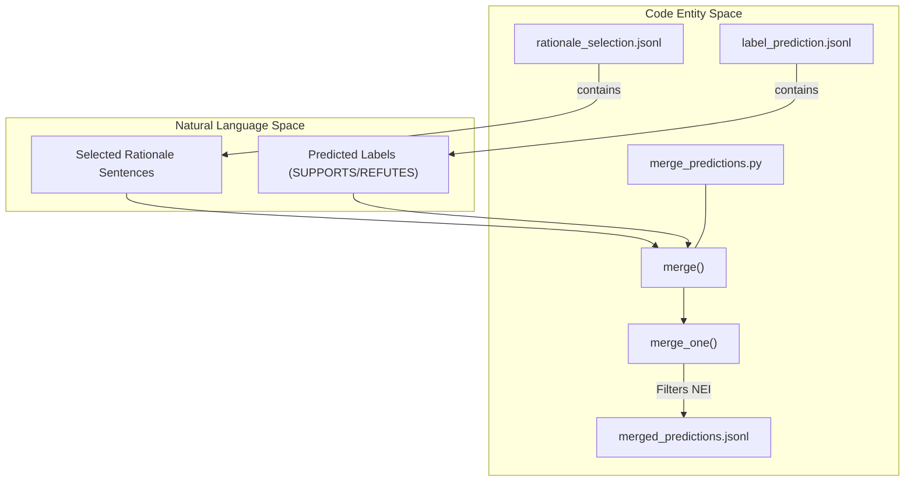
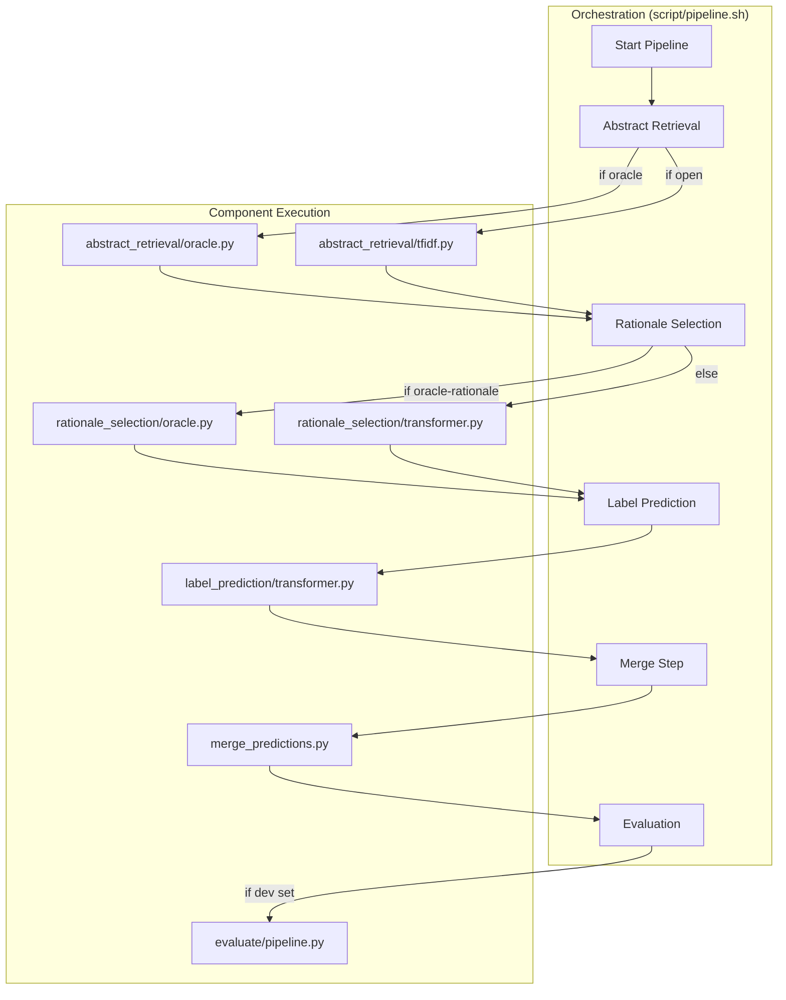

<!-- source: DeepWiki mcp.deepwiki.com · repo allenai/scifact · page 2.4 Prediction Merging and Pipeline Execution · fetched 2026-10-26 -->

# Prediction Merging and Pipeline Execution

Relevant source files

The following files were used as context for generating this wiki page:

- [doc/model.md](doc/model.md)
- [script/label-prediction.sh](script/label-prediction.sh)
- [script/pipeline.sh](script/pipeline.sh)
- [script/rationale-selection.sh](script/rationale-selection.sh)
- [verisci/evaluate/lib/data.py](verisci/evaluate/lib/data.py)
- [verisci/evaluate/pipeline.py](verisci/evaluate/pipeline.py)
- [verisci/inference/merge_predictions.py](verisci/inference/merge_predictions.py)

This page documents the final stage of the SciFact verification pipeline, where independent rationale and label predictions are unified into a single result file, and the orchestration scripts used to execute the end-to-end workflow.

## Prediction Merging

The SciFact pipeline processes rationale selection and label prediction as separate modules. The `verisci/inference/merge_predictions.py` script is responsible for combining these outputs into a final `merged_predictions.jsonl` file, which is the standard format for evaluation and leaderboard submission.

### Implementation Details
The merging process iterates through the predictions for each claim and performs the following logic:

1.  **Validation**: It ensures that the `claim_id` and the set of retrieved `doc_id` keys match between the rationale and label files [verisci/inference/merge_predictions.py:27-31]().
2.  **NEI Filtering**: The script specifically filters out any document predictions where the predicted label is `NOT_ENOUGH_INFO` (NEI) [verisci/inference/merge_predictions.py:41-43](). Only documents with `SUPPORTS` or `REFUTES` labels are included in the final evidence set.
3.  **Data Structure**: For each valid document, it pairs the selected sentence indices (from the rationale module) with the predicted label (from the label module) [verisci/inference/merge_predictions.py:42-43]().

### Data Flow: Merging Process
The following diagram illustrates how the outputs from the previous pipeline stages are unified by `merge_predictions.py`.

**Prediction Merging Data Flow**

**Sources:** [verisci/inference/merge_predictions.py:5-47](), [verisci/inference/merge_predictions.py:50-78]()

---

## Pipeline Orchestration

The project provides several bash scripts to automate the execution of the full pipeline. The primary entry point is `script/pipeline.sh`, which handles data downloading, model acquisition, and sequential execution of all three stages.

### Execution Modes
The `script/pipeline.sh` script supports different configurations based on command-line arguments:

| Argument | Options | Description |
| :--- | :--- | :--- |
| `retrieval` | `oracle`, `open` | Use gold-standard abstracts or TF-IDF retrieval. |
| `model` | `oracle-rationale`, `zero-shot`, `verisci` | Determines model weights and rationale thresholds. |
| `dataset` | `dev`, `test` | The data split to process. |

### Configuration Logic
The script adjusts hyperparameters based on the chosen model mode:
*   **zero-shot**: Uses models trained on FEVER for both rationale and label stages, with a low rationale threshold of `0.025` [script/pipeline.sh:14-18]().
*   **verisci**: Uses SciFact-trained rationale models and `fever_scifact` label models, with a standard rationale threshold of `0.5` [script/pipeline.sh:19-23]().

### Full Pipeline Workflow
The diagram below maps the orchestration logic in `script/pipeline.sh` to the specific Python components executed.

**Orchestration Logic and Component Mapping**

**Sources:** [script/pipeline.sh:46-117](), [doc/model.md:154-172]()

---

## Specialized Pipeline Scripts

In addition to the main pipeline, specialized scripts exist for reproducing specific tables from the SciFact paper:

### Rationale Selection Evaluation
`script/rationale-selection.sh` focuses on evaluating rationale selection performance in isolation using oracle abstracts. It supports various BERT variants and training datasets [script/rationale-selection.sh:5-12]().

### Label Prediction Evaluation
`script/label-prediction.sh` focuses on label prediction accuracy. It supports different input modes:
*   `only_claim`: Predicts labels without looking at rationales.
*   `only_rationale`: Predicts labels without looking at the claim.
*   `claim_and_rationale`: The standard mode using both inputs [script/label-prediction.sh:56-64]().

**Sources:** [script/rationale-selection.sh:1-62](), [script/label-prediction.sh:1-81]()

## Summary of Output Files
The pipeline produces a sequence of JSONL files in the `prediction/` directory:
1.  `abstract_retrieval.jsonl`: List of candidate documents for each claim.
2.  `rationale_selection.jsonl`: Sentence indices identified as evidence within retrieved documents.
3.  `label_prediction.jsonl`: Predicted veracity labels for each claim-document pair.
4.  `merged_predictions.jsonl`: The final unified output used for evaluation [script/pipeline.sh:41-101]().

**Sources:** [script/pipeline.sh:40-101](), [doc/model.md:156-162]()

---

