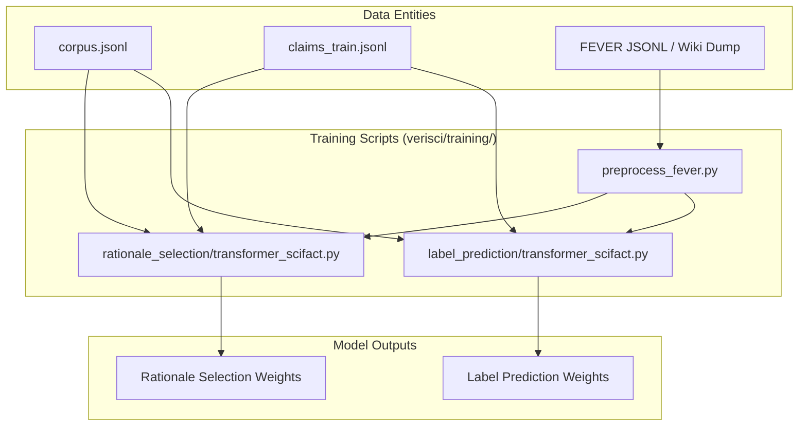
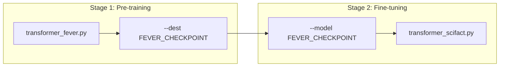

<!-- source: DeepWiki mcp.deepwiki.com · repo allenai/scifact · page 3 Model Training · fetched 2026-10-26 -->

# Model Training

Relevant source files

The following files were used as context for generating this wiki page:

- [doc/data.md](doc/data.md)
- [doc/training.md](doc/training.md)

The SciFact training infrastructure provides scripts to train the two primary neural components of the verification pipeline: **Rationale Selection** and **Label Prediction**. The framework supports multiple datasets, including SciFact, FEVER, and Snopes, and facilitates transfer learning strategies to improve performance on scientific claim verification.

### Training Infrastructure Overview

Training is modularized by task (rationale vs. label) and dataset. All training logic resides within the `verisci/training` directory [doc/training.md:3](). The system is built around Transformer-based architectures, supporting models such as `roberta-large`, `scibert`, and `biomed_roberta_base` [doc/training.md:13-14]().

#### Code Entity Map: Training Components
The following diagram illustrates how training scripts map to the core verification modules and their respective data inputs.

**Sources:** [doc/training.md:25-52](), [doc/training.md:71-75]()

---

### Supported Datasets

The training pipeline supports three major datasets, each requiring specific preprocessing or loading logic:

| Dataset | Description | Training Scripts |
| :--- | :--- | :--- |
| **SciFact** | Domain-specific scientific claims and abstracts. | `transformer_scifact.py` |
| **FEVER** | Large-scale general domain fact extraction. | `transformer_fever.py` |
| **Snopes** | Fact-checking data from Snopes.com. | `transformer_snopes.py` |

For details on dataset-specific CLI arguments and FEVER preprocessing, see [Training on SciFact, FEVER, and Snopes](#3.1).

**Sources:** [doc/training.md:25-122]()

---

### Transfer Learning Strategy

A key feature of the SciFact training pipeline is the support for **Transfer Learning**, specifically the **FEVER → SciFact** workflow. Because SciFact is relatively small, pre-training on the larger FEVER dataset before fine-tuning on SciFact significantly improves model robustness, particularly for the Label Prediction module [doc/training.md:96-99]().

#### Transfer Learning Flow: Code Entity Space
This diagram shows how the `--model` argument is used to pass checkpoints between different training stages.

For details on executing this two-stage process and the `fever_scifact` model variant, see [Transfer Learning: FEVER → SciFact](#3.2).

**Sources:** [doc/training.md:96-99]()

---

### Common Configuration

All training scripts share a set of common command-line arguments to control the training loop and hardware utilization:

*   `--model`: Specifies the starting checkpoint (HuggingFace ID or local path) [doc/training.md:13-14]().
*   `--dest`: The directory where model weights are saved after every epoch [doc/training.md:16]().
*   `--batch-size-gpu`: Controls the number of samples per GPU pass [doc/training.md:17]().
*   `--lr-base` & `--lr-linear`: Separate learning rates for the Transformer backbone and the classification head [doc/training.md:19-20]().

**Sources:** [doc/training.md:11-20]()

---

