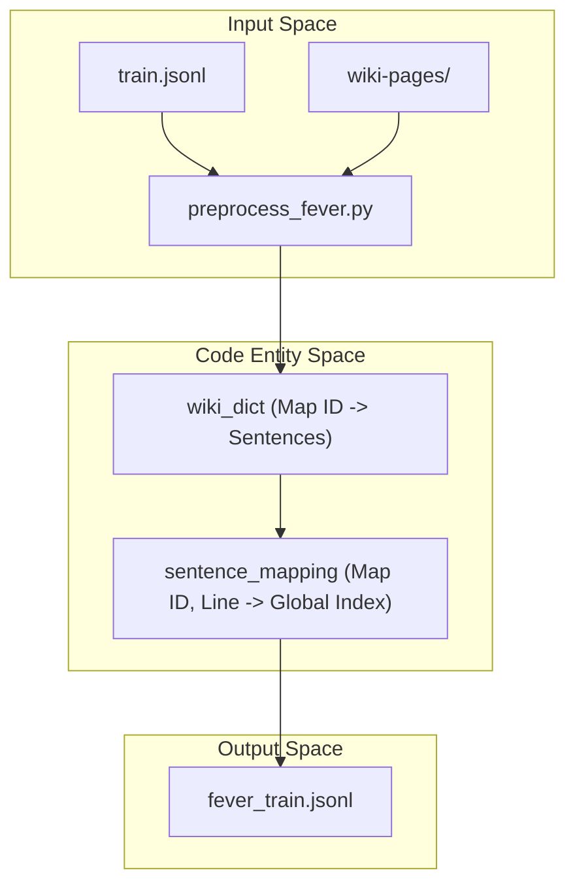
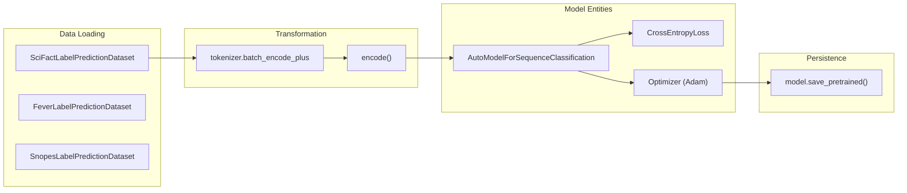

<!-- source: DeepWiki mcp.deepwiki.com · repo allenai/scifact · page 3.1 Training on SciFact, FEVER, and Snopes · fetched 2026-10-26 -->

# Training on SciFact, FEVER, and Snopes

Relevant source files

The following files were used as context for generating this wiki page:

- [verisci/training/label_prediction/transformer_fever.py](verisci/training/label_prediction/transformer_fever.py)
- [verisci/training/label_prediction/transformer_scifact.py](verisci/training/label_prediction/transformer_scifact.py)
- [verisci/training/label_prediction/transformer_snopes.py](verisci/training/label_prediction/transformer_snopes.py)
- [verisci/training/preprocess_fever.py](verisci/training/preprocess_fever.py)
- [verisci/training/rationale_selection/transformer_fever.py](verisci/training/rationale_selection/transformer_fever.py)
- [verisci/training/rationale_selection/transformer_scifact.py](verisci/training/rationale_selection/transformer_scifact.py)
- [verisci/training/rationale_selection/transformer_snopes.py](verisci/training/rationale_selection/transformer_snopes.py)

This page documents the training infrastructure for the two primary supervised components of the SciFact pipeline: **Rationale Selection** and **Label Prediction**. The codebase provides specialized scripts for training these models on the SciFact, FEVER, and Snopes datasets, utilizing Transformer-based architectures (typically RoBERTa-large).

## 1. Common Training Configuration

All training scripts across datasets share a consistent set of command-line arguments and optimization logic.

### CLI Arguments
| Argument | Type | Default | Description |
| :--- | :--- | :--- | :--- |
| `--model` | `str` | `roberta-large` | Pre-trained model identifier from HuggingFace. |
| `--dest` | `str` | (Required) | Directory where model weights and tokenizers are saved. |
| `--epochs` | `int` | `20` | Total number of training epochs. |
| `--batch-size-gpu` | `int` | `8` | Batch size per GPU forward/backward pass. |
| `--batch-size-accumulated` | `int` | `256` | Effective batch size via gradient accumulation. |
| `--lr-base` | `float` | `1e-5` | Learning rate for the Transformer backbone. |
| `--lr-linear` | `float` | `1e-4` / `1e-3` | Learning rate for the classification head. |

### Optimization Strategy
The scripts use a split-learning rate approach to preserve pre-trained features while allowing the task-specific head to converge faster [verisci/training/label_prediction/transformer_scifact.py:97-101](). Gradient accumulation is used to simulate large batch sizes on hardware with limited VRAM [verisci/training/label_prediction/transformer_scifact.py:147-151](). A cosine schedule with warmup is applied over 20 steps [verisci/training/label_prediction/transformer_scifact.py:102]().

**Sources:** [verisci/training/label_prediction/transformer_scifact.py:13-24](), [verisci/training/rationale_selection/transformer_fever.py:12-22]()

---

## 2. FEVER Preprocessing

Before training on FEVER, the raw dataset must be converted into the internal SciFact format. This involves resolving Wikipedia document IDs to actual sentence text.

### Data Flow: FEVER Preprocessing
The `preprocess_fever.py` script loads a Wikipedia dump into memory and maps claim evidence sets to absolute sentence indices within the flattened document list [verisci/training/preprocess_fever.py:27-40]().

Title: FEVER Preprocessing Logic

**Sources:** [verisci/training/preprocess_fever.py:27-81]()

---

## 3. Rationale Selection Training

Rationale selection is treated as a binary classification task: given a `(claim, sentence)` pair, the model predicts if the sentence is evidence (`True`) or not (`False`).

### Dataset Implementations
Each dataset class iterates through claims and their associated documents to generate training pairs.

*   **SciFact:** Uses `SciFactRationaleSelectionDataset`. It maps gold evidence indices from the claim to sentences in the corpus abstract [verisci/training/rationale_selection/transformer_scifact.py:30-43]().
*   **FEVER:** Uses `FeverRationaleSelectionDataset`. It flattens all sentences across relevant wiki pages for a claim [verisci/training/rationale_selection/transformer_fever.py:25-34]().
*   **Snopes:** Uses `SnopesRationaleSelectionDataset`. It cleans HTML tags (e.g., `
`) from the Snopes corpus during loading [verisci/training/rationale_selection/transformer_snopes.py:30-48]().

### Training Logic
The `encode` function handles tokenization and ensures sequences do not exceed the 512-token limit by truncating the first sequence (the sentence/rationale) while keeping the claim [verisci/training/rationale_selection/transformer_scifact.py:63-77]().

**Sources:** [verisci/training/rationale_selection/transformer_scifact.py:29-48](), [verisci/training/rationale_selection/transformer_fever.py:58-72]()

---

## 4. Label Prediction Training

Label prediction is a 3-way classification task: **SUPPORTS** (2), **NOT ENOUGH INFO** (1), or **REFUTES** (0).

### Negative Sampling and Data Augmentation
To improve model robustness, the datasets implement specific sampling strategies for the `NOT ENOUGH INFO` (NEI) class.

| Dataset | NEI Sampling Strategy |
| :--- | :--- |
| **SciFact** | Samples 1-2 random non-rationale sentences from cited documents or abstracts [verisci/training/label_prediction/transformer_scifact.py:63-82](). |
| **FEVER** | Randomly samples sentences from the document that were not part of any gold evidence set [verisci/training/label_prediction/transformer_fever.py:50-61](). |
| **Snopes** | Uses the provided evidence sets and labels from the `snopes.stance` files [verisci/training/label_prediction/transformer_snopes.py:36-48](). |

### Model Architecture and Data Flow
The system uses `AutoModelForSequenceClassification` with `num_labels=3`.

Title: Label Prediction Data Flow

### Key Functions
*   `encode(claims, rationale)`: Zips rationale and claim, pads to max length, and moves tensors to the GPU [verisci/training/label_prediction/transformer_scifact.py:105-119]().
*   `evaluate(model, dataset)`: Calculates Macro F1, and per-class Precision, Recall, and F1 [verisci/training/label_prediction/transformer_scifact.py:122-137]().

**Sources:** [verisci/training/label_prediction/transformer_scifact.py:30-88](), [verisci/training/label_prediction/transformer_fever.py:29-61](), [verisci/training/label_prediction/transformer_snopes.py:30-54]()

---

