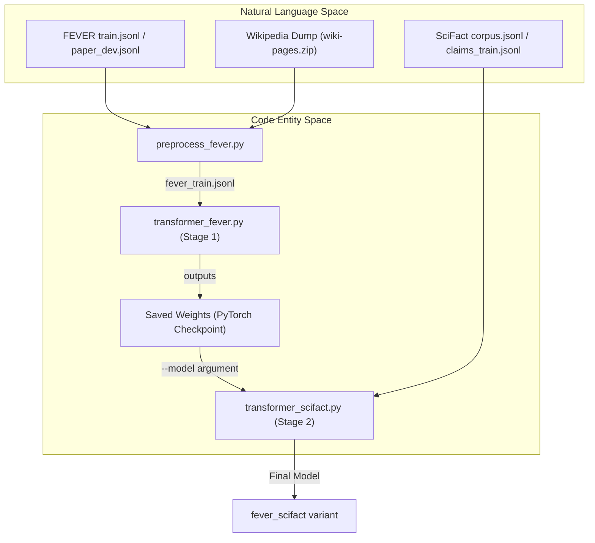
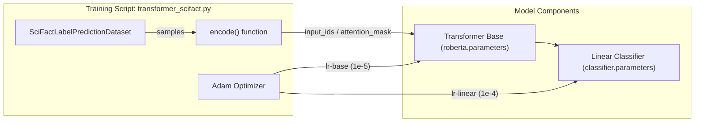

<!-- source: DeepWiki mcp.deepwiki.com · repo allenai/scifact · page 3.2 Transfer Learning: FEVER → SciFact · fetched 2026-10-26 -->

# Transfer Learning: FEVER → SciFact

Relevant source files

The following files were used as context for generating this wiki page:

- [doc/data.md](doc/data.md)
- [doc/training.md](doc/training.md)
- [script/download-model.sh](script/download-model.sh)
- [verisci/training/label_prediction/transformer_fever.py](verisci/training/label_prediction/transformer_fever.py)
- [verisci/training/label_prediction/transformer_scifact.py](verisci/training/label_prediction/transformer_scifact.py)
- [verisci/training/preprocess_fever.py](verisci/training/preprocess_fever.py)

This page explains the recommended two-stage transfer learning workflow for the SciFact pipeline. By pre-training on the large-scale FEVER dataset before fine-tuning on the domain-specific SciFact dataset, models achieve significantly higher performance, particularly in the **Label Prediction** stage.

## Workflow Overview

The SciFact dataset is relatively small compared to general-domain fact-checking datasets. To improve model robustness, the codebase supports a transfer learning strategy where a model is first exposed to the FEVER dataset to learn the general relationship between claims and evidence, then adapted to the scientific domain of SciFact.

### Two-Stage Training Process
1.  **Stage 1 (FEVER Pre-training):** Train a transformer model (e.g., RoBERTa-large) on the FEVER dataset using the `transformer_fever.py` scripts [doc/training.md:86-93]().
2.  **Stage 2 (SciFact Fine-tuning):** Use the weights saved from Stage 1 as the starting point for the `--model` argument in the `transformer_scifact.py` scripts [doc/training.md:97-99]().

### Data Flow and Component Interaction

The following diagram illustrates how data moves from the FEVER source through the preprocessing stage and into the two-stage training pipeline.

**Transfer Learning Data Flow**

Sources: [doc/training.md:68-75](), [doc/training.md:96-99](), [verisci/training/preprocess_fever.py:1-25]()

---

## Stage 1: Pre-training on FEVER

Because the FEVER dataset uses a different schema than SciFact, the `verisci/training/preprocess_fever.py` script is used to normalize FEVER data into a format compatible with the SciFact training infrastructure [verisci/training/preprocess_fever.py:75-81]().

### Preprocessing Logic
The preprocessor performs the following tasks:
*   **Document Merging:** Loads the Wikipedia dump into a dictionary (`wiki_dict`) mapping IDs to lists of sentences [verisci/training/preprocess_fever.py:27-40]().
*   **Sentence Mapping:** Converts FEVER's evidence pointers (doc_id, line_index) into a flat list of sentences and a corresponding index mapping [verisci/training/preprocess_fever.py:53-63]().
*   **Label Normalization:** Maps FEVER labels to the internal format used by the `FeverLabelPredictionDataset` class [verisci/training/label_prediction/transformer_fever.py:32]().

### FEVER Label Prediction Training
The training script `verisci/training/label_prediction/transformer_fever.py` handles the first stage of label prediction training. It uses the `FeverLabelPredictionDataset` to sample evidence sets and generate negative "NOT ENOUGH INFO" (NEI) samples [verisci/training/label_prediction/transformer_fever.py:29-61]().

Sources: [verisci/training/preprocess_fever.py:1-82](), [verisci/training/label_prediction/transformer_fever.py:1-143]()

---

## Stage 2: Fine-tuning on SciFact

The second stage involves taking the checkpoint from FEVER training and fine-tuning it on scientific abstracts. This is where the `fever_scifact` model variant is produced.

### Training Implementation
The script `verisci/training/label_prediction/transformer_scifact.py` is used for this stage. It defines the `SciFactLabelPredictionDataset`, which constructs training triples of `(claim, rationale, label)` [verisci/training/label_prediction/transformer_scifact.py:30-49]().

**Training Logic Association**

Sources: [verisci/training/label_prediction/transformer_scifact.py:30-88](), [verisci/training/label_prediction/transformer_scifact.py:97-101](), [doc/training.md:19-20]()

### Why "fever_scifact" Performs Best
The `fever_scifact` variant (accessible via `download-model.sh` [script/download-model.sh:8]()) achieves superior performance on label prediction for several reasons:
1.  **Sample Diversity:** SciFact provides multiple rationales per claim. The `SciFactLabelPredictionDataset` adds individual evidence sets as separate samples AND a combined sample containing all evidence sentences [verisci/training/label_prediction/transformer_scifact.py:43-60]().
2.  **Hard Negative Mining:** The script generates negative samples (NEI) by selecting non-rationale sentences from the same document or from cited documents that were not found to contain evidence [verisci/training/label_prediction/transformer_scifact.py:62-82]().
3.  **Cross-Domain Robustness:** Pre-training on FEVER provides the model with a strong foundation in logical entailment, while fine-tuning on SciFact adapts the model to scientific terminology and the structure of S2ORC abstracts [doc/data.md:67-75]().

---

## Usage Summary

To reproduce the best-performing model or use the pre-trained weights, the following command structure is recommended:

| Step | Script | Key Argument | Purpose |
| :--- | :--- | :--- | :--- |
| **Download** | `download-model.sh` | `label roberta_large fever_scifact` | Get the optimized model [script/download-model.sh:5-19](). |
| **Train (Stage 1)** | `transformer_fever.py` | `--model roberta-large` | Learn general entailment [doc/training.md:88-93](). |
| **Train (Stage 2)** | `transformer_scifact.py` | `--model [PATH_TO_STAGE_1]` | Domain adaptation [doc/training.md:96-99](). |

Sources: [script/download-model.sh:1-34](), [doc/training.md:1-123](), [verisci/training/label_prediction/transformer_scifact.py:1-102]()

---

