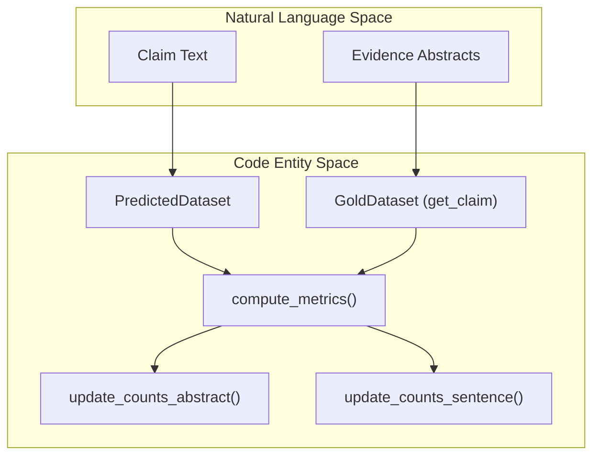
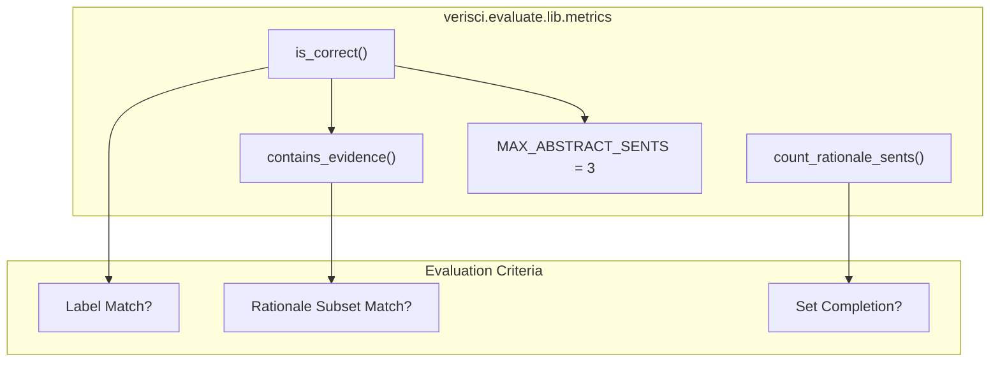

<!-- source: DeepWiki mcp.deepwiki.com · repo allenai/scifact · page 4 Evaluation Framework · fetched 2026-10-26 -->

# Evaluation Framework

Relevant source files

The following files were used as context for generating this wiki page:

- [doc/evaluation.md](doc/evaluation.md)
- [verisci/evaluate/abstract_retrieval.py](verisci/evaluate/abstract_retrieval.py)
- [verisci/evaluate/label_prediction.py](verisci/evaluate/label_prediction.py)
- [verisci/evaluate/lib/__init__.py](verisci/evaluate/lib/__init__.py)
- [verisci/evaluate/lib/metrics.py](verisci/evaluate/lib/metrics.py)

The SciFact evaluation framework provides tools and metrics to assess the performance of claim verification models at both the individual component level and as a complete end-to-end pipeline. The system measures the ability of a model to retrieve relevant abstracts, identify specific rationale sentences, and predict the correct stance (SUPPORT or CONTRADICT) [doc/evaluation.md:1-8]().

### Pipeline Evaluation Overview

The primary entry point for pipeline evaluation is the `compute_metrics()` function in the `verisci.evaluate.lib.metrics` module [verisci/evaluate/lib/metrics.py:162-165](). This function calculates four core F1 metrics that are used for the SciFact leaderboard:

1.  **Sentence Selection**: Measures the accuracy of identifying rationale sentences.
2.  **Sentence Label**: Measures the accuracy of identifying rationale sentences with the correct label.
3.  **Abstract Label Only**: Measures label prediction accuracy at the document level.
4.  **Abstract Rationalized**: Measures the combined accuracy of label prediction and rationale selection at the document level.

For details on the calculation logic, the three-sentence cap, and set-completion requirements, see [Metrics: Abstract-Level and Sentence-Level F1](#4.1).

### Component-Level Assessment

Before evaluating the full pipeline, developers can assess individual modules using dedicated scripts. These scripts allow for isolated debugging of the retrieval and classification stages.

| Component | Script Path | Primary Metrics |
| :--- | :--- | :--- |
| **Abstract Retrieval** | `verisci/evaluate/abstract_retrieval.py` | Hit@1, Hit@All [verisci/evaluate/abstract_retrieval.py:11-28]() |
| **Label Prediction** | `verisci/evaluate/label_prediction.py` | Macro F1, Confusion Matrix [verisci/evaluate/label_prediction.py:40-50]() |

For details on running these scripts and preparing submissions for the leaderboard, see [Component Evaluation Scripts and Leaderboard Submission](#4.2).

### Data Flow for Evaluation

The evaluation framework bridges the "Natural Language Space" (claims and abstracts) to the "Code Entity Space" (internal representations and scoring logic) by processing predictions against gold standard datasets.

**Evaluation Data Mapping**

Sources: [verisci/evaluate/lib/metrics.py:162-181](), [doc/evaluation.md:42-83]()

### Scoring Logic Architecture

The following diagram illustrates how the `verisci.evaluate.lib.metrics` module determines correctness for a prediction. Note the use of `MAX_ABSTRACT_SENTS` to cap rationale length during abstract-level scoring [verisci/evaluate/lib/metrics.py:14-15]().

**Metric Calculation Logic**

Sources: [verisci/evaluate/lib/metrics.py:14-60](), [verisci/evaluate/lib/metrics.py:84-98](), [doc/evaluation.md:86-120]()

### Key Constraints
*   **Three-Sentence Cap**: For abstract-level evaluation, only the first three predicted sentences are considered [doc/evaluation.md:90-91]().
*   **Set Completion**: For sentence-level scoring, a model only receives credit for a sentence if it predicts the *entire* gold rationale set that the sentence belongs to [doc/evaluation.md:118-120]().
*   **NEI Handling**: Predictions labeled as `NOT_ENOUGH_INFO` (NEI) are typically skipped during the counting of retrieved documents in the pipeline metrics [verisci/evaluate/lib/metrics.py:67-68]().

Sources: [doc/evaluation.md:1-146](), [verisci/evaluate/lib/metrics.py:1-182](), [verisci/evaluate/label_prediction.py:1-51](), [verisci/evaluate/abstract_retrieval.py:1-28]()

---

