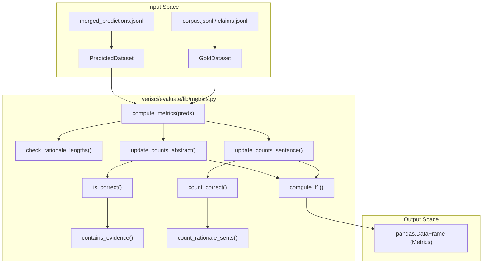
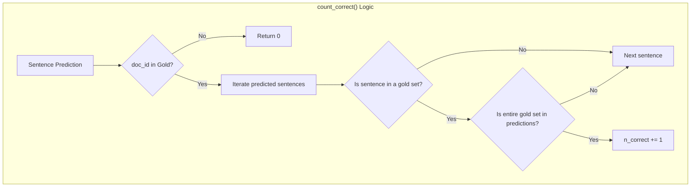

<!-- source: DeepWiki mcp.deepwiki.com · repo allenai/scifact · page 4.1 Metrics: Abstract-Level and Sentence-Level F1 · fetched 2026-10-26 -->

# Metrics: Abstract-Level and Sentence-Level F1

Relevant source files

The following files were used as context for generating this wiki page:

- [doc/evaluation.md](doc/evaluation.md)
- [requirements.txt](requirements.txt)
- [verisci/evaluate/lib/__init__.py](verisci/evaluate/lib/__init__.py)
- [verisci/evaluate/lib/metrics.py](verisci/evaluate/lib/metrics.py)

This page provides a technical deep dive into the evaluation framework used by SciFact to measure claim verification performance. The system evaluates models at two granularities: the **Abstract Level** (retrieval and label correctness) and the **Sentence Level** (precise rationale identification).

## Evaluation Overview

The SciFact evaluation suite computes four primary metrics to assess different aspects of the pipeline. These metrics are implemented in `verisci/evaluate/lib/metrics.py` and are calculated by comparing a `PredictedDataset` against a `GoldDataset`.

### Core Metrics Summary

| Metric Name | Granularity | Requirement |
| :--- | :--- | :--- |
| `abstract_label_only` | Abstract | Correct `doc_id` and correct `label` (SUPPORT/CONTRADICT). |
| `abstract_rationalized` | Abstract | Correct `doc_id`, correct `label`, and at least one complete gold evidence set found in the first 3 predicted sentences. |
| `sentence_selection` | Sentence | Correct `doc_id` and the predicted sentence belongs to a gold evidence set where **all** sentences in that set were predicted. |
| `sentence_label` | Sentence | Same as `sentence_selection`, but the abstract-level label must also be correct. |

Sources: [verisci/evaluate/lib/metrics.py:176-181](), [doc/evaluation.md:86-114]()

---

## Data Flow: From Predictions to Metrics

The evaluation process involves transforming raw prediction JSONL files into structured objects, which are then processed by the `compute_metrics` API.

### Evaluation Logic Diagram

The following diagram bridges the "Natural Language Space" (claims and evidence) to the "Code Entity Space" (classes and functions).

**Title: SciFact Metrics Calculation Flow**

Sources: [verisci/evaluate/lib/metrics.py:162-182](), [doc/evaluation.md:6-34]()

---

## Abstract-Level Metrics

Abstract-level evaluation treats the document as the unit of retrieval.

### The Three-Sentence Cap Rule
To prevent models from "gaming" the F1 score by predicting every sentence in an abstract as a rationale, the abstract-level evaluation enforces a strict cap. Only the **first three** predicted sentences for any given abstract are considered [verisci/evaluate/lib/metrics.py:14]().

*   **Logic**: If a model predicts `[1, 5, 8, 10]`, only `[1, 5, 8]` are passed to the scoring logic [verisci/evaluate/lib/metrics.py:46]().
*   **Warning**: The function `check_rationale_lengths()` issues a warning if predictions exceed this limit [verisci/evaluate/lib/metrics.py:141-157]().

### Correctness Criteria (`is_correct`)
An abstract is considered "correctly rationalized" if:
1.  The `doc_id` exists in the gold evidence for that claim [verisci/evaluate/lib/metrics.py:49-50]().
2.  The predicted `label` matches the gold `label` [verisci/evaluate/lib/metrics.py:53-55]().
3.  The predicted sentences (capped at 3) contain at least one complete evidence set from the gold data [verisci/evaluate/lib/metrics.py:57-58]().

Sources: [verisci/evaluate/lib/metrics.py:36-60](), [doc/evaluation.md:86-91]()

---

## Sentence-Level Metrics

Sentence-level evaluation is more granular and does **not** apply the three-sentence cap [doc/evaluation.md:120]().

### Set-Completion Requirement
SciFact rationales are often "sets" of sentences that must be read together to support or refute a claim. A model only receives credit for a sentence if it predicts the **entire** set it belongs to.

**Example Logic (`count_rationale_sents`):**
*   **Gold Set**: `{1, 2}`
*   **Prediction**: `{1, 5}`
*   **Result**: 0 points. Sentence `1` is "correct" in isolation, but because sentence `2` is missing, the set is incomplete [verisci/evaluate/lib/metrics.py:93-96]().
*   **Prediction**: `{1, 2, 5}`
*   **Result**: 2 points. Both `1` and `2` are counted as correct because the full set `{1, 2}` was retrieved [verisci/evaluate/lib/metrics.py:96-97]().

### Code Mapping: Sentence Evaluation

**Title: Sentence-Level Correctness Logic**

Sources: [verisci/evaluate/lib/metrics.py:84-116](), [doc/evaluation.md:118-141]()

---

## The `compute_metrics()` API

The entry point for all pipeline evaluation is `compute_metrics(preds)` in `verisci/evaluate/lib/metrics.py`.

### Implementation Details
1.  **Initialization**: Creates `Counter` objects for abstract and sentence counts [verisci/evaluate/lib/metrics.py:166-167]().
2.  **Iteration**: Loops through every prediction in the `PredictedDataset`.
3.  **Gold Retrieval**: Uses `preds.gold.get_claim(pred.claim_id)` to fetch the ground truth for comparison [verisci/evaluate/lib/metrics.py:172]().
4.  **Counters**:
    *   `update_counts_abstract`: Increments `relevant`, `retrieved`, `correct_label_only`, and `correct_rationalized` [verisci/evaluate/lib/metrics.py:63-77]().
    *   `update_counts_sentence`: Increments `relevant` (sum of lengths of all gold sets), `retrieved` (total sentences predicted), `correct_selection`, and `correct_label` [verisci/evaluate/lib/metrics.py:119-134]().
5.  **F1 Calculation**: Uses `safe_divide` to prevent errors when no documents are retrieved [verisci/evaluate/lib/metrics.py:17-29]().

### Precision, Recall, and F1 Formulas
For any metric $M$:
*   **Precision**: $\frac{\text{counts}[M]}{\text{retrieved}}$
*   **Recall**: $\frac{\text{counts}[M]}{\text{relevant}}$
*   **F1**: $\frac{2 \cdot \text{Precision} \cdot \text{Recall}}{\text{Precision} + \text{Recall}}$

Sources: [verisci/evaluate/lib/metrics.py:17-29](), [verisci/evaluate/lib/metrics.py:162-182]()

---

