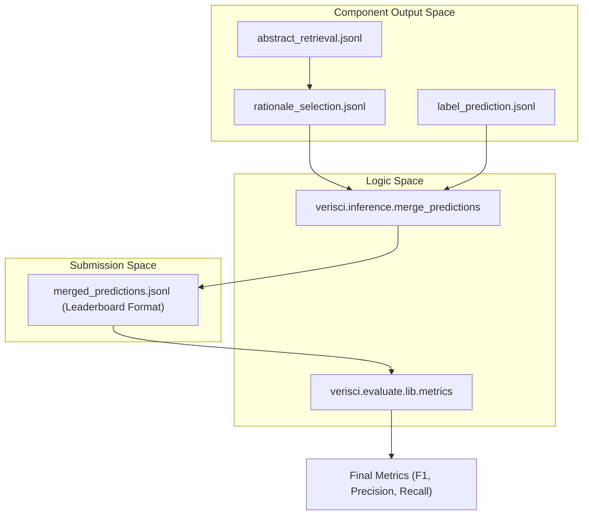
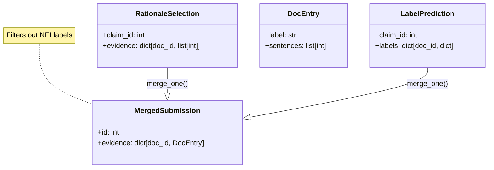

<!-- source: DeepWiki mcp.deepwiki.com · repo allenai/scifact · page 4.2 Component Evaluation Scripts and Leaderboard Submission · fetched 2026-10-26 -->

# Component Evaluation Scripts and Leaderboard Submission

<details>
<summary>Relevant source files</summary>

The following files were used as context for generating this wiki page:

- [doc/evaluation.md](doc/evaluation.md)
- [verisci/evaluate/abstract_retrieval.py](verisci/evaluate/abstract_retrieval.py)
- [verisci/evaluate/label_accuracy_gold_inputs.py](verisci/evaluate/label_accuracy_gold_inputs.py)
- [verisci/evaluate/label_prediction.py](verisci/evaluate/label_prediction.py)
- [verisci/evaluate/lib/__init__.py](verisci/evaluate/lib/__init__.py)
- [verisci/evaluate/lib/data.py](verisci/evaluate/lib/data.py)
- [verisci/evaluate/lib/metrics.py](verisci/evaluate/lib/metrics.py)
- [verisci/inference/merge_predictions.py](verisci/inference/merge_predictions.py)

</details>


This page documents the evaluation infrastructure for the SciFact verification pipeline. It covers the specialized scripts for evaluating individual pipeline components—Abstract Retrieval, Rationale Selection, and Label Prediction—as well as the requirements for generating a valid submission for the SciFact leaderboard.

## Evaluation Overview

The SciFact evaluation framework operates at two levels:
1.  **Component-Level Evaluation**: Independent scripts assess the performance of retrieval, selection, and prediction modules using specific metrics like "Hit One" for retrieval or Macro F1 for labels.
2.  **Pipeline-Level Evaluation**: Assesses the end-to-end system using unified Abstract-level and Sentence-level F1 metrics.

### Prediction Data Flow

The following diagram illustrates how raw component outputs are processed and merged into the final submission format.

**Data Flow to Leaderboard Submission**


**Sources:** [verisci/inference/merge_predictions.py:1-78](), [verisci/evaluate/lib/metrics.py:162-181]()

---

## Component Evaluation Scripts

Each stage of the pipeline has a corresponding evaluation script to measure performance in isolation.

### 1. Abstract Retrieval Evaluation
The script `verisci/evaluate/abstract_retrieval.py` evaluates the quality of the candidate abstracts retrieved for each claim.

*   **Input**: A dataset file and the `abstract_retrieval.jsonl` output.
*   **Metrics**:
    *   **Hit One**: Percentage of claims where at least one gold evidence abstract was retrieved.
    *   **Hit All**: Percentage of claims where all gold evidence abstracts were retrieved.

**Sources:** [verisci/evaluate/abstract_retrieval.py:11-28]()

### 2. Label Prediction Evaluation
Two scripts are provided for label evaluation depending on the input context:

*   **`verisci/evaluate/label_prediction.py`**: Evaluates predicted labels against gold labels. It supports filtering by document type (`--filter structured|unstructured`) and reports Accuracy, Macro F1, and a Confusion Matrix. [verisci/evaluate/label_prediction.py:17-50]()
*   **`verisci/evaluate/label_accuracy_gold_inputs.py`**: A specialized script to measure labeler performance when provided with gold rationale sentences as input. [verisci/evaluate/label_accuracy_gold_inputs.py:23-41]()

### 3. Pipeline Metrics Implementation
The core evaluation logic resides in `verisci/evaluate/lib/metrics.py`. It implements the complex set-completion logic required for SciFact.

| Metric | Logic | Key Function |
| :--- | :--- | :--- |
| **Abstract Label Only** | Matches gold abstract ID and predicted label. | `is_correct` |
| **Abstract Rationalized** | Matches gold abstract ID, label, and contains at least one gold evidence set. | `contains_evidence` |
| **Sentence Selection** | Matches sentence ID and requires all sentences in the gold set to be present. | `count_rationale_sents` |
| **Sentence Label** | Same as selection, but also requires the abstract label to be correct. | `count_correct` |

**Sources:** [verisci/evaluate/lib/metrics.py:36-134](), [verisci/evaluate/lib/metrics.py:177-181]()

---

## Leaderboard Submission Format

For leaderboard submission, the predictions from the Rationale Selection and Label Prediction modules must be merged into a single JSONL file.

### Merging Predictions
The `verisci/inference/merge_predictions.py` script combines the outputs. It performs a critical filtering step: **NEI (Not Enough Info) predictions are discarded** from the final `evidence` dictionary to adhere to the submission schema.

**Merging Logic Mapping**


**Sources:** [verisci/inference/merge_predictions.py:21-47](), [doc/evaluation.md:6-21]()

### Submission Schema
Each line in the `merged_predictions.jsonl` must follow this structure:

```json
{
    "id": 84,
    "evidence": {
        "22406695": {
            "sentences": [1, 2], 
            "label": "SUPPORT"
        },
        "7521113": {
            "sentences": [4], 
            "label": "CONTRADICT"
        }
    }
}
```

**Key Constraints:**
1.  **Sentence Cap**: For abstract-level evaluation, only the **first three** predicted sentences per document are considered. Additional sentences are ignored to prevent "over-prediction" gaming. [verisci/evaluate/lib/metrics.py:14](), [doc/evaluation.md:89-91]()
2.  **Sentence-Level Credit**: To receive credit for a sentence, the model must predict **all** sentences in that specific gold evidence set (set-completion). [doc/evaluation.md:118-120]()
3.  **Label Mapping**: Labels must be strictly `"SUPPORT"` or `"CONTRADICT"`. [doc/evaluation.md:16]()

---

## Evaluation Data Models

The evaluation library uses specific Python classes to represent the relationship between gold data and model predictions.

| Code Entity | Description |
| :--- | :--- |
| `GoldDataset` | Loads the `corpus.jsonl` and `claims.jsonl` files. [verisci/evaluate/lib/data.py:98-104]() |
| `Claim` | Represents a single claim and its associated `EvidenceAbstract` objects. [verisci/evaluate/lib/data.py:145-154]() |
| `PredictedDataset` | Loads the `merged_predictions.jsonl` and pairs them with the corresponding `GoldDataset`. [verisci/evaluate/lib/data.py:208-219]() |
| `Label` (Enum) | Maps strings to internal integer representations: `SUPPORTS` (2), `NEI` (1), `REFUTES` (0). [verisci/evaluate/lib/data.py:20-24]() |

**Sources:** [verisci/evaluate/lib/data.py:1-236]()

---

