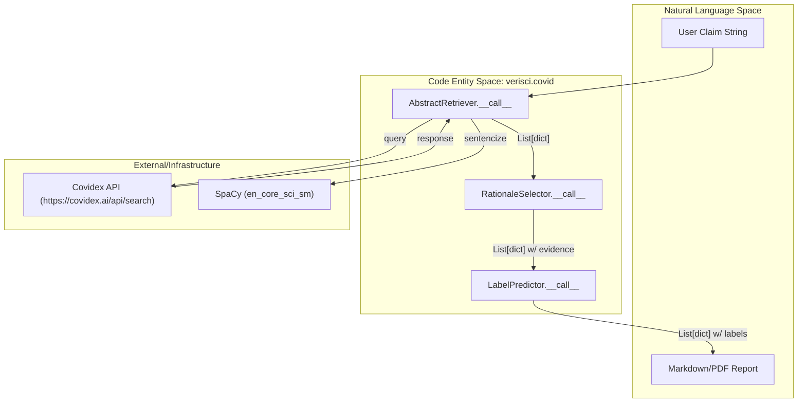
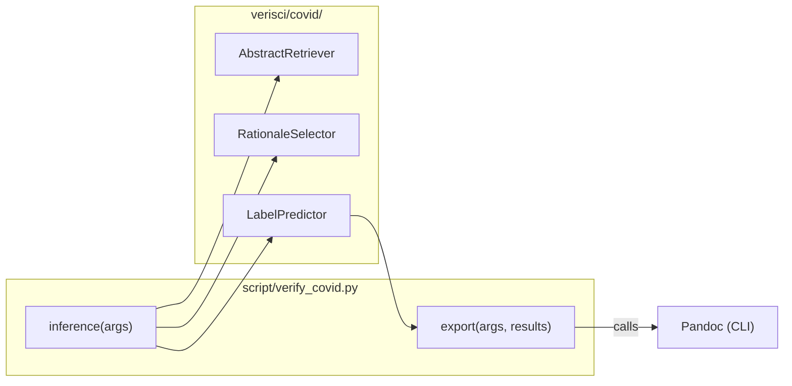

<!-- source: DeepWiki mcp.deepwiki.com · repo allenai/scifact · page 5 COVID-19 Claim Verification · fetched 2026-10-26 -->

# COVID-19 Claim Verification

Relevant source files

The following files were used as context for generating this wiki page:

- [covid/claims.txt](covid/claims.txt)
- [script/verify_covid.py](script/verify_covid.py)
- [verisci/covid/__init__.py](verisci/covid/__init__.py)
- [verisci/covid/abstract_retriever.py](verisci/covid/abstract_retriever.py)
- [verisci/covid/label_predictor.py](verisci/covid/label_predictor.py)
- [verisci/covid/rationale_selector.py](verisci/covid/rationale_selector.py)

The SciFact repository includes a specialized sub-system designed to verify claims against the **CORD-19** (COVID-19 Open Research Dataset) corpus. Unlike the standard SciFact pipeline which operates on a local, static `corpus.jsonl` file, the COVID-19 system integrates with the external **Covidex API** for real-time abstract retrieval.

The system is encapsulated within the `verisci.covid` module [verisci/covid/__init__.py:1-4]() and is primarily interacted with through the `verify_covid.py` command-line interface [script/verify_covid.py:10-35]().

### System Architecture

The COVID-19 verification process follows a three-stage pipeline: retrieval, selection, and prediction. The orchestration is handled by the `inference()` function in the CLI [script/verify_covid.py:38-75]().

#### 1. Abstract Retrieval
The pipeline begins with the `AbstractRetriever` [verisci/covid/abstract_retriever.py:8-48](). It queries the Covidex API using a claim string and processes the response by:
*   Normalizing source URLs (e.g., converting DOI or PubMed links to Semantic Scholar API links) [verisci/covid/abstract_retriever.py:24-33]().
*   Sentencizing the retrieved abstract text using the `en_core_sci_sm` SpaCy model [verisci/covid/abstract_retriever.py:45-47]().

#### 2. Rationale Selection
The `RationaleSelector` [verisci/covid/rationale_selector.py:8-41]() takes the retrieved abstracts and identifies specific sentences that serve as evidence for the claim. It supports two selection strategies:
*   **topk**: Selects the top $k$ sentences with the highest sigmoid scores.
*   **threshold**: Selects all sentences with a sigmoid score exceeding a user-defined value.

#### 3. Label Prediction
The `LabelPredictor` [verisci/covid/label_predictor.py:7-41]() evaluates the claim against the selected rationales. It outputs a classification of `SUPPORT`, `REFUTE`, or `NOT_ENOUGH_INFO` (NEI). By default, the system can be configured to filter out NEI results to focus on actionable evidence [script/verify_covid.py:27-28]().

### Code Entity Map: Pipeline Flow

The following diagram maps the high-level verification stages to the specific Python classes and methods that implement them.

**Verification Pipeline Mapping**

Sources: [verisci/covid/abstract_retriever.py:12-43](), [verisci/covid/rationale_selector.py:17-41](), [verisci/covid/label_predictor.py:17-41](), [script/verify_covid.py:61-75]()

### CLI and Orchestration

The `verify_covid.py` script serves as the entry point for the COVID-19 sub-system. It manages model loading (typically using RoBERTa-large models fine-tuned on SciFact and FEVER) and handles the export of findings into human-readable formats.

**Component Initialization**

Sources: [script/verify_covid.py:38-75](), [script/verify_covid.py:103-131]()

### Child Pages

For detailed technical documentation on the individual components and the command-line interface, refer to the following child pages:

*   **[COVID Pipeline Components: Retriever, Selector, Predictor](#5.1)**: Deep dive into the `verisci.covid` module, API integration details, and model scoring logic.
*   **[verify_covid.py CLI and Report Generation](#5.2)**: Detailed guide on CLI arguments, the inference loop, and how to generate PDF/Markdown reports from claim verifications.

Sources: [script/verify_covid.py:1-141](), [verisci/covid/abstract_retriever.py:1-48](), [verisci/covid/rationale_selector.py:1-41](), [verisci/covid/label_predictor.py:1-41]()

---

