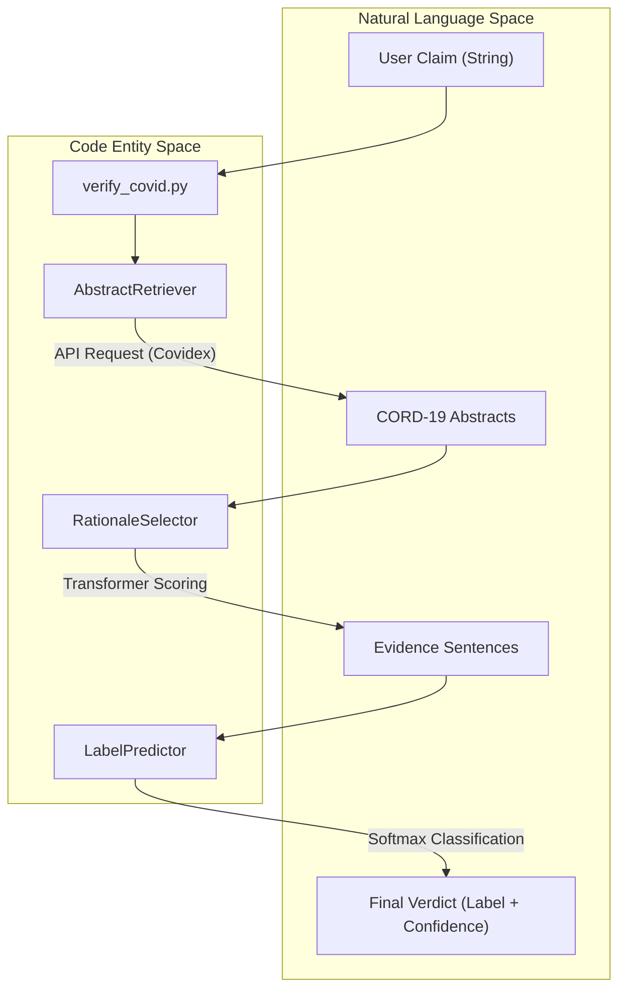
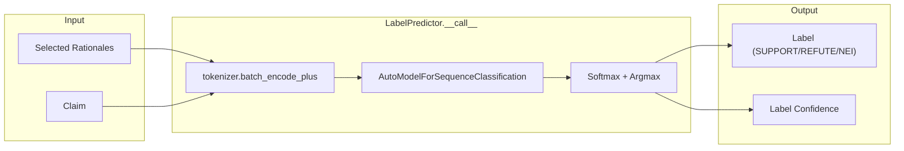

<!-- source: DeepWiki mcp.deepwiki.com · repo allenai/scifact · page 5.1 COVID Pipeline Components: Retriever, Selector, Predictor · fetched 2026-10-26 -->

# COVID Pipeline Components: Retriever, Selector, Predictor

Relevant source files

The following files were used as context for generating this wiki page:

- [script/verify_covid.py](script/verify_covid.py)
- [verisci/covid/__init__.py](verisci/covid/__init__.py)
- [verisci/covid/abstract_retriever.py](verisci/covid/abstract_retriever.py)
- [verisci/covid/label_predictor.py](verisci/covid/label_predictor.py)
- [verisci/covid/rationale_selector.py](verisci/covid/rationale_selector.py)
- [verisci/evaluate/lib/data.py](verisci/evaluate/lib/data.py)
- [verisci/inference/merge_predictions.py](verisci/inference/merge_predictions.py)

This page documents the specialized components within the `verisci.covid` module designed for verifying claims against the CORD-19 corpus. Unlike the standard SciFact pipeline which operates on a static local corpus, the COVID pipeline integrates with external APIs and provides a streamlined interface for real-time inference.

## Pipeline Architecture and Data Flow

The COVID verification pipeline consists of three sequential stages: retrieval of relevant abstracts via the Covidex API, selection of rationale sentences from those abstracts, and final label prediction.

### Component Relationship Diagram
The following diagram maps the logical pipeline stages to their corresponding implementation classes in the `verisci.covid` package.

**COVID Pipeline Code Mapping**

Sources: [verisci/covid/__init__.py:1-3](), [script/verify_covid.py:38-75]()

---

## AbstractRetriever

The `AbstractRetriever` class handles the initial discovery of scientific literature related to a claim. It interfaces with the **Covidex** search engine API.

### Implementation Details
- **API Integration**: It sends a GET request to `https://covidex.ai/api/search` with the claim as a query parameter [verisci/covid/abstract_retriever.py:14-16]().
- **URL Normalization**: The retriever converts various source URLs (DOI, PubMed, ArXiv) into Semantic Scholar API links to ensure consistent document access [verisci/covid/abstract_retriever.py:25-33]().
- **Sentencization**: Raw abstract text is processed using the `en_core_sci_sm` SpaCy model to split the text into a list of individual sentences [verisci/covid/abstract_retriever.py:10,45-47]().

### Data Structure
The retriever returns a list of dictionaries (blobs) containing:
| Field | Type | Description |
| :--- | :--- | :--- |
| `id` | `str` | Document identifier from Covidex |
| `title` | `str` | Paper title |
| `abstract` | `List[str]` | Sentencized abstract text |
| `url` | `str` | Normalized Semantic Scholar URL |

Sources: [verisci/covid/abstract_retriever.py:8-48]()

---

## RationaleSelector

The `RationaleSelector` identifies which specific sentences within a retrieved abstract support or refute the given claim.

### Selection Strategies
The selector supports two modes for identifying evidence [verisci/covid/rationale_selector.py:31-35]():
1. **Top-K (`topk`)**: Selects exactly `k` sentences (default is 3) with the highest sigmoid scores [verisci/covid/rationale_selector.py:17,35]().
2. **Threshold (`threshold`)**: Selects all sentences whose sigmoid score exceeds a user-defined `threshold` (e.g., 0.5) [verisci/covid/rationale_selector.py:31-33]().

### Implementation
The selector uses a Transformer model (typically `rationale_roberta_large_scifact`) to score sentence-claim pairs [script/verify_covid.py:42](). It applies a sigmoid function to the output logits to determine the confidence of each sentence being a rationale [verisci/covid/rationale_selector.py:28-29]().

Sources: [verisci/covid/rationale_selector.py:8-41](), [script/verify_covid.py:52-55]()

---

## LabelPredictor

The `LabelPredictor` performs the final classification of the claim based on the selected rationales.

### Three-Class Output
The predictor outputs one of three labels defined in the `Label` enum [verisci/evaluate/lib/data.py:20-23]():
- `SUPPORT`: The evidence confirms the claim.
- `REFUTE`: The evidence contradicts the claim.
- `NOT_ENOUGH_INFO` (NEI): The evidence is insufficient.

### Key Logic and Flags
- **Keep NEI**: By default, the pipeline may filter out inconclusive results. The `keep_nei` flag determines whether documents resulting in an `NEI` classification are retained in the final report [verisci/covid/label_predictor.py:34-35]().
- **Thresholding**: Even if a label is predicted, it is only returned if the softmax confidence score exceeds the `label_threshold` [verisci/covid/label_predictor.py:34]().
- **Inference**: The rationales are joined into a single string and concatenated with the claim for a single forward pass through the classification model [verisci/covid/label_predictor.py:24-30]().

**Predictor Data Flow**

Sources: [verisci/covid/label_predictor.py:7-41](), [script/verify_covid.py:56-59]()

---

## Component Integration Summary

The components are orchestrated by the `inference()` function in `verify_covid.py`.

| Component | Class Name | Input | Output |
| :--- | :--- | :--- | :--- |
| **Retriever** | `AbstractRetriever` | Claim String | List of Document Dicts |
| **Selector** | `RationaleSelector` | Claim + Documents | Documents + `evidence` (indices) |
| **Predictor** | `LabelPredictor` | Claim + Evidence | Documents + `label` + `label_confidence` |

Sources: [script/verify_covid.py:38-75]()

---

