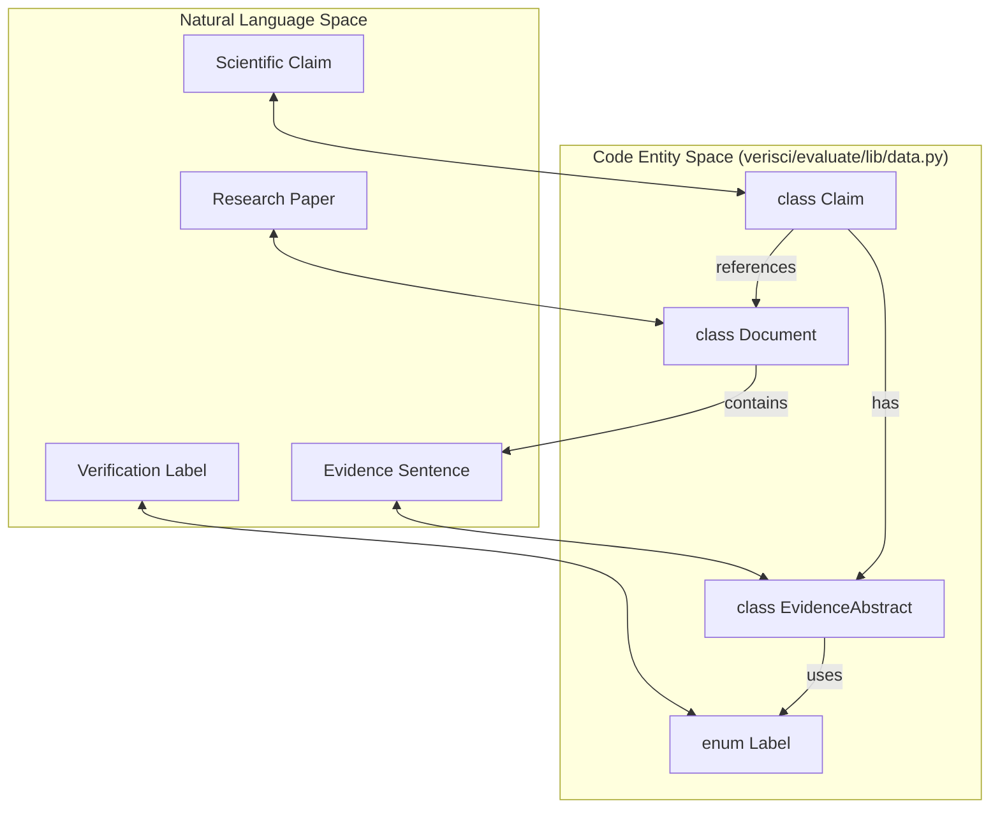
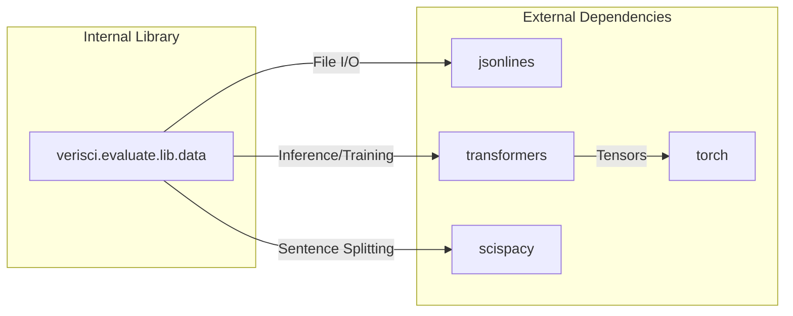

<!-- source: DeepWiki mcp.deepwiki.com · repo allenai/scifact · page 6 Core Library: Data Models and Utilities · fetched 2026-10-26 -->

# Core Library: Data Models and Utilities

Relevant source files

The following files were used as context for generating this wiki page:

- [requirements.txt](requirements.txt)
- [verisci/evaluate/lib/data.py](verisci/evaluate/lib/data.py)
- [verisci/inference/merge_predictions.py](verisci/inference/merge_predictions.py)

This page provides a high-level overview of the shared Python library used across the SciFact codebase. The library provides standardized data structures for handling the corpus, gold standard annotations, and model predictions, ensuring consistency between training, inference, and evaluation stages.

The core logic resides in `verisci/evaluate/lib/data.py`, which defines the object-oriented interface for the SciFact dataset.

### Data Model Overview

The library bridges the gap between raw JSONL files and structured Python objects. The following diagram illustrates how the primary code entities relate to the natural language concepts in the SciFact task.

**Entity Relationship: Natural Language to Code**

**Sources:** [verisci/evaluate/lib/data.py:20-154]()

---

### GoldDataset and Corpus Classes

The `GoldDataset` class is the primary entry point for loading the SciFact dataset. It encapsulates both the `Corpus` (the collection of available research abstracts) and the `Claim` objects (the individual claims to be verified).

*   **`Corpus`**: A collection of `Document` objects. It provides methods to retrieve abstracts by their unique `doc_id` [verisci/evaluate/lib/data.py:63-91]().
*   **`Document`**: Represents a single research paper, containing its title and a tuple of sentences [verisci/evaluate/lib/data.py:43-60]().
*   **`Claim`**: Represents a single claim, including the text of the claim, the IDs of cited documents, and the structured evidence (rationales and labels) [verisci/evaluate/lib/data.py:145-182]().
*   **`Label` Enum**: A standardized enumeration for claim verification: `SUPPORTS` (2), `NEI` (1), and `REFUTES` (0) [verisci/evaluate/lib/data.py:20-23]().

For detailed API references and examples of how to load these classes from JSONL files, see **[GoldDataset and Corpus Classes](#6.1)**.

**Sources:** [verisci/evaluate/lib/data.py:20-154]()

---

### PredictedDataset and Prediction Classes

While `GoldDataset` handles ground-truth data, the `PredictedDataset` class is designed to manage the output of the verification pipeline. It allows for structured access to model-generated rationales and labels, typically loaded from a `merged_predictions.jsonl` file.

*   **`PredictedDataset`**: Holds a collection of predictions and maintains a reference back to the `GoldDataset` for easy comparison during evaluation [verisci/evaluate/lib/data.py:208-235]().
*   **`ClaimPredictions`**: Represents the pipeline's output for a specific claim across multiple documents.
*   **`DocPrediction`**: Contains the specific sentences selected as rationales and the predicted label for a single document.

The `merge_predictions.py` utility is often used to combine separate rationale and label outputs into the format expected by these classes [verisci/inference/merge_predictions.py:21-47]().

For details on the prediction schema and pairing predictions with gold data, see **[PredictedDataset and Prediction Classes](#6.2)**.

**Sources:** [verisci/evaluate/lib/data.py:208-235](), [verisci/inference/merge_predictions.py:50-69]()

---

### Utility Functions

The library includes several helper functions to streamline data processing:

| Function | Description | Source |
| :--- | :--- | :--- |
| `load_jsonl(fname)` | Loads a JSON Lines file into a list of dictionaries. | [verisci/evaluate/lib/data.py:16-17]() |
| `make_label(label_str)` | Converts string labels (e.g., "SUPPORT") into `Label` enum members. | [verisci/evaluate/lib/data.py:26-35]() |
| `Claim.pretty_print()` | Formats a claim and its evidence for human-readable console output. | [verisci/evaluate/lib/data.py:184-202]() |

**Sources:** [verisci/evaluate/lib/data.py:16-202]()

---

### Library Dependencies

The core library relies on several key external packages for data handling and scientific text processing, as defined in the project requirements.

**Core Dependencies Mapping**

**Sources:** [requirements.txt:11-28]()

---

