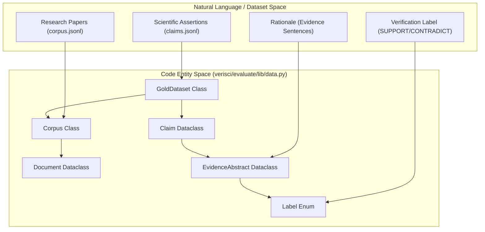
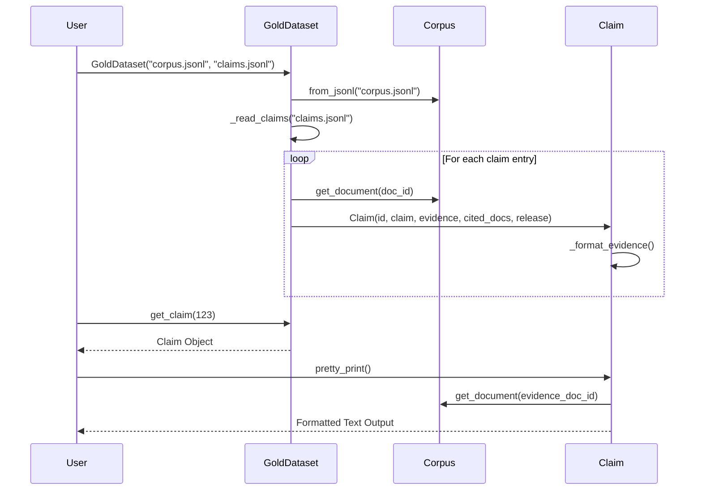

<!-- source: DeepWiki mcp.deepwiki.com · repo allenai/scifact · page 6.1 GoldDataset and Corpus Classes · fetched 2026-10-26 -->

# GoldDataset and Corpus Classes

<details>
<summary>Relevant source files</summary>

The following files were used as context for generating this wiki page:

- [doc/data.md](doc/data.md)
- [doc/training.md](doc/training.md)
- [verisci/evaluate/lib/data.py](verisci/evaluate/lib/data.py)
- [verisci/inference/merge_predictions.py](verisci/inference/merge_predictions.py)

</details>


The SciFact codebase provides a structured API for interacting with the dataset's gold annotations and evidence corpus. These classes abstract the underlying JSONL file formats into Python dataclasses, facilitating claim lookup, document retrieval, and visualization of evidence sets.

## Data Model Overview

The core data models are defined in `verisci/evaluate/lib/data.py`. The system uses a hierarchical structure where a `GoldDataset` encapsulates both the `Corpus` (the collection of available research abstracts) and the `Claim` objects (the individual scientific assertions to be verified).

### Natural Language to Code Entity Mapping

The following diagram illustrates how the conceptual components of a scientific claim verification task map to specific classes and data structures in the SciFact library.

**Entity Mapping: Dataset Representation**

**Sources:** [verisci/evaluate/lib/data.py:5-153](), [doc/data.md:13-90]()

---

## Core Classes

### Label Enum
The `Label` enum standardizes the verification outcomes. While the raw JSONL files use string identifiers like `"SUPPORT"` or `"CONTRADICT"`, the internal API converts these into an enumeration for type safety.

| Enum Member | Integer Value | JSONL String Mapping |
| :--- | :--- | :--- |
| `Label.SUPPORTS` | 2 | `"SUPPORT"` |
| `Label.NEI` | 1 | `"NOT_ENOUGH_INFO"` |
| `Label.REFUTES` | 0 | `"CONTRADICT"` |

The utility function `make_label(label_str, allow_NEI=True)` is used to perform this conversion [verisci/evaluate/lib/data.py:20-35]().

### Document and Corpus
A `Document` represents a single entry in the corpus, containing the title and the abstract split into a list of sentences [verisci/evaluate/lib/data.py:42-46]().

*   **`Corpus`**: A collection of `Document` objects. It provides `get_document(doc_id)` to retrieve a specific abstract by its S2ORC ID [verisci/evaluate/lib/data.py:63-82]().
*   **Construction**: The `Corpus.from_jsonl(corpus_file)` method reads the `corpus.jsonl` file and instantiates the documents [verisci/evaluate/lib/data.py:84-91]().

### GoldDataset
The `GoldDataset` is the primary entry point for researchers. It loads both the corpus and the claims into memory [verisci/evaluate/lib/data.py:98-104]().

*   **`get_claim(example_id)`**: Returns a specific `Claim` object by its unique ID [verisci/evaluate/lib/data.py:129-133]().
*   **Internal Loading**: It uses `_read_claims()` to parse the claims file, automatically linking each claim to its `cited_docs` by looking them up in the `Corpus` [verisci/evaluate/lib/data.py:113-127]().

**Sources:** [verisci/evaluate/lib/data.py:20-133]()

---

## Claim and Evidence Representation

The `Claim` class represents the assertion and its associated evidence.

### EvidenceAbstract Dataclass
Because SciFact ensures that all rationales within a single abstract share the same label, the `EvidenceAbstract` class groups rationales at the document level [verisci/evaluate/lib/data.py:137-141]().

*   `id`: The document ID.
*   `label`: The `Label` enum (SUPPORTS/REFUTES).
*   `rationales`: A list of lists, where each inner list contains sentence indices forming a single rationale.

### Claim Methods
*   **`__post_init__`**: Calls `_format_evidence` to restructure the raw dictionary into `EvidenceAbstract` objects [verisci/evaluate/lib/data.py:155-156]().
*   **`pretty_print()`**: A visualization tool that prints the claim text followed by the specific sentences from the corpus that serve as evidence [verisci/evaluate/lib/data.py:184-202]().

**Data Flow: Loading a Gold Claim**

**Sources:** [verisci/evaluate/lib/data.py:98-202](), [doc/data.md:93-115]()

---

## JSONL Schema Comparison

The classes are designed to parse the following standard SciFact formats:

### Claims Format (`claims.jsonl`)
```json
{
    "id": 263,
    "claim": "Claim text here...",
    "evidence": {
        "11328820": [
            { "sentences": [7, 9], "label": "CONTRADICT" }
        ]
    },
    "cited_doc_ids": [11328820, 30041340]
}
```
[doc/data.md:16-30]()

### Corpus Format (`corpus.jsonl`)
```json
{
    "doc_id": 4983,
    "title": "Title here...",
    "abstract": ["Sentence 0", "Sentence 1"],
    "structured": false
}
```
[doc/data.md:68-75]()

**Sources:** [doc/data.md:16-75](), [verisci/evaluate/lib/data.py:159-178]()

---

