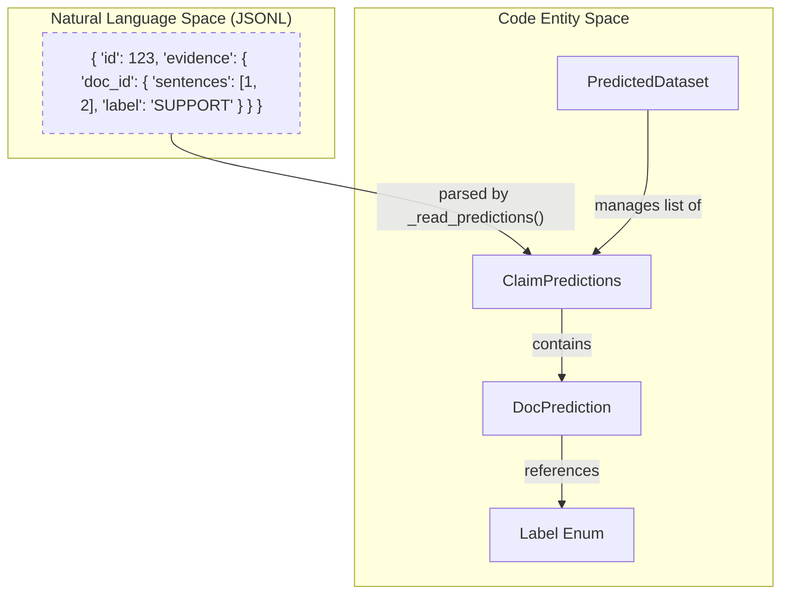
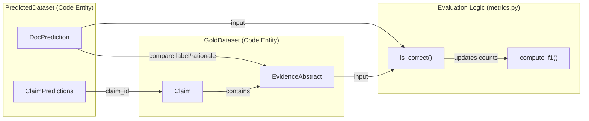

<!-- source: DeepWiki mcp.deepwiki.com · repo allenai/scifact · page 6.2 PredictedDataset and Prediction Classes · fetched 2026-10-26 -->

# PredictedDataset and Prediction Classes

Relevant source files

The following files were used as context for generating this wiki page:

- [verisci/evaluate/abstract_retrieval.py](verisci/evaluate/abstract_retrieval.py)
- [verisci/evaluate/label_prediction.py](verisci/evaluate/label_prediction.py)
- [verisci/evaluate/lib/__init__.py](verisci/evaluate/lib/__init__.py)
- [verisci/evaluate/lib/data.py](verisci/evaluate/lib/data.py)
- [verisci/evaluate/lib/metrics.py](verisci/evaluate/lib/metrics.py)
- [verisci/inference/merge_predictions.py](verisci/inference/merge_predictions.py)

The `PredictedDataset` and its associated prediction classes provide a structured representation for model outputs in the SciFact pipeline. These classes facilitate the loading of merged rationale and label predictions, allowing for systematic comparison against a `GoldDataset` for evaluation.

### Data Flow and Representation

Model predictions are typically stored in a JSONL format where each line represents a claim and its associated evidence (rationale sentences and labels). The `PredictedDataset` class parses these files into a collection of `ClaimPredictions` objects, which in turn contain `DocPrediction` objects for each relevant document.

#### Relationship between Gold and Predicted Entities

The following diagram illustrates how the system bridges the gap between the raw prediction files (Natural Language/JSON Space) and the internal class representations (Code Entity Space).

**Figure 1: Prediction Entity Mapping**

Sources: [verisci/evaluate/lib/data.py:208-235](), [verisci/evaluate/lib/data.py:255-275]()

### Core Prediction Classes

#### PredictedDataset
The `PredictedDataset` is the top-level container for all predictions. It requires a `GoldDataset` instance during initialization to maintain a reference to the ground truth data used for evaluation.

*   **Initialization**: It takes a `GoldDataset` and a path to a prediction file [verisci/evaluate/lib/data.py:212-218]().
*   **Parsing**: The `_parse_prediction` method converts raw dictionary entries into `ClaimPredictions` [verisci/evaluate/lib/data.py:237-248]().

#### ClaimPredictions
Represents all model predictions for a single claim across multiple documents.
*   **Attributes**:
    *   `claim_id`: The unique identifier of the claim [verisci/evaluate/lib/data.py:252]().
    *   `predictions`: A dictionary mapping document IDs to `DocPrediction` objects [verisci/evaluate/lib/data.py:253]().

#### DocPrediction
Represents the specific prediction made for a single claim-document pair.
*   **Attributes**:
    *   `label`: A `Label` enum value (SUPPORTS, REFUTES, or NEI) [verisci/evaluate/lib/data.py:263]().
    *   `rationale`: A list of integers representing the indices of the sentences selected as evidence [verisci/evaluate/lib/data.py:264]().

Sources: [verisci/evaluate/lib/data.py:208-275]()

### Interaction with Gold Data for Evaluation

The primary purpose of these classes is to enable the computation of metrics. The `compute_metrics` function iterates through a `PredictedDataset`, retrieving the corresponding gold claim for each prediction to calculate F1 scores.

**Figure 2: Evaluation Comparison Logic**

Sources: [verisci/evaluate/lib/metrics.py:45-61](), [verisci/evaluate/lib/metrics.py:162-181]()

### Key Functions and Evaluation Rules

| Function | Role | Logic |
| :--- | :--- | :--- |
| `is_correct` | Abstract-level check | Validates if the predicted label matches gold and if the rationale meets the `MAX_ABSTRACT_SENTS` cap (default 3) [verisci/evaluate/lib/metrics.py:45-61](). |
| `count_rationale_sents` | Sentence-level check | Implements the "set-completion" rule: a sentence is only correct if it is part of a gold rationale set and all other sentences in that set were also predicted [verisci/evaluate/lib/metrics.py:84-98](). |
| `merge_one` | Data Preparation | Combines outputs from rationale selection and label prediction modules, filtering out `NOT_ENOUGH_INFO` (NEI) predictions for the final evaluation file [verisci/inference/merge_predictions.py:21-47](). |

#### The NEI Filter
During the merge process in `merge_predictions.py`, any document predicted as `NOT_ENOUGH_INFO` is excluded from the final evidence dictionary [verisci/inference/merge_predictions.py:41-43](). Consequently, in the `PredictedDataset`, the absence of a document ID in `ClaimPredictions.predictions` implies an NEI prediction or that the document was not retrieved.

Sources: [verisci/evaluate/lib/metrics.py:13-14](), [verisci/evaluate/lib/metrics.py:45-61](), [verisci/evaluate/lib/metrics.py:84-98](), [verisci/inference/merge_predictions.py:21-47]()

---

