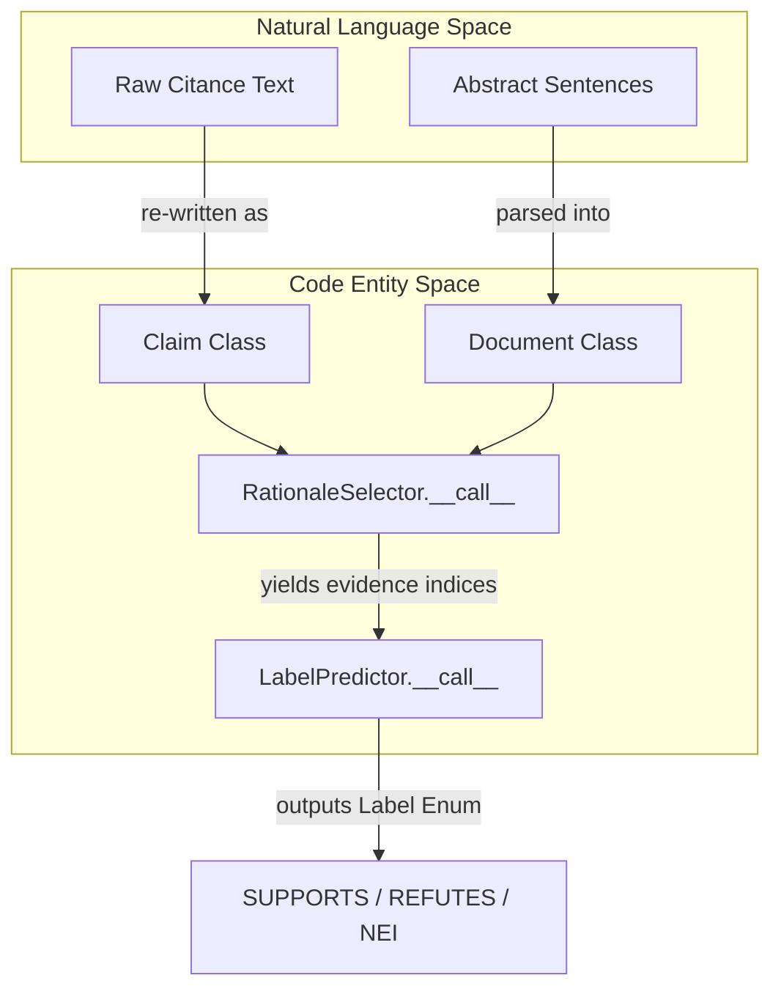
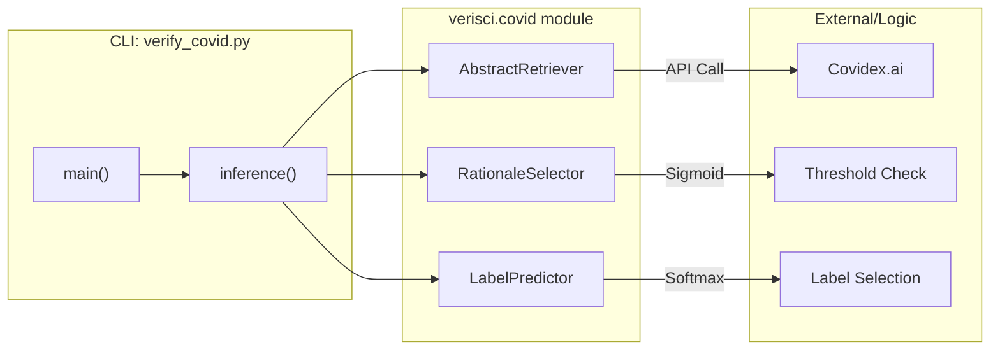

<!-- source: DeepWiki mcp.deepwiki.com · repo allenai/scifact · page 7 Glossary · fetched 2026-10-26 -->

# Glossary

Relevant source files

The following files were used as context for generating this wiki page:

- [README.md](README.md)
- [doc/claims-with-citances.md](doc/claims-with-citances.md)
- [doc/data.md](doc/data.md)
- [doc/evaluation.md](doc/evaluation.md)
- [doc/training.md](doc/training.md)
- [script/download-model.sh](script/download-model.sh)
- [script/verify_covid.py](script/verify_covid.py)
- [verisci/covid/__init__.py](verisci/covid/__init__.py)
- [verisci/covid/abstract_retriever.py](verisci/covid/abstract_retriever.py)
- [verisci/covid/label_predictor.py](verisci/covid/label_predictor.py)
- [verisci/covid/rationale_selector.py](verisci/covid/rationale_selector.py)
- [verisci/evaluate/lib/__init__.py](verisci/evaluate/lib/__init__.py)
- [verisci/evaluate/lib/data.py](verisci/evaluate/lib/data.py)
- [verisci/evaluate/lib/metrics.py](verisci/evaluate/lib/metrics.py)
- [verisci/inference/merge_predictions.py](verisci/inference/merge_predictions.py)

This page defines codebase-specific terms, abbreviations, and domain concepts used throughout the SciFact project. It provides technical details on implementation, data flow, and key class structures to assist onboarding engineers.

### Core Domain Entities

The SciFact verification task revolves around three primary data entities: **Claims**, **Documents**, and **Evidence**.

| Term | Definition | Code Reference |
| :--- | :--- | :--- |
| **Claim** | A scientific statement to be verified. In the dataset, these are generated by re-writing "citances" (citation sentences) into atomic claims. | [verisci/evaluate/lib/data.py:145-154]() |
| **Document** | An entry in the corpus consisting of a title and an abstract (represented as a list of sentences). Identified by an S2ORC ID. | [verisci/evaluate/lib/data.py:42-59]() |
| **Evidence** | A set of rationale sentences from a document that either `SUPPORTS` or `REFUTES` a claim. | [doc/data.md:20-27]() |
| **Citance** | The original citation sentence from a source paper used to generate a claim. | [doc/claims-with-citances.md:9-9]() |
| **Rationale** | A minimal set of sentences within an abstract that provides sufficient information to verify a claim. | [verisci/evaluate/lib/metrics.py:107-108]() |

**Sources:** [verisci/evaluate/lib/data.py:42-154](), [doc/data.md:20-27](), [doc/claims-with-citances.md:1-14]().

---

### Pipeline Components & Architecture

The system is structured as a modular pipeline where each stage processes the output of the previous one.

#### 1. Abstract Retrieval
The process of identifying relevant documents from the `Corpus` for a given `Claim`.
* **Oracle Retrieval**: Uses the gold-standard `cited_doc_ids` to bypass the search step during training or controlled evaluation [README.md:83-90]().
* **Open Retrieval**: Uses a search engine (like TF-IDF or the Covidex API) to find relevant abstracts from a large corpus [README.md:83-90]().

#### 2. Rationale Selection
A binary classification task where the system identifies which sentences in a retrieved abstract serve as evidence.
* **Implementation**: Often a Transformer-based model (e.g., `roberta-large`) that takes `(sentence, claim)` pairs as input [verisci/covid/rationale_selector.py:22-26]().
* **Methods**: 
    * `threshold`: Selects all sentences with a sigmoid score above a defined value [verisci/covid/rationale_selector.py:31-33]().
    * `topk`: Selects the top $k$ highest-scoring sentences [verisci/covid/rationale_selector.py:34-35]().

#### 3. Label Prediction
A three-class classification task (`SUPPORT`, `REFUTE`, `NEI`) that determines the relationship between the claim and the selected rationales.
* **NEI (Not Enough Info)**: A label assigned when a document is relevant but does not contain sufficient evidence to support or refute the claim [verisci/evaluate/lib/data.py:20-35]().

#### Data Flow Diagram: Natural Language to Code Entities
The following diagram illustrates how raw scientific text is transformed into internal code objects through the pipeline.

**Sources:** [verisci/evaluate/lib/data.py:20-154](), [verisci/covid/rationale_selector.py:17-41](), [verisci/covid/label_predictor.py:17-41]().

---

### Evaluation Metrics

SciFact uses specific metrics to account for the multi-sentence nature of scientific evidence.

* **Sentence-level F1**: Requires "set-completion." A model only gets credit for a sentence if it is part of a gold evidence set and **all** other sentences in that specific set were also predicted [verisci/evaluate/lib/metrics.py:118-125]().
* **Abstract-level F1**: An abstract is correct if the label matches and at least one complete gold evidence set is found within the first **three** predicted sentences [verisci/evaluate/lib/metrics.py:86-91]().
* **MAX_ABSTRACT_SENTS**: A constant (value = 3) used to cap the number of sentences considered for abstract-level scoring to prevent "over-prediction" gaming [verisci/evaluate/lib/metrics.py:14-14]().

**Sources:** [verisci/evaluate/lib/metrics.py:14-182](), [doc/evaluation.md:86-146]().

---

### COVID-19 Sub-system (VeriSci)

The `verisci.covid` module is a specialized implementation designed for the CORD-19 corpus.

#### System Architecture: `verify_covid.py`
This diagram maps the CLI execution to the specific classes in the `verisci.covid` package.

| Class | Role | Technical Detail |
| :--- | :--- | :--- |
| `AbstractRetriever` | Retrieval | Calls the Covidex API and performs "sentencization" using `spacy` (`en_core_sci_sm`) [verisci/covid/abstract_retriever.py:8-47](). |
| `RationaleSelector` | Selection | Uses `AutoModelForSequenceClassification` to score sentence-claim pairs [verisci/covid/rationale_selector.py:8-13](). |
| `LabelPredictor` | Prediction | Concatenates all selected rationale sentences into a single block to predict the final label [verisci/covid/label_predictor.py:24-30](). |

**Sources:** [script/verify_covid.py:38-75](), [verisci/covid/abstract_retriever.py:8-47](), [verisci/covid/rationale_selector.py:8-41](), [verisci/covid/label_predictor.py:7-41]().

---

### Implementation Details

#### Label Enum
The `Label` enum maps string categories to internal integers:
* `REFUTES`: 0
* `NEI`: 1
* `SUPPORTS`: 2

Defined in: [verisci/evaluate/lib/data.py:20-23]().

#### Transfer Learning Strategy
The project frequently uses a two-stage training process referred to as `fever_scifact`.
1. **Pre-training**: Models are trained on the FEVER or Snopes datasets [README.md:143-148]().
2. **Fine-tuning**: The FEVER-trained weights are used as the starting point for training on the smaller SciFact dataset [doc/training.md:96-99]().

**Sources:** [README.md:143-157](), [doc/training.md:96-99]().