# Page: SciFact Overview

# SciFact Overview

<details>
<summary>Relevant source files</summary>

The following files were used as context for generating this wiki page:

- [.gitignore](.gitignore)
- [README.md](README.md)
- [doc/claims-with-citances.md](doc/claims-with-citances.md)
- [doc/data.md](doc/data.md)
- [doc/training.md](doc/training.md)

</details>


The SciFact project provides a dataset and a software pipeline for the verification of scientific claims. Given a claim, the system retrieves relevant scientific abstracts, identifies specific sentences that serve as evidence (rationales), and predicts whether the evidence supports or refutes the claim.

The project encompasses the original SciFact dataset, pre-trained transformer-based models (VeriSci), and an evaluation framework for both component-level and pipeline-level performance [README.md:1-11]().

## System Architecture

The SciFact verification process is structured as a three-stage pipeline. Data flows between these stages primarily via `.jsonl` files, allowing for modular execution and evaluation of each component.

### High-Level Component Flow
The following diagram illustrates the relationship between the logical pipeline stages and the corresponding code entities/scripts.

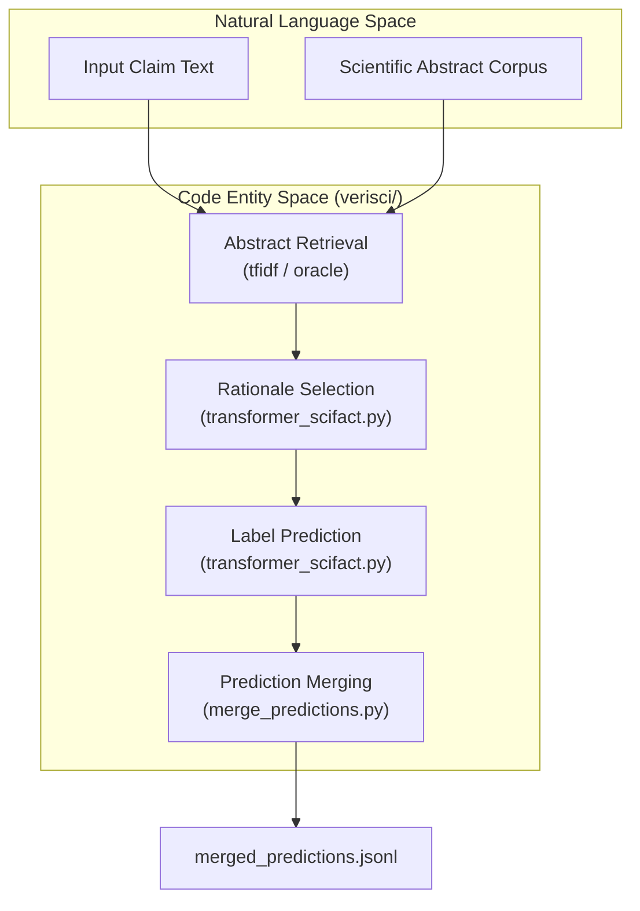
**Sources:** [README.md:77-85](), [doc/training.md:26-52]()

## Key Components

### 1. Abstract Retrieval
This stage identifies relevant documents from the `corpus.jsonl` for a given claim. The system supports "Oracle" retrieval (using gold-standard document IDs) for development and "Open" retrieval (using TF-IDF) for real-world inference [README.md:83-90]().

### 2. Rationale Selection
This module performs sentence-level binary classification. It identifies which sentences within a retrieved abstract provide evidence for or against the claim. Models are typically based on architectures like `roberta-large` or `scibert` [doc/training.md:13-15](), [doc/training.md:26-32]().

### 3. Label Prediction
The final stage takes the claim and the selected rationales to produce a verdict: **SUPPORT**, **REFUTE**, or **NOT_ENOUGH_INFO (NEI)**. The highest-performing configurations often involve transfer learning, such as pre-training on the FEVER dataset before fine-tuning on SciFact [README.md:152-157](), [doc/training.md:96-100]().

## Data Models and Schema

SciFact uses a structured JSONL format to represent claims and evidence. The `GoldDataset` class in the `verisci` library is the primary interface for interacting with this data [doc/data.md:93-100]().

### Core Data Entities
The diagram below maps the JSON schema elements to the internal data structures.

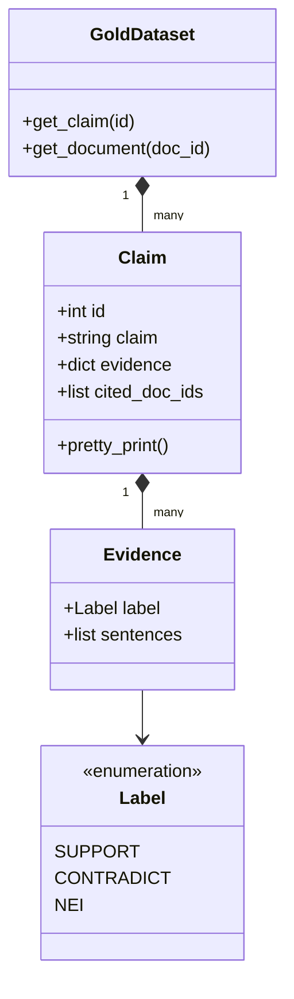
**Sources:** [doc/data.md:15-30](), [doc/data.md:93-100]()

## Getting Started

To set up the environment and run the pipeline:
1.  **Environment:** Create a conda environment and install dependencies from `requirements.txt` [README.md:37-55]().
2.  **Data:** Download the corpus and claims using the provided `download-data.sh` script [README.md:98-101]().
3.  **Models:** Pre-trained models for rationale selection and label prediction can be retrieved via `download-model.sh` [README.md:140-143]().

For detailed setup instructions, see **[Getting Started: Installation & Environment Setup](#1.1)**.
For information on data formats and the claim generation task, see **[Dataset: Schema, Formats, and Claim Generation](#1.2)**.

**Sources:** [README.md:35-57](), [README.md:96-106](), [README.md:138-145]()

---

# Page: Getting Started: Installation & Environment Setup

# Getting Started: Installation & Environment Setup

<details>
<summary>Relevant source files</summary>

The following files were used as context for generating this wiki page:

- [README.md](README.md)
- [doc/claims-with-citances.md](doc/claims-with-citances.md)
- [requirements.txt](requirements.txt)
- [script/download-data.sh](script/download-data.sh)
- [script/download-model.sh](script/download-model.sh)

</details>


This page provides a comprehensive guide to setting up the SciFact development environment. It covers dependency management via Conda, data acquisition, pre-trained model retrieval, and the execution of the end-to-end verification pipeline.

## 1. Environment Configuration

The SciFact project requires Python 3.7. The environment setup involves creating a dedicated Conda environment and installing specific versions of deep learning libraries, including `torch` and `transformers`.

### Step-by-Step Setup

1.  **Create Conda Environment**: Initialize a new environment named `scifact`.
    ```bash
    conda create --name scifact python=3.7 conda-build
    ```
2.  **Project Integration**: Add the project root to your `PYTHONPATH` using `conda develop`. This allows the interpreter to resolve internal modules like `verisci`.
    ```bash
    conda develop .
    ```
3.  **Install Dependencies**: Install the required Python packages listed in `requirements.txt`.
    ```bash
    pip install -r requirements.txt
    ```

### Key Dependencies
The project relies on the following core libraries for its NLP pipeline:
*   `torch==1.5.0`: Core tensor computations and neural network modules.
*   `transformers==2.7.0`: Interface for BERT, RoBERTa, and SciBERT models.
*   `scispacy==0.2.5`: Specialized scientific text processing.
*   `jsonlines==1.2.0`: Handling the `.jsonl` data formats used throughout the pipeline.

**Sources:** [README.md:35-55](), [requirements.txt:1-30]()

---

## 2. Data and Model Acquisition

SciFact uses a structured directory format for its corpus and claims. Pre-trained models are hosted on AWS S3 and can be retrieved using provided shell scripts.

### Downloading the Dataset
Run the following script to download and unpack the corpus and claim files:
```bash
./script/download-data.sh
```
This script fetches `data.tar.gz` and extracts it into a `data/` directory with the following structure:
*   `corpus.jsonl`: The collection of scientific abstracts.
*   `claims_train.jsonl` / `claims_dev.jsonl`: Labeled claims for training and development.
*   `claims_test.jsonl`: Unlabeled claims for leaderboard submission.

### Downloading Pre-trained Models
Models are categorized by their component (rationale selection or label prediction), the BERT variant used, and the training dataset.
```bash
./script/download-model.sh [model-component] [bert-variant] [training-dataset]
```
*   **Components**: `rationale`, `label`.
*   **Variants**: `roberta_large`, `roberta_base`, `scibert`, `biomed_roberta_base`.
*   **Training Sets**: `scifact`, `fever_scifact`, `fever`, `snopes`.

**Sources:** [README.md:96-124](), [README.md:138-159](), [script/download-data.sh:1-16](), [script/download-model.sh:1-34]()

---

## 3. System Architecture & Data Flow

The following diagrams illustrate how the installation components map to the functional entities in the codebase.

### Environment and Data Entity Mapping
This diagram bridges the "Natural Language" requirements to the "Code Entities" that manage them.

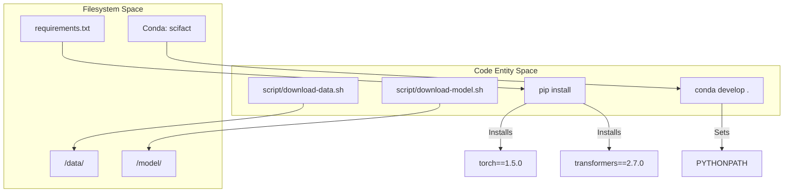
**Sources:** [README.md:35-55](), [requirements.txt:1-30](), [script/download-data.sh:1-16](), [script/download-model.sh:1-34]()

### Pipeline Execution Flow
This diagram shows the relationship between the scripts and the data components they produce.

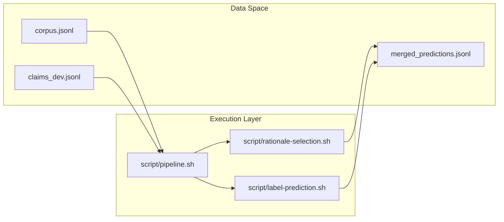
**Sources:** [README.md:57-85](), [script/download-data.sh:1-16]()

---

## 4. Running the End-to-End Pipeline

Once the environment is set up and data is downloaded, you can run the full verification pipeline. The pipeline consists of three main stages: retrieval, rationale selection, and label prediction.

### Pipeline Command
```bash
./script/pipeline.sh [retrieval] [model] [dataset]
```

### Argument Configurations
| Argument | Options | Description |
| :--- | :--- | :--- |
| `retrieval` | `oracle`, `open` | `oracle` uses gold abstracts; `open` uses TF-IDF retrieval. |
| `model` | `oracle-rationale`, `zero-shot`, `verisci` | `verisci` is the standard pipeline described in the paper. |
| `dataset` | `dev`, `test` | Use `dev` for evaluation; `test` for unlabeled predictions. |

### Example: Reproducing Paper Metrics
To run the standard "VeriSci" pipeline on the development set with open retrieval:
```bash
./script/pipeline.sh open verisci dev
```
This script will:
1.  Retrieve relevant abstracts from `corpus.jsonl`.
2.  Select rationale sentences within those abstracts.
3.  Predict the veracity label (SUPPORT, REFUTE, or NO_INFO).
4.  Output a `merged_predictions.jsonl` file and compute performance metrics (F1 scores).

**Sources:** [README.md:57-94]()

---

# Page: Dataset: Schema, Formats, and Claim Generation

# Dataset: Schema, Formats, and Claim Generation

<details>
<summary>Relevant source files</summary>

The following files were used as context for generating this wiki page:

- [README.md](README.md)
- [doc/claims-with-citances.md](doc/claims-with-citances.md)
- [doc/data.md](doc/data.md)
- [doc/training.md](doc/training.md)
- [verisci/evaluate/lib/data.py](verisci/evaluate/lib/data.py)
- [verisci/inference/merge_predictions.py](verisci/inference/merge_predictions.py)

</details>


This page provides a technical deep dive into the SciFact dataset structure, the programmatic interfaces used to interact with the data, and the specialized formats for claim generation research.

## Data Formats and Schema

The SciFact dataset is distributed as a set of JSONL (JSON Lines) files. The core components are the **Corpus**, which contains the evidence documents, and the **Claims**, which contain the statements to be verified along with their ground-truth evidence and labels.

### Corpus Schema (`corpus.jsonl`)
The corpus contains the abstracts used as the source of evidence. Each line is a JSON object representing a single document.

| Field | Type | Description |
| :--- | :--- | :--- |
| `doc_id` | `number` | The unique S2ORC identifier for the document. |
| `title` | `string` | The title of the scientific paper. |
| `abstract` | `string[]` | The abstract text, pre-tokenized into a list of sentences. |
| `structured` | `boolean` | Indicates if the abstract contains section headers (e.g., "METHODS", "RESULTS"). |

Sources: [doc/data.md:67-75](), [verisci/evaluate/lib/data.py:54-59]()

### Claims Schema (`claims_train.jsonl`, `claims_dev.jsonl`)
Claims include the statement text and the "gold" evidence required to verify them.

| Field | Type | Description |
| :--- | :--- | :--- |
| `id` | `number` | Unique integer claim ID. |
| `claim` | `string` | The natural language statement. |
| `evidence` | `dict` | Keyed by `doc_id`, containing a list of rationale objects (sentences and labels). |
| `cited_doc_ids` | `number[]` | IDs of documents cited in the original paper's citation sentence. |

**Evidence Object Detail:**
Within the `evidence` dictionary, each entry for a `doc_id` contains a list of rationales. In the current SciFact release, all rationales for a single abstract share the same label (`SUPPORT` or `CONTRADICT`).

Sources: [doc/data.md:15-32](), [verisci/evaluate/lib/data.py:158-178]()

---

## Python API: GoldDataset and Data Models

The `verisci` library provides a high-level API to load and manipulate these files, abstracting the raw JSON into Python dataclasses.

### Key Classes
- **`GoldDataset`**: The primary entry point. It loads both the `Corpus` and the claim files, linking them together. [verisci/evaluate/lib/data.py:98-104]()
- **`Corpus`**: A collection of `Document` objects. It provides `get_document(doc_id)` for O(1) or O(N) lookup. [verisci/evaluate/lib/data.py:63-91]()
- **`Claim`**: Represents a single claim. During initialization, it converts raw evidence dictionaries into `EvidenceAbstract` objects and resolves `cited_doc_ids` into full `Document` objects. [verisci/evaluate/lib/data.py:145-156]()
- **`Label` (Enum)**: Maps dataset strings to integers: `SUPPORTS` (2), `NEI` (1), `REFUTES` (0). [verisci/evaluate/lib/data.py:20-23]()

### Data Flow and Relationship
The following diagram illustrates how the `GoldDataset` class bridges the gap between the raw JSONL files and the internal Python object graph.

**Data Loading and Object Mapping**
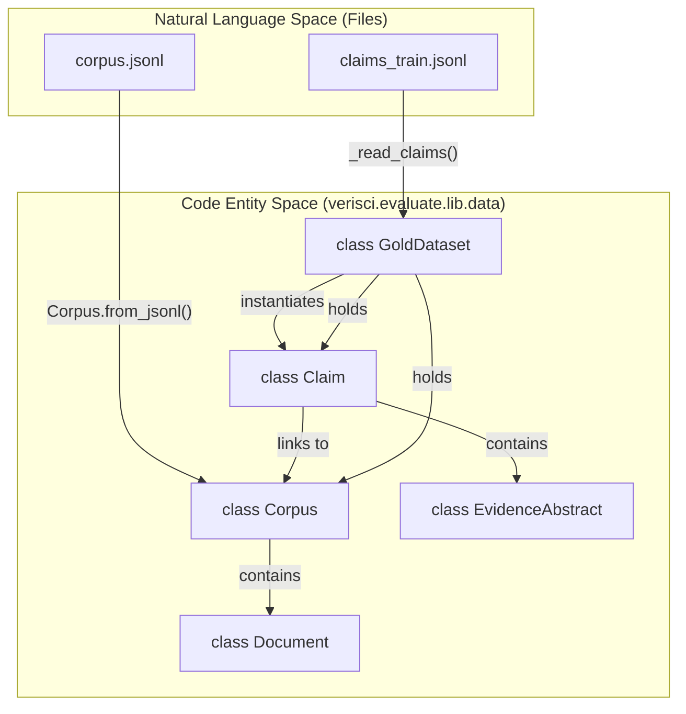
Sources: [verisci/evaluate/lib/data.py:83-91](), [verisci/evaluate/lib/data.py:102-104](), [verisci/evaluate/lib/data.py:113-127]()

---

## Claim Generation: `claims_with_citances.jsonl`

For research into generating claims from citation contexts (citances), a specialized dataset is provided. This format maps a citation sentence within its original paragraph context to the resulting atomic claims.

### Schema Detail
- **`citation_paragraph`**: The full paragraph from the source paper.
- **`citance`**: The specific sentence containing the citation.
- **`claims`**: A list of objects containing:
    - `claim_text`: The resulting atomic claim.
    - `claim_subject`: The specific entity the claim is about.
    - `is_negation`: Boolean indicating if the claim contradicts the citance.

Sources: [doc/claims-with-citances.md:1-14](), [README.md:128-136]()

---

## Implementation Details: Evidence Formatting

The `Claim` class performs a critical normalization step in its `__post_init__` method. While the JSON schema allows for multiple rationales with different labels per document, the `verisci` implementation enforces a "one label per abstract" rule for the current SciFact release.

**Logic Flow for Evidence Normalization**
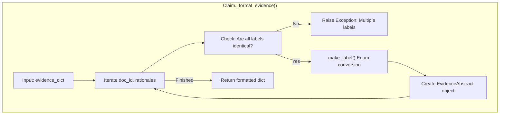

### Key Functions
- `make_label(label_str)`: Converts strings like "SUPPORT" or "CONTRADICT" into `Label` enum values. [verisci/evaluate/lib/data.py:26-35]()
- `Claim.pretty_print()`: A utility for debugging that renders a claim and its associated evidence sentences directly to the console. [verisci/evaluate/lib/data.py:184-202]()

Sources: [verisci/evaluate/lib/data.py:158-178](), [doc/data.md:91-114]()

---

# Page: Verification Pipeline Architecture

# Verification Pipeline Architecture

<details>
<summary>Relevant source files</summary>

The following files were used as context for generating this wiki page:

- [doc/model.md](doc/model.md)
- [script/label-prediction.sh](script/label-prediction.sh)
- [script/pipeline.sh](script/pipeline.sh)
- [script/rationale-selection.sh](script/rationale-selection.sh)
- [verisci/evaluate/lib/data.py](verisci/evaluate/lib/data.py)
- [verisci/evaluate/pipeline.py](verisci/evaluate/pipeline.py)
- [verisci/inference/merge_predictions.py](verisci/inference/merge_predictions.py)

</details>


The SciFact verification pipeline is a modular, three-stage system designed to verify scientific claims against a large corpus of research abstracts. The pipeline transitions from a massive search space (thousands of documents) to a specific set of supporting or refuting sentences (rationales) and a final veracity label.

The pipeline is orchestrated primarily through shell scripts that invoke Python modules, with each stage communicating via standardized JSONL files.

## Pipeline Overview

The verification process follows a sequential flow where the output of one stage serves as the input for the next. This modularity allows for "Oracle" experiments, where gold-standard data can be substituted for any stage's output to isolate component performance.

### Verification Workflow Diagram

This diagram illustrates the flow of data through the system's core inference modules and the resulting file artifacts.

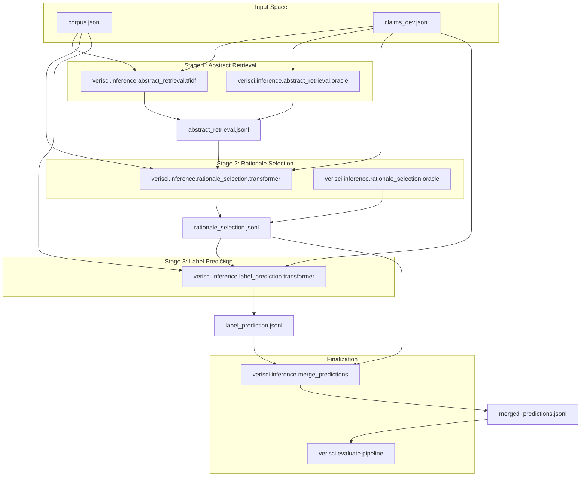

**Sources:** [script/pipeline.sh:46-102](), [doc/model.md:3-7]()

---

## Pipeline Stages

### 1. Abstract Retrieval
The first stage filters the `corpus.jsonl` to identify a small set of documents (typically $k=3$) relevant to a given claim. The system supports a TF-IDF baseline and an Oracle mode for evaluation.
*   **Primary Script:** `verisci/inference/abstract_retrieval/tfidf.py`
*   **Output:** `abstract_retrieval.jsonl`
*   **For details, see [Abstract Retrieval](#2.1)**

### 2. Rationale Selection
Given the retrieved abstracts, this stage identifies specific sentences that provide evidence for or against the claim. It uses a Transformer-based model to score sentences and selects them based on a probability threshold (flex) or a fixed count (top-k).
*   **Primary Script:** `verisci/inference/rationale_selection/transformer.py`
*   **Output:** `rationale_selection.jsonl`
*   **For details, see [Rationale Selection](#2.2)**

### 3. Label Prediction
This stage assigns a veracity label—`SUPPORTS`, `REFUTES`, or `NOT_ENOUGH_INFO` (NEI)—to the claim based on the rationales selected in the previous step.
*   **Primary Script:** `verisci/inference/label_prediction/transformer.py`
*   **Output:** `label_prediction.jsonl`
*   **For details, see [Label Prediction](#2.3)**

**Sources:** [script/pipeline.sh:46-93](), [doc/model.md:17-143]()

---

## Data Integration and Merging

The outputs of the Rationale Selection and Label Prediction stages are stored in separate files. To perform final evaluation or submission, these must be unified into a single result file.

### Prediction Merging
The `merge_predictions.py` script performs the following logic:
1.  Aligns rationale and label files by `claim_id` [verisci/inference/merge_predictions.py:58-61]().
2.  Filters out documents where the predicted label is `NOT_ENOUGH_INFO` [verisci/inference/merge_predictions.py:41-43]().
3.  Pairs the selected sentence indices with the final veracity label for each document [verisci/inference/merge_predictions.py:42-43]().

### Code Entity Mapping
The following diagram maps the high-level pipeline concepts to the specific Python classes and functions responsible for data representation and merging.

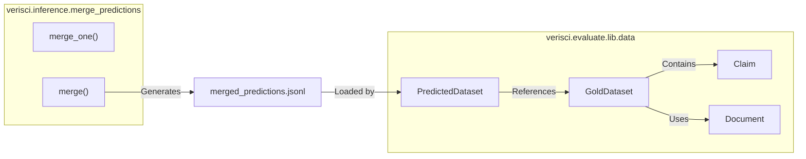

**Sources:** [verisci/inference/merge_predictions.py:21-70](), [verisci/evaluate/lib/data.py:98-218]()

---

## Execution Modes

The pipeline can be executed in different configurations using `script/pipeline.sh` [script/pipeline.sh:1-12]():

| Mode | Retrieval | Rationale Selection | Label Model |
| :--- | :--- | :--- | :--- |
| **Oracle** | `oracle.py` | `oracle.py` | `transformer.py` |
| **Zero-Shot** | `tfidf.py` | `transformer.py` (FEVER) | `transformer.py` (FEVER) |
| **VeriSci** | `tfidf.py` | `transformer.py` (SciFact) | `transformer.py` (FEVER+SciFact) |

**Sources:** [script/pipeline.sh:14-23](), [script/pipeline.sh:48-81]()

For detailed instructions on running the full pipeline and merging results, see **[Prediction Merging and Pipeline Execution](#2.4)**.

---

# Page: Abstract Retrieval

# Abstract Retrieval

<details>
<summary>Relevant source files</summary>

The following files were used as context for generating this wiki page:

- [doc/model.md](doc/model.md)
- [verisci/evaluate/pipeline.py](verisci/evaluate/pipeline.py)
- [verisci/evaluate/rationale_selection.py](verisci/evaluate/rationale_selection.py)
- [verisci/inference/abstract_retrieval/oracle.py](verisci/inference/abstract_retrieval/oracle.py)
- [verisci/inference/abstract_retrieval/tfidf.py](verisci/inference/abstract_retrieval/tfidf.py)
- [verisci/inference/label_prediction/oracle.py](verisci/inference/label_prediction/oracle.py)
- [verisci/inference/rationale_selection/first.py](verisci/inference/rationale_selection/first.py)

</details>


Abstract Retrieval is the first stage of the SciFact verification pipeline [doc/model.md:3-4](). Its primary goal is to identify a subset of documents from the corpus that are likely to contain evidence (rationales) for a given claim. The output of this stage serves as the input for the subsequent Rationale Selection stage [doc/model.md:100]().

The system supports two main modes: **Oracle** retrieval (using gold-standard data) and **TF-IDF** retrieval (open retrieval using term frequency-inverse document frequency).

## Implementation Overview

The retrieval process transforms a natural language claim into a set of document identifiers. The following diagram illustrates the data flow and the code entities involved in this transformation.

### Retrieval Data Flow
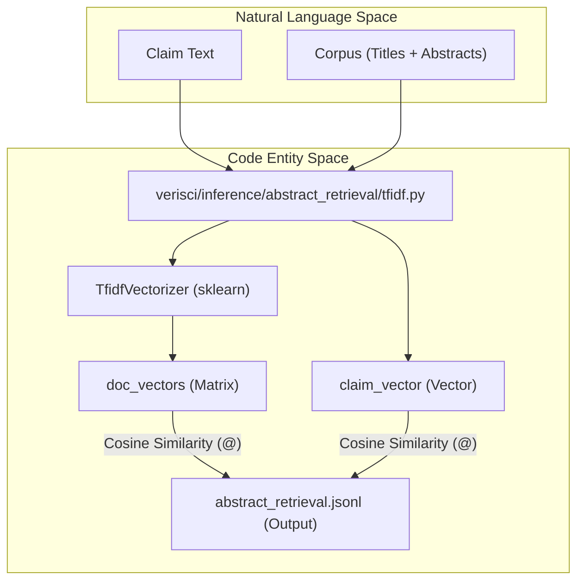
Sources: [verisci/inference/abstract_retrieval/tfidf.py:5-37]()

## Retrieval Methods

### 1. TF-IDF Retrieval
The TF-IDF retriever [verisci/inference/abstract_retrieval/tfidf.py]() uses `sklearn.feature_extraction.text.TfidfVectorizer` to represent both the corpus and the claims in a vector space.

*   **Mechanism**: It concatenates the document title and all sentences in the abstract to form the document representation [verisci/inference/abstract_retrieval/tfidf.py:27-28]().
*   **Ranking**: Documents are ranked by the dot product (cosine similarity) of the `doc_vectors` and the `claim_vector` [verisci/inference/abstract_retrieval/tfidf.py:35-36]().
*   **Parameters**:
    *   `--k`: Number of documents to retrieve per claim [verisci/inference/abstract_retrieval/tfidf.py:10]().
    *   `--min-gram` / `--max-gram`: N-gram range for the vectorizer [verisci/inference/abstract_retrieval/tfidf.py:11-12]().

### 2. Oracle Retrieval
The Oracle retriever [verisci/inference/abstract_retrieval/oracle.py]() is used for upper-bound experiments. It bypasses actual search and returns the ground-truth document IDs associated with a claim.

*   **Behavior**: It extracts keys from the `evidence` field in the dataset [verisci/inference/abstract_retrieval/oracle.py:14]().
*   **NEI Handling**: If `--include-nei` is specified, it will include the first document from `cited_doc_ids` for claims that have no supporting/refuting evidence (NOT_ENOUGH_INFO) [verisci/inference/abstract_retrieval/oracle.py:15-16]().

Sources: [verisci/inference/abstract_retrieval/tfidf.py:1-54](), [verisci/inference/abstract_retrieval/oracle.py:1-22](), [doc/model.md:19-37]()

## Output Format: `abstract_retrieval.jsonl`

Regardless of the method used, the output is a JSONL file where each line corresponds to a claim and its retrieved documents.

| Field | Type | Description |
| :--- | :--- | :--- |
| `claim_id` | Integer | The unique identifier of the claim. |
| `doc_ids` | List[Int] | A list of retrieved document IDs, ranked by relevance. |

**Example Entry:**
```json
{"claim_id": 1, "doc_ids": [123, 456, 789]}
```
Sources: [verisci/inference/abstract_retrieval/tfidf.py:44-47](), [verisci/inference/abstract_retrieval/oracle.py:18-21]()

## Evaluation

Evaluation is performed by comparing the retrieved document IDs against the gold-standard evidence documents.

### Metrics
The TF-IDF script calculates several statistics if the dataset is not the test set [verisci/inference/abstract_retrieval/tfidf.py:17]():
*   **Reciprocal Rank**: Median, Average, Min, and Max reciprocal ranks of the gold documents within the retrieved list [verisci/inference/abstract_retrieval/tfidf.py:50-53]().

### Execution
To evaluate retrieval performance, use the dedicated evaluation script:
```sh
python verisci/evaluate/abstract_retrieval.py \
    --dataset data/claims_test.jsonl \
    --abstract-retrieval abstract_retrieval.jsonl
```
Sources: [verisci/inference/abstract_retrieval/tfidf.py:49-54](), [doc/model.md:41-44]()

## Usage Summary

| Scenario | Script | Key Arguments |
| :--- | :--- | :--- |
| **Open Retrieval** | `tfidf.py` | `--k`, `--min-gram`, `--max-gram`, `--corpus` |
| **Upper-bound Testing** | `oracle.py` | `--dataset`, `--include-nei` |
| **Evaluation** | `abstract_retrieval.py` | `--dataset`, `--abstract-retrieval` |

### Pipeline Integration
The retrieval output is consumed by the Rationale Selection scripts via the `--abstract-retrieval` argument [doc/model.md:54, 71, 100]().

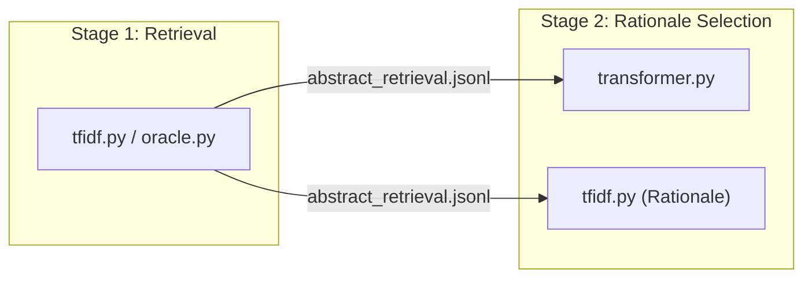
Sources: [doc/model.md:17-107]()

---

# Page: Rationale Selection

# Rationale Selection

<details>
<summary>Relevant source files</summary>

The following files were used as context for generating this wiki page:

- [script/label-prediction.sh](script/label-prediction.sh)
- [script/rationale-selection.sh](script/rationale-selection.sh)
- [verisci/inference/label_prediction/transformer.py](verisci/inference/label_prediction/transformer.py)
- [verisci/inference/rationale_selection/last.py](verisci/inference/rationale_selection/last.py)
- [verisci/inference/rationale_selection/oracle.py](verisci/inference/rationale_selection/oracle.py)
- [verisci/inference/rationale_selection/oracle_tfidf.py](verisci/inference/rationale_selection/oracle_tfidf.py)
- [verisci/inference/rationale_selection/tfidf.py](verisci/inference/rationale_selection/tfidf.py)
- [verisci/inference/rationale_selection/transformer.py](verisci/inference/rationale_selection/transformer.py)

</details>


Rationale selection is the second stage of the SciFact verification pipeline. Its purpose is to identify specific sentences (rationales) within retrieved abstracts that support or refute a given claim. This stage transforms a document-level retrieval into a sentence-level evidence set, which is then used by the Label Predictor to determine the final veracity of the claim.

## Overview and Data Flow

The rationale selection module takes as input the claims and the abstracts identified in the [Abstract Retrieval](2.1.-Abstract-Retrieval) stage. It outputs a JSONL file mapping claim IDs to document IDs and their corresponding rationale sentence indices.

### System Architecture and Code Entity Mapping

The following diagram illustrates how the rationale selection process bridges the natural language abstracts to the structured evidence used in the code.

**Rationale Selection Data Flow**
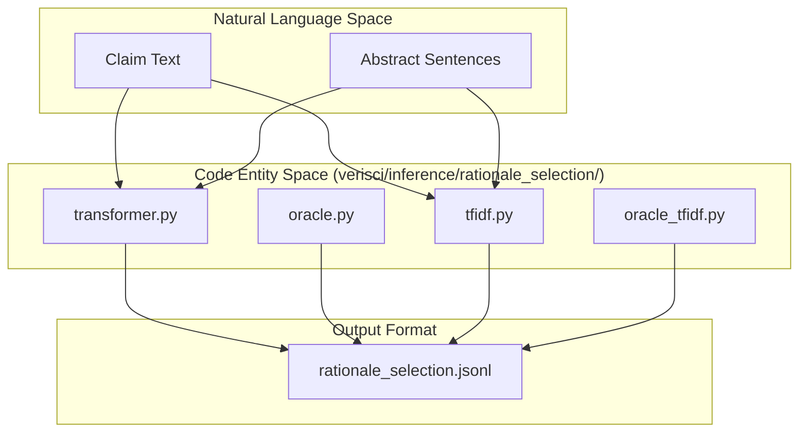
**Sources:** [verisci/inference/rationale_selection/transformer.py:8-20](), [verisci/inference/rationale_selection/oracle.py:4-8](), [verisci/inference/rationale_selection/tfidf.py:8-14]()

## Transformer-based Selection

The primary method for rationale selection uses a Transformer-based sequence classifier (e.g., SciBERT, RoBERTa). The model is trained to perform binary classification on sentence-claim pairs to determine if a sentence is a rationale.

### Implementation Details
The implementation in `verisci/inference/rationale_selection/transformer.py` performs the following steps:
1. **Encoding**: By default, it pairs each sentence in an abstract with the claim: `zip(sentences, [claim] * len(sentences))` [verisci/inference/rationale_selection/transformer.py:44-45]().
2. **Scoring**: The model outputs a probability score for each sentence being a rationale using a softmax over the classification head [verisci/inference/rationale_selection/transformer.py:50]().
3. **Selection Strategies**:
    *   **Threshold (Flex)**: Selects all sentences with a score $\ge$ `args.threshold` (default 0.5) [verisci/inference/rationale_selection/transformer.py:13, 65]().
    *   **Top-K**: Selects the $K$ highest-scoring sentences [verisci/inference/rationale_selection/transformer.py:61-63]().

### The `--only-rationale` Flag
If the `--only-rationale` flag is provided, the model encodes only the sentences without concatenating the claim [verisci/inference/rationale_selection/transformer.py:45](). This is typically used when evaluating models trained specifically to identify "evidence-like" sentences regardless of the specific claim.

**Sources:** [verisci/inference/rationale_selection/transformer.py:29-55](), [script/rationale-selection.sh:42-53]()

## Selection Strategies and Baselines

SciFact supports several baseline and oracle strategies for research and benchmarking.

| Strategy | File | Description |
| :--- | :--- | :--- |
| **Oracle** | `oracle.py` | Selects the actual gold-standard rationale sentences from the dataset [verisci/inference/rationale_selection/oracle.py:20-21](). |
| **TF-IDF** | `tfidf.py` | Uses `TfidfVectorizer` to find the $K$ sentences in the abstract most similar to the claim [verisci/inference/rationale_selection/tfidf.py:27-34](). |
| **Oracle + TF-IDF** | `oracle_tfidf.py` | Uses Oracle rationales for SUPPORT/REFUTE claims and TF-IDF for NOT_ENOUGH_INFO claims [verisci/inference/rationale_selection/oracle_tfidf.py:29-39](). |
| **First Sentence** | (Implicit) | A baseline selecting the first sentence of an abstract. |
| **Last Sentence** | `last.py` | A baseline selecting only the final sentence of each abstract [verisci/inference/rationale_selection/last.py:18](). |

**Sources:** [verisci/inference/rationale_selection/oracle.py:14-28](), [verisci/inference/rationale_selection/tfidf.py:21-39](), [verisci/inference/rationale_selection/oracle_tfidf.py:23-44](), [verisci/inference/rationale_selection/last.py:14-23]()

## Execution Logic

The rationale selection is typically invoked via `script/rationale-selection.sh`. This script manages model downloading and runs the transformer inference.

**Rationale Selection Sequence**
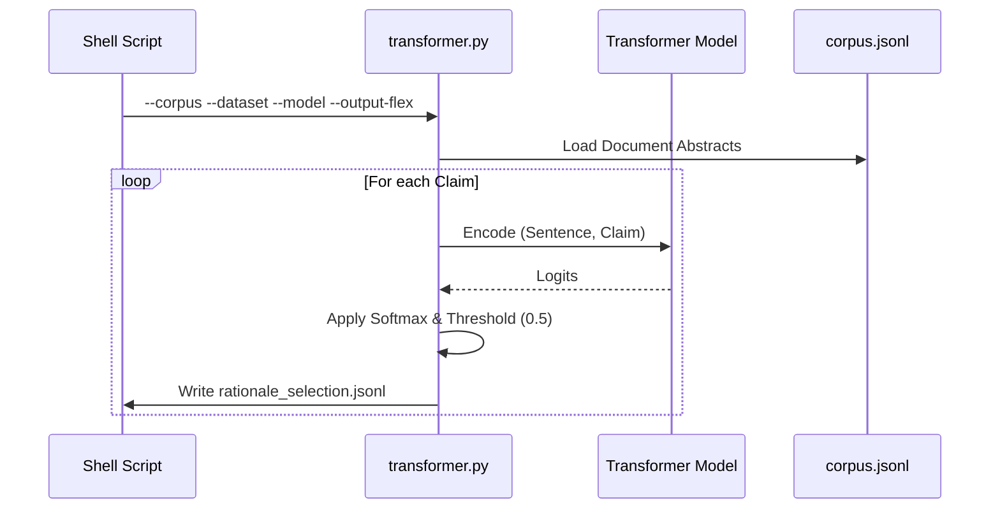
**Sources:** [script/rationale-selection.sh:47-53](), [verisci/inference/rationale_selection/transformer.py:34-55]()

## Output Format

The output is a JSONL file where each line represents a claim and its associated evidence rationales.

**Schema:**
```json
{
  "claim_id": 123,
  "evidence": {
    "doc_id_A": [0, 2],
    "doc_id_B": []
  }
}
```
*   `claim_id`: Unique identifier for the claim [verisci/inference/rationale_selection/transformer.py:68]().
*   `evidence`: A dictionary where keys are document IDs and values are lists of zero-indexed sentence indices identified as rationales [verisci/inference/rationale_selection/transformer.py:69]().

**Sources:** [verisci/inference/rationale_selection/transformer.py:58-70](), [verisci/inference/label_prediction/transformer.py:63-67]()

---

# Page: Label Prediction

# Label Prediction

<details>
<summary>Relevant source files</summary>

The following files were used as context for generating this wiki page:

- [script/label-prediction.sh](script/label-prediction.sh)
- [script/rationale-selection.sh](script/rationale-selection.sh)
- [verisci/evaluate/rationale_selection.py](verisci/evaluate/rationale_selection.py)
- [verisci/inference/abstract_retrieval/oracle.py](verisci/inference/abstract_retrieval/oracle.py)
- [verisci/inference/label_prediction/oracle.py](verisci/inference/label_prediction/oracle.py)
- [verisci/inference/label_prediction/transformer.py](verisci/inference/label_prediction/transformer.py)
- [verisci/inference/rationale_selection/first.py](verisci/inference/rationale_selection/first.py)
- [verisci/inference/rationale_selection/transformer.py](verisci/inference/rationale_selection/transformer.py)

</details>


The Label Prediction module is the final stage of the SciFact verification pipeline. It takes a claim and its associated rationales (selected in the previous stage) and classifies the relationship into one of three categories: `SUPPORT`, `CONTRADICT`, or `NOT_ENOUGH_INFO` (NEI) [verisci/inference/label_prediction/transformer.py:31-31]().

## System Architecture

The label predictor is a Transformer-based sequence classifier. It consumes the output of the Rationale Selection stage and produces a document-level verdict for each retrieved abstract.

### Data Flow and Entity Mapping
The following diagram illustrates how natural language inputs are transformed into code entities and processed by the `Transformer` predictor.

**Label Prediction Process Flow**
```mermaid
graph TD
    subgraph "Natural Language Space"
        Claim["Claim Text"]
        Rationale["Rationale Sentences"]
    end

    subgraph "Code Entity Space (verisci/inference/label_prediction/transformer.py)"
        InputData["dataset (JSONL)"]
        RationaleData["rationale_selection (JSONL)"]
        CorpusData["corpus (JSONL)"]
        
        Predictor["AutoModelForSequenceClassification"]
        Tokenizer["AutoTokenizer"]
        
        Claim --> InputData
        Rationale --> RationaleData
        
        InputData -->|data['claim']| Encode["encode() function"]
        RationaleData -->|selection['evidence']| Encode
        CorpusData -->|corpus[doc_id]['abstract']| Encode
        
        Tokenizer -->|batch_encode_plus| Encode
        Encode -->|encoded_dict| Predictor
        Predictor -->|label_scores| Output["output.write()"]
    end
    
    Output --> Verdict["Final Label: SUPPORT/CONTRADICT/NEI"]
```
**Sources:** [verisci/inference/label_prediction/transformer.py:19-31](), [verisci/inference/label_prediction/transformer.py:58-76]()

---

## Input Modes

The `transformer.py` script supports three input modes via the `--mode` flag, which determines how the sequence is constructed before being fed into the Transformer model [verisci/inference/label_prediction/transformer.py:13-13]().

| Mode | Description | Implementation |
| :--- | :--- | :--- |
| `claim_and_rationale` | Standard mode. Concatenates the claim and the selected rationale sentences. | `list(zip(sentences, claims))` |
| `only_claim` | Ablation mode. Predicts the label based solely on the claim text (checking for dataset bias). | `claims` |
| `only_rationale` | Ablation mode. Predicts based only on the rationale sentences. | `sentences` |

**Sources:** [verisci/inference/label_prediction/transformer.py:33-38](), [script/label-prediction.sh:56-64]()

---

## Implementation Details

### The Labeling Logic
The predictor iterates through each document identified in the rationale selection file. For each document, it concatenates the sentences identified by their indices into a single string [verisci/inference/label_prediction/transformer.py:63-67]().

1. **NEI Handling**: If the rationale selection stage returns no evidence indices for a document, the predictor automatically assigns `NOT_ENOUGH_INFO` with a confidence of 1.0 [verisci/inference/label_prediction/transformer.py:64-65]().
2. **Encoding**: The `encode` function handles tokenization and enforces a maximum sequence length of 512 tokens using a `truncation_strategy='only_first'` [verisci/inference/label_prediction/transformer.py:44-51]().
3. **Classification**: The model outputs logits for three classes. A softmax is applied to determine the label and the confidence score [verisci/inference/label_prediction/transformer.py:69-72]().

### Oracle Label Predictor
The codebase includes an `oracle.py` predictor used for upper-bound evaluation. It bypasses the Transformer model and assigns labels based on the gold standard data:
* It checks if the predicted rationale sentences are a subset of any gold rationale set [verisci/inference/label_prediction/oracle.py:24-24]().
* If a valid subset is found, it assigns the gold label [verisci/inference/label_prediction/oracle.py:25-25]().
* Otherwise, it defaults to `NOT_ENOUGH_INFO` [verisci/inference/label_prediction/oracle.py:27-27]().

**Sources:** [verisci/inference/label_prediction/transformer.py:33-54](), [verisci/inference/label_prediction/oracle.py:14-32]()

---

## Output Format

The module produces a JSONL file where each line represents a claim and its associated document-level labels.

```json
{
  "claim_id": 1,
  "labels": {
    "123456": {
      "label": "SUPPORT",
      "confidence": 0.9981
    },
    "789012": {
      "label": "NOT_ENOUGH_INFO",
      "confidence": 1.0
    }
  }
}
```

**Sources:** [verisci/inference/label_prediction/transformer.py:73-76](), [verisci/inference/label_prediction/oracle.py:29-32]()

---

## Integration and Execution

Label prediction is typically executed as the third step in the `label-prediction.sh` or `pipeline.sh` scripts. It requires the output from `rationale_selection.jsonl` to know which sentences to evaluate.

**Execution Pipeline Integration**
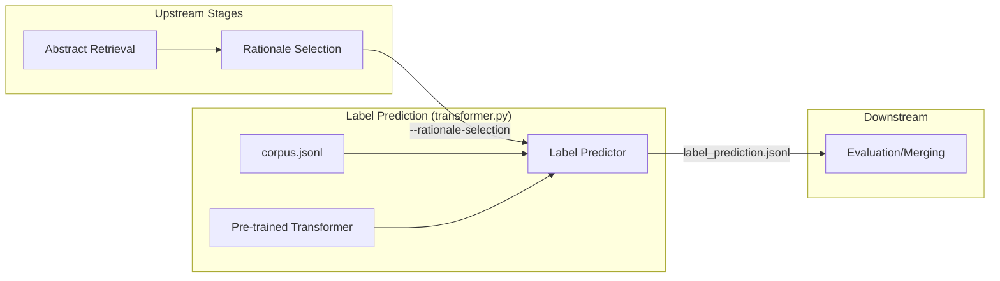

### Example Command
```bash
python3 verisci/inference/label_prediction/transformer.py \
    --corpus data/corpus.jsonl \
    --dataset data/claims_dev.jsonl \
    --rationale-selection prediction/rationale_selection.jsonl \
    --model model/label_roberta_large_fever_scifact \
    --mode claim_and_rationale \
    --output prediction/label_prediction.jsonl
```

**Sources:** [script/label-prediction.sh:66-72](), [verisci/inference/label_prediction/transformer.py:8-15]()

---

# Page: Prediction Merging and Pipeline Execution

# Prediction Merging and Pipeline Execution

<details>
<summary>Relevant source files</summary>

The following files were used as context for generating this wiki page:

- [doc/model.md](doc/model.md)
- [script/label-prediction.sh](script/label-prediction.sh)
- [script/pipeline.sh](script/pipeline.sh)
- [script/rationale-selection.sh](script/rationale-selection.sh)
- [verisci/evaluate/lib/data.py](verisci/evaluate/lib/data.py)
- [verisci/evaluate/pipeline.py](verisci/evaluate/pipeline.py)
- [verisci/inference/merge_predictions.py](verisci/inference/merge_predictions.py)

</details>


This page documents the final stage of the SciFact verification pipeline, where independent rationale and label predictions are unified into a single result file, and the orchestration scripts used to execute the end-to-end workflow.

## Prediction Merging

The SciFact pipeline processes rationale selection and label prediction as separate modules. The `verisci/inference/merge_predictions.py` script is responsible for combining these outputs into a final `merged_predictions.jsonl` file, which is the standard format for evaluation and leaderboard submission.

### Implementation Details
The merging process iterates through the predictions for each claim and performs the following logic:

1.  **Validation**: It ensures that the `claim_id` and the set of retrieved `doc_id` keys match between the rationale and label files [verisci/inference/merge_predictions.py:27-31]().
2.  **NEI Filtering**: The script specifically filters out any document predictions where the predicted label is `NOT_ENOUGH_INFO` (NEI) [verisci/inference/merge_predictions.py:41-43](). Only documents with `SUPPORTS` or `REFUTES` labels are included in the final evidence set.
3.  **Data Structure**: For each valid document, it pairs the selected sentence indices (from the rationale module) with the predicted label (from the label module) [verisci/inference/merge_predictions.py:42-43]().

### Data Flow: Merging Process
The following diagram illustrates how the outputs from the previous pipeline stages are unified by `merge_predictions.py`.

**Prediction Merging Data Flow**
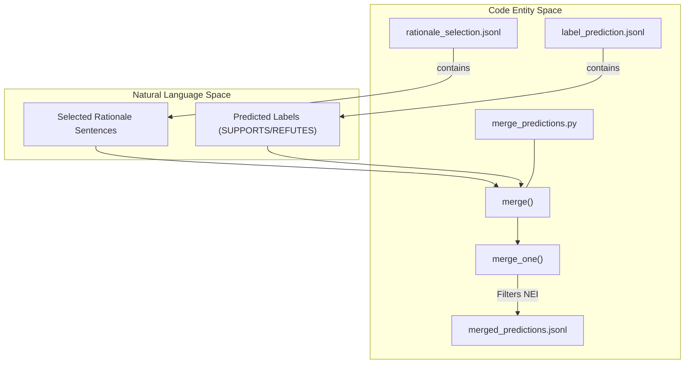
**Sources:** [verisci/inference/merge_predictions.py:5-47](), [verisci/inference/merge_predictions.py:50-78]()

---

## Pipeline Orchestration

The project provides several bash scripts to automate the execution of the full pipeline. The primary entry point is `script/pipeline.sh`, which handles data downloading, model acquisition, and sequential execution of all three stages.

### Execution Modes
The `script/pipeline.sh` script supports different configurations based on command-line arguments:

| Argument | Options | Description |
| :--- | :--- | :--- |
| `retrieval` | `oracle`, `open` | Use gold-standard abstracts or TF-IDF retrieval. |
| `model` | `oracle-rationale`, `zero-shot`, `verisci` | Determines model weights and rationale thresholds. |
| `dataset` | `dev`, `test` | The data split to process. |

### Configuration Logic
The script adjusts hyperparameters based on the chosen model mode:
*   **zero-shot**: Uses models trained on FEVER for both rationale and label stages, with a low rationale threshold of `0.025` [script/pipeline.sh:14-18]().
*   **verisci**: Uses SciFact-trained rationale models and `fever_scifact` label models, with a standard rationale threshold of `0.5` [script/pipeline.sh:19-23]().

### Full Pipeline Workflow
The diagram below maps the orchestration logic in `script/pipeline.sh` to the specific Python components executed.

**Orchestration Logic and Component Mapping**
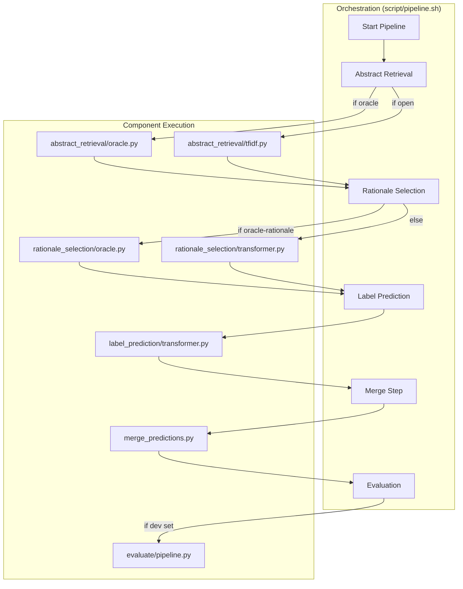
**Sources:** [script/pipeline.sh:46-117](), [doc/model.md:154-172]()

---

## Specialized Pipeline Scripts

In addition to the main pipeline, specialized scripts exist for reproducing specific tables from the SciFact paper:

### Rationale Selection Evaluation
`script/rationale-selection.sh` focuses on evaluating rationale selection performance in isolation using oracle abstracts. It supports various BERT variants and training datasets [script/rationale-selection.sh:5-12]().

### Label Prediction Evaluation
`script/label-prediction.sh` focuses on label prediction accuracy. It supports different input modes:
*   `only_claim`: Predicts labels without looking at rationales.
*   `only_rationale`: Predicts labels without looking at the claim.
*   `claim_and_rationale`: The standard mode using both inputs [script/label-prediction.sh:56-64]().

**Sources:** [script/rationale-selection.sh:1-62](), [script/label-prediction.sh:1-81]()

## Summary of Output Files
The pipeline produces a sequence of JSONL files in the `prediction/` directory:
1.  `abstract_retrieval.jsonl`: List of candidate documents for each claim.
2.  `rationale_selection.jsonl`: Sentence indices identified as evidence within retrieved documents.
3.  `label_prediction.jsonl`: Predicted veracity labels for each claim-document pair.
4.  `merged_predictions.jsonl`: The final unified output used for evaluation [script/pipeline.sh:41-101]().

**Sources:** [script/pipeline.sh:40-101](), [doc/model.md:156-162]()

---

# Page: Model Training

# Model Training

<details>
<summary>Relevant source files</summary>

The following files were used as context for generating this wiki page:

- [doc/data.md](doc/data.md)
- [doc/training.md](doc/training.md)

</details>


The SciFact training infrastructure provides scripts to train the two primary neural components of the verification pipeline: **Rationale Selection** and **Label Prediction**. The framework supports multiple datasets, including SciFact, FEVER, and Snopes, and facilitates transfer learning strategies to improve performance on scientific claim verification.

### Training Infrastructure Overview

Training is modularized by task (rationale vs. label) and dataset. All training logic resides within the `verisci/training` directory [doc/training.md:3](). The system is built around Transformer-based architectures, supporting models such as `roberta-large`, `scibert`, and `biomed_roberta_base` [doc/training.md:13-14]().

#### Code Entity Map: Training Components
The following diagram illustrates how training scripts map to the core verification modules and their respective data inputs.

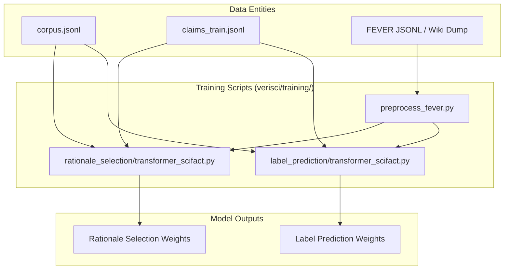
**Sources:** [doc/training.md:25-52](), [doc/training.md:71-75]()

---

### Supported Datasets

The training pipeline supports three major datasets, each requiring specific preprocessing or loading logic:

| Dataset | Description | Training Scripts |
| :--- | :--- | :--- |
| **SciFact** | Domain-specific scientific claims and abstracts. | `transformer_scifact.py` |
| **FEVER** | Large-scale general domain fact extraction. | `transformer_fever.py` |
| **Snopes** | Fact-checking data from Snopes.com. | `transformer_snopes.py` |

For details on dataset-specific CLI arguments and FEVER preprocessing, see [Training on SciFact, FEVER, and Snopes](#3.1).

**Sources:** [doc/training.md:25-122]()

---

### Transfer Learning Strategy

A key feature of the SciFact training pipeline is the support for **Transfer Learning**, specifically the **FEVER → SciFact** workflow. Because SciFact is relatively small, pre-training on the larger FEVER dataset before fine-tuning on SciFact significantly improves model robustness, particularly for the Label Prediction module [doc/training.md:96-99]().

#### Transfer Learning Flow: Code Entity Space
This diagram shows how the `--model` argument is used to pass checkpoints between different training stages.

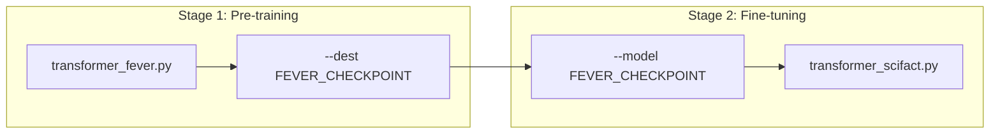

For details on executing this two-stage process and the `fever_scifact` model variant, see [Transfer Learning: FEVER → SciFact](#3.2).

**Sources:** [doc/training.md:96-99]()

---

### Common Configuration

All training scripts share a set of common command-line arguments to control the training loop and hardware utilization:

*   `--model`: Specifies the starting checkpoint (HuggingFace ID or local path) [doc/training.md:13-14]().
*   `--dest`: The directory where model weights are saved after every epoch [doc/training.md:16]().
*   `--batch-size-gpu`: Controls the number of samples per GPU pass [doc/training.md:17]().
*   `--lr-base` & `--lr-linear`: Separate learning rates for the Transformer backbone and the classification head [doc/training.md:19-20]().

**Sources:** [doc/training.md:11-20]()

---

# Page: Training on SciFact, FEVER, and Snopes

# Training on SciFact, FEVER, and Snopes

<details>
<summary>Relevant source files</summary>

The following files were used as context for generating this wiki page:

- [verisci/training/label_prediction/transformer_fever.py](verisci/training/label_prediction/transformer_fever.py)
- [verisci/training/label_prediction/transformer_scifact.py](verisci/training/label_prediction/transformer_scifact.py)
- [verisci/training/label_prediction/transformer_snopes.py](verisci/training/label_prediction/transformer_snopes.py)
- [verisci/training/preprocess_fever.py](verisci/training/preprocess_fever.py)
- [verisci/training/rationale_selection/transformer_fever.py](verisci/training/rationale_selection/transformer_fever.py)
- [verisci/training/rationale_selection/transformer_scifact.py](verisci/training/rationale_selection/transformer_scifact.py)
- [verisci/training/rationale_selection/transformer_snopes.py](verisci/training/rationale_selection/transformer_snopes.py)

</details>


This page documents the training infrastructure for the two primary supervised components of the SciFact pipeline: **Rationale Selection** and **Label Prediction**. The codebase provides specialized scripts for training these models on the SciFact, FEVER, and Snopes datasets, utilizing Transformer-based architectures (typically RoBERTa-large).

## 1. Common Training Configuration

All training scripts across datasets share a consistent set of command-line arguments and optimization logic.

### CLI Arguments
| Argument | Type | Default | Description |
| :--- | :--- | :--- | :--- |
| `--model` | `str` | `roberta-large` | Pre-trained model identifier from HuggingFace. |
| `--dest` | `str` | (Required) | Directory where model weights and tokenizers are saved. |
| `--epochs` | `int` | `20` | Total number of training epochs. |
| `--batch-size-gpu` | `int` | `8` | Batch size per GPU forward/backward pass. |
| `--batch-size-accumulated` | `int` | `256` | Effective batch size via gradient accumulation. |
| `--lr-base` | `float` | `1e-5` | Learning rate for the Transformer backbone. |
| `--lr-linear` | `float` | `1e-4` / `1e-3` | Learning rate for the classification head. |

### Optimization Strategy
The scripts use a split-learning rate approach to preserve pre-trained features while allowing the task-specific head to converge faster [verisci/training/label_prediction/transformer_scifact.py:97-101](). Gradient accumulation is used to simulate large batch sizes on hardware with limited VRAM [verisci/training/label_prediction/transformer_scifact.py:147-151](). A cosine schedule with warmup is applied over 20 steps [verisci/training/label_prediction/transformer_scifact.py:102]().

**Sources:** [verisci/training/label_prediction/transformer_scifact.py:13-24](), [verisci/training/rationale_selection/transformer_fever.py:12-22]()

---

## 2. FEVER Preprocessing

Before training on FEVER, the raw dataset must be converted into the internal SciFact format. This involves resolving Wikipedia document IDs to actual sentence text.

### Data Flow: FEVER Preprocessing
The `preprocess_fever.py` script loads a Wikipedia dump into memory and maps claim evidence sets to absolute sentence indices within the flattened document list [verisci/training/preprocess_fever.py:27-40]().

Title: FEVER Preprocessing Logic
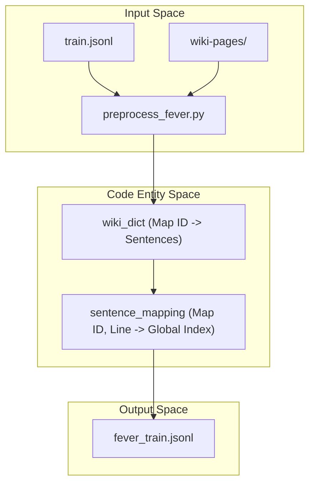
**Sources:** [verisci/training/preprocess_fever.py:27-81]()

---

## 3. Rationale Selection Training

Rationale selection is treated as a binary classification task: given a `(claim, sentence)` pair, the model predicts if the sentence is evidence (`True`) or not (`False`).

### Dataset Implementations
Each dataset class iterates through claims and their associated documents to generate training pairs.

*   **SciFact:** Uses `SciFactRationaleSelectionDataset`. It maps gold evidence indices from the claim to sentences in the corpus abstract [verisci/training/rationale_selection/transformer_scifact.py:30-43]().
*   **FEVER:** Uses `FeverRationaleSelectionDataset`. It flattens all sentences across relevant wiki pages for a claim [verisci/training/rationale_selection/transformer_fever.py:25-34]().
*   **Snopes:** Uses `SnopesRationaleSelectionDataset`. It cleans HTML tags (e.g., `<p>`) from the Snopes corpus during loading [verisci/training/rationale_selection/transformer_snopes.py:30-48]().

### Training Logic
The `encode` function handles tokenization and ensures sequences do not exceed the 512-token limit by truncating the first sequence (the sentence/rationale) while keeping the claim [verisci/training/rationale_selection/transformer_scifact.py:63-77]().

**Sources:** [verisci/training/rationale_selection/transformer_scifact.py:29-48](), [verisci/training/rationale_selection/transformer_fever.py:58-72]()

---

## 4. Label Prediction Training

Label prediction is a 3-way classification task: **SUPPORTS** (2), **NOT ENOUGH INFO** (1), or **REFUTES** (0).

### Negative Sampling and Data Augmentation
To improve model robustness, the datasets implement specific sampling strategies for the `NOT ENOUGH INFO` (NEI) class.

| Dataset | NEI Sampling Strategy |
| :--- | :--- |
| **SciFact** | Samples 1-2 random non-rationale sentences from cited documents or abstracts [verisci/training/label_prediction/transformer_scifact.py:63-82](). |
| **FEVER** | Randomly samples sentences from the document that were not part of any gold evidence set [verisci/training/label_prediction/transformer_fever.py:50-61](). |
| **Snopes** | Uses the provided evidence sets and labels from the `snopes.stance` files [verisci/training/label_prediction/transformer_snopes.py:36-48](). |

### Model Architecture and Data Flow
The system uses `AutoModelForSequenceClassification` with `num_labels=3`.

Title: Label Prediction Data Flow
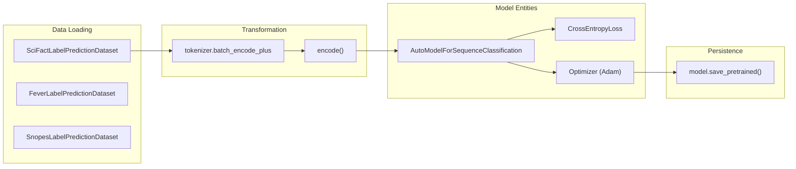

### Key Functions
*   `encode(claims, rationale)`: Zips rationale and claim, pads to max length, and moves tensors to the GPU [verisci/training/label_prediction/transformer_scifact.py:105-119]().
*   `evaluate(model, dataset)`: Calculates Macro F1, and per-class Precision, Recall, and F1 [verisci/training/label_prediction/transformer_scifact.py:122-137]().

**Sources:** [verisci/training/label_prediction/transformer_scifact.py:30-88](), [verisci/training/label_prediction/transformer_fever.py:29-61](), [verisci/training/label_prediction/transformer_snopes.py:30-54]()

---

# Page: Transfer Learning: FEVER → SciFact

# Transfer Learning: FEVER → SciFact

<details>
<summary>Relevant source files</summary>

The following files were used as context for generating this wiki page:

- [doc/data.md](doc/data.md)
- [doc/training.md](doc/training.md)
- [script/download-model.sh](script/download-model.sh)
- [verisci/training/label_prediction/transformer_fever.py](verisci/training/label_prediction/transformer_fever.py)
- [verisci/training/label_prediction/transformer_scifact.py](verisci/training/label_prediction/transformer_scifact.py)
- [verisci/training/preprocess_fever.py](verisci/training/preprocess_fever.py)

</details>


This page explains the recommended two-stage transfer learning workflow for the SciFact pipeline. By pre-training on the large-scale FEVER dataset before fine-tuning on the domain-specific SciFact dataset, models achieve significantly higher performance, particularly in the **Label Prediction** stage.

## Workflow Overview

The SciFact dataset is relatively small compared to general-domain fact-checking datasets. To improve model robustness, the codebase supports a transfer learning strategy where a model is first exposed to the FEVER dataset to learn the general relationship between claims and evidence, then adapted to the scientific domain of SciFact.

### Two-Stage Training Process
1.  **Stage 1 (FEVER Pre-training):** Train a transformer model (e.g., RoBERTa-large) on the FEVER dataset using the `transformer_fever.py` scripts [doc/training.md:86-93]().
2.  **Stage 2 (SciFact Fine-tuning):** Use the weights saved from Stage 1 as the starting point for the `--model` argument in the `transformer_scifact.py` scripts [doc/training.md:97-99]().

### Data Flow and Component Interaction

The following diagram illustrates how data moves from the FEVER source through the preprocessing stage and into the two-stage training pipeline.

**Transfer Learning Data Flow**
```mermaid
graph TD
    subgraph "Natural Language Space"
        F_RAW["FEVER train.jsonl / paper_dev.jsonl"]
        WIKI["Wikipedia Dump (wiki-pages.zip)"]
        S_RAW["SciFact corpus.jsonl / claims_train.jsonl"]
    end

    subgraph "Code Entity Space"
        PRE["preprocess_fever.py"]
        T_FEVER["transformer_fever.py (Stage 1)"]
        T_SCI["transformer_scifact.py (Stage 2)"]
        SAVED_W["Saved Weights (PyTorch Checkpoint)"]
    end

    F_RAW --> PRE
    WIKI --> PRE
    PRE -- "fever_train.jsonl" --> T_FEVER
    T_FEVER -- "outputs" --> SAVED_W
    SAVED_W -- "--model argument" --> T_SCI
    S_RAW --> T_SCI
    T_SCI -- "Final Model" --> FINAL["fever_scifact variant"]
```
Sources: [doc/training.md:68-75](), [doc/training.md:96-99](), [verisci/training/preprocess_fever.py:1-25]()

---

## Stage 1: Pre-training on FEVER

Because the FEVER dataset uses a different schema than SciFact, the `verisci/training/preprocess_fever.py` script is used to normalize FEVER data into a format compatible with the SciFact training infrastructure [verisci/training/preprocess_fever.py:75-81]().

### Preprocessing Logic
The preprocessor performs the following tasks:
*   **Document Merging:** Loads the Wikipedia dump into a dictionary (`wiki_dict`) mapping IDs to lists of sentences [verisci/training/preprocess_fever.py:27-40]().
*   **Sentence Mapping:** Converts FEVER's evidence pointers (doc_id, line_index) into a flat list of sentences and a corresponding index mapping [verisci/training/preprocess_fever.py:53-63]().
*   **Label Normalization:** Maps FEVER labels to the internal format used by the `FeverLabelPredictionDataset` class [verisci/training/label_prediction/transformer_fever.py:32]().

### FEVER Label Prediction Training
The training script `verisci/training/label_prediction/transformer_fever.py` handles the first stage of label prediction training. It uses the `FeverLabelPredictionDataset` to sample evidence sets and generate negative "NOT ENOUGH INFO" (NEI) samples [verisci/training/label_prediction/transformer_fever.py:29-61]().

Sources: [verisci/training/preprocess_fever.py:1-82](), [verisci/training/label_prediction/transformer_fever.py:1-143]()

---

## Stage 2: Fine-tuning on SciFact

The second stage involves taking the checkpoint from FEVER training and fine-tuning it on scientific abstracts. This is where the `fever_scifact` model variant is produced.

### Training Implementation
The script `verisci/training/label_prediction/transformer_scifact.py` is used for this stage. It defines the `SciFactLabelPredictionDataset`, which constructs training triples of `(claim, rationale, label)` [verisci/training/label_prediction/transformer_scifact.py:30-49]().

**Training Logic Association**
```mermaid
graph LR
    subgraph "Training Script: transformer_scifact.py"
        DS["SciFactLabelPredictionDataset"]
        ENC["encode() function"]
        OPT["Adam Optimizer"]
    end

    subgraph "Model Components"
        BASE["Transformer Base (roberta.parameters)"]
        HEAD["Linear Classifier (classifier.parameters)"]
    end

    DS -- "samples" --> ENC
    ENC -- "input_ids / attention_mask" --> BASE
    BASE --> HEAD
    OPT -- "lr-base (1e-5)" --> BASE
    OPT -- "lr-linear (1e-4)" --> HEAD
```
Sources: [verisci/training/label_prediction/transformer_scifact.py:30-88](), [verisci/training/label_prediction/transformer_scifact.py:97-101](), [doc/training.md:19-20]()

### Why "fever_scifact" Performs Best
The `fever_scifact` variant (accessible via `download-model.sh` [script/download-model.sh:8]()) achieves superior performance on label prediction for several reasons:
1.  **Sample Diversity:** SciFact provides multiple rationales per claim. The `SciFactLabelPredictionDataset` adds individual evidence sets as separate samples AND a combined sample containing all evidence sentences [verisci/training/label_prediction/transformer_scifact.py:43-60]().
2.  **Hard Negative Mining:** The script generates negative samples (NEI) by selecting non-rationale sentences from the same document or from cited documents that were not found to contain evidence [verisci/training/label_prediction/transformer_scifact.py:62-82]().
3.  **Cross-Domain Robustness:** Pre-training on FEVER provides the model with a strong foundation in logical entailment, while fine-tuning on SciFact adapts the model to scientific terminology and the structure of S2ORC abstracts [doc/data.md:67-75]().

---

## Usage Summary

To reproduce the best-performing model or use the pre-trained weights, the following command structure is recommended:

| Step | Script | Key Argument | Purpose |
| :--- | :--- | :--- | :--- |
| **Download** | `download-model.sh` | `label roberta_large fever_scifact` | Get the optimized model [script/download-model.sh:5-19](). |
| **Train (Stage 1)** | `transformer_fever.py` | `--model roberta-large` | Learn general entailment [doc/training.md:88-93](). |
| **Train (Stage 2)** | `transformer_scifact.py` | `--model [PATH_TO_STAGE_1]` | Domain adaptation [doc/training.md:96-99](). |

Sources: [script/download-model.sh:1-34](), [doc/training.md:1-123](), [verisci/training/label_prediction/transformer_scifact.py:1-102]()

---

# Page: Evaluation Framework

# Evaluation Framework

<details>
<summary>Relevant source files</summary>

The following files were used as context for generating this wiki page:

- [doc/evaluation.md](doc/evaluation.md)
- [verisci/evaluate/abstract_retrieval.py](verisci/evaluate/abstract_retrieval.py)
- [verisci/evaluate/label_prediction.py](verisci/evaluate/label_prediction.py)
- [verisci/evaluate/lib/__init__.py](verisci/evaluate/lib/__init__.py)
- [verisci/evaluate/lib/metrics.py](verisci/evaluate/lib/metrics.py)

</details>


The SciFact evaluation framework provides tools and metrics to assess the performance of claim verification models at both the individual component level and as a complete end-to-end pipeline. The system measures the ability of a model to retrieve relevant abstracts, identify specific rationale sentences, and predict the correct stance (SUPPORT or CONTRADICT) [doc/evaluation.md:1-8]().

### Pipeline Evaluation Overview

The primary entry point for pipeline evaluation is the `compute_metrics()` function in the `verisci.evaluate.lib.metrics` module [verisci/evaluate/lib/metrics.py:162-165](). This function calculates four core F1 metrics that are used for the SciFact leaderboard:

1.  **Sentence Selection**: Measures the accuracy of identifying rationale sentences.
2.  **Sentence Label**: Measures the accuracy of identifying rationale sentences with the correct label.
3.  **Abstract Label Only**: Measures label prediction accuracy at the document level.
4.  **Abstract Rationalized**: Measures the combined accuracy of label prediction and rationale selection at the document level.

For details on the calculation logic, the three-sentence cap, and set-completion requirements, see [Metrics: Abstract-Level and Sentence-Level F1](#4.1).

### Component-Level Assessment

Before evaluating the full pipeline, developers can assess individual modules using dedicated scripts. These scripts allow for isolated debugging of the retrieval and classification stages.

| Component | Script Path | Primary Metrics |
| :--- | :--- | :--- |
| **Abstract Retrieval** | `verisci/evaluate/abstract_retrieval.py` | Hit@1, Hit@All [verisci/evaluate/abstract_retrieval.py:11-28]() |
| **Label Prediction** | `verisci/evaluate/label_prediction.py` | Macro F1, Confusion Matrix [verisci/evaluate/label_prediction.py:40-50]() |

For details on running these scripts and preparing submissions for the leaderboard, see [Component Evaluation Scripts and Leaderboard Submission](#4.2).

### Data Flow for Evaluation

The evaluation framework bridges the "Natural Language Space" (claims and abstracts) to the "Code Entity Space" (internal representations and scoring logic) by processing predictions against gold standard datasets.

**Evaluation Data Mapping**
```mermaid
graph TD
    subgraph "Natural Language Space"
        A["Claim Text"]
        B["Evidence Abstracts"]
    end

    subgraph "Code Entity Space"
        C["PredictedDataset"]
        D["GoldDataset (get_claim)"]
        E["compute_metrics()"]
        F["update_counts_abstract()"]
        G["update_counts_sentence()"]
    end

    A --> C
    B --> D
    C --> E
    D --> E
    E --> F
    E --> G
```
Sources: [verisci/evaluate/lib/metrics.py:162-181](), [doc/evaluation.md:42-83]()

### Scoring Logic Architecture

The following diagram illustrates how the `verisci.evaluate.lib.metrics` module determines correctness for a prediction. Note the use of `MAX_ABSTRACT_SENTS` to cap rationale length during abstract-level scoring [verisci/evaluate/lib/metrics.py:14-15]().

**Metric Calculation Logic**
```mermaid
graph TD
    subgraph "verisci.evaluate.lib.metrics"
        H["is_correct()"]
        I["count_rationale_sents()"]
        J["contains_evidence()"]
        K["MAX_ABSTRACT_SENTS = 3"]
    end

    subgraph "Evaluation Criteria"
        L["Label Match?"]
        M["Rationale Subset Match?"]
        N["Set Completion?"]
    end

    H --> K
    H --> L
    H --> J
    J --> M
    I --> N
```
Sources: [verisci/evaluate/lib/metrics.py:14-60](), [verisci/evaluate/lib/metrics.py:84-98](), [doc/evaluation.md:86-120]()

### Key Constraints
*   **Three-Sentence Cap**: For abstract-level evaluation, only the first three predicted sentences are considered [doc/evaluation.md:90-91]().
*   **Set Completion**: For sentence-level scoring, a model only receives credit for a sentence if it predicts the *entire* gold rationale set that the sentence belongs to [doc/evaluation.md:118-120]().
*   **NEI Handling**: Predictions labeled as `NOT_ENOUGH_INFO` (NEI) are typically skipped during the counting of retrieved documents in the pipeline metrics [verisci/evaluate/lib/metrics.py:67-68]().

Sources: [doc/evaluation.md:1-146](), [verisci/evaluate/lib/metrics.py:1-182](), [verisci/evaluate/label_prediction.py:1-51](), [verisci/evaluate/abstract_retrieval.py:1-28]()

---

# Page: Metrics: Abstract-Level and Sentence-Level F1

# Metrics: Abstract-Level and Sentence-Level F1

<details>
<summary>Relevant source files</summary>

The following files were used as context for generating this wiki page:

- [doc/evaluation.md](doc/evaluation.md)
- [requirements.txt](requirements.txt)
- [verisci/evaluate/lib/__init__.py](verisci/evaluate/lib/__init__.py)
- [verisci/evaluate/lib/metrics.py](verisci/evaluate/lib/metrics.py)

</details>


This page provides a technical deep dive into the evaluation framework used by SciFact to measure claim verification performance. The system evaluates models at two granularities: the **Abstract Level** (retrieval and label correctness) and the **Sentence Level** (precise rationale identification).

## Evaluation Overview

The SciFact evaluation suite computes four primary metrics to assess different aspects of the pipeline. These metrics are implemented in `verisci/evaluate/lib/metrics.py` and are calculated by comparing a `PredictedDataset` against a `GoldDataset`.

### Core Metrics Summary

| Metric Name | Granularity | Requirement |
| :--- | :--- | :--- |
| `abstract_label_only` | Abstract | Correct `doc_id` and correct `label` (SUPPORT/CONTRADICT). |
| `abstract_rationalized` | Abstract | Correct `doc_id`, correct `label`, and at least one complete gold evidence set found in the first 3 predicted sentences. |
| `sentence_selection` | Sentence | Correct `doc_id` and the predicted sentence belongs to a gold evidence set where **all** sentences in that set were predicted. |
| `sentence_label` | Sentence | Same as `sentence_selection`, but the abstract-level label must also be correct. |

Sources: [verisci/evaluate/lib/metrics.py:176-181](), [doc/evaluation.md:86-114]()

---

## Data Flow: From Predictions to Metrics

The evaluation process involves transforming raw prediction JSONL files into structured objects, which are then processed by the `compute_metrics` API.

### Evaluation Logic Diagram

The following diagram bridges the "Natural Language Space" (claims and evidence) to the "Code Entity Space" (classes and functions).

**Title: SciFact Metrics Calculation Flow**
```mermaid
graph TD
    subgraph "Input Space"
        A["merged_predictions.jsonl"] --> B["PredictedDataset"]
        C["corpus.jsonl / claims.jsonl"] --> D["GoldDataset"]
    end

    subgraph "verisci/evaluate/lib/metrics.py"
        B --> E["compute_metrics(preds)"]
        D --> E
        
        E --> F["check_rationale_lengths()"]
        E --> G["update_counts_abstract()"]
        E --> H["update_counts_sentence()"]
        
        G --> I["is_correct()"]
        I --> J["contains_evidence()"]
        
        H --> K["count_correct()"]
        K --> L["count_rationale_sents()"]
        
        G & H --> M["compute_f1()"]
    end

    subgraph "Output Space"
        M --> N["pandas.DataFrame (Metrics)"]
    end
```
Sources: [verisci/evaluate/lib/metrics.py:162-182](), [doc/evaluation.md:6-34]()

---

## Abstract-Level Metrics

Abstract-level evaluation treats the document as the unit of retrieval.

### The Three-Sentence Cap Rule
To prevent models from "gaming" the F1 score by predicting every sentence in an abstract as a rationale, the abstract-level evaluation enforces a strict cap. Only the **first three** predicted sentences for any given abstract are considered [verisci/evaluate/lib/metrics.py:14]().

*   **Logic**: If a model predicts `[1, 5, 8, 10]`, only `[1, 5, 8]` are passed to the scoring logic [verisci/evaluate/lib/metrics.py:46]().
*   **Warning**: The function `check_rationale_lengths()` issues a warning if predictions exceed this limit [verisci/evaluate/lib/metrics.py:141-157]().

### Correctness Criteria (`is_correct`)
An abstract is considered "correctly rationalized" if:
1.  The `doc_id` exists in the gold evidence for that claim [verisci/evaluate/lib/metrics.py:49-50]().
2.  The predicted `label` matches the gold `label` [verisci/evaluate/lib/metrics.py:53-55]().
3.  The predicted sentences (capped at 3) contain at least one complete evidence set from the gold data [verisci/evaluate/lib/metrics.py:57-58]().

Sources: [verisci/evaluate/lib/metrics.py:36-60](), [doc/evaluation.md:86-91]()

---

## Sentence-Level Metrics

Sentence-level evaluation is more granular and does **not** apply the three-sentence cap [doc/evaluation.md:120]().

### Set-Completion Requirement
SciFact rationales are often "sets" of sentences that must be read together to support or refute a claim. A model only receives credit for a sentence if it predicts the **entire** set it belongs to.

**Example Logic (`count_rationale_sents`):**
*   **Gold Set**: `{1, 2}`
*   **Prediction**: `{1, 5}`
*   **Result**: 0 points. Sentence `1` is "correct" in isolation, but because sentence `2` is missing, the set is incomplete [verisci/evaluate/lib/metrics.py:93-96]().
*   **Prediction**: `{1, 2, 5}`
*   **Result**: 2 points. Both `1` and `2` are counted as correct because the full set `{1, 2}` was retrieved [verisci/evaluate/lib/metrics.py:96-97]().

### Code Mapping: Sentence Evaluation

**Title: Sentence-Level Correctness Logic**
```mermaid
graph TD
    subgraph "count_correct() Logic"
        Start["Sentence Prediction"] --> LabelCheck{"doc_id in Gold?"}
        LabelCheck -- "No" --> Zero["Return 0"]
        LabelCheck -- "Yes" --> RationaleLoop["Iterate predicted sentences"]
        
        RationaleLoop --> SetCheck{"Is sentence in a gold set?"}
        SetCheck -- "No" --> Next["Next sentence"]
        SetCheck -- "Yes" --> SubsetCheck{"Is entire gold set in predictions?"}
        
        SubsetCheck -- "Yes" --> Credit["n_correct += 1"]
        SubsetCheck -- "No" --> Next
    end
```
Sources: [verisci/evaluate/lib/metrics.py:84-116](), [doc/evaluation.md:118-141]()

---

## The `compute_metrics()` API

The entry point for all pipeline evaluation is `compute_metrics(preds)` in `verisci/evaluate/lib/metrics.py`.

### Implementation Details
1.  **Initialization**: Creates `Counter` objects for abstract and sentence counts [verisci/evaluate/lib/metrics.py:166-167]().
2.  **Iteration**: Loops through every prediction in the `PredictedDataset`.
3.  **Gold Retrieval**: Uses `preds.gold.get_claim(pred.claim_id)` to fetch the ground truth for comparison [verisci/evaluate/lib/metrics.py:172]().
4.  **Counters**:
    *   `update_counts_abstract`: Increments `relevant`, `retrieved`, `correct_label_only`, and `correct_rationalized` [verisci/evaluate/lib/metrics.py:63-77]().
    *   `update_counts_sentence`: Increments `relevant` (sum of lengths of all gold sets), `retrieved` (total sentences predicted), `correct_selection`, and `correct_label` [verisci/evaluate/lib/metrics.py:119-134]().
5.  **F1 Calculation**: Uses `safe_divide` to prevent errors when no documents are retrieved [verisci/evaluate/lib/metrics.py:17-29]().

### Precision, Recall, and F1 Formulas
For any metric $M$:
*   **Precision**: $\frac{\text{counts}[M]}{\text{retrieved}}$
*   **Recall**: $\frac{\text{counts}[M]}{\text{relevant}}$
*   **F1**: $\frac{2 \cdot \text{Precision} \cdot \text{Recall}}{\text{Precision} + \text{Recall}}$

Sources: [verisci/evaluate/lib/metrics.py:17-29](), [verisci/evaluate/lib/metrics.py:162-182]()

---

# Page: Component Evaluation Scripts and Leaderboard Submission

# Component Evaluation Scripts and Leaderboard Submission

<details>
<summary>Relevant source files</summary>

The following files were used as context for generating this wiki page:

- [doc/evaluation.md](doc/evaluation.md)
- [verisci/evaluate/abstract_retrieval.py](verisci/evaluate/abstract_retrieval.py)
- [verisci/evaluate/label_accuracy_gold_inputs.py](verisci/evaluate/label_accuracy_gold_inputs.py)
- [verisci/evaluate/label_prediction.py](verisci/evaluate/label_prediction.py)
- [verisci/evaluate/lib/__init__.py](verisci/evaluate/lib/__init__.py)
- [verisci/evaluate/lib/data.py](verisci/evaluate/lib/data.py)
- [verisci/evaluate/lib/metrics.py](verisci/evaluate/lib/metrics.py)
- [verisci/inference/merge_predictions.py](verisci/inference/merge_predictions.py)

</details>


This page documents the evaluation infrastructure for the SciFact verification pipeline. It covers the specialized scripts for evaluating individual pipeline components—Abstract Retrieval, Rationale Selection, and Label Prediction—as well as the requirements for generating a valid submission for the SciFact leaderboard.

## Evaluation Overview

The SciFact evaluation framework operates at two levels:
1.  **Component-Level Evaluation**: Independent scripts assess the performance of retrieval, selection, and prediction modules using specific metrics like "Hit One" for retrieval or Macro F1 for labels.
2.  **Pipeline-Level Evaluation**: Assesses the end-to-end system using unified Abstract-level and Sentence-level F1 metrics.

### Prediction Data Flow

The following diagram illustrates how raw component outputs are processed and merged into the final submission format.

**Data Flow to Leaderboard Submission**

```mermaid
graph TD
    subgraph "Component Output Space"
        A["abstract_retrieval.jsonl"]
        B["rationale_selection.jsonl"]
        C["label_prediction.jsonl"]
    end

    subgraph "Logic Space"
        D["verisci.inference.merge_predictions"]
        E["verisci.evaluate.lib.metrics"]
    end

    subgraph "Submission Space"
        F["merged_predictions.jsonl (Leaderboard Format)"]
    end

    A --> B
    B --> D
    C --> D
    D --> F
    F --> E
    E --> G["Final Metrics (F1, Precision, Recall)"]
```
**Sources:** [verisci/inference/merge_predictions.py:1-78](), [verisci/evaluate/lib/metrics.py:162-181]()

---

## Component Evaluation Scripts

Each stage of the pipeline has a corresponding evaluation script to measure performance in isolation.

### 1. Abstract Retrieval Evaluation
The script `verisci/evaluate/abstract_retrieval.py` evaluates the quality of the candidate abstracts retrieved for each claim.

*   **Input**: A dataset file and the `abstract_retrieval.jsonl` output.
*   **Metrics**:
    *   **Hit One**: Percentage of claims where at least one gold evidence abstract was retrieved.
    *   **Hit All**: Percentage of claims where all gold evidence abstracts were retrieved.

**Sources:** [verisci/evaluate/abstract_retrieval.py:11-28]()

### 2. Label Prediction Evaluation
Two scripts are provided for label evaluation depending on the input context:

*   **`verisci/evaluate/label_prediction.py`**: Evaluates predicted labels against gold labels. It supports filtering by document type (`--filter structured|unstructured`) and reports Accuracy, Macro F1, and a Confusion Matrix. [verisci/evaluate/label_prediction.py:17-50]()
*   **`verisci/evaluate/label_accuracy_gold_inputs.py`**: A specialized script to measure labeler performance when provided with gold rationale sentences as input. [verisci/evaluate/label_accuracy_gold_inputs.py:23-41]()

### 3. Pipeline Metrics Implementation
The core evaluation logic resides in `verisci/evaluate/lib/metrics.py`. It implements the complex set-completion logic required for SciFact.

| Metric | Logic | Key Function |
| :--- | :--- | :--- |
| **Abstract Label Only** | Matches gold abstract ID and predicted label. | `is_correct` |
| **Abstract Rationalized** | Matches gold abstract ID, label, and contains at least one gold evidence set. | `contains_evidence` |
| **Sentence Selection** | Matches sentence ID and requires all sentences in the gold set to be present. | `count_rationale_sents` |
| **Sentence Label** | Same as selection, but also requires the abstract label to be correct. | `count_correct` |

**Sources:** [verisci/evaluate/lib/metrics.py:36-134](), [verisci/evaluate/lib/metrics.py:177-181]()

---

## Leaderboard Submission Format

For leaderboard submission, the predictions from the Rationale Selection and Label Prediction modules must be merged into a single JSONL file.

### Merging Predictions
The `verisci/inference/merge_predictions.py` script combines the outputs. It performs a critical filtering step: **NEI (Not Enough Info) predictions are discarded** from the final `evidence` dictionary to adhere to the submission schema.

**Merging Logic Mapping**

```mermaid
classDiagram
    class RationaleSelection {
        +claim_id: int
        +evidence: dict[doc_id, list[int]]
    }
    class LabelPrediction {
        +claim_id: int
        +labels: dict[doc_id, dict]
    }
    class MergedSubmission {
        +id: int
        +evidence: dict[doc_id, DocEntry]
    }
    class DocEntry {
        +label: str
        +sentences: list[int]
    }

    RationaleSelection --|> MergedSubmission : merge_one()
    LabelPrediction --|> MergedSubmission : merge_one()
    note for MergedSubmission "Filters out NEI labels"
```
**Sources:** [verisci/inference/merge_predictions.py:21-47](), [doc/evaluation.md:6-21]()

### Submission Schema
Each line in the `merged_predictions.jsonl` must follow this structure:

```json
{
    "id": 84,
    "evidence": {
        "22406695": {
            "sentences": [1, 2], 
            "label": "SUPPORT"
        },
        "7521113": {
            "sentences": [4], 
            "label": "CONTRADICT"
        }
    }
}
```

**Key Constraints:**
1.  **Sentence Cap**: For abstract-level evaluation, only the **first three** predicted sentences per document are considered. Additional sentences are ignored to prevent "over-prediction" gaming. [verisci/evaluate/lib/metrics.py:14](), [doc/evaluation.md:89-91]()
2.  **Sentence-Level Credit**: To receive credit for a sentence, the model must predict **all** sentences in that specific gold evidence set (set-completion). [doc/evaluation.md:118-120]()
3.  **Label Mapping**: Labels must be strictly `"SUPPORT"` or `"CONTRADICT"`. [doc/evaluation.md:16]()

---

## Evaluation Data Models

The evaluation library uses specific Python classes to represent the relationship between gold data and model predictions.

| Code Entity | Description |
| :--- | :--- |
| `GoldDataset` | Loads the `corpus.jsonl` and `claims.jsonl` files. [verisci/evaluate/lib/data.py:98-104]() |
| `Claim` | Represents a single claim and its associated `EvidenceAbstract` objects. [verisci/evaluate/lib/data.py:145-154]() |
| `PredictedDataset` | Loads the `merged_predictions.jsonl` and pairs them with the corresponding `GoldDataset`. [verisci/evaluate/lib/data.py:208-219]() |
| `Label` (Enum) | Maps strings to internal integer representations: `SUPPORTS` (2), `NEI` (1), `REFUTES` (0). [verisci/evaluate/lib/data.py:20-24]() |

**Sources:** [verisci/evaluate/lib/data.py:1-236]()

---

# Page: COVID-19 Claim Verification

# COVID-19 Claim Verification

<details>
<summary>Relevant source files</summary>

The following files were used as context for generating this wiki page:

- [covid/claims.txt](covid/claims.txt)
- [script/verify_covid.py](script/verify_covid.py)
- [verisci/covid/__init__.py](verisci/covid/__init__.py)
- [verisci/covid/abstract_retriever.py](verisci/covid/abstract_retriever.py)
- [verisci/covid/label_predictor.py](verisci/covid/label_predictor.py)
- [verisci/covid/rationale_selector.py](verisci/covid/rationale_selector.py)

</details>


The SciFact repository includes a specialized sub-system designed to verify claims against the **CORD-19** (COVID-19 Open Research Dataset) corpus. Unlike the standard SciFact pipeline which operates on a local, static `corpus.jsonl` file, the COVID-19 system integrates with the external **Covidex API** for real-time abstract retrieval.

The system is encapsulated within the `verisci.covid` module [verisci/covid/__init__.py:1-4]() and is primarily interacted with through the `verify_covid.py` command-line interface [script/verify_covid.py:10-35]().

### System Architecture

The COVID-19 verification process follows a three-stage pipeline: retrieval, selection, and prediction. The orchestration is handled by the `inference()` function in the CLI [script/verify_covid.py:38-75]().

#### 1. Abstract Retrieval
The pipeline begins with the `AbstractRetriever` [verisci/covid/abstract_retriever.py:8-48](). It queries the Covidex API using a claim string and processes the response by:
*   Normalizing source URLs (e.g., converting DOI or PubMed links to Semantic Scholar API links) [verisci/covid/abstract_retriever.py:24-33]().
*   Sentencizing the retrieved abstract text using the `en_core_sci_sm` SpaCy model [verisci/covid/abstract_retriever.py:45-47]().

#### 2. Rationale Selection
The `RationaleSelector` [verisci/covid/rationale_selector.py:8-41]() takes the retrieved abstracts and identifies specific sentences that serve as evidence for the claim. It supports two selection strategies:
*   **topk**: Selects the top $k$ sentences with the highest sigmoid scores.
*   **threshold**: Selects all sentences with a sigmoid score exceeding a user-defined value.

#### 3. Label Prediction
The `LabelPredictor` [verisci/covid/label_predictor.py:7-41]() evaluates the claim against the selected rationales. It outputs a classification of `SUPPORT`, `REFUTE`, or `NOT_ENOUGH_INFO` (NEI). By default, the system can be configured to filter out NEI results to focus on actionable evidence [script/verify_covid.py:27-28]().

### Code Entity Map: Pipeline Flow

The following diagram maps the high-level verification stages to the specific Python classes and methods that implement them.

**Verification Pipeline Mapping**
```mermaid
graph TD
    subgraph "Natural Language Space"
        Claim["User Claim String"]
        Report["Markdown/PDF Report"]
    end

    subgraph "Code Entity Space: verisci.covid"
        AR["AbstractRetriever.__call__"]
        RS["RationaleSelector.__call__"]
        LP["LabelPredictor.__call__"]
    end

    subgraph "External/Infrastructure"
        CDX["Covidex API (https://covidex.ai/api/search)"]
        SP["SpaCy (en_core_sci_sm)"]
    end

    Claim --> AR
    AR -- "query" --> CDX
    CDX -- "response" --> AR
    AR -- "sentencize" --> SP
    AR -- "List[dict]" --> RS
    RS -- "List[dict] w/ evidence" --> LP
    LP -- "List[dict] w/ labels" --> Report

```
Sources: [verisci/covid/abstract_retriever.py:12-43](), [verisci/covid/rationale_selector.py:17-41](), [verisci/covid/label_predictor.py:17-41](), [script/verify_covid.py:61-75]()

### CLI and Orchestration

The `verify_covid.py` script serves as the entry point for the COVID-19 sub-system. It manages model loading (typically using RoBERTa-large models fine-tuned on SciFact and FEVER) and handles the export of findings into human-readable formats.

**Component Initialization**
```mermaid
graph LR
    subgraph "script/verify_covid.py"
        INF["inference(args)"]
        EX["export(args, results)"]
    end

    subgraph "verisci/covid/"
        M1["AbstractRetriever"]
        M2["RationaleSelector"]
        M3["LabelPredictor"]
    end

    INF --> M1
    INF --> M2
    INF --> M3
    M3 --> EX
    EX -- "calls" --> PANDOC["Pandoc (CLI)"]
```
Sources: [script/verify_covid.py:38-75](), [script/verify_covid.py:103-131]()

### Child Pages

For detailed technical documentation on the individual components and the command-line interface, refer to the following child pages:

*   **[COVID Pipeline Components: Retriever, Selector, Predictor](#5.1)**: Deep dive into the `verisci.covid` module, API integration details, and model scoring logic.
*   **[verify_covid.py CLI and Report Generation](#5.2)**: Detailed guide on CLI arguments, the inference loop, and how to generate PDF/Markdown reports from claim verifications.

Sources: [script/verify_covid.py:1-141](), [verisci/covid/abstract_retriever.py:1-48](), [verisci/covid/rationale_selector.py:1-41](), [verisci/covid/label_predictor.py:1-41]()

---

# Page: COVID Pipeline Components: Retriever, Selector, Predictor

# COVID Pipeline Components: Retriever, Selector, Predictor

<details>
<summary>Relevant source files</summary>

The following files were used as context for generating this wiki page:

- [script/verify_covid.py](script/verify_covid.py)
- [verisci/covid/__init__.py](verisci/covid/__init__.py)
- [verisci/covid/abstract_retriever.py](verisci/covid/abstract_retriever.py)
- [verisci/covid/label_predictor.py](verisci/covid/label_predictor.py)
- [verisci/covid/rationale_selector.py](verisci/covid/rationale_selector.py)
- [verisci/evaluate/lib/data.py](verisci/evaluate/lib/data.py)
- [verisci/inference/merge_predictions.py](verisci/inference/merge_predictions.py)

</details>


This page documents the specialized components within the `verisci.covid` module designed for verifying claims against the CORD-19 corpus. Unlike the standard SciFact pipeline which operates on a static local corpus, the COVID pipeline integrates with external APIs and provides a streamlined interface for real-time inference.

## Pipeline Architecture and Data Flow

The COVID verification pipeline consists of three sequential stages: retrieval of relevant abstracts via the Covidex API, selection of rationale sentences from those abstracts, and final label prediction.

### Component Relationship Diagram
The following diagram maps the logical pipeline stages to their corresponding implementation classes in the `verisci.covid` package.

**COVID Pipeline Code Mapping**
```mermaid
graph TD
    subgraph "Natural Language Space"
        Claim["User Claim (String)"]
        Abstracts["CORD-19 Abstracts"]
        Rationales["Evidence Sentences"]
        Verdict["Final Verdict (Label + Confidence)"]
    end

    subgraph "Code Entity Space"
        AR["AbstractRetriever"]
        RS["RationaleSelector"]
        LP["LabelPredictor"]
        VC["verify_covid.py"]
    end

    Claim --> VC
    VC --> AR
    AR -- "API Request (Covidex)" --> Abstracts
    Abstracts --> RS
    RS -- "Transformer Scoring" --> Rationales
    Rationales --> LP
    LP -- "Softmax Classification" --> Verdict
```
Sources: [verisci/covid/__init__.py:1-3](), [script/verify_covid.py:38-75]()

---

## AbstractRetriever

The `AbstractRetriever` class handles the initial discovery of scientific literature related to a claim. It interfaces with the **Covidex** search engine API.

### Implementation Details
- **API Integration**: It sends a GET request to `https://covidex.ai/api/search` with the claim as a query parameter [verisci/covid/abstract_retriever.py:14-16]().
- **URL Normalization**: The retriever converts various source URLs (DOI, PubMed, ArXiv) into Semantic Scholar API links to ensure consistent document access [verisci/covid/abstract_retriever.py:25-33]().
- **Sentencization**: Raw abstract text is processed using the `en_core_sci_sm` SpaCy model to split the text into a list of individual sentences [verisci/covid/abstract_retriever.py:10,45-47]().

### Data Structure
The retriever returns a list of dictionaries (blobs) containing:
| Field | Type | Description |
| :--- | :--- | :--- |
| `id` | `str` | Document identifier from Covidex |
| `title` | `str` | Paper title |
| `abstract` | `List[str]` | Sentencized abstract text |
| `url` | `str` | Normalized Semantic Scholar URL |

Sources: [verisci/covid/abstract_retriever.py:8-48]()

---

## RationaleSelector

The `RationaleSelector` identifies which specific sentences within a retrieved abstract support or refute the given claim.

### Selection Strategies
The selector supports two modes for identifying evidence [verisci/covid/rationale_selector.py:31-35]():
1. **Top-K (`topk`)**: Selects exactly `k` sentences (default is 3) with the highest sigmoid scores [verisci/covid/rationale_selector.py:17,35]().
2. **Threshold (`threshold`)**: Selects all sentences whose sigmoid score exceeds a user-defined `threshold` (e.g., 0.5) [verisci/covid/rationale_selector.py:31-33]().

### Implementation
The selector uses a Transformer model (typically `rationale_roberta_large_scifact`) to score sentence-claim pairs [script/verify_covid.py:42](). It applies a sigmoid function to the output logits to determine the confidence of each sentence being a rationale [verisci/covid/rationale_selector.py:28-29]().

Sources: [verisci/covid/rationale_selector.py:8-41](), [script/verify_covid.py:52-55]()

---

## LabelPredictor

The `LabelPredictor` performs the final classification of the claim based on the selected rationales.

### Three-Class Output
The predictor outputs one of three labels defined in the `Label` enum [verisci/evaluate/lib/data.py:20-23]():
- `SUPPORT`: The evidence confirms the claim.
- `REFUTE`: The evidence contradicts the claim.
- `NOT_ENOUGH_INFO` (NEI): The evidence is insufficient.

### Key Logic and Flags
- **Keep NEI**: By default, the pipeline may filter out inconclusive results. The `keep_nei` flag determines whether documents resulting in an `NEI` classification are retained in the final report [verisci/covid/label_predictor.py:34-35]().
- **Thresholding**: Even if a label is predicted, it is only returned if the softmax confidence score exceeds the `label_threshold` [verisci/covid/label_predictor.py:34]().
- **Inference**: The rationales are joined into a single string and concatenated with the claim for a single forward pass through the classification model [verisci/covid/label_predictor.py:24-30]().

**Predictor Data Flow**
```mermaid
graph LR
    subgraph "Input"
        R["Selected Rationales"]
        C["Claim"]
    end

    subgraph "LabelPredictor.__call__"
        Enc["tokenizer.batch_encode_plus"]
        Mod["AutoModelForSequenceClassification"]
        Soft["Softmax + Argmax"]
    end

    subgraph "Output"
        L["Label (SUPPORT/REFUTE/NEI)"]
        Conf["Label Confidence"]
    end

    R --> Enc
    C --> Enc
    Enc --> Mod
    Mod --> Soft
    Soft --> L
    Soft --> Conf
```
Sources: [verisci/covid/label_predictor.py:7-41](), [script/verify_covid.py:56-59]()

---

## Component Integration Summary

The components are orchestrated by the `inference()` function in `verify_covid.py`.

| Component | Class Name | Input | Output |
| :--- | :--- | :--- | :--- |
| **Retriever** | `AbstractRetriever` | Claim String | List of Document Dicts |
| **Selector** | `RationaleSelector` | Claim + Documents | Documents + `evidence` (indices) |
| **Predictor** | `LabelPredictor` | Claim + Evidence | Documents + `label` + `label_confidence` |

Sources: [script/verify_covid.py:38-75]()

---

# Page: verify_covid.py CLI and Report Generation

# verify_covid.py CLI and Report Generation

<details>
<summary>Relevant source files</summary>

The following files were used as context for generating this wiki page:

- [README.md](README.md)
- [covid/claims.txt](covid/claims.txt)
- [doc/claims-with-citances.md](doc/claims-with-citances.md)
- [script/verify_covid.py](script/verify_covid.py)
- [verisci/covid/__init__.py](verisci/covid/__init__.py)
- [verisci/covid/abstract_retriever.py](verisci/covid/abstract_retriever.py)
- [verisci/covid/label_predictor.py](verisci/covid/label_predictor.py)
- [verisci/covid/rationale_selector.py](verisci/covid/rationale_selector.py)

</details>


The `verify_covid.py` script provides a specialized command-line interface for verifying arbitrary COVID-19 related claims against the CORD-19 corpus. Unlike the standard SciFact pipeline which operates on local JSONL files, this tool integrates with external APIs (Covidex) to retrieve real-time evidence and generates human-readable reports in Markdown or PDF formats.

### System Orchestration and Data Flow

The script is orchestrated by the `inference()` function, which manages the sequential execution of the three primary pipeline components: retrieval, selection, and prediction.

#### High-Level Pipeline Flow
The following diagram illustrates the transition from a natural language claim to a structured report, mapping the logical stages to their corresponding classes in the `verisci.covid` module.

**Claim Verification Logic Map**
```mermaid
graph TD
    subgraph "CLI Layer (script/verify_covid.py)"
        START["User Claim (String)"] --> MAIN["main()"]
        MAIN --> INF["inference()"]
        INF --> EXP["export()"]
        EXP --> REPORT["PDF/Markdown Report"]
    end

    subgraph "Logic Layer (verisci/covid/)"
        INF --> AR["AbstractRetriever"]
        INF --> RS["RationaleSelector"]
        INF --> LP["LabelPredictor"]
        
        AR -- "List[dict] (Abstracts)" --> RS
        RS -- "List[dict] (w/ Evidence Indices)" --> LP
        LP -- "List[dict] (w/ Labels & Scores)" --> INF
    end

    subgraph "External Space"
        AR <--> COVIDEX["Covidex API (Search)"]
        RS <--> RS_MODEL["model/rationale_roberta_large_scifact"]
        LP <--> LP_MODEL["model/label_roberta_large_fever_scifact"]
    end
```
**Sources:** [script/verify_covid.py:38-75](), [verisci/covid/__init__.py:1-3]()

---

### Command-Line Interface

The CLI is defined in `get_args()` using `argparse`. It supports a variety of configurations for document volume, selection strategy, and output formatting.

| Argument | Type | Default | Description |
| :--- | :--- | :--- | :--- |
| `claim` | `str` | N/A | The natural language claim to verify. |
| `report_file` | `str` | `"report"` | Output filename (without extension). |
| `--n_documents` | `int` | `20` | Number of abstracts to retrieve via Covidex. |
| `--rationale_selection_method` | `str` | `"topk"` | Method to select evidence: `topk` or `threshold`. |
| `--rationale_threshold` | `float` | `0.5` | Sigmoid threshold for `threshold` selection method. |
| `--label_threshold` | `float` | `0.5` | Minimum confidence to include a label prediction. |
| `--output_format` | `str` | `"pdf"` | Format of the final report (`pdf` or `markdown`). |
| `--keep_nei` | `flag` | `False` | If set, includes `NOT_ENOUGH_INFO` results in the report. |
| `--full_abstract` | `flag` | `False` | If set, prints the entire abstract with highlighted evidence. |
| `--device` | `str` | `None` | Execution device (e.g., `cuda`, `cpu`). |

**Sources:** [script/verify_covid.py:9-35]()

---

### Execution Logic: The `inference()` Function

The `inference()` function serves as the central controller. It initializes the models and coordinates the data transformation between components.

1.  **Model Initialization**: It hardcodes the best-performing models: `rationale_roberta_large_scifact` for selection and `label_roberta_large_fever_scifact` for prediction [script/verify_covid.py:42-43]().
2.  **Retrieval**: Calls `AbstractRetriever` to fetch `k` documents from Covidex based on the claim [script/verify_covid.py:64]().
3.  **Selection**: Passes the retrieved abstracts to `RationaleSelector` to identify specific evidence sentences [script/verify_covid.py:68]().
4.  **Prediction**: Passes the rationalized documents to `LabelPredictor` to determine if they SUPPORT or REFUTE the claim [script/verify_covid.py:72]().
5.  **Sorting**: The final results are sorted by `label_confidence` in descending order before being returned for export [script/verify_covid.py:74]().

**Sources:** [script/verify_covid.py:38-75]()

---

### Report Generation and Export

The `export()` function handles the conversion of model outputs into a readable format. 

#### Data Flow to Export
```mermaid
graph LR
    subgraph "Data Structures"
        RES["results (List[dict])"]
        ARGS["args (Namespace)"]
    end

    subgraph "Processing (script/verify_covid.py)"
        EXPORT["export()"]
        WRITE["write_result()"]
        PANDOC["Pandoc (Subprocess)"]
    end

    RES --> EXPORT
    ARGS --> EXPORT
    EXPORT --> WRITE
    WRITE -- "Markdown Content" --> MD_FILE["report.md"]
    MD_FILE --> PANDOC
    PANDOC --> PDF_FILE["report.pdf"]
```

#### Export Implementation Details
*   **Markdown Generation**: The script first writes a Markdown file. It includes the original claim, the verification config (all CLI arguments), and a section for each piece of evidence [script/verify_covid.py:103-125]().
*   **Result Formatting**: `write_result()` formats individual evidence entries. It includes the paper title (linked to its URL), the decision label, confidence scores, and the evidence sentences [script/verify_covid.py:78-100]().
*   **Visual Highlighting**: If `--full_abstract` is enabled, evidence sentences are wrapped in `<span style='color:green'>` tags within the Markdown [script/verify_covid.py:88-92]().
*   **PDF Conversion**: If the output format is `pdf`, the script executes a system call to `pandoc`. It converts the Markdown to PDF using the `html` transition format and subsequently deletes the intermediate Markdown file [script/verify_covid.py:126-130]().

**Sources:** [script/verify_covid.py:78-132]()

---

# Page: Core Library: Data Models and Utilities

# Core Library: Data Models and Utilities

<details>
<summary>Relevant source files</summary>

The following files were used as context for generating this wiki page:

- [requirements.txt](requirements.txt)
- [verisci/evaluate/lib/data.py](verisci/evaluate/lib/data.py)
- [verisci/inference/merge_predictions.py](verisci/inference/merge_predictions.py)

</details>


This page provides a high-level overview of the shared Python library used across the SciFact codebase. The library provides standardized data structures for handling the corpus, gold standard annotations, and model predictions, ensuring consistency between training, inference, and evaluation stages.

The core logic resides in `verisci/evaluate/lib/data.py`, which defines the object-oriented interface for the SciFact dataset.

### Data Model Overview

The library bridges the gap between raw JSONL files and structured Python objects. The following diagram illustrates how the primary code entities relate to the natural language concepts in the SciFact task.

**Entity Relationship: Natural Language to Code**

```mermaid
graph TD
    subgraph "Natural Language Space"
        A["Research Paper"]
        B["Scientific Claim"]
        C["Evidence Sentence"]
        D["Verification Label"]
    end

    subgraph "Code Entity Space (verisci/evaluate/lib/data.py)"
        Document["class Document"]
        Claim["class Claim"]
        EvidenceAbstract["class EvidenceAbstract"]
        Label["enum Label"]
    end

    A <--> Document
    B <--> Claim
    C <--> EvidenceAbstract
    D <--> Label
    
    Document -- "contains" --> C
    Claim -- "references" --> Document
    Claim -- "has" --> EvidenceAbstract
    EvidenceAbstract -- "uses" --> Label
```
**Sources:** [verisci/evaluate/lib/data.py:20-154]()

---

### GoldDataset and Corpus Classes

The `GoldDataset` class is the primary entry point for loading the SciFact dataset. It encapsulates both the `Corpus` (the collection of available research abstracts) and the `Claim` objects (the individual claims to be verified).

*   **`Corpus`**: A collection of `Document` objects. It provides methods to retrieve abstracts by their unique `doc_id` [verisci/evaluate/lib/data.py:63-91]().
*   **`Document`**: Represents a single research paper, containing its title and a tuple of sentences [verisci/evaluate/lib/data.py:43-60]().
*   **`Claim`**: Represents a single claim, including the text of the claim, the IDs of cited documents, and the structured evidence (rationales and labels) [verisci/evaluate/lib/data.py:145-182]().
*   **`Label` Enum**: A standardized enumeration for claim verification: `SUPPORTS` (2), `NEI` (1), and `REFUTES` (0) [verisci/evaluate/lib/data.py:20-23]().

For detailed API references and examples of how to load these classes from JSONL files, see **[GoldDataset and Corpus Classes](#6.1)**.

**Sources:** [verisci/evaluate/lib/data.py:20-154]()

---

### PredictedDataset and Prediction Classes

While `GoldDataset` handles ground-truth data, the `PredictedDataset` class is designed to manage the output of the verification pipeline. It allows for structured access to model-generated rationales and labels, typically loaded from a `merged_predictions.jsonl` file.

*   **`PredictedDataset`**: Holds a collection of predictions and maintains a reference back to the `GoldDataset` for easy comparison during evaluation [verisci/evaluate/lib/data.py:208-235]().
*   **`ClaimPredictions`**: Represents the pipeline's output for a specific claim across multiple documents.
*   **`DocPrediction`**: Contains the specific sentences selected as rationales and the predicted label for a single document.

The `merge_predictions.py` utility is often used to combine separate rationale and label outputs into the format expected by these classes [verisci/inference/merge_predictions.py:21-47]().

For details on the prediction schema and pairing predictions with gold data, see **[PredictedDataset and Prediction Classes](#6.2)**.

**Sources:** [verisci/evaluate/lib/data.py:208-235](), [verisci/inference/merge_predictions.py:50-69]()

---

### Utility Functions

The library includes several helper functions to streamline data processing:

| Function | Description | Source |
| :--- | :--- | :--- |
| `load_jsonl(fname)` | Loads a JSON Lines file into a list of dictionaries. | [verisci/evaluate/lib/data.py:16-17]() |
| `make_label(label_str)` | Converts string labels (e.g., "SUPPORT") into `Label` enum members. | [verisci/evaluate/lib/data.py:26-35]() |
| `Claim.pretty_print()` | Formats a claim and its evidence for human-readable console output. | [verisci/evaluate/lib/data.py:184-202]() |

**Sources:** [verisci/evaluate/lib/data.py:16-202]()

---

### Library Dependencies

The core library relies on several key external packages for data handling and scientific text processing, as defined in the project requirements.

**Core Dependencies Mapping**

```mermaid
graph LR
    subgraph "Internal Library"
        Data["verisci.evaluate.lib.data"]
    end

    subgraph "External Dependencies"
        JSONL["jsonlines"]
        Transformers["transformers"]
        SciSpacy["scispacy"]
        PyTorch["torch"]
    end

    Data -- "File I/O" --> JSONL
    Data -- "Inference/Training" --> Transformers
    Data -- "Sentence Splitting" --> SciSpacy
    Transformers -- "Tensors" --> PyTorch
```
**Sources:** [requirements.txt:11-28]()

---

# Page: GoldDataset and Corpus Classes

# GoldDataset and Corpus Classes

<details>
<summary>Relevant source files</summary>

The following files were used as context for generating this wiki page:

- [doc/data.md](doc/data.md)
- [doc/training.md](doc/training.md)
- [verisci/evaluate/lib/data.py](verisci/evaluate/lib/data.py)
- [verisci/inference/merge_predictions.py](verisci/inference/merge_predictions.py)

</details>


The SciFact codebase provides a structured API for interacting with the dataset's gold annotations and evidence corpus. These classes abstract the underlying JSONL file formats into Python dataclasses, facilitating claim lookup, document retrieval, and visualization of evidence sets.

## Data Model Overview

The core data models are defined in `verisci/evaluate/lib/data.py`. The system uses a hierarchical structure where a `GoldDataset` encapsulates both the `Corpus` (the collection of available research abstracts) and the `Claim` objects (the individual scientific assertions to be verified).

### Natural Language to Code Entity Mapping

The following diagram illustrates how the conceptual components of a scientific claim verification task map to specific classes and data structures in the SciFact library.

**Entity Mapping: Dataset Representation**
```mermaid
graph TD
    subgraph "Natural Language / Dataset Space"
        A["Research Papers (corpus.jsonl)"]
        B["Scientific Assertions (claims.jsonl)"]
        C["Verification Label (SUPPORT/CONTRADICT)"]
        D["Rationale (Evidence Sentences)"]
    end

    subgraph "Code Entity Space (verisci/evaluate/lib/data.py)"
        A --> E["Corpus Class"]
        E --> F["Document Dataclass"]
        B --> G["GoldDataset Class"]
        G --> H["Claim Dataclass"]
        C --> I["Label Enum"]
        D --> J["EvidenceAbstract Dataclass"]
    end

    H --> J
    J --> I
    G --> E
```
**Sources:** [verisci/evaluate/lib/data.py:5-153](), [doc/data.md:13-90]()

---

## Core Classes

### Label Enum
The `Label` enum standardizes the verification outcomes. While the raw JSONL files use string identifiers like `"SUPPORT"` or `"CONTRADICT"`, the internal API converts these into an enumeration for type safety.

| Enum Member | Integer Value | JSONL String Mapping |
| :--- | :--- | :--- |
| `Label.SUPPORTS` | 2 | `"SUPPORT"` |
| `Label.NEI` | 1 | `"NOT_ENOUGH_INFO"` |
| `Label.REFUTES` | 0 | `"CONTRADICT"` |

The utility function `make_label(label_str, allow_NEI=True)` is used to perform this conversion [verisci/evaluate/lib/data.py:20-35]().

### Document and Corpus
A `Document` represents a single entry in the corpus, containing the title and the abstract split into a list of sentences [verisci/evaluate/lib/data.py:42-46]().

*   **`Corpus`**: A collection of `Document` objects. It provides `get_document(doc_id)` to retrieve a specific abstract by its S2ORC ID [verisci/evaluate/lib/data.py:63-82]().
*   **Construction**: The `Corpus.from_jsonl(corpus_file)` method reads the `corpus.jsonl` file and instantiates the documents [verisci/evaluate/lib/data.py:84-91]().

### GoldDataset
The `GoldDataset` is the primary entry point for researchers. It loads both the corpus and the claims into memory [verisci/evaluate/lib/data.py:98-104]().

*   **`get_claim(example_id)`**: Returns a specific `Claim` object by its unique ID [verisci/evaluate/lib/data.py:129-133]().
*   **Internal Loading**: It uses `_read_claims()` to parse the claims file, automatically linking each claim to its `cited_docs` by looking them up in the `Corpus` [verisci/evaluate/lib/data.py:113-127]().

**Sources:** [verisci/evaluate/lib/data.py:20-133]()

---

## Claim and Evidence Representation

The `Claim` class represents the assertion and its associated evidence.

### EvidenceAbstract Dataclass
Because SciFact ensures that all rationales within a single abstract share the same label, the `EvidenceAbstract` class groups rationales at the document level [verisci/evaluate/lib/data.py:137-141]().

*   `id`: The document ID.
*   `label`: The `Label` enum (SUPPORTS/REFUTES).
*   `rationales`: A list of lists, where each inner list contains sentence indices forming a single rationale.

### Claim Methods
*   **`__post_init__`**: Calls `_format_evidence` to restructure the raw dictionary into `EvidenceAbstract` objects [verisci/evaluate/lib/data.py:155-156]().
*   **`pretty_print()`**: A visualization tool that prints the claim text followed by the specific sentences from the corpus that serve as evidence [verisci/evaluate/lib/data.py:184-202]().

**Data Flow: Loading a Gold Claim**
```mermaid
sequenceDiagram
    participant User
    participant GD as GoldDataset
    participant C as Corpus
    participant CL as Claim

    User->>GD: GoldDataset("corpus.jsonl", "claims.jsonl")
    GD->>C: from_jsonl("corpus.jsonl")
    GD->>GD: _read_claims("claims.jsonl")
    loop For each claim entry
        GD->>C: get_document(doc_id)
        GD->>CL: Claim(id, claim, evidence, cited_docs, release)
        CL->>CL: _format_evidence()
    end
    User->>GD: get_claim(123)
    GD-->>User: Claim Object
    User->>CL: pretty_print()
    CL->>C: get_document(evidence_doc_id)
    CL-->>User: Formatted Text Output
```
**Sources:** [verisci/evaluate/lib/data.py:98-202](), [doc/data.md:93-115]()

---

## JSONL Schema Comparison

The classes are designed to parse the following standard SciFact formats:

### Claims Format (`claims.jsonl`)
```json
{
    "id": 263,
    "claim": "Claim text here...",
    "evidence": {
        "11328820": [
            { "sentences": [7, 9], "label": "CONTRADICT" }
        ]
    },
    "cited_doc_ids": [11328820, 30041340]
}
```
[doc/data.md:16-30]()

### Corpus Format (`corpus.jsonl`)
```json
{
    "doc_id": 4983,
    "title": "Title here...",
    "abstract": ["Sentence 0", "Sentence 1"],
    "structured": false
}
```
[doc/data.md:68-75]()

**Sources:** [doc/data.md:16-75](), [verisci/evaluate/lib/data.py:159-178]()

---

# Page: PredictedDataset and Prediction Classes

# PredictedDataset and Prediction Classes

<details>
<summary>Relevant source files</summary>

The following files were used as context for generating this wiki page:

- [verisci/evaluate/abstract_retrieval.py](verisci/evaluate/abstract_retrieval.py)
- [verisci/evaluate/label_prediction.py](verisci/evaluate/label_prediction.py)
- [verisci/evaluate/lib/__init__.py](verisci/evaluate/lib/__init__.py)
- [verisci/evaluate/lib/data.py](verisci/evaluate/lib/data.py)
- [verisci/evaluate/lib/metrics.py](verisci/evaluate/lib/metrics.py)
- [verisci/inference/merge_predictions.py](verisci/inference/merge_predictions.py)

</details>


The `PredictedDataset` and its associated prediction classes provide a structured representation for model outputs in the SciFact pipeline. These classes facilitate the loading of merged rationale and label predictions, allowing for systematic comparison against a `GoldDataset` for evaluation.

### Data Flow and Representation

Model predictions are typically stored in a JSONL format where each line represents a claim and its associated evidence (rationale sentences and labels). The `PredictedDataset` class parses these files into a collection of `ClaimPredictions` objects, which in turn contain `DocPrediction` objects for each relevant document.

#### Relationship between Gold and Predicted Entities

The following diagram illustrates how the system bridges the gap between the raw prediction files (Natural Language/JSON Space) and the internal class representations (Code Entity Space).

**Figure 1: Prediction Entity Mapping**
```mermaid
graph TD
    subgraph "Natural Language Space (JSONL)"
        JSON_LINE["{ 'id': 123, 'evidence': { 'doc_id': { 'sentences': [1, 2], 'label': 'SUPPORT' } } }"]
    end

    subgraph "Code Entity Space"
        PD["PredictedDataset"]
        CP["ClaimPredictions"]
        DP["DocPrediction"]
        LE["Label Enum"]
    end

    JSON_LINE -- "parsed by _read_predictions()" --> CP
    CP -- "contains" --> DP
    DP -- "references" --> LE
    PD -- "manages list of" --> CP
    
    style JSON_LINE stroke-dasharray: 5 5
```
Sources: [verisci/evaluate/lib/data.py:208-235](), [verisci/evaluate/lib/data.py:255-275]()

### Core Prediction Classes

#### PredictedDataset
The `PredictedDataset` is the top-level container for all predictions. It requires a `GoldDataset` instance during initialization to maintain a reference to the ground truth data used for evaluation.

*   **Initialization**: It takes a `GoldDataset` and a path to a prediction file [verisci/evaluate/lib/data.py:212-218]().
*   **Parsing**: The `_parse_prediction` method converts raw dictionary entries into `ClaimPredictions` [verisci/evaluate/lib/data.py:237-248]().

#### ClaimPredictions
Represents all model predictions for a single claim across multiple documents.
*   **Attributes**:
    *   `claim_id`: The unique identifier of the claim [verisci/evaluate/lib/data.py:252]().
    *   `predictions`: A dictionary mapping document IDs to `DocPrediction` objects [verisci/evaluate/lib/data.py:253]().

#### DocPrediction
Represents the specific prediction made for a single claim-document pair.
*   **Attributes**:
    *   `label`: A `Label` enum value (SUPPORTS, REFUTES, or NEI) [verisci/evaluate/lib/data.py:263]().
    *   `rationale`: A list of integers representing the indices of the sentences selected as evidence [verisci/evaluate/lib/data.py:264]().

Sources: [verisci/evaluate/lib/data.py:208-275]()

### Interaction with Gold Data for Evaluation

The primary purpose of these classes is to enable the computation of metrics. The `compute_metrics` function iterates through a `PredictedDataset`, retrieving the corresponding gold claim for each prediction to calculate F1 scores.

**Figure 2: Evaluation Comparison Logic**
```mermaid
graph LR
    subgraph "PredictedDataset (Code Entity)"
        CP["ClaimPredictions"]
        DP["DocPrediction"]
    end

    subgraph "GoldDataset (Code Entity)"
        GC["Claim"]
        EA["EvidenceAbstract"]
    end

    subgraph "Evaluation Logic (metrics.py)"
        IS_CORRECT["is_correct()"]
        COMP_F1["compute_f1()"]
    end

    CP -- "claim_id" --> GC
    DP -- "compare label/rationale" --> EA
    GC -- "contains" --> EA
    DP -- "input" --> IS_CORRECT
    EA -- "input" --> IS_CORRECT
    IS_CORRECT -- "updates counts" --> COMP_F1
```
Sources: [verisci/evaluate/lib/metrics.py:45-61](), [verisci/evaluate/lib/metrics.py:162-181]()

### Key Functions and Evaluation Rules

| Function | Role | Logic |
| :--- | :--- | :--- |
| `is_correct` | Abstract-level check | Validates if the predicted label matches gold and if the rationale meets the `MAX_ABSTRACT_SENTS` cap (default 3) [verisci/evaluate/lib/metrics.py:45-61](). |
| `count_rationale_sents` | Sentence-level check | Implements the "set-completion" rule: a sentence is only correct if it is part of a gold rationale set and all other sentences in that set were also predicted [verisci/evaluate/lib/metrics.py:84-98](). |
| `merge_one` | Data Preparation | Combines outputs from rationale selection and label prediction modules, filtering out `NOT_ENOUGH_INFO` (NEI) predictions for the final evaluation file [verisci/inference/merge_predictions.py:21-47](). |

#### The NEI Filter
During the merge process in `merge_predictions.py`, any document predicted as `NOT_ENOUGH_INFO` is excluded from the final evidence dictionary [verisci/inference/merge_predictions.py:41-43](). Consequently, in the `PredictedDataset`, the absence of a document ID in `ClaimPredictions.predictions` implies an NEI prediction or that the document was not retrieved.

Sources: [verisci/evaluate/lib/metrics.py:13-14](), [verisci/evaluate/lib/metrics.py:45-61](), [verisci/evaluate/lib/metrics.py:84-98](), [verisci/inference/merge_predictions.py:21-47]()

---

# Page: Glossary

# Glossary

<details>
<summary>Relevant source files</summary>

The following files were used as context for generating this wiki page:

- [README.md](README.md)
- [doc/claims-with-citances.md](doc/claims-with-citances.md)
- [doc/data.md](doc/data.md)
- [doc/evaluation.md](doc/evaluation.md)
- [doc/training.md](doc/training.md)
- [script/download-model.sh](script/download-model.sh)
- [script/verify_covid.py](script/verify_covid.py)
- [verisci/covid/__init__.py](verisci/covid/__init__.py)
- [verisci/covid/abstract_retriever.py](verisci/covid/abstract_retriever.py)
- [verisci/covid/label_predictor.py](verisci/covid/label_predictor.py)
- [verisci/covid/rationale_selector.py](verisci/covid/rationale_selector.py)
- [verisci/evaluate/lib/__init__.py](verisci/evaluate/lib/__init__.py)
- [verisci/evaluate/lib/data.py](verisci/evaluate/lib/data.py)
- [verisci/evaluate/lib/metrics.py](verisci/evaluate/lib/metrics.py)
- [verisci/inference/merge_predictions.py](verisci/inference/merge_predictions.py)

</details>


This page defines codebase-specific terms, abbreviations, and domain concepts used throughout the SciFact project. It provides technical details on implementation, data flow, and key class structures to assist onboarding engineers.

### Core Domain Entities

The SciFact verification task revolves around three primary data entities: **Claims**, **Documents**, and **Evidence**.

| Term | Definition | Code Reference |
| :--- | :--- | :--- |
| **Claim** | A scientific statement to be verified. In the dataset, these are generated by re-writing "citances" (citation sentences) into atomic claims. | [verisci/evaluate/lib/data.py:145-154]() |
| **Document** | An entry in the corpus consisting of a title and an abstract (represented as a list of sentences). Identified by an S2ORC ID. | [verisci/evaluate/lib/data.py:42-59]() |
| **Evidence** | A set of rationale sentences from a document that either `SUPPORTS` or `REFUTES` a claim. | [doc/data.md:20-27]() |
| **Citance** | The original citation sentence from a source paper used to generate a claim. | [doc/claims-with-citances.md:9-9]() |
| **Rationale** | A minimal set of sentences within an abstract that provides sufficient information to verify a claim. | [verisci/evaluate/lib/metrics.py:107-108]() |

**Sources:** [verisci/evaluate/lib/data.py:42-154](), [doc/data.md:20-27](), [doc/claims-with-citances.md:1-14]().

---

### Pipeline Components & Architecture

The system is structured as a modular pipeline where each stage processes the output of the previous one.

#### 1. Abstract Retrieval
The process of identifying relevant documents from the `Corpus` for a given `Claim`.
* **Oracle Retrieval**: Uses the gold-standard `cited_doc_ids` to bypass the search step during training or controlled evaluation [README.md:83-90]().
* **Open Retrieval**: Uses a search engine (like TF-IDF or the Covidex API) to find relevant abstracts from a large corpus [README.md:83-90]().

#### 2. Rationale Selection
A binary classification task where the system identifies which sentences in a retrieved abstract serve as evidence.
* **Implementation**: Often a Transformer-based model (e.g., `roberta-large`) that takes `(sentence, claim)` pairs as input [verisci/covid/rationale_selector.py:22-26]().
* **Methods**: 
    * `threshold`: Selects all sentences with a sigmoid score above a defined value [verisci/covid/rationale_selector.py:31-33]().
    * `topk`: Selects the top $k$ highest-scoring sentences [verisci/covid/rationale_selector.py:34-35]().

#### 3. Label Prediction
A three-class classification task (`SUPPORT`, `REFUTE`, `NEI`) that determines the relationship between the claim and the selected rationales.
* **NEI (Not Enough Info)**: A label assigned when a document is relevant but does not contain sufficient evidence to support or refute the claim [verisci/evaluate/lib/data.py:20-35]().

#### Data Flow Diagram: Natural Language to Code Entities
The following diagram illustrates how raw scientific text is transformed into internal code objects through the pipeline.

```mermaid
graph TD
    subgraph "Natural Language Space"
        A["Raw Citance Text"]
        B["Abstract Sentences"]
    end

    subgraph "Code Entity Space"
        C["Claim Class"]
        D["Document Class"]
        E["RationaleSelector.__call__"]
        F["LabelPredictor.__call__"]
    end

    A -->|"re-written as"| C
    B -->|"parsed into"| D
    C & D --> E
    E -->|"yields evidence indices"| F
    F -->|"outputs Label Enum"| G["SUPPORTS / REFUTES / NEI"]
```
**Sources:** [verisci/evaluate/lib/data.py:20-154](), [verisci/covid/rationale_selector.py:17-41](), [verisci/covid/label_predictor.py:17-41]().

---

### Evaluation Metrics

SciFact uses specific metrics to account for the multi-sentence nature of scientific evidence.

* **Sentence-level F1**: Requires "set-completion." A model only gets credit for a sentence if it is part of a gold evidence set and **all** other sentences in that specific set were also predicted [verisci/evaluate/lib/metrics.py:118-125]().
* **Abstract-level F1**: An abstract is correct if the label matches and at least one complete gold evidence set is found within the first **three** predicted sentences [verisci/evaluate/lib/metrics.py:86-91]().
* **MAX_ABSTRACT_SENTS**: A constant (value = 3) used to cap the number of sentences considered for abstract-level scoring to prevent "over-prediction" gaming [verisci/evaluate/lib/metrics.py:14-14]().

**Sources:** [verisci/evaluate/lib/metrics.py:14-182](), [doc/evaluation.md:86-146]().

---

### COVID-19 Sub-system (VeriSci)

The `verisci.covid` module is a specialized implementation designed for the CORD-19 corpus.

#### System Architecture: `verify_covid.py`
This diagram maps the CLI execution to the specific classes in the `verisci.covid` package.

```mermaid
graph LR
    subgraph "CLI: verify_covid.py"
        CLI["main()"] --> INF["inference()"]
    end

    subgraph "verisci.covid module"
        INF --> AR["AbstractRetriever"]
        INF --> RS["RationaleSelector"]
        INF --> LP["LabelPredictor"]
    end

    subgraph "External/Logic"
        AR -->|"API Call"| CX["Covidex.ai"]
        RS -->|"Sigmoid"| TH["Threshold Check"]
        LP -->|"Softmax"| LBL["Label Selection"]
    end
```

| Class | Role | Technical Detail |
| :--- | :--- | :--- |
| `AbstractRetriever` | Retrieval | Calls the Covidex API and performs "sentencization" using `spacy` (`en_core_sci_sm`) [verisci/covid/abstract_retriever.py:8-47](). |
| `RationaleSelector` | Selection | Uses `AutoModelForSequenceClassification` to score sentence-claim pairs [verisci/covid/rationale_selector.py:8-13](). |
| `LabelPredictor` | Prediction | Concatenates all selected rationale sentences into a single block to predict the final label [verisci/covid/label_predictor.py:24-30](). |

**Sources:** [script/verify_covid.py:38-75](), [verisci/covid/abstract_retriever.py:8-47](), [verisci/covid/rationale_selector.py:8-41](), [verisci/covid/label_predictor.py:7-41]().

---

### Implementation Details

#### Label Enum
The `Label` enum maps string categories to internal integers:
* `REFUTES`: 0
* `NEI`: 1
* `SUPPORTS`: 2

Defined in: [verisci/evaluate/lib/data.py:20-23]().

#### Transfer Learning Strategy
The project frequently uses a two-stage training process referred to as `fever_scifact`.
1. **Pre-training**: Models are trained on the FEVER or Snopes datasets [README.md:143-148]().
2. **Fine-tuning**: The FEVER-trained weights are used as the starting point for training on the smaller SciFact dataset [doc/training.md:96-99]().

**Sources:** [README.md:143-157](), [doc/training.md:96-99]().