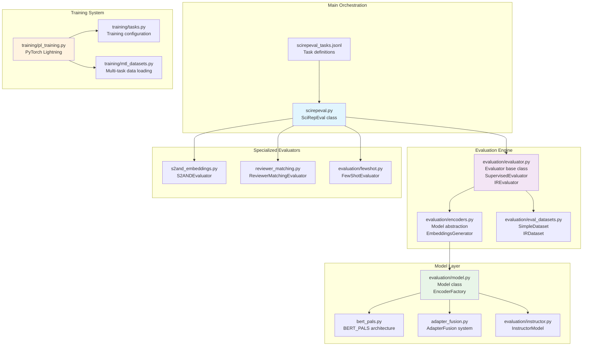
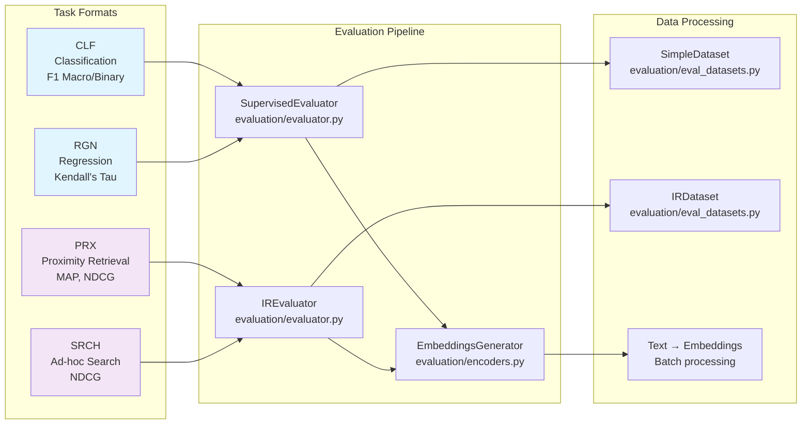

<!-- source: DeepWiki mcp.deepwiki.com · repo allenai/scirepeval · page 1 Overview · fetched 2026-10-26 -->

# Overview

Relevant source files

The following files were used as context for generating this wiki page:

- [README.md](README.md)
- [requirements.txt](requirements.txt)

## Purpose and Scope

SciRepEval is a comprehensive framework for training and evaluating scientific document representation models across multiple task formats and domains. The repository provides both a standardized benchmark consisting of 24 scientific document tasks and the infrastructure to train multi-task transformer models with parameter-efficient adaptation methods.

This document covers the high-level architecture and core capabilities of the SciRepEval system. For detailed information about specific components, see [Core Evaluation Framework](#2) for the evaluation engine, [Model Architecture and Variants](#3) for supported model types, [Training System](#4) for multi-task training capabilities, and [Task Configuration and Evaluation](#5) for benchmark task definitions.

## System Architecture

SciRepEval operates through a modular architecture that separates evaluation orchestration, model abstraction, and task-specific evaluation logic. The system supports both pre-trained model evaluation and custom model training across scientific document understanding tasks.

### Core Components and File Structure

Sources: [README.md:1-98](), [scirepeval.py](), [evaluation/evaluator.py](), [evaluation/encoders.py](), [evaluation/model.py]()

## Core Capabilities

SciRepEval provides four primary capabilities organized around scientific document representation learning:

| Capability | Description | Key Components |
|------------|-------------|----------------|
| **Benchmark Evaluation** | Evaluate models on 24 standardized scientific tasks | `scirepeval.py`, `scirepeval_tasks.jsonl` |
| **Multi-Task Training** | Train transformer models with parameter-efficient methods | `training/pl_training.py`, `bert_pals.py` |
| **Model Abstraction** | Unified interface for HuggingFace, local, and custom models | `evaluation/model.py`, `evaluation/encoders.py` |
| **Specialized Evaluation** | Domain-specific evaluators for scientific tasks | `s2and_embeddings.py`, `reviewer_matching.py` |

### Task Format Support

The framework supports four distinct task formats that cover different aspects of scientific document understanding:

Sources: [README.md:49-74](), [evaluation/evaluator.py](), [evaluation/eval_datasets.py]()

## Model Architecture Support

SciRepEval provides a unified interface for multiple model architectures through the `Model` class and `EncoderFactory`. The system supports both standard transformer models and parameter-efficient adaptation methods:

### Supported Model Types

- **HuggingFace Models**: Standard transformer models loaded via `transformers.AutoModel`
- **BERT PALS**: Parameter-efficient adaptation using the BERT PALS architecture in [bert_pals.py]()
- **Adapter Systems**: Task-specific adapters and AdapterFusion in [adapter_fusion.py]()
- **Instructor Models**: Instruction-based embeddings via [evaluation/instructor.py]()
- **External APIs**: Integration with OpenAI GPT-3 and other external services

The model abstraction layer in [evaluation/encoders.py]() handles embedding generation, caching, and batch processing across all supported model types.

## Data Infrastructure

The benchmark utilizes a comprehensive dataset infrastructure spanning 24 scientific document tasks:

- **Data Sources**: AWS S3 (~24 GB), HuggingFace Datasets (`allenai/scirepeval`, `allenai/scirepeval_test`)
- **Task Coverage**: Citation prediction, author matching, field classification, peer review scoring, and information retrieval
- **Evaluation Metrics**: F1 scores, Kendall's Tau, MAP, NDCG, and specialized metrics like B³ F1 for clustering

The framework separates test metadata (for embedding generation) from labeled examples (for evaluation), enabling proper representation learning evaluation protocols.

Sources: [README.md:26-48](), [requirements.txt:1-102]()

---

