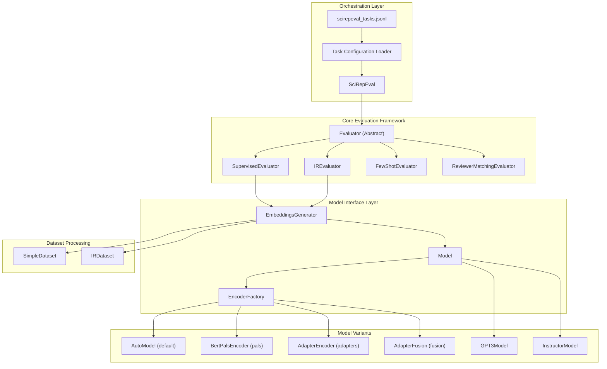
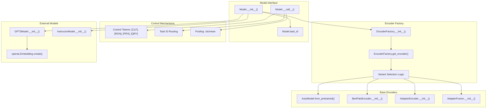
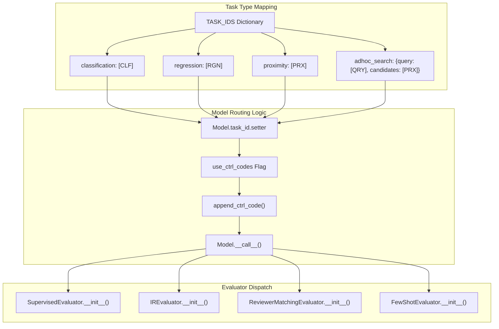

<!-- source: DeepWiki mcp.deepwiki.com · repo allenai/scirepeval · page 1.1 System Architecture · fetched 2026-10-26 -->

# System Architecture

Relevant source files

The following files were used as context for generating this wiki page:

- [evaluation/encoders.py](evaluation/encoders.py)
- [evaluation/evaluator.py](evaluation/evaluator.py)
- [evaluation/gpt3_encoder.py](evaluation/gpt3_encoder.py)
- [scirepeval.py](scirepeval.py)

This document provides a comprehensive overview of the SciRepEval system architecture, detailing how the core evaluation framework, model interfaces, and orchestration components interact to enable scientific document representation evaluation. This covers the high-level system design, data flow patterns, and component relationships that enable multi-task evaluation across different model variants.

For specific task configuration details, see [Task Definitions](#5.1). For training system architecture, see [Training Framework](#4.1).

## Overview

SciRepEval implements a modular evaluation framework consisting of three primary architectural layers:

1. **Orchestration Layer**: Main coordination through `SciRepEval` class
2. **Core Evaluation Framework**: Abstract and concrete evaluator implementations  
3. **Model Interface Layer**: Unified model abstraction supporting multiple variants

The system supports evaluation across classification, regression, and information retrieval tasks using various model architectures including standard transformers, parameter-efficient methods (PALS, adapters), and external APIs.

## Core System Components

**Sources**: [scirepeval.py:22-43](), [evaluation/evaluator.py:27-50](), [evaluation/encoders.py:48-75]()

## Evaluation Pipeline Flow

The evaluation pipeline follows a standardized flow from task configuration through model evaluation to metric calculation:

```mermaid
graph LR
    subgraph "Configuration Input"
        TasksJSONL["scirepeval_tasks.jsonl"]
        ModelConfig["Model Configuration"]
    end
    
    subgraph "Task Processing"
        SciRepEvalEvaluate["SciRepEval.evaluate()"]
        TaskIteration["Task Loop Processing"]
        EvaluatorFactory["Dynamic Evaluator Creation"]
    end
    
    subgraph "Data Loading"
        DatasetLoader["Dataset Loading"]
        SimpleDatasetClass["SimpleDataset.__init__()"]
        IRDatasetClass["IRDataset.__init__()"]
    end
    
    subgraph "Embedding Generation"
        EmbeddingsGeneratorGenerate["EmbeddingsGenerator.generate_embeddings()"]
        ModelCall["Model.__call__()"]
        BatchProcessing["Batch Processing Loop"]
    end
    
    subgraph "Evaluation Execution"
        EvaluatorEvaluate["Evaluator.evaluate()"]
        MetricCalculation["calc_metrics()"]
        ResultsOutput["JSON Results Output"]
    end
    
    TasksJSONL --> SciRepEvalEvaluate
    ModelConfig --> SciRepEvalEvaluate
    SciRepEvalEvaluate --> TaskIteration
    TaskIteration --> EvaluatorFactory
    EvaluatorFactory --> DatasetLoader
    
    DatasetLoader --> SimpleDatasetClass
    DatasetLoader --> IRDatasetClass
    
    SimpleDatasetClass --> EmbeddingsGeneratorGenerate
    IRDatasetClass --> EmbeddingsGeneratorGenerate
    EmbeddingsGeneratorGenerate --> ModelCall
    ModelCall --> BatchProcessing
    
    BatchProcessing --> EvaluatorEvaluate
    EvaluatorEvaluate --> MetricCalculation
    MetricCalculation --> ResultsOutput
```

**Sources**: [scirepeval.py:45-119](), [evaluation/evaluator.py:44-46](), [evaluation/embeddings_generator.py]()

## Model Architecture and Variant Support

The system implements a unified model interface that abstracts different encoder variants while maintaining consistent evaluation protocols:

**Sources**: [evaluation/encoders.py:13-46](), [evaluation/encoders.py:48-139](), [evaluation/gpt3_encoder.py:7-30]()

## Task Configuration and Data Flow

The system processes task configurations through a standardized pipeline that maps JSONL definitions to evaluator instances:

| Component | File Path | Key Classes/Functions | Purpose |
|-----------|-----------|---------------------|---------|
| Task Loading | `scirepeval.py` | `SciRepEval.__init__()` | Parse JSONL task configurations |
| Dataset Handling | `evaluation/eval_datasets.py` | `SimpleDataset`, `IRDataset` | Load and preprocess evaluation data |
| Embedding Generation | `evaluation/embeddings_generator.py` | `EmbeddingsGenerator` | Batch process text to embeddings |
| Metric Calculation | `evaluation/evaluator.py` | `calc_metrics()` | Compute task-specific performance metrics |

```mermaid
graph LR
    subgraph "Configuration Processing"
        JSONLParsing["JSONL Line-by-line Parsing"]
        TaskDictConstruction["Task Dictionary Construction"]
        MetadataExtraction["Metadata Extraction"]
    end
    
    subgraph "Evaluator Instantiation"
        TaskTypeDetection["Task Type Detection"]
        SupervisedTaskEnum["SupervisedTask.CLASSIFICATION/REGRESSION"]
        IRTaskDetection["IR Task Detection"]
        SpecializedTaskDetection["Specialized Task Detection"]
    end
    
    subgraph "Data Processing Pipeline"
        DatasetInstantiation["Dataset Class Instantiation"]
        TokenizerSetup["Tokenizer Configuration"]
        BatchConfiguration["Batch Size Configuration"]
        FieldMapping["Field Mapping Setup"]
    end
    
    subgraph "Execution Flow"
        EmbeddingGeneration["generate_embeddings()"]
        EvaluationExecution["evaluate()"]
        MetricsAggregation["Metrics Aggregation"]
        ResultsSerialization["JSON Results Serialization"]
    end
    
    JSONLParsing --> TaskDictConstruction
    TaskDictConstruction --> MetadataExtraction
    MetadataExtraction --> TaskTypeDetection
    
    TaskTypeDetection --> SupervisedTaskEnum
    TaskTypeDetection --> IRTaskDetection
    TaskTypeDetection --> SpecializedTaskDetection
    
    SupervisedTaskEnum --> DatasetInstantiation
    IRTaskDetection --> DatasetInstantiation
    SpecializedTaskDetection --> DatasetInstantiation
    
    DatasetInstantiation --> TokenizerSetup
    TokenizerSetup --> BatchConfiguration
    BatchConfiguration --> FieldMapping
    
    FieldMapping --> EmbeddingGeneration
    EmbeddingGeneration --> EvaluationExecution
    EvaluationExecution --> MetricsAggregation
    MetricsAggregation --> ResultsSerialization
```

**Sources**: [scirepeval.py:24-43](), [scirepeval.py:49-119](), [evaluation/evaluator.py:66-77]()

## Task-Specific Control Flow

The system implements task-specific routing through control tokens and task IDs that enable multi-task model evaluation:

**Sources**: [scirepeval.py:15-16](), [scirepeval.py:50-51](), [evaluation/encoders.py:80-86](), [evaluation/encoders.py:89-100]()

---

