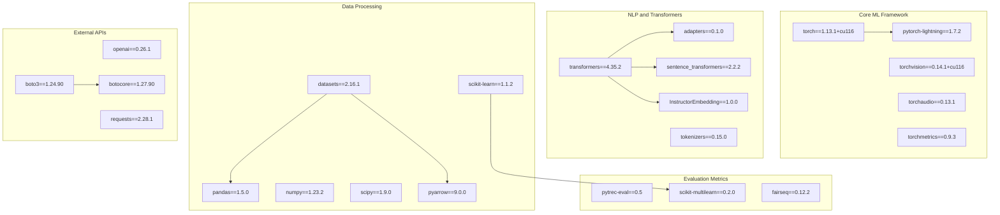
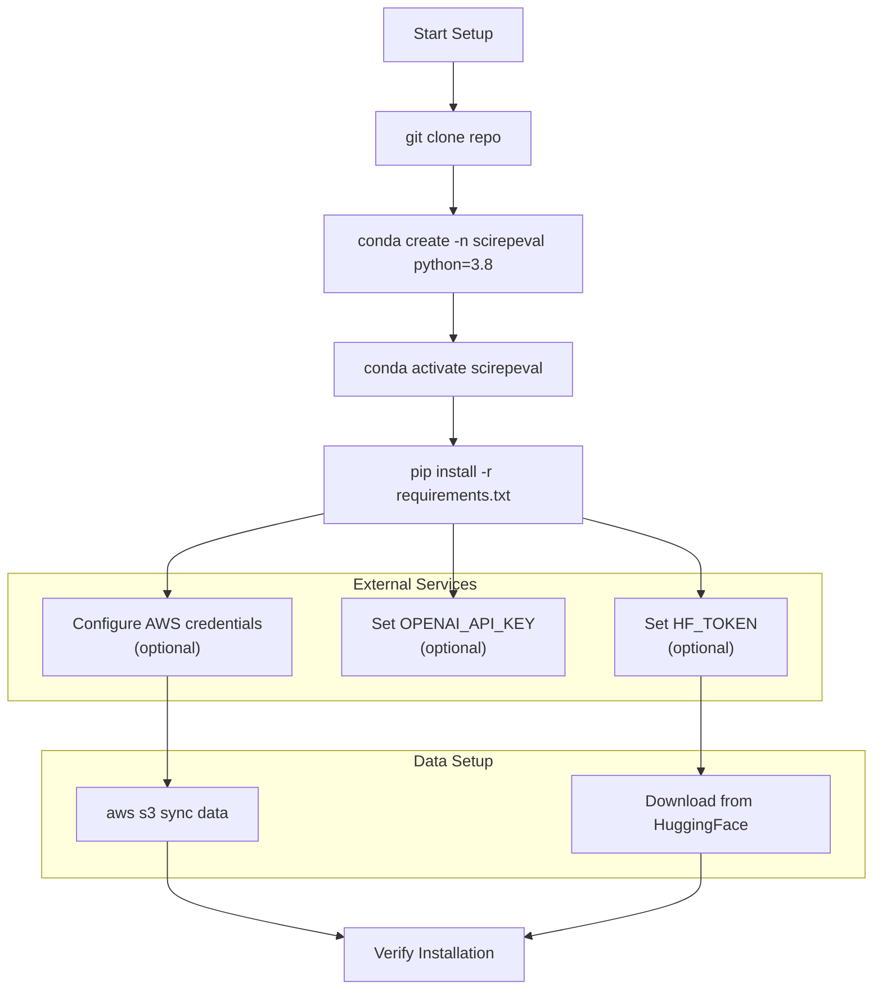
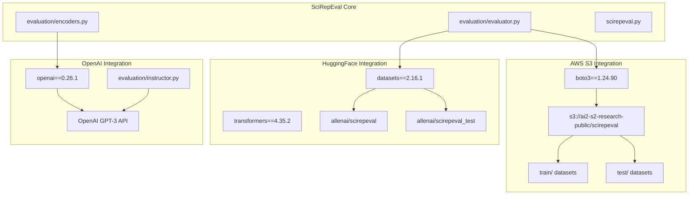
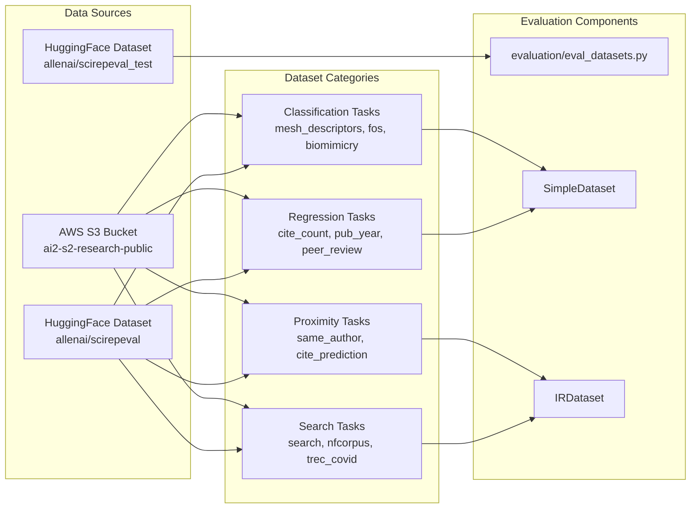
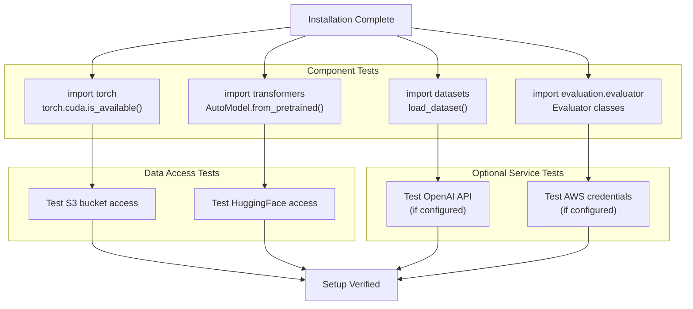

<!-- source: DeepWiki mcp.deepwiki.com · repo allenai/scirepeval · page 1.2 Dependencies and Setup · fetched 2026-10-26 -->

# Dependencies and Setup

<details>
<summary>Relevant source files</summary>

The following files were used as context for generating this wiki page:

- [README.md](README.md)
- [requirements.txt](requirements.txt)

</details>


This document covers the Python dependencies, environment configuration, and external service integrations required to run SciRepEval. It includes setup instructions for the evaluation framework, training system, and data access requirements.

For information about system architecture, see [System Architecture](#1.1). For benchmarking setup, see [Benchmarking System](#6.1).

## Core Dependencies Overview

SciRepEval requires a comprehensive set of Python packages spanning machine learning frameworks, natural language processing libraries, and cloud storage integrations. The system is built primarily on PyTorch and Transformers, with additional specialized packages for scientific document processing.

### Dependency Categories



**Sources:** [requirements.txt:1-102]()

### Key Dependencies Analysis

| Category | Package | Version | Purpose |
|----------|---------|---------|---------|
| Deep Learning | `torch` | 1.13.1+cu116 | Core tensor operations and CUDA support |
| Training Framework | `pytorch-lightning` | 1.7.2 | Multi-task training orchestration |
| Transformers | `transformers` | 4.35.2 | Pre-trained model access and fine-tuning |
| Adapters | `adapters` | 0.1.0 | Parameter-efficient fine-tuning |
| Dataset Loading | `datasets` | 2.16.1 | HuggingFace dataset integration |
| Cloud Storage | `boto3` | 1.24.90 | AWS S3 data access |
| External API | `openai` | 0.26.1 | GPT-3 model integration |
| Evaluation | `pytrec-eval` | 0.5 | Information retrieval metrics |

**Sources:** [requirements.txt:2-4](), [requirements.txt:6](), [requirements.txt:23](), [requirements.txt:63](), [requirements.txt:91](), [requirements.txt:99-101]()

## Environment Setup Process

The setup process involves creating a conda environment, installing dependencies, and configuring external service access.

### Installation Workflow



**Sources:** [README.md:5-12](), [README.md:27-33](), [README.md:35-45]()

### Basic Setup Commands

The following commands establish the core environment:

```bash
git clone git@github.com:allenai/scirepeval.git
cd scirepeval
conda create -n scirepeval python=3.8
conda activate scirepeval
pip install -r requirements.txt
```

**Sources:** [README.md:6-12]()

### CUDA and GPU Requirements

The system is configured for CUDA 11.6 support through PyTorch CUDA builds. GPU acceleration is recommended but not required for evaluation tasks.

**Sources:** [requirements.txt:1-4]()

## External Service Integration

SciRepEval integrates with multiple external services for data access and model inference.

### Service Integration Architecture



**Sources:** [README.md:27-36](), [README.md:38-45](), [requirements.txt:14-15](), [requirements.txt:23](), [requirements.txt:99]()

### AWS S3 Configuration

For accessing the benchmark datasets via AWS S3:

```bash
mkdir scirepeval_data && mkdir scirepeval_data/train && mkdir scirepeval_data/test && cd scirepeval_data
aws s3 --no-sign-request sync s3://ai2-s2-research-public/scirepeval/train train
aws s3 --no-sign-request sync s3://ai2-s2-research-public/scirepeval/test test
```

The dataset is approximately 24 GB in total size. No AWS credentials are required as the bucket allows anonymous access.

**Sources:** [README.md:28-33]()

### HuggingFace Integration

The system accesses datasets through two HuggingFace repositories:

- `allenai/scirepeval`: Training, validation, and evaluation metadata
- `allenai/scirepeval_test`: Labeled test examples

**Sources:** [README.md:35-36](), [README.md:41-44]()

### OpenAI API Integration

For GPT-3 model evaluation, set the API key environment variable:

```bash
export OPENAI_API_KEY="your-api-key-here"
```

**Sources:** [requirements.txt:99]()

## Data Dependencies

The framework requires access to benchmark datasets in multiple formats and storage locations.

### Data Source Architecture



**Sources:** [README.md:25-78]()

### Dataset Format Requirements

The benchmark includes 24 tasks across 4 formats:

- **CLF**: Classification tasks (F1 Macro/Binary metrics)
- **RGN**: Regression tasks (Kendall's Tau metric)
- **PRX**: Proximity/retrieval tasks (MAP, NDCG metrics)
- **SRCH**: Ad-hoc search tasks (NDCG metric)

**Sources:** [README.md:25-26](), [README.md:49-74]()

## Installation Verification

After setup completion, verify the installation by testing core components.

### Verification Process



### Basic Import Tests

Verify core functionality by testing key imports:

```python
# Core ML framework
import torch
import pytorch_lightning as pl
import transformers

# Evaluation framework
from evaluation.evaluator import Evaluator
from evaluation.encoders import Model

# Data access
import datasets
import boto3
```

### GPU Verification

Check CUDA availability for accelerated training and inference:

```python
import torch
print(f"CUDA available: {torch.cuda.is_available()}")
print(f"CUDA devices: {torch.cuda.device_count()}")
```

**Sources:** [requirements.txt:2](), [requirements.txt:63](), [requirements.txt:91]()

---

