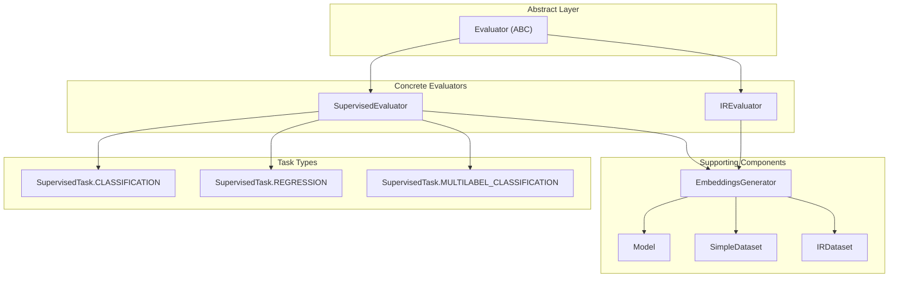
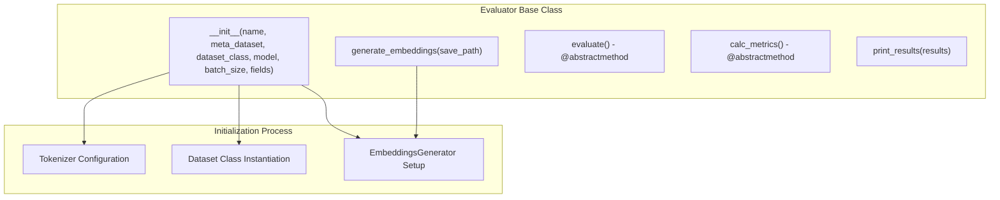
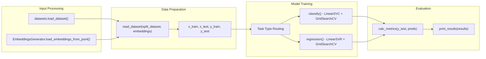
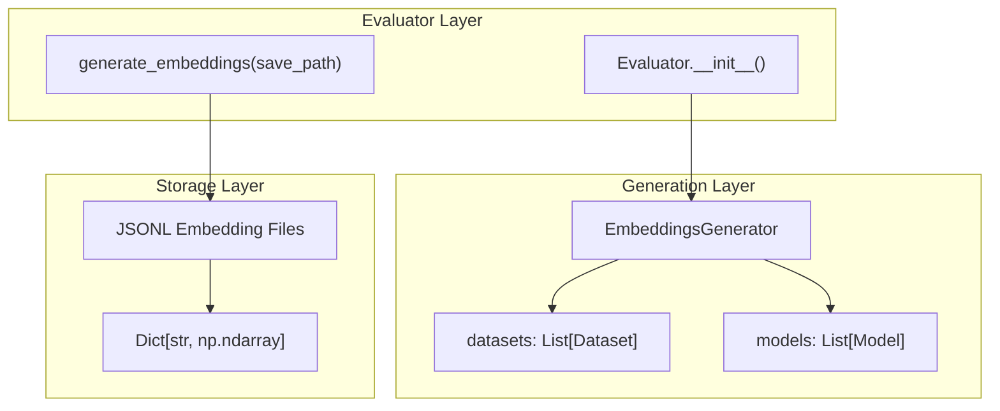

<!-- source: DeepWiki mcp.deepwiki.com · repo allenai/scirepeval · page 2 Core Evaluation Framework · fetched 2026-10-26 -->

# Core Evaluation Framework

Relevant source files

The following files were used as context for generating this wiki page:

- [evaluation/evaluator.py](evaluation/evaluator.py)

The Core Evaluation Framework forms the central engine for assessing scientific document representation models across diverse task types. This framework provides a unified interface for evaluating models on classification, regression, and information retrieval tasks through standardized metrics and evaluation protocols.

For information about model variants and architectures, see [Model Architecture and Variants](#3). For details on training systems, see [Training System](#4). For task configuration and definitions, see [Task Configuration and Evaluation](#5).

## Framework Architecture

The evaluation framework is built around an abstract base class that defines the common interface, with concrete implementations for different evaluation paradigms:

**Core Evaluation Framework Architecture**

Sources: [evaluation/evaluator.py:27-51](), [evaluation/evaluator.py:80-88](), [evaluation/evaluator.py:173-179]()

## Abstract Evaluator Base Class

The `Evaluator` base class establishes the common interface and core functionality shared across all evaluation types. It handles model initialization, tokenizer configuration, and embedding generation coordination.

**Evaluator Class Structure**

The base class performs critical setup operations including tokenizer padding configuration and special token handling:

| Component | Purpose | Key Operations |
|-----------|---------|----------------|
| Tokenizer Setup | Standardize tokenization across models | Add `[PAD]` token, set padding side, configure separator tokens |
| Dataset Creation | Instantiate appropriate dataset class per model | Create dataset instances with tokenizer-specific separators |
| EmbeddingsGenerator | Coordinate embedding generation | Initialize with datasets and models for batch processing |

Sources: [evaluation/evaluator.py:27-46](), [evaluation/evaluator.py:34-40]()

## Supervised Learning Evaluator

The `SupervisedEvaluator` handles classification and regression tasks using Support Vector Machine models with grid search hyperparameter optimization.

**SupervisedEvaluator Task Flow**

### Task Types and Metrics

The framework supports three supervised learning paradigms through the `SupervisedTask` enum:

| Task Type | Enum Value | Supported Metrics | Model Configuration |
|-----------|------------|-------------------|-------------------|
| Classification | `SupervisedTask.CLASSIFICATION` | f1, accuracy, precision, recall | LinearSVC with squared hinge loss |
| Multi-label Classification | `SupervisedTask.MULTILABEL_CLASSIFICATION` | f1, accuracy, precision, recall | OneVsRestClassifier(LinearSVC) |
| Regression | `SupervisedTask.REGRESSION` | mse, r2, pearsonr, kendalltau | LinearSVR |

The hyperparameter optimization uses cross-validation with predefined parameter grids:
- Classification: `C ∈ [0.01, 0.1, 1, 10, 100]` with 3-fold CV
- Regression: `C ∈ [0.0001, 0.001, 0.01, 0.1, 1, 10, 100]` with 3-fold CV

Sources: [evaluation/evaluator.py:66-77](), [evaluation/evaluator.py:118-134](), [evaluation/evaluator.py:136-143]()

## Information Retrieval Evaluator

The `IREvaluator` implements document retrieval evaluation using cosine similarity and TREC evaluation metrics through the `pytrec_eval` library.

**IREvaluator Processing Pipeline**

```mermaid
graph LR
    subgraph "Query-Candidate Setup"
        load_qrels["Load test_qrel.jsonl"]
        get_qc_pairs["get_qc_pairs(dataset)"]
        qrels_dict["qrels: Dict[query_id, Dict[cand_id, score]]"]
    end
    
    subgraph "Similarity Computation"
        retrieval["retrieval(embeddings, qrels)"]
        euclidean_dist["euclidean_distances(cands, query)"]
        score_negation["float(-scores[i])"]
    end
    
    subgraph "Metric Calculation"
        pytrec_eval["pytrec_eval.RelevanceEvaluator"]
        compute_aggregated["pytrec_eval.compute_aggregated_measure"]
        metric_results["metric_values: Dict[str, float]"]
    end
    
    load_qrels --> get_qc_pairs
    get_qc_pairs --> qrels_dict
    qrels_dict --> retrieval
    retrieval --> euclidean_dist
    euclidean_dist --> score_negation
    score_negation --> pytrec_eval
    pytrec_eval --> compute_aggregated
    compute_aggregated --> metric_results
```

### Retrieval Implementation

The retrieval process uses negative Euclidean distance as similarity scores, converting distance measurements to similarity rankings. For each query, the system:

1. Extracts query embedding: `query = np.array([embeddings[qid]])`
2. Retrieves candidate embeddings: `cands = np.array([embeddings[cid] for cid in qrels[qid]])`
3. Computes distances: `scores = euclidean_distances(cands, query).flatten()`
4. Converts to similarity: `run[qid][cid] = float(-scores[i])`

The evaluation supports standard IR metrics including NDCG, MAP, MRR, and precision at various cutoffs, computed using the `pytrec_eval` library's aggregated measure functions.

Sources: [evaluation/evaluator.py:173-179](), [evaluation/evaluator.py:180-187](), [evaluation/evaluator.py:218-229](), [evaluation/evaluator.py:189-200]()

## Integration with Embedding Generation

Both evaluator types integrate with the `EmbeddingsGenerator` component through a standardized interface:

**Embedding Generation Integration**

The framework supports both in-memory embedding dictionaries and persistent JSONL storage, enabling efficient reuse of computed embeddings across multiple evaluations. The `load_embeddings_from_jsonl()` static method provides standardized loading functionality for both evaluator types.

Sources: [evaluation/evaluator.py:41-46](), [evaluation/evaluator.py:97-98](), [evaluation/evaluator.py:209-210]()

---

