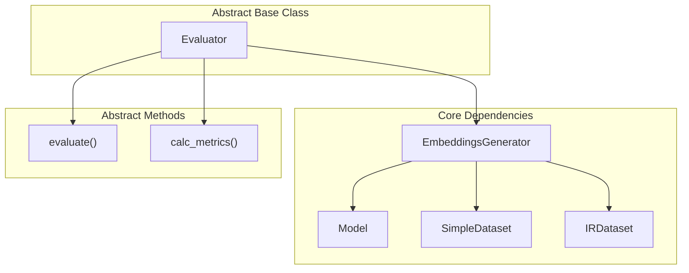
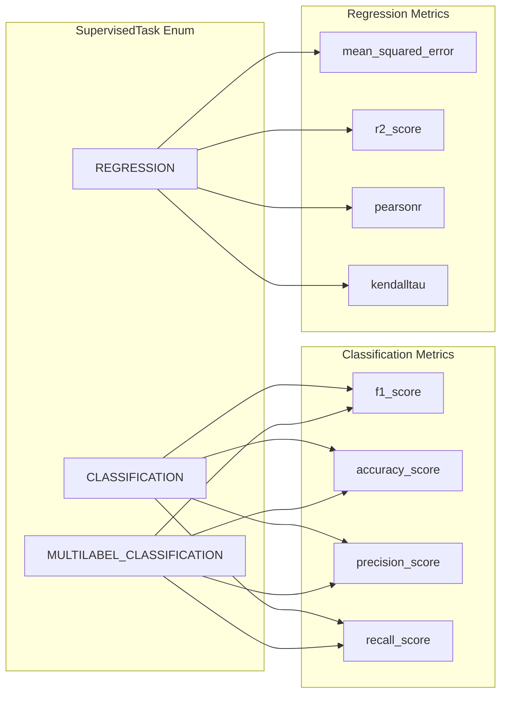
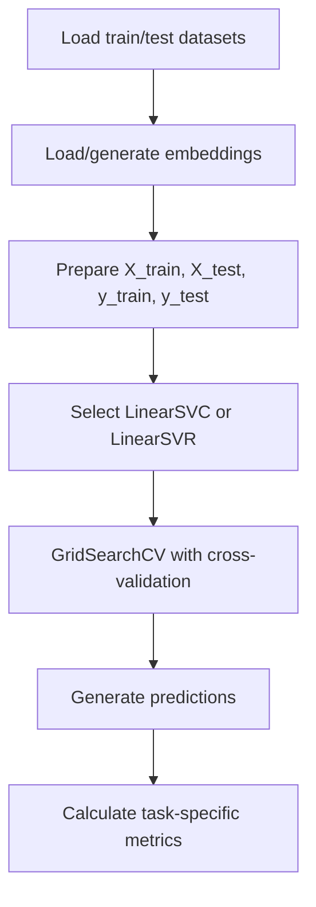
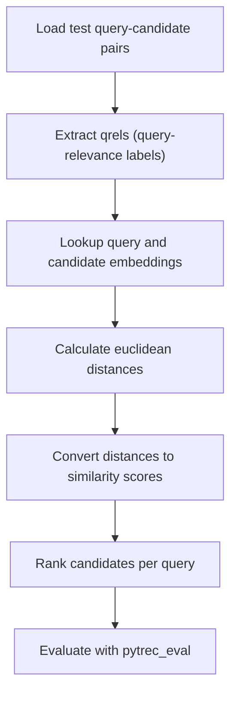
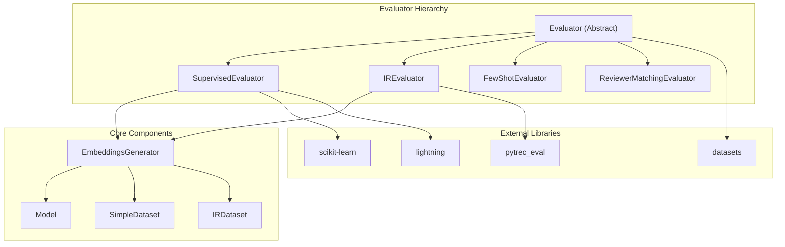

<!-- source: DeepWiki mcp.deepwiki.com · repo allenai/scirepeval · page 2.1 Evaluator Classes · fetched 2026-10-26 -->

# Evaluator Classes

Relevant source files

The following files were used as context for generating this wiki page:

- [evaluation/evaluator.py](evaluation/evaluator.py)
- [examples/classification.py](examples/classification.py)
- [examples/fewshot_classification.py](examples/fewshot_classification.py)
- [examples/regression.py](examples/regression.py)
- [examples/retrieval.py](examples/retrieval.py)

This document covers the core evaluator classes that form the backbone of SciRepEval's evaluation framework. These classes provide standardized interfaces for evaluating scientific document representations across different task types including supervised learning and information retrieval. For information about the main orchestration that coordinates these evaluators, see [Main Orchestration](#2.2). For details about dataset handling used by these evaluators, see [Dataset Handling](#2.3).

## Abstract Evaluator Base Class

The `Evaluator` class serves as the abstract base class for all evaluation components in the framework. It establishes a common contract and provides shared functionality for embedding generation and result presentation.

The base class constructor [evaluation/evaluator.py:28-42]() initializes the evaluator with essential components:

- **Name**: Identifier for the evaluation task
- **Meta dataset**: Dataset configuration for embedding generation  
- **Dataset class**: Either `SimpleDataset` or `IRDataset` depending on task type
- **Model**: The model instance to evaluate
- **Batch size**: Processing batch size for efficient computation
- **Fields**: Specific data fields to process
- **Key and process_fn**: Optional dataset processing parameters

The base class handles tokenizer setup automatically, ensuring all models have proper padding tokens [evaluation/evaluator.py:34-38](). It creates dataset instances for each model and initializes the `EmbeddingsGenerator` for text-to-vector conversion.

Sources: evaluation/evaluator.py:27-64

## SupervisedEvaluator for Classification and Regression

The `SupervisedEvaluator` class handles supervised learning tasks including classification, multi-label classification, and regression. It extends the base `Evaluator` class with task-specific functionality for training linear models on document embeddings.

### Task Types and Metrics

The `SupervisedTask` enum [evaluation/evaluator.py:66-70]() defines three task types, each associated with specific metrics through the `SUPERVISED_TASK_METRICS` mapping [evaluation/evaluator.py:72-77]().

### Evaluation Pipeline

The supervised evaluation process follows this flow:

The `evaluate` method [evaluation/evaluator.py:89-104]() orchestrates this pipeline:

1. **Dataset Loading**: Loads train/test splits from HuggingFace datasets or local CSV files
2. **Data Preparation**: Maps paper IDs to embeddings and labels using `read_dataset` [evaluation/evaluator.py:107-116]()
3. **Model Training**: Uses either `classify` [evaluation/evaluator.py:118-134]() or `regression` [evaluation/evaluator.py:136-143]() methods
4. **Metric Calculation**: Computes task-appropriate metrics via `calc_metrics` [evaluation/evaluator.py:145-170]()

For classification tasks, the evaluator uses `LinearSVC` with squared hinge loss and cross-validated hyperparameter search across C values. Multi-label classification employs `OneVsRestClassifier` wrapper. Regression tasks use `LinearSVR` with similar hyperparameter optimization.

Sources: evaluation/evaluator.py:80-171, examples/classification.py:1-25, examples/regression.py:1-24

## IREvaluator for Information Retrieval

The `IREvaluator` class specializes in information retrieval evaluation using query-candidate similarity scoring. It evaluates how well document embeddings capture semantic relationships for retrieval tasks.

### Retrieval Process

The `IREvaluator` constructor [evaluation/evaluator.py:174-178]() accepts similar parameters to the base class but defaults to using `IRDataset` for handling query-candidate pair data structures.

### Similarity Calculation and Ranking

The core retrieval logic in the `retrieval` method [evaluation/evaluator.py:218-229]() implements the following algorithm:

1. **Query Processing**: For each query ID in the test set, retrieve the query embedding
2. **Candidate Collection**: Gather embeddings for all candidate documents associated with the query
3. **Distance Computation**: Calculate euclidean distances between query and candidate embeddings
4. **Score Conversion**: Convert distances to similarity scores by negating (smaller distances = higher similarity)
5. **Ranking**: Create ranked lists of candidates per query

The `get_qc_pairs` method [evaluation/evaluator.py:180-187]() structures the test data into query-candidate-relevance mappings required by the evaluation framework.

### Metric Evaluation

The `calc_metrics` method [evaluation/evaluator.py:189-200]() leverages the `pytrec_eval` library for standard IR metrics:

- **MAP**: Mean Average Precision
- **NDCG**: Normalized Discounted Cumulative Gain  
- **P@k**: Precision at rank k
- **Recall**: Recall at various cutoffs

Results are aggregated across all queries and scaled to percentages for consistent reporting.

Sources: evaluation/evaluator.py:173-230, examples/retrieval.py:1-40

## Class Hierarchy and Integration

The evaluator classes integrate with the broader SciRepEval ecosystem through well-defined interfaces:

### Common Interface Contract

All evaluator classes must implement two abstract methods defined in the base class:

| Method | Purpose | Parameters | Returns |
|--------|---------|------------|---------|
| `evaluate` | Main evaluation entry point | `embeddings`: Dict or file path, `**kwargs` | `Dict[str, float]` of metrics |
| `calc_metrics` | Task-specific metric calculation | `test`: ground truth, `preds`: predictions | `Dict[str, float]` of metrics |

### Shared Functionality

The base `Evaluator` class provides common functionality used by all subclasses:

- **Embedding Generation**: The `generate_embeddings` method [evaluation/evaluator.py:44-46]() delegates to `EmbeddingsGenerator` for text-to-vector conversion
- **Result Display**: The `print_results` method [evaluation/evaluator.py:56-63]() provides consistent formatting for evaluation outputs
- **Model Integration**: Automatic tokenizer configuration and model preparation for batch processing

This design enables consistent evaluation interfaces while allowing task-specific customization in the concrete implementations.

Sources: evaluation/evaluator.py:27-230, examples/classification.py:1-25, examples/retrieval.py:1-40, examples/fewshot_classification.py:1-24

---

