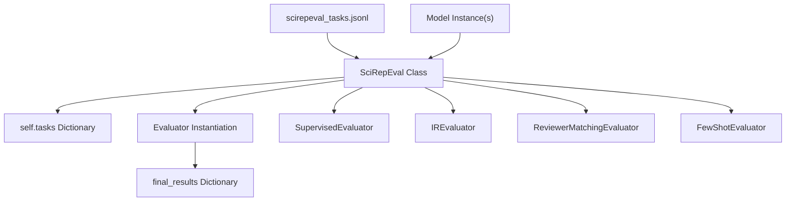
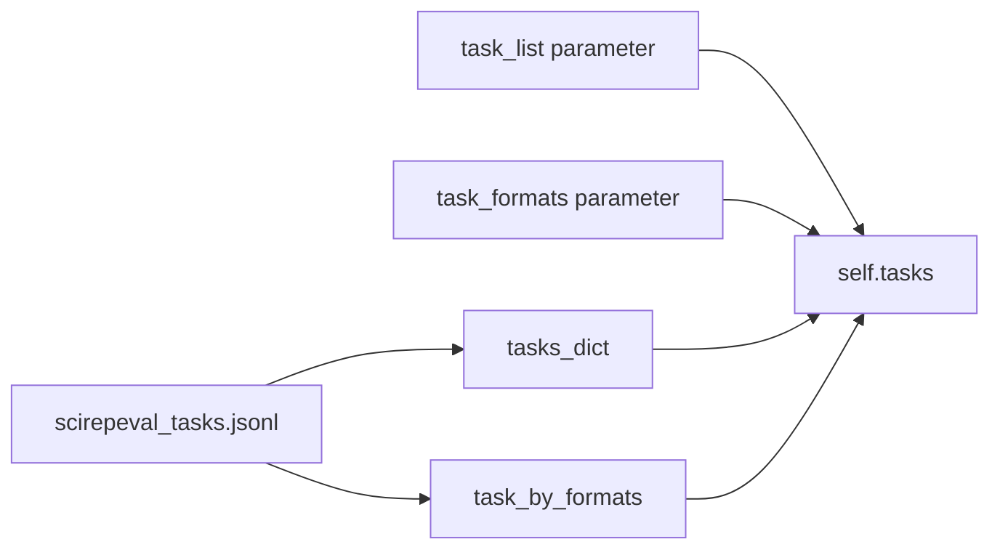
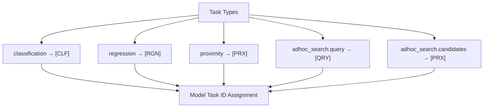
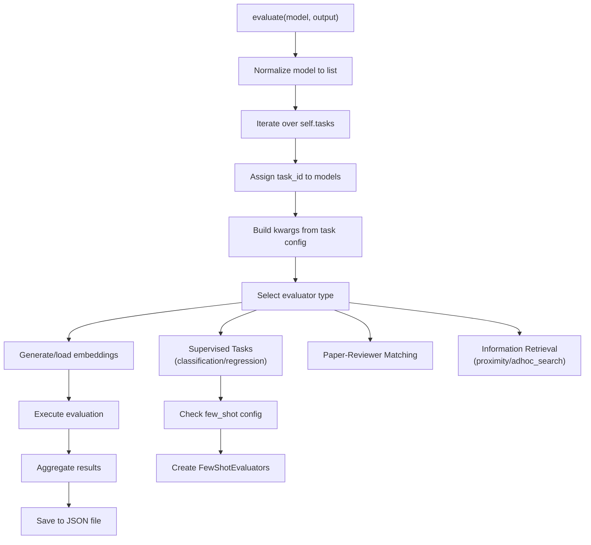
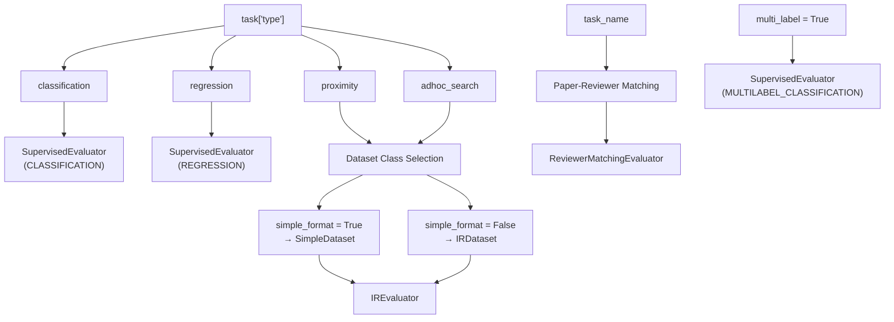
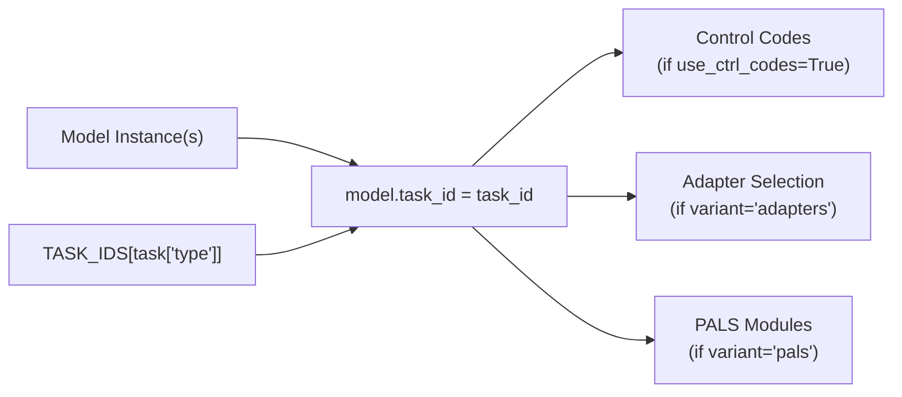
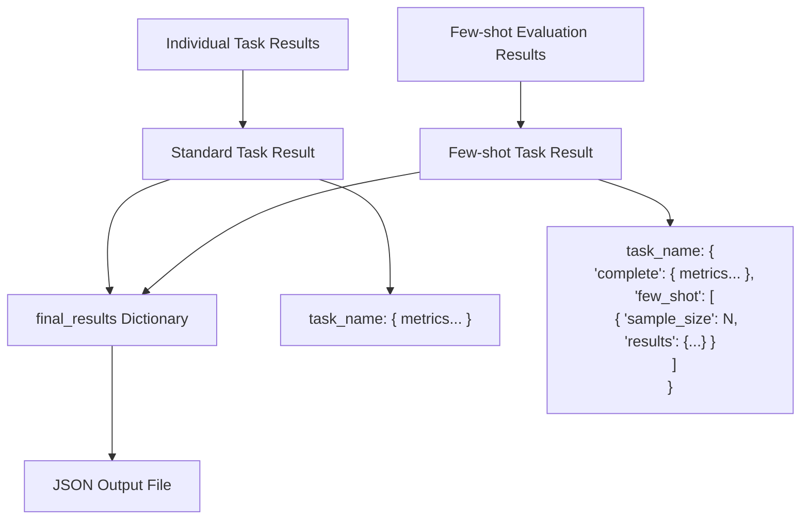

<!-- source: DeepWiki mcp.deepwiki.com · repo allenai/scirepeval · page 2.2 Main Orchestration · fetched 2026-10-26 -->

# Main Orchestration

Relevant source files

The following files were used as context for generating this wiki page:

- [BENCHMARKING.md](BENCHMARKING.md)
- [evaluation/gpt3_encoder.py](evaluation/gpt3_encoder.py)
- [scirepeval.py](scirepeval.py)

The main orchestration system coordinates the evaluation of scientific document representation models across multiple tasks and configurations. This document covers the `SciRepEval` class and its role in managing task configurations, model instances, evaluator selection, and result aggregation. For details about individual evaluator implementations, see [Evaluator Classes](#2.1). For task configuration formats, see [Task Definitions](#5.1).

## SciRepEval Class Overview

The `SciRepEval` class serves as the central coordinator for the entire evaluation framework. It manages task configurations, instantiates appropriate evaluators, coordinates model evaluation across tasks, and aggregates results.

The class initializes by loading and filtering tasks from a JSONL configuration file, then provides an `evaluate` method that orchestrates evaluation across all configured tasks.

Sources: [scirepeval.py:22-44]()

## Task Configuration Management

The orchestration system loads task definitions from a JSONL file and supports flexible task filtering by name or type. Each task configuration specifies the evaluation type, data sources, metrics, and optional parameters.

The initialization process supports three filtering modes:
- **All tasks**: When neither `task_list` nor `task_formats` are specified
- **Specific tasks**: Using the `task_list` parameter to select individual tasks
- **Task type filtering**: Using `task_formats` to select all tasks of specific types

Sources: [scirepeval.py:24-43]()

## Task ID System

The orchestration uses a standardized task ID mapping system that assigns control tokens to different task types. These tokens serve as either control codes for multi-task models or module identifiers for parameter-efficient methods.

| Task Type | Task ID | Usage |
|-----------|---------|-------|
| Classification | `[CLF]` | Classification tasks |
| Regression | `[RGN]` | Regression tasks |
| Proximity | `[PRX]` | Proximity/similarity tasks |
| Ad-hoc Search (queries) | `[QRY]` | Query encoding in search tasks |
| Ad-hoc Search (candidates) | `[PRX]` | Candidate encoding in search tasks |

Sources: [scirepeval.py:15-16](), [scirepeval.py:50-51]()

## Evaluation Orchestration Flow

The main `evaluate` method orchestrates the entire evaluation process through a systematic workflow that handles multiple models and tasks with proper error handling and result aggregation.

The orchestration handles several key responsibilities:
- **Model normalization**: Ensures models are always processed as lists for consistent handling
- **Task configuration parsing**: Extracts dataset references, metadata, metrics, and evaluation parameters
- **Evaluator selection**: Routes to appropriate evaluator classes based on task type
- **Few-shot evaluation**: Creates additional evaluators for tasks with few-shot configurations

Sources: [scirepeval.py:45-119]()

## Evaluator Factory Pattern

The orchestration implements a factory pattern for evaluator instantiation, selecting the appropriate evaluator class based on task type and configuration parameters.

The factory logic includes:
- **Supervised tasks**: Routes classification and regression to `SupervisedEvaluator` with appropriate subtypes
- **Multi-label handling**: Detects multi-label classification tasks and sets the appropriate subtype
- **Special cases**: Handles "Paper-Reviewer Matching" as a specialized reviewer matching task
- **IR tasks**: Selects dataset class based on `simple_format` configuration parameter

Sources: [scirepeval.py:80-104]()

## Model Coordination

The orchestration system manages model instances and assigns task-specific identifiers to enable proper routing in multi-task and parameter-efficient models.

The task ID assignment occurs before each task evaluation and enables:
- **Control token injection**: For models trained with control codes
- **Adapter routing**: For adapter-based parameter-efficient fine-tuning
- **Module selection**: For PALS-based parameter sharing

Sources: [scirepeval.py:50-51]()

## Result Aggregation and Output

The orchestration system aggregates evaluation results across all tasks and models, handling both standard evaluation and few-shot evaluation results in a structured format.

The result structure accommodates:
- **Standard results**: Direct metric mappings for tasks without few-shot evaluation
- **Combined results**: Structured format with both complete and few-shot results for applicable tasks
- **Incremental saving**: Results are saved after each task to preserve partial progress

Sources: [scirepeval.py:105-118]()

## Command-Line Interface

The orchestration system provides a comprehensive command-line interface that supports all model variants and evaluation configurations available in the framework.

| Parameter | Purpose | Model Variants |
|-----------|---------|----------------|
| `--mtype` | Model variant selection | `default`, `pals`, `adapters`, `fusion` |
| `--model` | Base model checkpoint | HuggingFace model names or local paths |
| `--ctrl-tokens` | Enable control token usage | MTL CTRL models |
| `--adapters-dir` | Local adapter directory | Adapter and Fusion variants |
| `--adapters-chkpt` | HuggingFace adapter mapping | Adapter and Fusion variants |
| `--fusion-dir` | Fusion module directory | Fusion variant |
| `--instructor` | Use Instructor models | Instructor embeddings |
| `--gpt3-model` | OpenAI embedding model | GPT-3 embeddings |

Sources: [scirepeval.py:121-156]()

---

