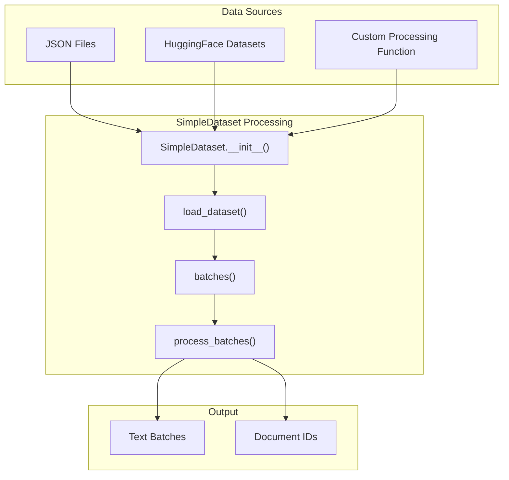
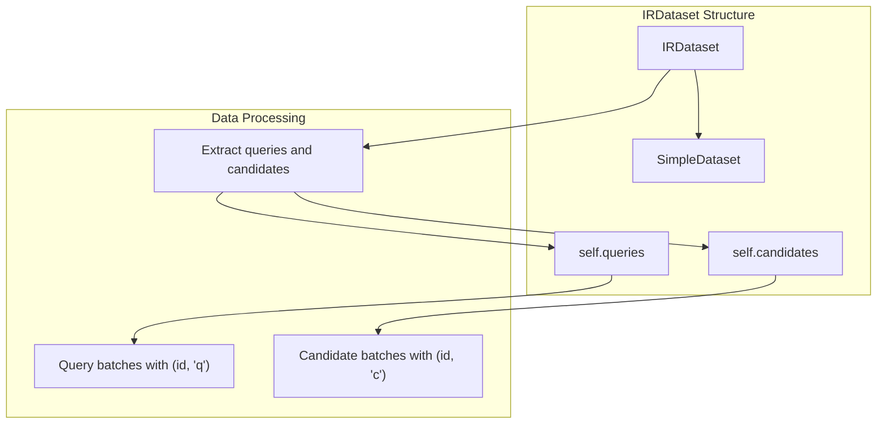
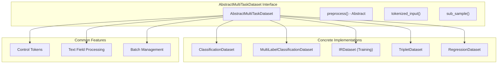
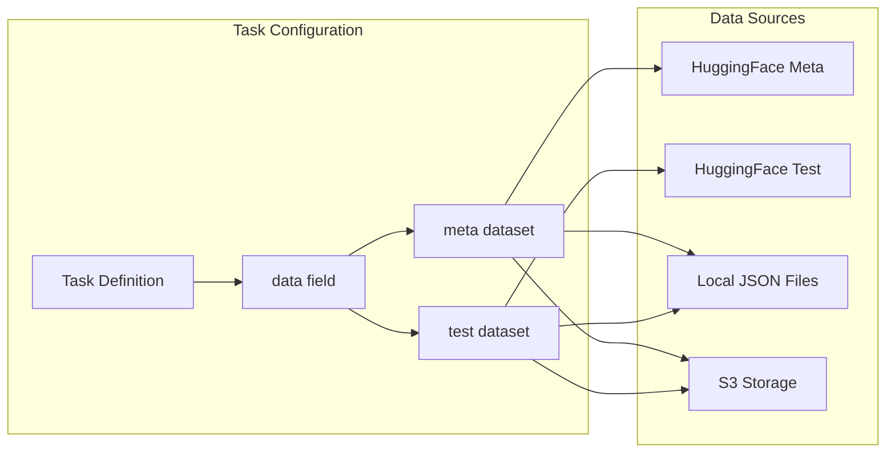
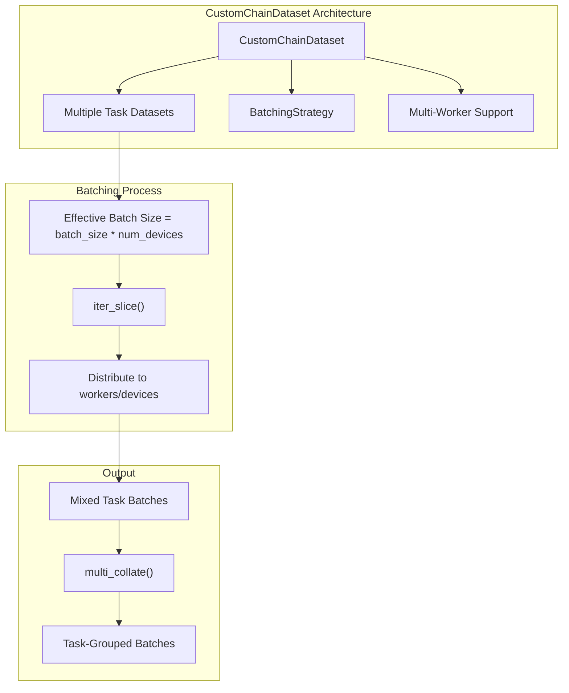
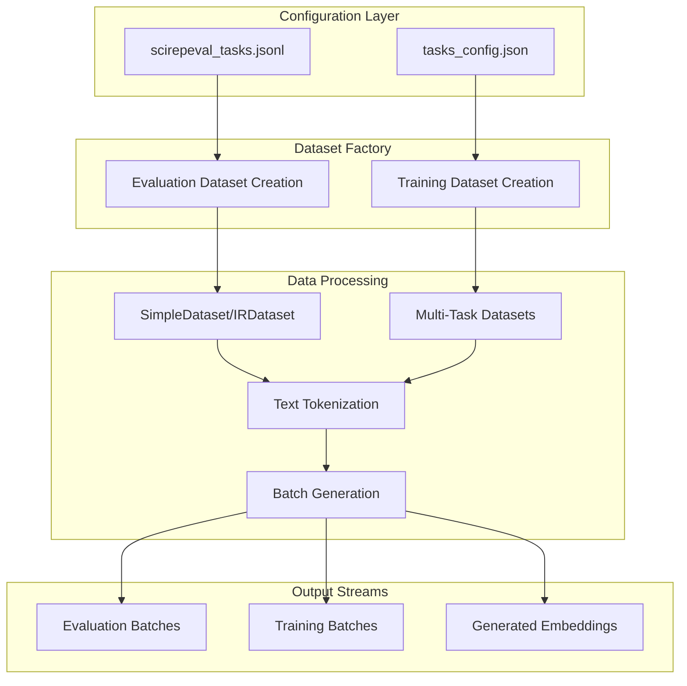

<!-- source: DeepWiki mcp.deepwiki.com · repo allenai/scirepeval · page 2.3 Dataset Handling · fetched 2026-10-26 -->

# Dataset Handling

Relevant source files

The following files were used as context for generating this wiki page:

- [evaluation/eval_datasets.py](evaluation/eval_datasets.py)
- [scirepeval_tasks.jsonl](scirepeval_tasks.jsonl)
- [training/mtl_datasets.py](training/mtl_datasets.py)

This document covers how datasets are loaded, processed, and managed within SciRepEval for both evaluation and training purposes. The framework supports multiple data sources including HuggingFace datasets, local JSON files, and AWS S3 storage, with specialized dataset classes for different task types.

For information about how datasets are used within the evaluation pipeline, see [Core Evaluation Framework](#2). For training configuration and task setup, see [Task Configuration for Training](#4.2).

## Overview

SciRepEval provides two main categories of dataset handling:

1. **Evaluation Datasets** - Used by evaluators to load test data and metadata for model assessment
2. **Training Datasets** - Used during multi-task training to prepare data for different learning objectives

The framework abstracts dataset complexity through consistent interfaces while supporting diverse data formats and sources.

## Evaluation Dataset Classes

### SimpleDataset

The `SimpleDataset` class provides the foundational dataset handling for evaluation tasks. It loads documents, processes them into batches, and handles text field concatenation.

Key features of `SimpleDataset`:

| Feature | Description | Implementation |
|---------|-------------|----------------|
| Data Loading | Supports local JSON and HuggingFace datasets | [evaluation/eval_datasets.py:21-26]() |
| Field Concatenation | Combines multiple text fields with separator tokens | [evaluation/eval_datasets.py:48-52]() |
| Batch Processing | Creates batches with configurable size | [evaluation/eval_datasets.py:37-62]() |
| Deduplication | Prevents processing duplicate documents | [evaluation/eval_datasets.py:45-47]() |

**Sources:** [evaluation/eval_datasets.py:10-63]()

### IRDataset

The `IRDataset` class extends `SimpleDataset` for information retrieval tasks, handling query-candidate pairs with separate processing streams.

The `IRDataset` processes data containing query-candidate relationships, creating separate batch streams for queries and candidates with type annotations.

**Sources:** [evaluation/eval_datasets.py:65-88]()

## Training Dataset Classes

### AbstractMultiTaskDataset

The base class for all training datasets provides common functionality for multi-task learning scenarios.

Key components:

- **Control Tokens**: Prepended to text for task identification [training/mtl_datasets.py:80-82]()
- **Field Processing**: Concatenates multiple text fields with separators [training/mtl_datasets.py:72-77]()
- **Tokenization**: Converts text to model inputs with padding and truncation [training/mtl_datasets.py:83-88]()

**Sources:** [training/mtl_datasets.py:22-89]()

### Specialized Training Dataset Classes

Each task type has a specialized dataset class that handles task-specific data processing:

| Dataset Class | Purpose | Key Features |
|---------------|---------|--------------|
| `ClassificationDataset` | Single-label classification | Stratified sampling, label mapping |
| `MultiLabelClassificationDataset` | Multi-label classification | `MultiLabelBinarizer`, iterative stratification |
| `IRDataset` | Information retrieval training | Triplet generation from query-candidate pairs |
| `TripletDataset` | Similarity learning | Direct triplet processing |
| `RegressionDataset` | Continuous value prediction | Numerical label handling |

**Sources:** [training/mtl_datasets.py:91-260]()

## Data Source Configuration

### Task Definition Format

Tasks are defined in `scirepeval_tasks.jsonl` with standardized data source specifications:

Example task configuration structure:
- `name`: Task identifier
- `type`: Task type (classification, regression, proximity, adhoc_search)
- `data.meta`: Metadata/training dataset source
- `data.test`: Test dataset source
- `fields`: Text fields to use (defaults to ["title", "abstract"])

**Sources:** [scirepeval_tasks.jsonl:1-23]()

### Data Loading Patterns

The framework supports multiple data loading patterns:

1. **HuggingFace Datasets**: `{"name": "allenai/scirepeval", "config": "biomimicry"}`
2. **Local Files**: Direct file paths for JSON/JSONL files
3. **Processing Functions**: Custom data loading through `processing_fn` parameter
4. **Embedding Caching**: Save/load embeddings to avoid recomputation

**Sources:** [evaluation/eval_datasets.py:21-26](), [scirepeval_tasks.jsonl:1-23]()

## Multi-Task Data Pipeline

### CustomChainDataset

The `CustomChainDataset` class orchestrates multiple datasets for multi-task training with sophisticated batching strategies.

The `CustomChainDataset` handles:
- **Multi-GPU Training**: Distributes batches across devices [training/mtl_datasets.py:232-233]()
- **Worker Coordination**: Manages data loading across multiple workers [training/mtl_datasets.py:233-234]()
- **Batching Strategies**: Supports different mixing strategies via `BatchingStrategy` enum

**Sources:** [training/mtl_datasets.py:214-246]()

## Data Flow Architecture

### End-to-End Processing Pipeline

This pipeline demonstrates how configuration files drive dataset creation, which flows through processing stages to produce model-ready batches for both evaluation and training scenarios.

**Sources:** [evaluation/eval_datasets.py:10-88](), [training/mtl_datasets.py:22-266](), [scirepeval_tasks.jsonl:1-23]()

---

