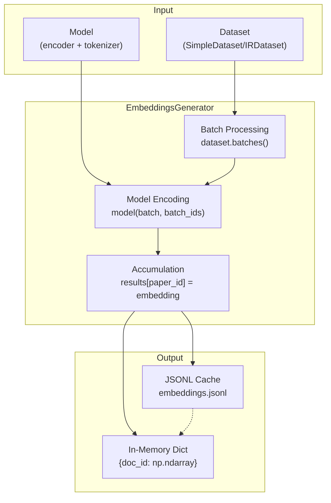
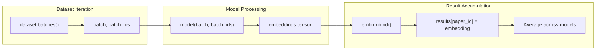
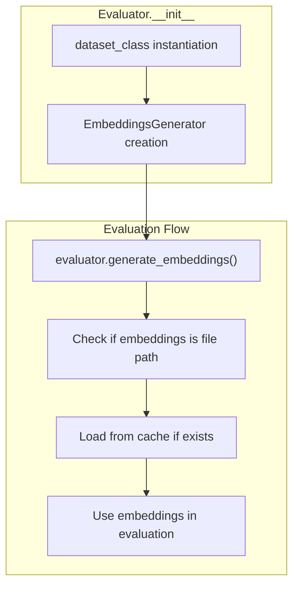

<!-- source: DeepWiki mcp.deepwiki.com · repo allenai/scirepeval · page 2.4 Embedding Generation · fetched 2026-10-26 -->

# Embedding Generation

<details>
<summary>Relevant source files</summary>

The following files were used as context for generating this wiki page:

- [evaluation/embeddings_generator.py](evaluation/embeddings_generator.py)
- [evaluation/evaluator.py](evaluation/evaluator.py)
- [training/bert_pals_config/low_rank_config.json](training/bert_pals_config/low_rank_config.json)
- [training/bert_pals_config/pals.config.json](training/bert_pals_config/pals.config.json)

</details>


This page documents the embedding generation system in SciRepEval, which is responsible for converting text documents into dense vector representations that can be used for downstream evaluation tasks. The system handles batch processing, caching, and reuse of embeddings across multiple evaluation runs.

For information about the model architectures that generate these embeddings, see [Model Architecture and Variants](#3). For details about how embeddings are used in specific evaluation tasks, see [Evaluator Classes](#2.1).

## Overview

The embedding generation system centers around the `EmbeddingsGenerator` class, which orchestrates the conversion of text documents into numerical embeddings using various model architectures. The system is designed for efficiency, supporting batch processing and persistent caching to avoid redundant computation across evaluation runs.



**Embedding Generation Pipeline**

Sources: [evaluation/embeddings_generator.py:18-43]()

## EmbeddingsGenerator Class

The `EmbeddingsGenerator` class serves as the primary interface for converting text documents into embeddings. It handles multiple models and datasets simultaneously, enabling ensemble-style embedding generation.

### Core Architecture

| Component | Type | Purpose |
|-----------|------|---------|
| `datasets` | List | Dataset instances containing text to encode |
| `models` | List[Model] | Model instances for encoding text |
| `generate_embeddings()` | Method | Main processing pipeline |
| `load_embeddings_from_jsonl()` | Static Method | Cache loading utility |

### Batch Processing Flow

The embedding generation process operates on batches of documents to maximize computational efficiency:



**Batch Processing Workflow**

Sources: [evaluation/embeddings_generator.py:21-33]()

### Multi-Model Ensemble Support

When multiple models are provided, the generator processes each model independently and averages the resulting embeddings:

- Each model processes the same batch of text
- Individual embeddings are accumulated per document ID
- Final embeddings are averaged across all models: `results = {k: v/len(self.models) for k, v in results.items()}`

Sources: [evaluation/embeddings_generator.py:27-33]()

## Caching and Persistence

The system implements a JSONL-based caching mechanism to store and reuse embeddings across evaluation runs.

### JSONL Format

Embeddings are serialized to JSONL (JSON Lines) format with the following structure:

```json
{"doc_id": "paper_123", "embedding": [0.1, -0.2, 0.5, ...]}
```

Each line contains a document ID and its corresponding embedding vector as a list of floats.

### Storage and Loading


**Caching Mechanism**

The loading process optimizes memory usage by converting embeddings to `float16` precision, reducing memory footprint while maintaining sufficient precision for most evaluation tasks.

Sources: [evaluation/embeddings_generator.py:37-42](), [evaluation/embeddings_generator.py:45-53]()

## Integration with Evaluators

The embedding generation system is tightly integrated with the evaluation framework through the `Evaluator` base class.

### Evaluator Integration Pattern



**Evaluator-Generator Integration**

### Automatic Cache Management

Evaluators automatically handle embedding caching:

1. **Cache Check**: During evaluation, if embeddings parameter is a file path, load from cache
2. **Generation**: If embeddings need to be generated, call `generate_embeddings()`
3. **Reuse**: Cached embeddings can be reused across multiple evaluation runs

Sources: [evaluation/evaluator.py:39-46](), [evaluation/evaluator.py:97-98](), [evaluation/evaluator.py:209-210]()

## Memory and Performance Optimization

The system implements several optimizations for efficient embedding generation:

### Memory Management

| Optimization | Implementation | Purpose |
|-------------|----------------|---------|
| Batch Processing | `dataset.batches()` | Limit memory usage per iteration |
| Tensor Cleanup | `del batch; del emb` | Free GPU memory after processing |
| Float16 Loading | `dtype=np.float16` | Reduce memory footprint in cache |
| CPU Transfer | `embedding.detach().cpu().numpy()` | Move tensors off GPU |

### Error Handling

The generation process includes comprehensive error handling to ensure partial results are saved even if processing fails:

```python
try:
    # Main processing loop
except Exception as e:
    print(e)
finally:
    if save_path:
        # Save whatever results were generated
```

This pattern ensures that partial embeddings are preserved for debugging and incremental processing.

Sources: [evaluation/embeddings_generator.py:20-42]()

## File Format Specifications

### Input Requirements

- **Datasets**: Must implement `batches()` method returning `(batch, batch_ids)` tuples
- **Models**: Must be callable with `model(batch, batch_ids)` signature returning embeddings tensor
- **Batch IDs**: Can be strings or tuples; tuples are converted to first element

### Output Specifications

- **In-Memory**: Dictionary mapping document IDs (strings) to NumPy arrays
- **Cached**: JSONL file with one JSON object per line containing `doc_id` and `embedding` fields
- **Precision**: Full precision in memory, `float16` when loaded from cache

Sources: [evaluation/embeddings_generator.py:24-28](), [evaluation/embeddings_generator.py:40-41](), [evaluation/embeddings_generator.py:51]()

---

