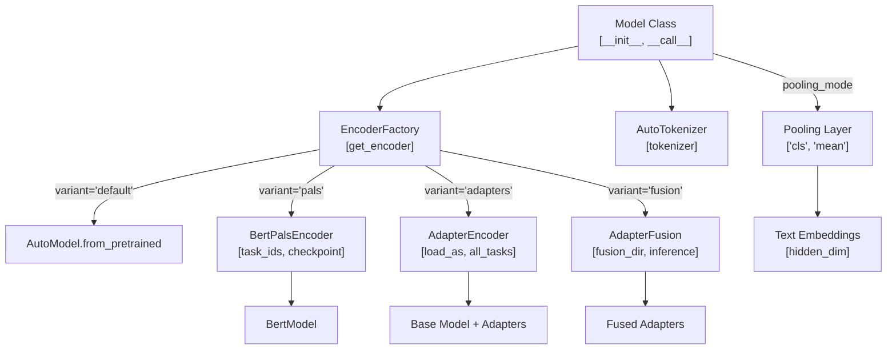
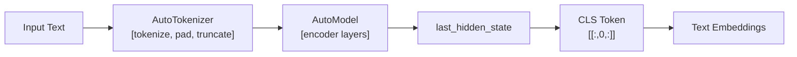
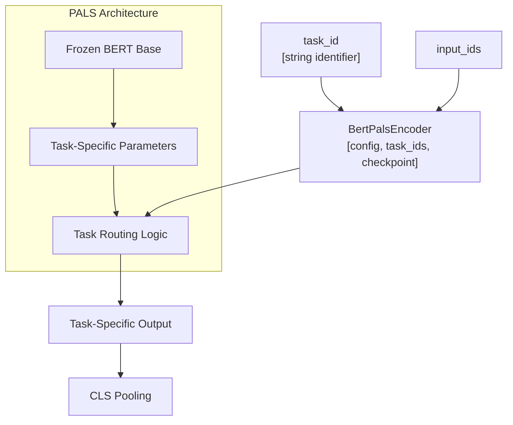
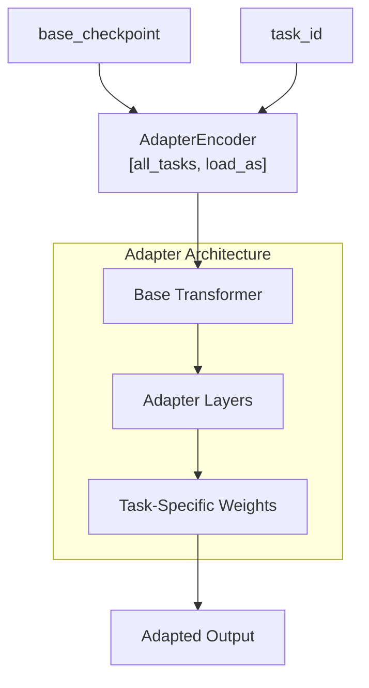
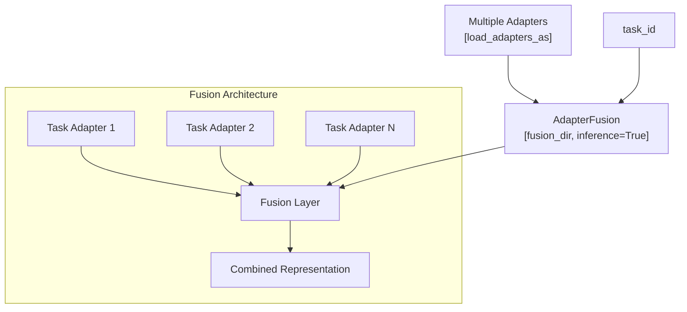
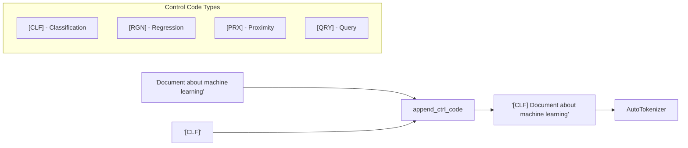
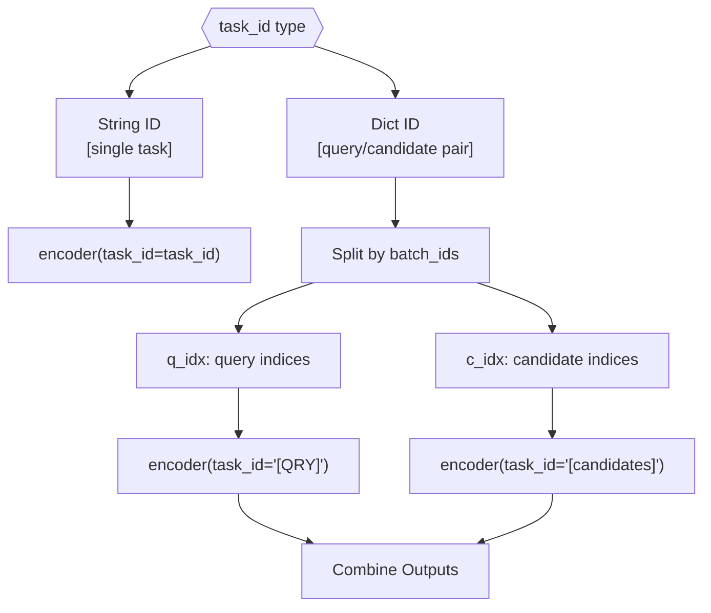
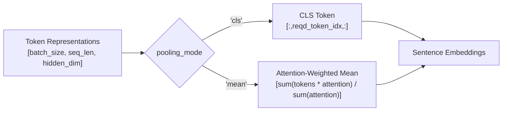
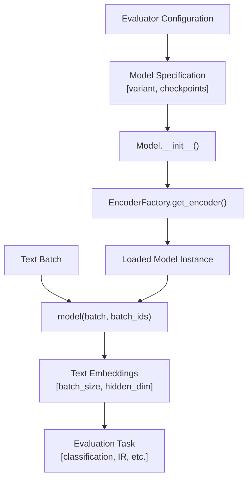

<!-- source: DeepWiki mcp.deepwiki.com · repo allenai/scirepeval · page 3 Model Architecture and Variants · fetched 2026-10-26 -->

# Model Architecture and Variants

Relevant source files

The following files were used as context for generating this wiki page:

- [evaluation/encoders.py](evaluation/encoders.py)

This document covers the unified model interface and architecture variants supported by SciRepEval. The system provides a consistent API for evaluating different types of text encoders, from standard transformers to parameter-efficient adaptations like BERT PALS and adapters. This abstraction layer enables seamless comparison of various model architectures within the same evaluation framework.

For information about how these models are used during evaluation, see [Core Evaluation Framework](#2). For details on training these model variants, see [Training System](#4).

## Model Interface System

SciRepEval uses a factory pattern to instantiate different model variants through a unified interface. The `Model` class provides consistent access to any supported encoder type, while the `EncoderFactory` handles the variant-specific instantiation logic.

### Factory Pattern Architecture

The `Model` class serves as the primary interface that evaluation components interact with. It encapsulates encoder selection, tokenization, and embedding generation in a consistent API regardless of the underlying architecture.

**Sources**: [evaluation/encoders.py:48-140]()

### Model Configuration Parameters

The `Model` class accepts several configuration parameters that control its behavior across all variants:

| Parameter | Type | Purpose | Default |
|-----------|------|---------|---------|
| `variant` | str | Specifies encoder type | "default" |
| `base_checkpoint` | str | Model checkpoint path | None |
| `adapters_load_from` | str/Dict | Adapter loading configuration | None |
| `fusion_load_from` | str | AdapterFusion checkpoint path | None |
| `use_ctrl_codes` | bool | Enable control code prefixing | False |
| `task_id` | str/Dict | Task identifier for routing | None |
| `pooling_mode` | str | Token pooling strategy | "cls" |
| `max_len` | int | Maximum sequence length | 512 |

**Sources**: [evaluation/encoders.py:49-74]()

## Supported Model Variants

### Default Variant (HuggingFace Models)

The "default" variant loads standard HuggingFace transformer models using `AutoModel.from_pretrained()`. This provides access to any model available on the HuggingFace Hub or stored locally.

**Sources**: [evaluation/encoders.py:24-25](), [evaluation/encoders.py:104-105]()

### PALS Variant (Parameter-Efficient Adaptation)

The "pals" variant implements BERT PALS (Parameter-efficient Adaptation for Language Specificity), which adds task-specific parameters while keeping the base model frozen. This enables multi-task learning with minimal parameter overhead.

The PALS encoder requires a task identifier to route inputs to the appropriate task-specific parameters. It supports both local checkpoint loading and HuggingFace Hub models.

**Sources**: [evaluation/encoders.py:26-35](), [evaluation/encoders.py:106-107]()

### Adapters Variant

The "adapters" variant uses the AdapterHub framework to add lightweight task-specific modules to a base transformer model. Adapters can be loaded from local paths or the AdapterHub repository.

**Sources**: [evaluation/encoders.py:36-39]()

### Fusion Variant (AdapterFusion)

The "fusion" variant combines multiple pre-trained adapters using AdapterFusion, which learns to weight and combine different task-specific adapters for improved multi-task performance.

**Sources**: [evaluation/encoders.py:40-43]()

## Control Mechanisms

### Control Codes

When `use_ctrl_codes=True`, the model prefixes input text with task-specific control tokens. This allows a single model to handle multiple tasks by learning task-conditional representations.

**Sources**: [evaluation/encoders.py:62-63](), [evaluation/encoders.py:89-95](), [evaluation/encoders.py:99-100]()

### Task Routing

For non-default variants, the model uses task identifiers to route inputs to appropriate task-specific parameters. The system supports both string and dictionary-based task IDs for handling query-candidate pairs in retrieval tasks.

**Sources**: [evaluation/encoders.py:106-127]()

### Pooling Strategies

The model supports two pooling strategies for converting token-level representations to sentence-level embeddings:

#### CLS Pooling
Uses the first token (CLS token) representation as the sentence embedding. For control codes, uses the second token to skip the control token.

#### Mean Pooling
Computes attention-weighted average of all token representations, providing a more comprehensive sentence representation.

**Sources**: [evaluation/encoders.py:128-138]()

## Integration with Evaluation Framework

The unified model interface integrates seamlessly with the evaluation framework. Evaluators instantiate models through this interface and call them with text batches, receiving consistent embedding outputs regardless of the underlying architecture.

This abstraction enables the evaluation framework to work with any supported model type without modification, facilitating comprehensive model comparison across different architectures and parameter-efficient methods.

**Sources**: [evaluation/encoders.py:88-139]()

---

