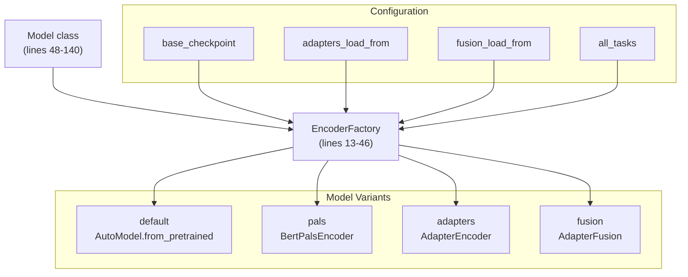
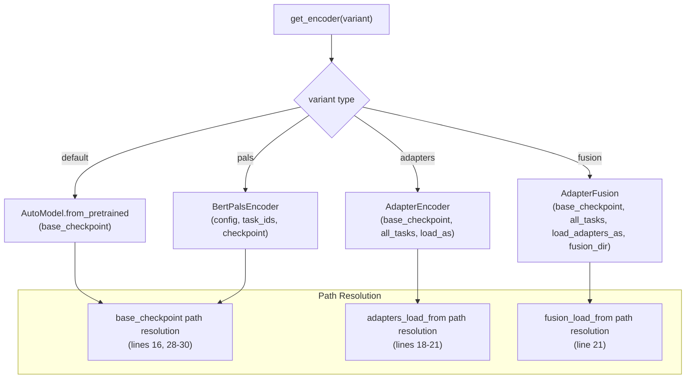
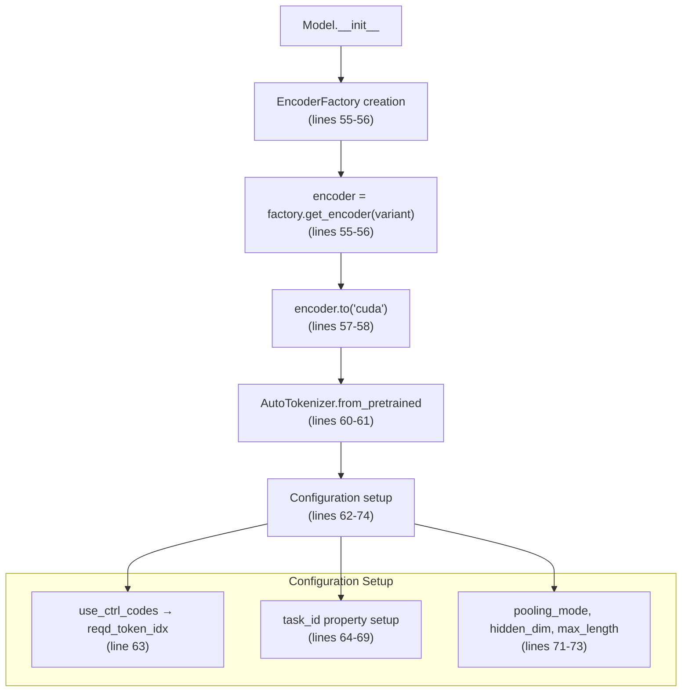
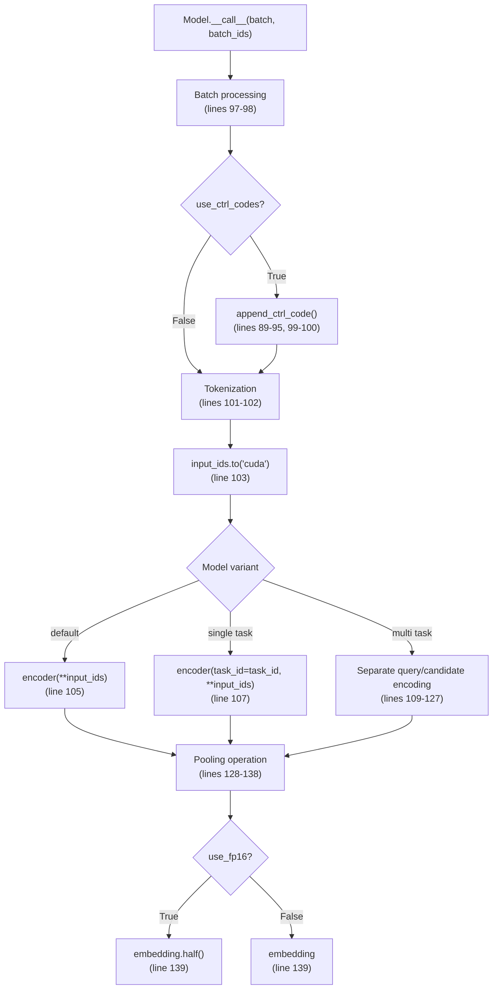
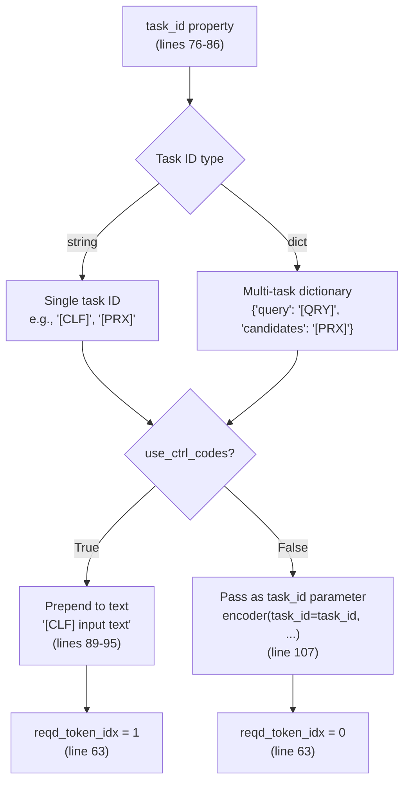

<!-- source: DeepWiki mcp.deepwiki.com · repo allenai/scirepeval · page 3.1 Model Interface · fetched 2026-10-26 -->

# Model Interface

<details>
<summary>Relevant source files</summary>

The following files were used as context for generating this wiki page:

- [evaluation/encoders.py](evaluation/encoders.py)
- [examples/classification.py](examples/classification.py)
- [examples/fewshot_classification.py](examples/fewshot_classification.py)
- [examples/regression.py](examples/regression.py)
- [examples/retrieval.py](examples/retrieval.py)

</details>


This document covers the unified model interface provided by the `Model` class and `EncoderFactory` that abstracts different model variants and configurations in SciRepEval. This interface enables seamless switching between different model architectures while maintaining consistent evaluation workflows.

For information about specific model architectures like PALS, see [PALS Architecture](#3.2). For adapter-based models, see [Adapter System](#3.3). For external model integrations, see [Specialized Models](#3.4).

## Unified Model Interface

The model interface consists of two primary components: the `EncoderFactory` class for instantiating different model variants and the `Model` class that provides a unified interface for text encoding regardless of the underlying architecture.

**Factory Pattern Architecture**


Sources: [evaluation/encoders.py:13-46](), [evaluation/encoders.py:48-140]()

## EncoderFactory Class

The `EncoderFactory` handles the instantiation of different encoder variants based on configuration parameters. It supports four main variants: default Hugging Face models, PALS encoders, adapter-based encoders, and fusion encoders.

**EncoderFactory Variant Selection**


The factory automatically handles path resolution for different checkpoint formats, converting directory paths to appropriate model and adapter paths as needed.

Sources: [evaluation/encoders.py:13-46]()

## Model Class Architecture

The `Model` class provides a unified interface that wraps different encoder variants with consistent tokenization, pooling, and inference capabilities. It handles device management, control codes, task IDs, and various configuration options.

| Parameter | Type | Purpose | Default |
|-----------|------|---------|---------|
| `variant` | str | Encoder type selection | "default" |
| `base_checkpoint` | str | Base model checkpoint path | None |
| `adapters_load_from` | Union[str, Dict] | Adapter loading configuration | None |
| `fusion_load_from` | str | Fusion model path | None |
| `use_ctrl_codes` | bool | Enable control code prefixing | False |
| `task_id` | Union[str, Dict] | Task identification for routing | None |
| `pooling_mode` | str | Embedding pooling strategy | "cls" |
| `max_len` | int | Maximum sequence length | 512 |

**Model Initialization Flow**


Sources: [evaluation/encoders.py:48-74]()

## Text Encoding Process

The model's `__call__` method handles batch text encoding with support for control codes, task-specific routing, and different pooling strategies.

**Encoding Pipeline**


Sources: [evaluation/encoders.py:88-139]()

## Task ID and Control Code System

The model interface supports two mechanisms for task-specific behavior: control codes and task IDs. Control codes are prepended to input text, while task IDs are passed directly to parameter-efficient models.

**Control Code Processing**


For multi-task scenarios with dictionaries, the model handles separate encoding for queries and candidates, routing them to appropriate task-specific parameters.

Sources: [evaluation/encoders.py:76-86](), [evaluation/encoders.py:89-95](), [evaluation/encoders.py:109-127]()

## Usage Patterns

The model interface is designed to be consistent across different evaluation scenarios. Here are the common usage patterns observed in the examples:

**Basic Usage (Default Models)**
```python
# From examples/regression.py:9
model = Model(base_checkpoint="allenai/specter")
```

**Control Code Usage**
```python
# From examples/classification.py:13
model = Model(base_checkpoint="../lightning_logs/full_run/scincl_ctrl/checkpoints/", 
              task_id="[CLF]", use_ctrl_codes=True)
```

**Adapter Usage**
```python
# From examples/retrieval.py:16-18
model = Model(base_checkpoint="malteos/scincl", variant="adapters",
              adapters_load_from="../../../phantasm/phantasm_new/lightning_logs/full_run/scincl_adapters/checkpoints/",
              task_id="[PRX]", all_tasks=["[PRX]"])
```

**Pooling Configuration**
The model supports two pooling modes defined in the `__call__` method:
- `cls`: Uses the CLS token embedding at position `reqd_token_idx`
- `mean`: Computes attention-masked mean pooling across all tokens

Sources: [examples/regression.py:9](), [examples/classification.py:13](), [examples/retrieval.py:16-18](), [evaluation/encoders.py:128-138]()

---

