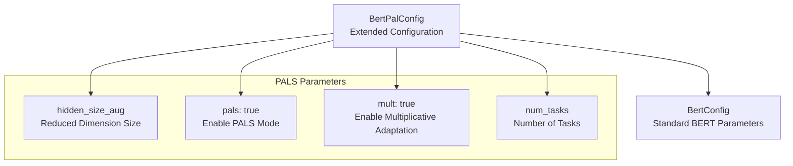
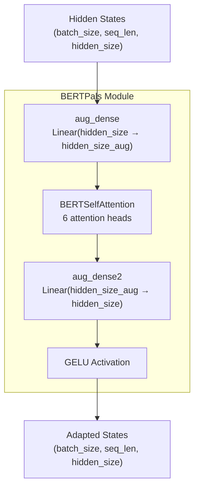
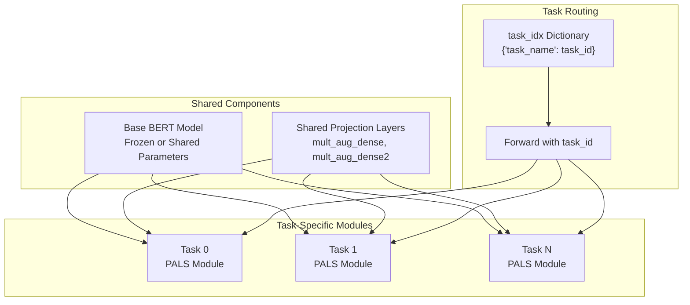
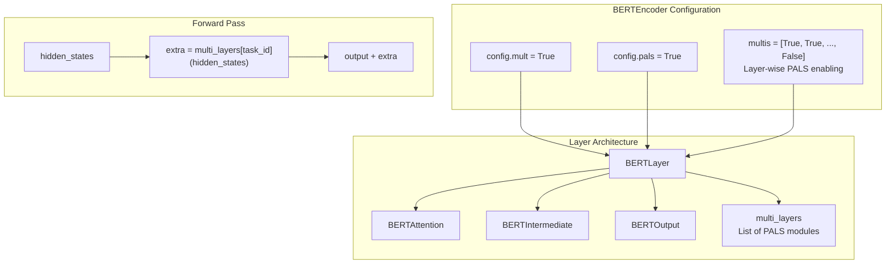
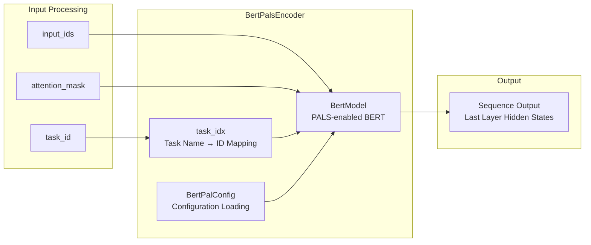

<!-- source: DeepWiki mcp.deepwiki.com · repo allenai/scirepeval · page 3.2 PALS Architecture · fetched 2026-10-26 -->

# PALS Architecture

<details>
<summary>Relevant source files</summary>

The following files were used as context for generating this wiki page:

- [bert_pals.py](bert_pals.py)
- [evaluation/embeddings_generator.py](evaluation/embeddings_generator.py)
- [training/bert_pals_config/low_rank_config.json](training/bert_pals_config/low_rank_config.json)
- [training/bert_pals_config/pals.config.json](training/bert_pals_config/pals.config.json)

</details>


This document describes the Parameter-efficient Adaptation Layer System (PALS) architecture implemented in SciRepEval. PALS provides a method for efficient multi-task learning by adding lightweight adaptation modules to pre-trained BERT models without requiring full model fine-tuning.

For information about the broader model interface system, see [Model Interface](#3.1). For details about adapter-based alternatives, see [Adapter System](#3.3).

## Overview

PALS (Parameter-efficient Adaptation Layer System) is a technique that adds task-specific adaptation capabilities to BERT models while maintaining a small parameter footprint. The architecture projects hidden states to a lower-dimensional space, applies attention mechanisms, and projects back to the original dimensionality.

The implementation centers around three key components:
- `BertPalConfig`: Configuration management for PALS-specific parameters
- `BERTPals`: Core adaptation module implementing dimensionality reduction and attention
- `BertPalsEncoder`: Integration wrapper for use within the SciRepEval framework

Sources: [bert_pals.py:1-862]()

## Core Architecture Components

### Configuration System

The PALS configuration extends the standard BERT configuration with additional parameters that control the adaptation behavior:



| Parameter | Purpose | Default Value |
|-----------|---------|---------------|
| `hidden_size_aug` | Dimensionality of the reduced space | 204 |
| `pals` | Enable PALS adaptation modules | false |
| `mult` | Enable multiplicative adaptation | false |
| `num_tasks` | Number of tasks for multi-task learning | 1 |

Sources: [bert_pals.py:45-125](), [training/bert_pals_config/pals.config.json:1-16]()

### PALS Adaptation Module

The core `BERTPals` class implements the parameter-efficient adaptation mechanism:



The adaptation process involves:
1. **Dimension Reduction**: Project from `hidden_size` (768) to `hidden_size_aug` (204)
2. **Attention Processing**: Apply self-attention with reduced head count (6 heads)
3. **Dimension Restoration**: Project back to original `hidden_size`
4. **Activation**: Apply GELU activation function

Sources: [bert_pals.py:283-300]()

### Multi-Task Integration

PALS supports multi-task learning by maintaining separate adaptation modules for each task while sharing the base BERT parameters:



Sources: [bert_pals.py:435-457](), [bert_pals.py:808-854]()

## BERT Layer Integration

PALS modules can be integrated at different levels within the BERT architecture:

### Layer-Level Integration



The integration follows this pattern:
1. **Layer Selection**: Configure which layers receive PALS modules via `multis` array
2. **Module Creation**: Instantiate task-specific PALS modules for each enabled layer
3. **Residual Addition**: Add PALS output to the standard layer output

Sources: [bert_pals.py:405-473](), [bert_pals.py:368-403]()

## Encoder Wrapper Implementation

The `BertPalsEncoder` class provides the integration point with SciRepEval's model system:



Key features of the encoder wrapper:
- **Task Mapping**: Converts task names to integer indices for internal routing
- **Checkpoint Loading**: Supports loading from both file paths and model objects
- **Weight Initialization**: Handles parameter initialization for new PALS components

Sources: [bert_pals.py:808-862]()

## Configuration Examples

### Standard PALS Configuration

The default PALS configuration demonstrates typical parameter settings:

```json
{
  "hidden_size_aug": 204,
  "mult": true,
  "pals": true,
  "hidden_size": 768,
  "num_attention_heads": 12,
  "num_hidden_layers": 12
}
```

### Low-Rank Alternative Configuration

For comparison, a low-rank adaptation configuration without PALS:

```json
{
  "hidden_size_aug": 100,
  "mult": true,
  "hidden_size": 768
}
```

The key difference is the absence of the `"pals": true` flag, which switches to using `BERTLowRank` modules instead of `BERTPals` modules.

Sources: [training/bert_pals_config/pals.config.json:1-16](), [training/bert_pals_config/low_rank_config.json:1-15]()

## Usage in SciRepEval

PALS models integrate with the broader SciRepEval system through the standard model interface. The `BertPalsEncoder` can be instantiated and used like any other encoder in the evaluation pipeline, with the task routing handled automatically based on the provided task identifiers.

The parameter efficiency of PALS makes it particularly suitable for multi-task scenarios where training separate models for each task would be computationally expensive.

Sources: [evaluation/embeddings_generator.py:13-54]()

---

