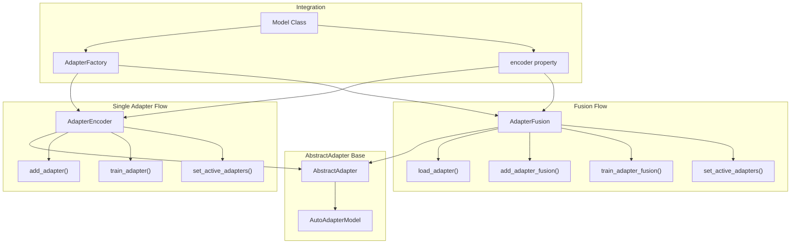
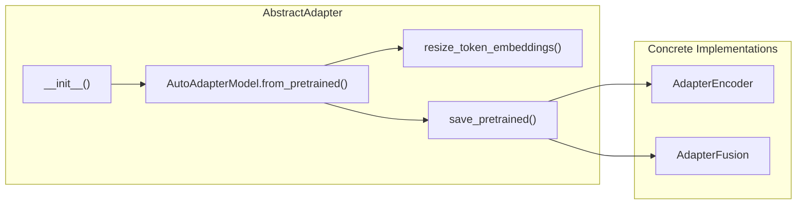
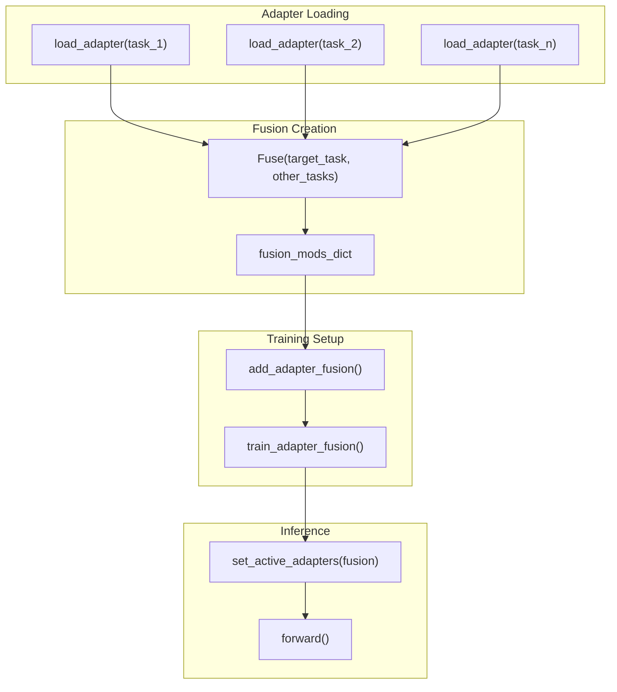
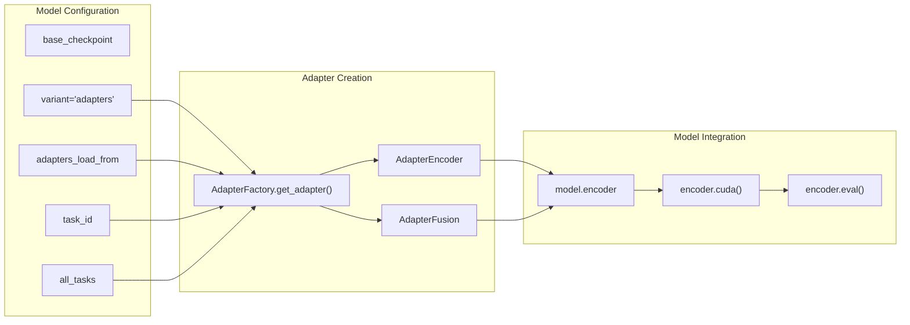

<!-- source: DeepWiki mcp.deepwiki.com · repo allenai/scirepeval · page 3.3 Adapter System · fetched 2026-10-26 -->

# Adapter System

<details>
<summary>Relevant source files</summary>

The following files were used as context for generating this wiki page:

- [adapter_fusion.py](adapter_fusion.py)
- [examples/classification.py](examples/classification.py)
- [examples/fewshot_classification.py](examples/fewshot_classification.py)
- [examples/regression.py](examples/regression.py)
- [examples/retrieval.py](examples/retrieval.py)

</details>


## Purpose and Scope

The Adapter System provides parameter-efficient fine-tuning capabilities for transformer models in SciRepEval. It enables task-specific adaptation without modifying the entire model parameters, supporting both single adapter training and adapter fusion for multi-task scenarios. The system is built on top of the `adapters` library and integrates seamlessly with the evaluation framework.

For information about the broader model architecture and variants, see [Model Architecture and Variants](#3). For training configuration details, see [Task Configuration for Training](#4.2).

## System Architecture

The adapter system consists of three main components: a factory for adapter creation, single adapter encoding, and adapter fusion for multi-task learning.



Sources: [adapter_fusion.py:1-106](), [examples/classification.py:1-25](), [examples/retrieval.py:1-40]()

## AdapterFactory

The `AdapterFactory` class provides a static factory method for creating appropriate adapter instances based on configuration parameters.

| Parameter | Type | Purpose |
|-----------|------|---------|
| `checkpoint_name` | str | Base model checkpoint path |
| `task_ids` | List[str] | Task identifiers for adapters |
| `fuse_adapters` | bool | Whether to use adapter fusion |
| `adapters_dir` | Union[str, Dict] | Directory or mapping for adapter loading |

The factory returns either an `AdapterEncoder` for single adapter usage or `AdapterFusion` for multi-task scenarios based on the `fuse_adapters` parameter.

Sources: [adapter_fusion.py:9-18]()

## AbstractAdapter Base Class

The `AbstractAdapter` class serves as the foundation for both adapter implementations, providing common functionality through inheritance from `torch.nn.Module`.

### Core Components

- **Model Initialization**: Wraps `AutoAdapterModel.from_pretrained()` for adapter-compatible transformer models
- **Token Embedding Resizing**: Supports dynamic vocabulary expansion via `resize_token_embeddings()`
- **Adapter Persistence**: Abstract `save_pretrained()` method for adapter serialization



Sources: [adapter_fusion.py:20-31]()

## AdapterEncoder

The `AdapterEncoder` class implements single adapter functionality for task-specific fine-tuning without parameter sharing across tasks.

### Initialization Process

The encoder supports both local adapter loading and Hugging Face Hub integration:

- **Local Loading**: Loads adapters from filesystem paths using `load_adapter()`
- **Hub Loading**: Downloads adapters from Hugging Face Hub using `source="hf"`
- **Fresh Adapters**: Creates new adapters with `add_adapter()` using SeqBn configuration

### Forward Pass

The forward method activates the appropriate adapter for each inference call using `set_active_adapters()` before processing input through the model.

### Persistence

Adapter saving supports both complete and selective adapter serialization to filesystem directories.

Sources: [adapter_fusion.py:33-61]()

## AdapterFusion

The `AdapterFusion` class implements multi-adapter fusion for combining knowledge from multiple task-specific adapters during inference.

### Fusion Architecture



### Fusion Strategy

For each task, AdapterFusion creates a `Fuse` composition that combines the target task adapter with all other available adapters. The `fusion_mods_dict` maintains the mapping between task IDs and their corresponding fusion configurations.

### Inference vs Training Modes

- **Training Mode**: Creates new fusion layers with `add_adapter_fusion()`
- **Inference Mode**: Loads pre-trained fusion weights from checkpoint directories

Sources: [adapter_fusion.py:63-106]()

## Integration with Model System

The adapter system integrates with the broader SciRepEval model architecture through the `Model` class configuration parameters.

### Configuration Parameters



### Usage Examples

The adapter system supports multiple usage patterns:

**Single Adapter Classification**:
```python
model = Model(base_checkpoint="malteos/scincl", variant="adapters",
              adapters_load_from="../checkpoints/adapters",
              task_id="[CLF]")
```

**Adapter Fusion for Retrieval**:
```python
encoder = AdapterEncoder("malteos/scincl", ["[PRX]"],
                         "../checkpoints/adapters")
model.encoder = encoder
```

Sources: [examples/classification.py:15-17](), [examples/retrieval.py:16-23]()

## Task-Specific Activation

The adapter system uses task identifier tokens (`[CLF]`, `[PRX]`, `[RGN]`) to activate appropriate adapters during inference. This enables multi-task models to route inputs to task-specific parameter subsets without requiring separate model instances.

The activation mechanism ensures that only relevant adapter parameters are used for each evaluation task, maintaining task-specific performance while enabling parameter sharing across the base transformer model.

Sources: [adapter_fusion.py:48-50](), [adapter_fusion.py:96-98](), [examples/classification.py:17](), [examples/retrieval.py:18]()

---

