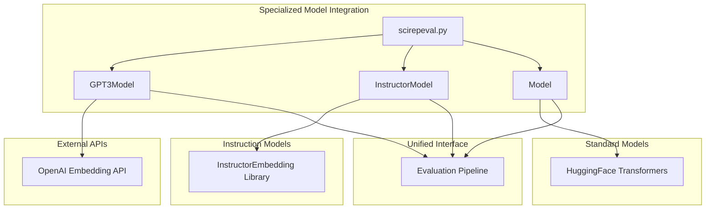
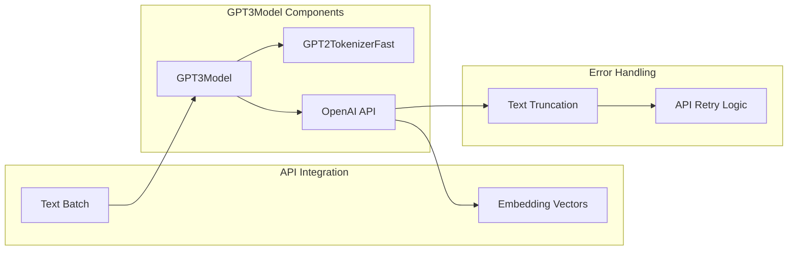
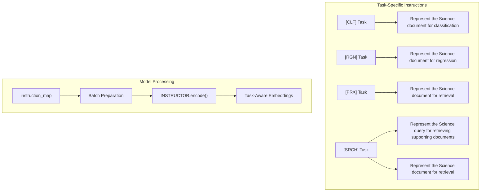
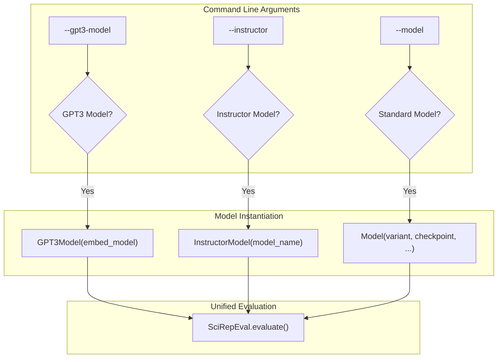
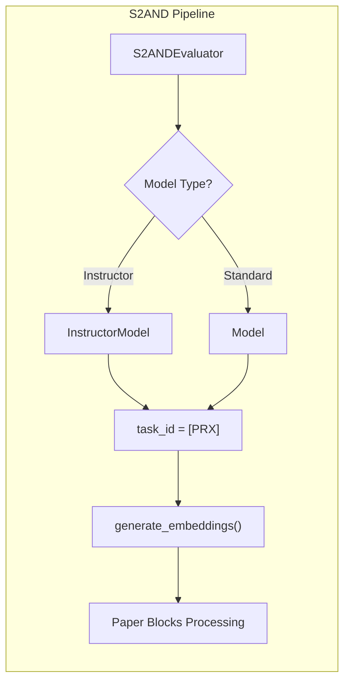

<!-- source: DeepWiki mcp.deepwiki.com · repo allenai/scirepeval · page 3.4 Specialized Models · fetched 2026-10-26 -->

# Specialized Models

<details>
<summary>Relevant source files</summary>

The following files were used as context for generating this wiki page:

- [evaluation/gpt3_encoder.py](evaluation/gpt3_encoder.py)
- [evaluation/instructor.py](evaluation/instructor.py)
- [mdcr.py](mdcr.py)
- [s2and_embeddings.py](s2and_embeddings.py)
- [scirepeval.py](scirepeval.py)

</details>


This section covers specialized model integrations that extend beyond the standard transformer-based models. These include external API-based models and instruction-tuned embedding models that provide domain-specific capabilities for scientific document representation.

For information about the standard model interface and parameter-efficient variants like PALS and adapters, see [Model Interface](#3.1), [PALS Architecture](#3.2), and [Adapter System](#3.3).

## Overview

SciRepEval supports several specialized model types that integrate with external APIs or use specialized architectures for embedding generation:



**Specialized Model Types Overview**

| Model Type | Class | Purpose | Key Features |
|------------|-------|---------|--------------|
| OpenAI Embeddings | `GPT3Model` | External API-based embeddings | High-quality embeddings via OpenAI API |
| Instruction Models | `InstructorModel` | Task-specific instructions | Domain-aware embedding generation |
| Standard Models | `Model` | Traditional transformers | Parameter-efficient adaptations |

Sources: [scirepeval.py:8-9](), [evaluation/gpt3_encoder.py:7-31](), [evaluation/instructor.py:7-26]()

## GPT3Model Integration

The `GPT3Model` class provides integration with OpenAI's embedding API, allowing evaluation using state-of-the-art commercial embedding models.

### Architecture



### Implementation Details

The `GPT3Model` class implements the standard model interface while delegating embedding generation to OpenAI's API:

**Key Components:**
- **API Authentication**: Uses `OPENAI_API_KEY` environment variable [evaluation/gpt3_encoder.py:9]()
- **Text Processing**: Handles input truncation for API limits [evaluation/gpt3_encoder.py:25-29]()
- **Error Recovery**: Automatic retry with truncated text on API failures [evaluation/gpt3_encoder.py:23-29]()

**Usage Pattern:**
```python
# From scirepeval.py command line integration
if args.gpt3_model:
    model = GPT3Model(embed_model=args.gpt3_model)
```

**API Call Flow:**
1. Batch text processing via `__call__` method [evaluation/gpt3_encoder.py:13-30]()
2. Individual text embedding via `openai.Embedding.create()` [evaluation/gpt3_encoder.py:17-21]()
3. Fallback truncation for oversized inputs [evaluation/gpt3_encoder.py:24-29]()
4. Tensor conversion for pipeline compatibility [evaluation/gpt3_encoder.py:30]()

Sources: [evaluation/gpt3_encoder.py:1-31](), [scirepeval.py:139-140]()

## InstructorModel Integration

The `InstructorModel` class leverages instruction-tuned embedding models that can generate task-specific representations based on natural language instructions.

### Instruction Mapping System



### Implementation Architecture

The instructor model system provides domain-specific embedding generation through structured instructions:

**Instruction Templates:**
- **Classification**: "Represent the Science document for classification" [evaluation/instructor.py:11]()
- **Regression**: "Represent the Science document for regression" [evaluation/instructor.py:11]()
- **Retrieval**: "Represent the Science document for retrieval" [evaluation/instructor.py:12]()
- **Search Queries**: "Represent the Science query for retrieving supporting documents" [evaluation/instructor.py:13-14]()

**Processing Pipeline:**
1. **Task ID Assignment**: Models receive task-specific identifiers [evaluation/instructor.py:19-23]()
2. **Instruction Mapping**: Text paired with appropriate instructions [evaluation/instructor.py:20-23]()
3. **Batch Encoding**: INSTRUCTOR library processes instruction-text pairs [evaluation/instructor.py:24]()
4. **GPU Processing**: Embeddings generated on CUDA devices [evaluation/instructor.py:24]()

**Dual-Mode Operation:**
- **Standard Tasks**: Single instruction per batch [evaluation/instructor.py:19-20]()
- **Search Tasks**: Query/candidate-specific instructions [evaluation/instructor.py:21-23]()

Sources: [evaluation/instructor.py:1-26](), [scirepeval.py:141-142]()

## Integration with Evaluation Pipeline

Both specialized models integrate seamlessly with the SciRepEval evaluation framework through a unified interface.

### Model Selection Logic



### Common Interface Requirements

All specialized models implement the following interface contract:

**Required Methods:**
- `__call__(batch, batch_ids=None)`: Generate embeddings for text batch [evaluation/gpt3_encoder.py:13](), [evaluation/instructor.py:18]()
- `task_id` attribute: Support for task-specific processing [evaluation/instructor.py:10]()
- `tokenizer` attribute: Text preprocessing capabilities [evaluation/gpt3_encoder.py:11](), [evaluation/instructor.py:15]()

**Task ID Integration:**
Both models support the standard task identification system used throughout SciRepEval:
- `[CLF]`: Classification tasks
- `[RGN]`: Regression tasks  
- `[PRX]`: Proximity/retrieval tasks
- `[QRY]`: Query processing for search tasks

Sources: [scirepeval.py:139-154](), [scirepeval.py:15-16]()

## Usage Examples

### S2AND Evaluation with Specialized Models

The S2AND evaluation demonstrates how specialized models integrate with domain-specific evaluators:



**Implementation Example:**
```python
# From s2and_embeddings.py
if args.instructor:
    model = InstructorModel(args.model)
    model.task_id = "[PRX]"
else:
    model = Model(variant=args.mtype, base_checkpoint=args.model, ...)
```

### MDCR Citation Recommendation

The MDCR evaluator shows specialized model usage for citation recommendation:

**Model Configuration:**
- **GPT3**: External API for high-quality embeddings [mdcr.py:69-70]()
- **Instructor**: Domain-specific retrieval instructions [mdcr.py:71-73]()
- **Standard**: Parameter-efficient adaptations [mdcr.py:74-77]()

**Task Assignment:**
All models receive `[PRX]` task identifier for retrieval-based evaluation [mdcr.py:73](), [mdcr.py:77]()

Sources: [s2and_embeddings.py:54-62](), [mdcr.py:69-77]()

---

